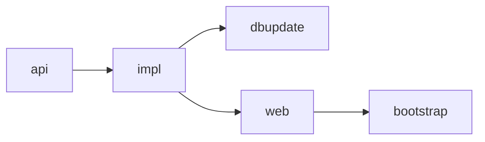
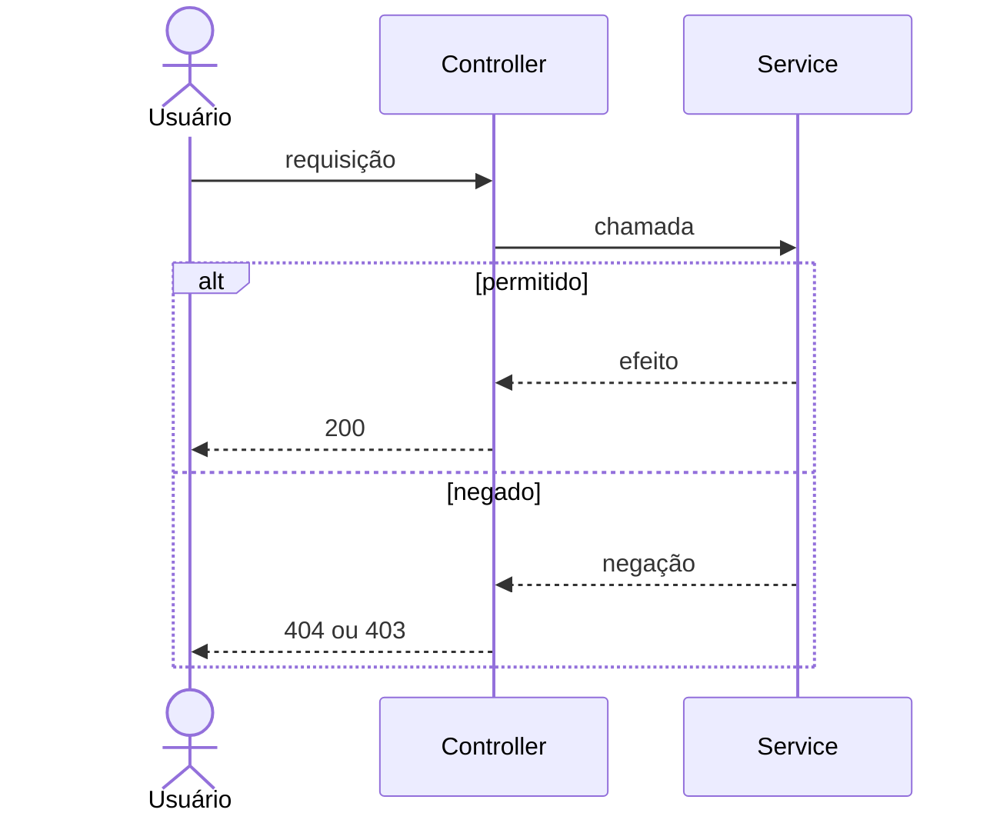

# Análise de codebase: <alvo>

## 1. Resumo executivo
<3–6 frases: o que foi avaliado, maior risco, decisão recomendada.>

## 2. Escopo e ponto de partida
- Alvo:
- Modo: full | feature | diff | security
- Pergunta que a análise responde:
- Commit/ref:
- Incluído:
- Excluído:

## 3. Método e cobertura
- Arquivos/diretórios examinados:
- Regras aplicáveis citadas:
- Ferramentas usadas:
- O que não foi executado:
- Validação executada: `node scripts/validate-evidence.mjs <arquivo>` — <resultado>

| Camada | Arquivos encontrados | Arquivos lidos | Evidência representativa |
|---|---|---|---|
| Regras | <n> | <n> | `AGENTS.md:1` |
| Backend | <n> | <n> | `<Controller.java:1`; `<ServiceImpl.java:1` |
| Frontend | <n> | <n> | `<componente.vue:1`; `<store.ts:1` |
| SQL e dados | <n> | <n> | `V<...>.sql:1`; `<Repository.java:1` |
| Testes | <n> | <n> | `<IT.java:1`; `<spec.ts:1` |

## 4. Mapa de contexto

### 4.1 Regras e precedência
- Instruções encontradas e ordem aplicada:
- Conflitos e resolução:

### 4.2 Backend
- Módulos e responsabilidades:
- Entry points e contratos HTTP:
- Serviços, domínio e transações:
- Persistência, queries e integrações:
- Testes que sustentam os controles:

#### 4.2.1 Matriz de endpoints

| Controller | Rota | Verbo | Autorização | Tenant | Teste |
|---|---|---|---|---|---|
| `<Controller.java:1>` | `/internal/...` | GET | `@HasPermission(...)` ou público | `@TenantScoped` / global / self | `<IT.java:1>` |

#### 4.2.2 Grafo de módulos
- Arestas lidas de `pom.xml`, com `arquivo:linha`:
- Ciclos, acoplamento concentrado ou dependência invertida:

Legenda: `api/pom.xml:1`; `impl/pom.xml:1`; `dbupdate/pom.xml:1`; `web/pom.xml:1`; `bootstrap/pom.xml:1`.

#### 4.2.3 Fluxos críticos
1. <fluxo> — origem `arquivo:linha`; decisões `arquivo:linha`; efeito `arquivo:linha`; teste `arquivo:linha`; falha: <impacto>
2. <fluxo> — origem `arquivo:linha`; decisões `arquivo:linha`; efeito `arquivo:linha`; teste `arquivo:linha`; falha: <impacto>
3. <fluxo> — origem `arquivo:linha`; decisões `arquivo:linha`; efeito `arquivo:linha`; teste `arquivo:linha`; falha: <impacto>

Legenda: `Controller.java:1`; `Service.java:1`; ramo permitido `Service.java:2`; ramo negado `Interceptor.java:1`.

#### 4.2.4 Modelo de dados e consistência
- Tabelas críticas, chave de tenant, FK, `NOT NULL` e índice: `<V....sql:1>` / `<Entity.java:1>`
- Transação, idempotência e ordem de escrita:
- Backfill e convergência — migração e caminho de runtime:

#### 4.2.5 Testes e controles

| Controle | Teste | Caso negativo | Lacuna |
|---|---|---|---|
| <controle> | `<arquivo:linha>` | <caso> | <nenhuma ou descrição> |

#### 4.2.6 Ameaças e riscos

| Ativo/fronteira | Ameaça | Controle | Evidência | Severidade | Incerteza |
|---|---|---|---|---|---|
| <ativo> | <ameaça> | <controle> | `arquivo:linha` | <crítico\|alto\|médio\|baixo> | <o que não foi verificado> |

### 4.3 Frontend
- Se o Gate 0 excluiu frontend, escreva apenas: `Fora do escopo — <motivo>`.
- Rotas, guardas e componentes:
- Estado, autenticação e cliente HTTP:
- Renderização, XSS e acessibilidade:
- Build e testes:

### 4.4 SQL e dados
- Migrações encontradas e lidas:
- Tabelas críticas, tenant e constraints:
- Queries, repositórios e dados sensíveis:
- Testes de dados:

### 4.5 Contratos e operação
- Autenticação, autorização e erro:
- Dados que cruzam fronteira:
- Configuração, CI/CD e observabilidade:

## 5. Achados de segurança

| ID | Título | Classe | CWE | ASVS | Top 10 | Evidência | Impacto | Remediação | Verificação |
|---|---|---|---|---|---|---|---|---|---|
| SEC-001 | <título> | suspeito | CWE-<n> | v5.0.0-<n.n.n> | A0n:2025 | `arquivo:linha` | <impacto observado> | <ação> | <como provar> |

Classes permitidas: `suspeito`, `fraca confirmada em código`, `requer runtime`.
Use uma por linha. `fraca confirmada em código` exige duas referências
`arquivo:linha` na célula Evidência: origem e efeito.

## 6. Achados de arquitetura e regras

| ID | Título | Evidência | Impacto | Recomendação |
|---|---|---|---|---|
| ARC-001 | <título> | `arquivo:linha` | <impacto> | <ação> |

## 7. Priorização
1. <ação> — por quê — onde verificar
2. <ação> — por quê — onde verificar

## 8. Lacunas e handoffs
- <pergunta> — verificar em <alvo>
- <achado> — requer validação em runtime — handoff para `pentest` com Gate 0

## 9. Fontes e versões
- OWASP ASVS 5.0.0 — https://asvs.owasp.org/ — consultado em YYYY-MM-DD
- OWASP Top 10:2025 — https://owasp.org/Top10/2025/ — consultado em YYYY-MM-DD
- MITRE CWE — https://cwe.mitre.org/about/index.html — consultado em YYYY-MM-DD

## 10. Plano de evolução

| Ordem | Ação | Arquivo alvo | Aceite | Risco |
|---|---|---|---|---|
| P0 | <ação> | `<arquivo:linha>` | <teste/comando/métrica verificável> | <o que pode quebrar e mitigação> |

## Regras de preenchimento

- Uma afirmação por citação; `arquivo:linha` para código, URL + data para fonte externa.
- `suspeito`, `fraca confirmada em código` e `requer runtime` não são intercambiáveis.
- Não usar “vulnerabilidade confirmada” sem evidência de runtime autorizado.
- Não incluir segredo, token, payload ou PII no relatório.
- Toda recomendação que vira código passa por `deepsearch` quando depender de fonte externa.
