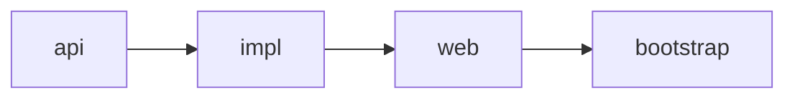
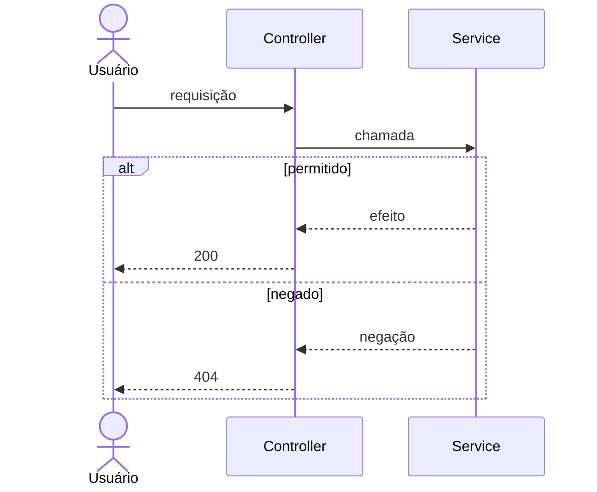

# Análise de codebase: backend sintético full

## 1. Resumo executivo

Esta fixture valida um relatório `full` explicitamente limitado ao backend.
Frontend está fora do escopo por decisão registrada no Gate 0.

## 2. Escopo e ponto de partida
- Alvo: `/projeto/backend`
- Modo: full
- Pergunta que a análise responde: como o backend é estruturado e seguro?
- Commit/ref: fixture-local
- Incluído: backend, migrations, testes de backend, config e regras aplicáveis
- Excluído: frontend, SPA e Vue

## 3. Método e cobertura
- Arquivos/diretórios examinados: 30 arquivos, sem truncamento
- Regras aplicáveis citadas: `AGENTS.md:1`
- Ferramentas usadas: `scripts/collect.mjs`
- O que não foi executado: runtime e testes ativos
- Validação executada: `node scripts/validate-evidence.mjs fixtures/report-backend-full.md` — aprovado

| Camada | Arquivos encontrados | Arquivos lidos | Evidência representativa |
|---|---|---|---|
| Regras | 2 | 2 | `AGENTS.md:1` |
| Backend | 12 | 8 | `src/main/java/Controller.java:10`; `src/main/java/ServiceImpl.java:20` |
| Frontend | 0 | 0 | Fora do escopo |
| SQL e dados | 5 | 4 | `V20260101001__create.sql:3`; `src/main/java/Entity.java:12` |
| Testes | 8 | 5 | `src/test/ServiceIT.java:1` |

## 4. Mapa de contexto

### 4.1 Regras e precedência
- `AGENTS.md:1` define o ponto de partida.

### 4.2 Backend
- Controller em `src/main/java/Controller.java:10`.
- Serviço em `src/main/java/ServiceImpl.java:20`.
- Repositório em `src/main/java/Repository.java:8`.

#### 4.2.1 Matriz de endpoints

| Controller | Rota | Verbo | Autorização | Tenant | Teste |
|---|---|---|---|---|---|
| `src/main/java/Controller.java:10` | `/internal/a` | GET | `@HasPermission(A_READ)` | `@TenantScoped` | `src/test/ControllerIT.java:1` |
| `src/main/java/Controller.java:12` | `/internal/a` | POST | `@HasPermission(A_WRITE)` | `@TenantScoped` | `src/test/ControllerIT.java:8` |
| `src/main/java/ControllerB.java:14` | `/internal/b` | GET | `@HasPermission(B_READ)` | `@TenantScoped` | `src/test/ControllerBIT.java:1` |
| `src/main/java/ControllerB.java:20` | `/internal/b/{id}` | DELETE | `@HasPermission(B_DELETE)` | `@TenantScoped` | `src/test/ControllerBIT.java:9` |
| `src/main/java/AuthController.java:18` | `/internal/auth/login` | POST | público | global | `src/test/AuthIT.java:1` |

#### 4.2.2 Grafo de módulos
- `api/pom.xml:3` → `impl/pom.xml:3` → `web/pom.xml:3` → `bootstrap/pom.xml:3`.
- `api/pom.xml:9` e `impl/pom.xml:9` mostram a direção dos contratos.

Legenda: `api/pom.xml:3`; `impl/pom.xml:3`; `web/pom.xml:3`; `bootstrap/pom.xml:3`.

#### 4.2.3 Fluxos críticos
1. login — origem `src/main/java/AuthController.java:18`; decisão `src/main/java/AuthServiceImpl.java:20`; efeito `src/main/java/JwtProvider.java:30`; teste `src/test/AuthIT.java:1`; falha: emissão sem tenant.
2. criação — origem `src/main/java/Controller.java:12`; decisão `src/main/java/ServiceImpl.java:20`; efeito `src/main/java/Repository.java:8`; teste `src/test/ControllerIT.java:8`; falha: escrita sem escopo.
3. leitura — origem `src/main/java/ControllerB.java:14`; decisão `src/main/java/ServiceImpl.java:25`; efeito `src/main/java/RepositoryB.java:9`; teste `src/test/ControllerBIT.java:1`; falha: vazamento entre tenants.

Legenda: `src/main/java/Controller.java:10`; `src/main/java/ServiceImpl.java:20`; ramo negado `src/main/java/Interceptor.java:8`.

#### 4.2.4 Modelo de dados e consistência
- `V20260101001__create.sql:3`, `V20260101001__create.sql:9`, `V20260101001__create.sql:14` definem tabela, chave e índice.
- `src/main/java/Entity.java:12` e `src/main/java/Repository.java:8` materializam escrita e leitura.
- Backfill e convergência usam o mesmo seed lógico.

#### 4.2.5 Testes e controles

| Controle | Teste | Caso negativo | Lacuna |
|---|---|---|---|
| autorização | `src/test/ControllerIT.java:1` | acesso negado | nenhuma |
| tenant | `src/test/ControllerBIT.java:1` | outro tenant | nenhuma |
| login | `src/test/AuthIT.java:1` | credencial inválida | nenhuma |
| validação | `src/test/ControllerIT.java:9` | DTO inválido | nenhuma |
| auditoria | `src/test/AuditIT.java:1` | escrita sem evento | nenhuma |

#### 4.2.6 Ameaças e riscos

| Ativo/fronteira | Ameaça | Controle | Evidência | Severidade | Incerteza |
|---|---|---|---|---|---|
| login | força bruta | rate limit | `src/main/java/AuthServiceImpl.java:20` | alto | contador local |
| documento | vazamento entre tenants | ACL + 404 | `src/main/java/Controller.java:10` | crítico | requer runtime |
| ACL | elevação | catálogo | `src/main/java/ServiceImpl.java:20` | médio | teste negativo ausente |

### 4.3 Frontend
Fora do escopo — análise restrita ao backend declarada no Gate 0.

### 4.4 SQL e dados
- Migration em `V20260101001__create.sql:3`.
- Entidade em `src/main/java/Entity.java:12`.

### 4.5 Contratos e operação
- Rota autenticada em `src/main/java/Controller.java:12`.
- Configuração em `application.properties:6`.

## 5. Achados de segurança

| ID | Título | Classe | CWE | ASVS | Top 10 | Evidência | Impacto | Remediação | Verificação |
|---|---|---|---|---|---|---|---|---|---|
| SEC-001 | Validação ausente | fraca confirmada em código | — | — | — | `src/main/java/Controller.java:10`; `src/main/java/ServiceImpl.java:20` | Dado não validado entra no serviço | Validar DTO na borda | Teste negativo |
| SEC-002 | TLS depende do ambiente | requer runtime | — | — | — | `application.properties:6` | Não atestável no repositório | Validar proxy em ambiente autorizado | Handoff: pentest — Gate 0 pendente |

## 6. Achados de arquitetura e regras

| ID | Título | Evidência | Impacto | Recomendação |
|---|---|---|---|---|
| ARC-001 | Acoplamento desnecessário | `src/main/java/Controller.java:15` | Difícil evolução | Extrair interface |

## 7. Priorização
1. Corrigir SEC-001 — verificar em `src/main/java/ServiceImpl.java:20`
2. Validar SEC-002 — verificar em ambiente autorizado

## 8. Lacunas e handoffs
- Frontend foi explicitamente excluído
- SEC-002 — handoff para `pentest` com Gate 0

## 9. Fontes e versões
- OWASP ASVS 5.0.0 — https://asvs.owasp.org/ — consultado em 2026-11-24 — referência genérica
- OWASP Top 10:2025 — https://owasp.org/Top10/2025/ — consultado em 2026-11-24 — referência genérica
- MITRE CWE — https://cwe.mitre.org/about/index.html — consultado em 2026-11-24

## 10. Plano de evolução

| Ordem | Ação | Arquivo alvo | Aceite | Risco |
|---|---|---|---|---|
| P0 | Validar DTO na borda | `src/main/java/Controller.java:10` | teste negativo de DTO | quebrar cliente legado; mitigar com contrato |
| P0 | Compartilhar contador de login | `src/main/java/AuthServiceImpl.java:20` | teste em duas instâncias | latência; mitigar com TTL |
| P1 | Persistir auditoria | `src/main/java/ServiceImpl.java:20` | IT de leitura da trilha | duplicidade; mitigar com idempotência |
