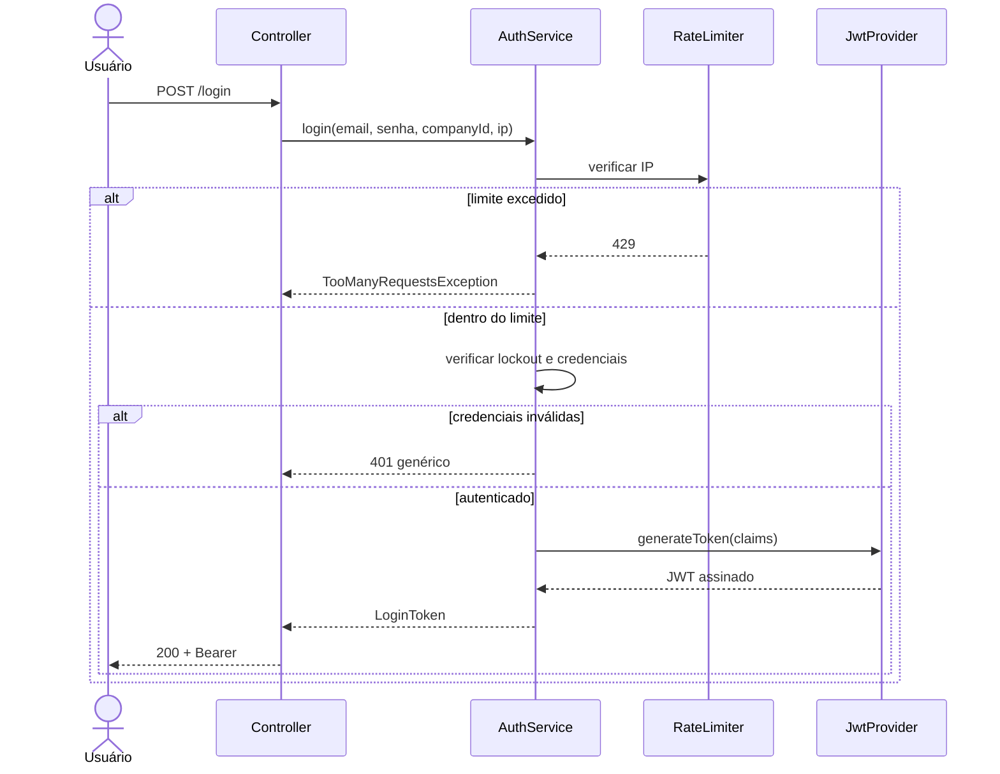
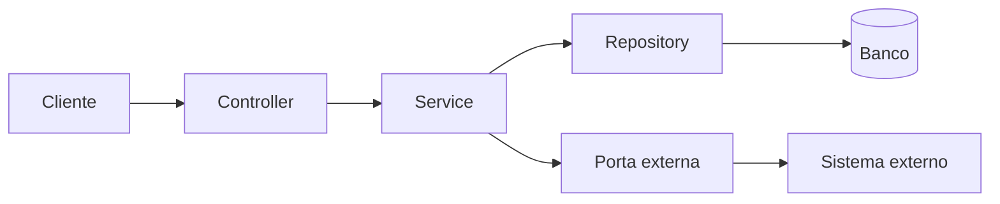

# Lente de diagramas e fluxos verificáveis

Diagrama não é decoração. Ele é um resumo executável do que foi lido no
código. Use Mermaid quando o leitor precisar entender sequência, fronteira ou
dependência sem percorrer 20 arquivos.

## Quando usar cada diagrama

| Diagrama | Uso típico nesta skill |
|---|---|
| `flowchart TD` / `flowchart LR` | mapa de módulos, fluxo de dados, fronteira de confiança |
| `sequenceDiagram` | autenticação, upload, concessão de ACL, publicação de evento |
| `stateDiagram-v2` | estados de entidade, onboarding, ciclo de versão |
| `erDiagram` | modelo de dados essencial quando as relações importam mais que os atributos |

Use o menor diagrama que responde à pergunta. Um `full` com backend deve ter
pelo menos um `flowchart` de arquitetura e um `sequenceDiagram` de fluxo
crítico. Perfis específicos podem exigir mais.

## Contrato de evidência

- Todo participante ou nó relevante deve ter uma legenda com `arquivo:linha`
  imediatamente antes ou depois do bloco.
- Toda ramificação (`alt`, `opt`, `loop`) deve corresponder a uma condição
  lida no código, não a uma suposição.
- Se o diagrama mostrar um controle que não existe, ele é inferência e deve
  estar marcado como tal na legenda.
- Não coloque segredo, token real, PII ou payload no diagrama.

## Sintaxe Mermaid verificada

Fonte oficial: Mermaid — Sequence diagrams, https://mermaid.js.org/syntax/sequenceDiagram.html — consultada em 2026-11-24.
Fonte oficial: Mermaid — Flowcharts, https://mermaid.js.org/syntax/flowchart.html — consultada em 2026-11-24.

- `sequenceDiagram` suporta `actor`, `participant A as Label`, mensagens
  `A->>B: texto`, retorno `B-->>A: texto`, `activate`/`deactivate`, `alt`,
  `else`, `opt`, `loop`, `par` e `Note over A,B`.
- Em diagramas de sequência, cada bloco `alt`, `opt`, `loop` ou `par` fecha com
  `end`.
- `flowchart TD` e `flowchart LR` suportam `subgraph`, arestas `-->`, arestas
  tracejadas `-. texto .->` e decisões `{texto}`.
- A palavra `end` em minúsculas pode quebrar um flowchart; use `End`, `END`
  ou aspas. Em sequência, `end` é a palavra de fechamento.
- Texto com unicode ou caracteres especiais deve ser colocado entre aspas.

## Template de fluxo de autenticação



Legenda obrigatória:

```text
Controller — arquivo:linha
AuthService — arquivo:linha
RateLimiter — arquivo:linha
JwtProvider — arquivo:linha
Ramo 429 — arquivo:linha
Ramo 401 — arquivo:linha
Emissão — arquivo:linha
```

## Template de arquitetura



Legenda: uma linha por caixa com `arquivo:linha`. Para módulos, cite o
`pom.xml` que prova a dependência.

## Validando antes de entregar

`scripts/validate-evidence.mjs` confere:

- existência de blocos ```mermaid```;
- uso de `flowchart`/`graph` e `sequenceDiagram`;
- fechamento de `alt`/`opt`/`loop`/`par` e `subgraph`;
- presença de legenda com `arquivo:linha` no documento.

Isso não substitui renderização. Se o ambiente tiver renderizador Mermaid,
confirme visualmente; se não tiver, declare que a validação foi sintática.
