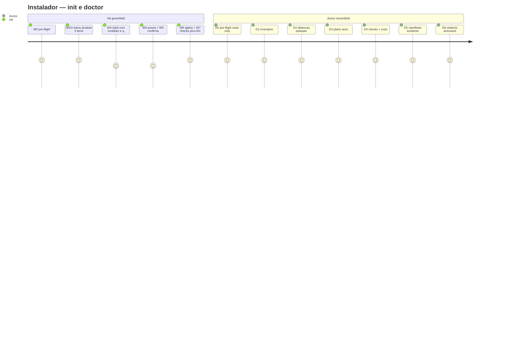

# Architecture & Software Specification — installer-melhoria

> **Feature ID**: `installer-melhoria`
> **PROPOSAL Source**: `.spec/backend/installer-melhoria/PROPOSAL.md`
> **Tipo de rota**: Melhoria (Feature)
> **Regra de rastreabilidade**: todo requisito funcional/invariante cita `arquivo:linha`. Requisito sem origem rastreável conta como defeito.

---

## 1. Architecture Decision Records (ADRs)

### ADR-011: Menu W2m em linguagem de produto (5 itens → stacks existentes, sem nova key)
- **Decision**: trocar o `WIZARD_MENU` técnico de 4 itens (`installer/install.mjs:1157-1162` — `flutter/dart/node/outra`) por 5 itens em linguagem de produto, cada um mapeando para stack existente de `STACK_VALUES` (`installer/install.mjs:245`). `STACK_PROFILES` (`installer/install.mjs:190-239`) e `STACK_VALUES` preservados integralmente — nenhuma key adicionada, removida ou renomeada.
- **Context**: parecer ux-designer vinculante (menu 5 itens produto→stack). Hoje `node-esm` e `java+vue` (`installer/install.mjs:245`) são inalcançáveis pelo menu; usuário de produto não fala "stack", fala "meu projeto é X".
- **Mapeamento normativo**:

  | # | Item de produto (label do menu) | Stack (`installer/install.mjs:245`) | Profile (`installer/install.mjs:190-239`) |
  |---|----------------------------------|--------------------------------------|--------------------------------------------|
  | 1 | App Flutter | `flutter` | `installer/install.mjs:223-230` (mcp `marionette_mcp,dart`, `flutter test`) |
  | 2 | Pacote Dart | `dart` | `installer/install.mjs:231-238` (`dart test`) |
  | 3 | Projeto Node.js | `node` (`node-esm` segue digitável em W3) | `installer/install.mjs:199-206` (`node --test`) |
  | 4 | Projeto Java + Vue | `java+vue` | `installer/install.mjs:207-214` |
  | 5 | Outro projeto | `outra` | `installer/install.mjs:215-222` |

- **Trade-offs**: 5 itens (não 6) colapsam `node`+`node-esm` num rótulo produto; `node-esm` continua válido em W3/`validateAnswer` (`installer/install.mjs:277-281`) e `--answers-file` — compat preservada, golden intacto (`installer/__tests__/golden.spec.mjs:64-71`).
- **Invariante**: `Object.keys(STACK_PROFILES).sort()` e `STACK_VALUES` byte-idênticos antes/depois (I-01).

### ADR-012: Erro padrão 4-linhas + marcadores dry-run / pico-fim
- **Decision**: todo erro do wizard/Q&A/checks imprime bloco fixo de 4 linhas — (1) o quê, (2) porquê, (3) correção, (4) onde-ver — reaproveitando `howToFix` (`installer/install.mjs:1236-1244`) como linha 3 e `sanitizeLog` (`installer/install.mjs:715-...`) em toda linha. Dry-run imprime `dry-run: NÃO EXECUTADO — nenhum write` (alinhado a `applyMerge` dryRun em `installer/install.mjs:507-513` e ao shape `passed:null` documentado em `.agents/skills/harness-installer/SKILL.md:131-133`). Sucesso imprime marcador pico-fim (`[OK] <etapa>: pico-fim`).
- **Context**: parecer ux-designer vinculante (erro 4-linhas). Pontos atuais sem padrão: menu inválida (`installer/install.mjs:1303`), W3 (`installer/install.mjs:1345-1346`), aborts (`installer/install.mjs:1263,1266`), CORRUPT (`installer/install.mjs:477,483`), `runChecks` (`installer/install.mjs:666-701`).
 - **Trade-offs**: bloco mais verboso vs. parseabilidade; mitigado mantendo tokens legados (`[ERRO]`, `como corrigir`, códigos `BAD_ANSWER/CORRUPT/NO_STDIN/USER_ABORT`) como substrings para não quebrar asserts existentes. (corrige CRÍTICA-001: código de menu inválido inexistente removido — código real só emite `BAD_ANSWER` em `installer/install.mjs:271-310`)

### ADR-013: `init` greenfield create-only (W0–W7 com contador e `q` visível)
- **Decision**: novo entrypoint `init` para destino limpo que executa o wizard W0–W7 (`installer/install.mjs:1246-1390`) com duas mudanças: (a) gate create-only — após `planMerge` (`installer/install.mjs:457-505`), qualquer `merge|flag` aborta com bloco 4-linhas indicando `doctor`; (b) UX — cada prompt exibe contador `[i/total]` e hint `q` (ex.: `[3/5] stack (q cancela)`), estendendo `ABORT_TOKENS` (`installer/install.mjs:1155`) já existentes para visibilidade.
- **Context**: parecer ux-designer vinculante (init greenfield). Wizard atual (`installer/install.mjs:1351-1386` W4/W5/W6/W7) mistura create+merge no mesmo fluxo.
- **Trade-offs**: destino "quase limpo" (ex.: só `opencode.json` com plugin extra) é rejeitado pelo `init` e direcionado ao fluxo padrão/`doctor` — fricção intencional para preservar o invariante create-only.

### ADR-014: `doctor` brownfield read-only (7 passos D0–D6, zero writes)
- **Decision**: novo entrypoint `doctor` exclusivamente de leitura com 7 passos D0–D6 (corrige ALTA-001: antes "6 passos D0–D6" — D0,D1,D2,D3,D4,D5,D6 são 7 passos; uniforme em todo o SPEC), reusando funções puras/read-only existentes e proibindo por construção qualquer write (`applyMerge` em `installer/install.mjs:507-545`, `writeManifest` em `installer/install.mjs:705-711`, `apply` delegado em `installer/install.mjs:1371-1386` — nenhum no caminho do doctor).
- **Context**: parecer ux-designer vinculante (doctor brownfield). Diagnóstico hoje exige tentar instalar.
- **Trade-offs**: sem `--fix` (fora de escopo); saída é relatório acionável por camada (`create|merge|flag|noop` por path + `checks.failed[]`), humano resolve e roda o fluxo de escrita.

---

## 2. Domain Context, Tenant Strategy & Provisioning
- **Bounded Context**: `installer/` — instalação da governança Harness v7 em repo destino (Node ESM, zero-dep TUI). Arquivos: `installer/install.mjs` (1492 linhas), `installer/zone.mjs` (`installer/zone.mjs:1-94`), `installer/dogfood*.mjs`, skill `.agents/skills/harness-installer/SKILL.md`.
- **System Type**: CLI local single-target (`--target <dir>`). Sem servidor, sem DB, sem multi-tenancy (N/A explícito — `harness.config.json` `infra.ports: null`).
- **Tenant Provisioning**: N/A — sem tenants; "provisionamento" = `backup → Q&A → geração → merge → manifesto → checks` (`.agents/skills/harness-installer/SKILL.md:9-15`).
- **Tenant Lifecycle**: N/A.
- **DDD api/impl/public**: N/A — CLI single-file zero-dep (`installer/install.mjs:1-10`, sem módulos `api/`, `impl/`, `public/v1/`, sem `AbstractController`/`BaseModel`); separação por funções puras exportadas (`generateConfig`, `planMerge`, `runChecks`, `detect`) testadas direto. (corrige ALTA-003: N/A DDD com linha de origem explícita)

---

## 3. Identity & Access Management (IAM)
- **Identity Provider (IdP)**: N/A — CLI local, sem login.
- **Protocol**: N/A.
- **MFA Strategy**: N/A.
- **Session & Token Management**: único segredo é `deployToken` (opcional, prompt `installer/install.mjs:180`): só-memória, nunca em disco/manifesto/config/log — `serializeAnswers` filtra (`installer/install.mjs:333-340`) + `sanitizeLog(line, answers)` (`installer/install.mjs:715-723`) + resumo omite segredos (`installer/install.mjs:1358-1359`). (corrige CRÍTICA-001: cita linhas `serializeAnswers:333` antes ausentes)
- **RBAC Matrix**: N/A — sem `@HasPermission` (CLI local sem IAM). Declarado explicitamente para fechar o item do spec-gate.

---

## 4. Security, Key Management (KMS) & Disaster Recovery
- **Key Management**: N/A externo; segredo tratado como acima (§3).
- **Key Lifecycle & Segregation**: N/A.
- **Backup & Disaster Recovery (BDR)**:
  - **Backups**: obrigatórios antes de qualquer write — `.harness-backup-<nome>-<data>` ao lado do destino (`.agents/skills/harness-installer/SKILL.md:104-122`); implementação `resolveBackupDir` + `backup` em `installer/install.mjs:135-164` (verificação de existência antes de liberar escrita); falha no backup = aborta. (corrige CRÍTICA-001: cita linhas do backup antes ausentes)
  - **Recovery**: rollback = copiar de volta do `backupDir` + apagar `.harness-install.json` (SKILL §6).
  - **RTO/RPO**: N/A quantitativo; invariante I-05 (abort até W5 = 0 writes; após W6 rollback via backupDir).
- **Proibições**: nunca `pkill -f` (higiene de shell — `lsof -ti :PORT` + `kill` por PID); nunca expor segredo em log (Y5).

---

## 5. Data Model & Concurrency
### Entity-Relationship Diagram (ERD)
N/A — sem banco/entidades. Modelo de dados do instalador = `harness.config.json` gerado por `generateConfig` (`installer/install.mjs:346-386`): `{ version, project, stack{backend,frontend}, moduleMap, commands, infra, mcp, protectedPaths, gates, riskPaths, escalateOnRisk, contraproveTimeoutMs, evidence }`. Sem Flyway (N/A explícito).

### Concurrency & Consistency
| Entity | Operation | Strategy | Rationale |
|--------|-----------|----------|-----------|
| `harness.config.json` | generate-overwrite | single-writer (CLI) + backup prévio | sem concorrência; backup permite rollback |
| `opencode.json` | additive merge | union plugins + append instructions; `permission/agent/mcp` only-add, conflito = flag (`installer/install.mjs:417-450`) | nunca remover config do host |
| `.agents/rules/*`, skills, plugins | flag-only | nunca auto-merge (`installer/install.mjs:501-502`) | prosa/código exigem decisão humana |

---

## 6. Event Model, Integrations & Messaging Isolation
N/A — sem eventos/mensageria. Sem Outbox, sem tópicos. Declarado para fechar o spec-gate.
Única "integração com rede zero": `install.mjs` é rede-zero (check estático V15); vendor de skills vive em `scripts/vendor-skills.mjs` (único ponto com rede) — inalterado por esta melhoria.

---

## 7. Invariants & Property-Based Testing (PBT)

### 7.1 Entity Invariants
| ID | Invariante | Origem | Teste |
|----|-----------|--------|-------|
| I-01 | `STACK_VALUES` (`installer/install.mjs:245`) e `Object.keys(STACK_PROFILES)` (`installer/install.mjs:190-239`) byte-idênticos antes/depois | `installer/install.mjs:190-245` + `installer/__tests__/golden.spec.mjs:64-71` | golden verde |
| I-02 | `generateConfig` puro: zero I/O, mesmo input → mesmo output | `installer/install.mjs:346-386` + `installer/__tests__/generate.spec.mjs:67-69` | pureza + determinismo |
| I-03 | `planMerge` nunca escreve; só classifica `create\|merge\|flag\|noop\|generate-overwrite` | `installer/install.mjs:457-505` | plano seco em target fixture |
| I-04 | `doctor` nunca chama `applyMerge`/`writeManifest`/`apply` | `installer/install.mjs:507-545`, `installer/install.mjs:705-711`, `installer/install.mjs:1371-1386` | scan estático + fs-mock zero-writes |
| I-05 | abort até W5 = 0 writes; após W6 rollback via `backupDir` | `installer/install.mjs:1272-1369` + SKILL §6 | wizard abort test (`installer/__tests__/wizard.spec.mjs:90-106`) |
| I-06 | segredo nunca em disco/log/manifesto | `installer/install.mjs:715-...`, `installer/install.mjs:1358-1359` | teste sanitize + manifesto sem token |

### 7.2 Workflow & State Invariants
- **W-menu**: opção digitada fora de `[1,5]` (intervalo fechado; ou `q`) nunca avança; repete com bloco 4-linhas (estende `installer/install.mjs:1299-1304`). (corrige CRÍTICA-001: intervalo agora fechado `[1,5]`)
- **`init` create-only**: plano com qualquer `merge|flag` ⇒ aborta antes de W5 com instrução para `doctor` (gate sobre `planMerge` em `installer/install.mjs:457-505`).
- **`doctor` read-only**: D0–D6 sem `mkdir/writeFile` no target; relatório final lista `flagged[]` com `how` vazio (`open`) como em `installer/install.mjs:580`.
- **Erro**: todo bloco contém as 4 linhas; linha 2 (porquê) cita código (`BAD_ANSWER|CORRUPT|NO_STDIN|USER_ABORT|flagged-open|literal-denied|...` — corrige CRÍTICA-001: código de menu inválido → `BAD_ANSWER`, único código emitido por `validateAnswer` em `installer/install.mjs:271-310`); dry-run sempre declara `NÃO EXECUTADO`.
- **Negativos**: sem `pkill -f`; sem Lombok; sem skip harness (suite completa verde).

### 7.3 Generator Constraints (Testing Data)
| Field | Type | Constraint | PBT Goal |
|-------|------|-----------|----------|
| menu choice | string | `[1,5]`, `q`, inválidos (`0,6,x,'',espaço`) — intervalo fechado (corrige CRÍTICA-001) | inválido nunca avança; `q` aborta sem writes |
| stack answers | enum | `STACK_VALUES` (`installer/install.mjs:245`) | fora do enum ⇒ `BAD_ANSWER` |
| target | path | dentro/fora de `/tmp` (dogfood), root sem `--allow-root` | trava C2 + preflight abortam |

---

## 8. Functional Requirements & Core Journeys



### RF-01 — Menu W2m 5 itens produto→stack (E1)
- **REQ-01**: W2m exibe exatamente 5 itens em linguagem de produto conforme tabela do ADR-011 (§1). Origem: `installer/install.mjs:1157-1162` (atual 4 itens a substituir) + `installer/install.mjs:1294-1305` (bloco W2m a estender).
- **REQ-02**: cada item mapeia para stack existente (`installer/install.mjs:245`); `node-esm` segue aceito em W3/`validateAnswer` (`installer/install.mjs:277-281`) mas não tem item próprio. Origem: `installer/install.mjs:245` + `installer/install.mjs:277-281`.
- **REQ-03**: `detect()` com pubspec (`installer/install.mjs:1171-1222`) continua soberano: com pubspec, W2m é pulado e `suggestedStack` (`installer/install.mjs:1217`) alimenta o default de W3 (`installer/install.mjs:1307-1314`); W2m só sem pubspec (`installer/install.mjs:1296`).
- **REQ-04**: inválida repete com bloco 4-linhas (§9.2) mantendo tokens `[ERRO]`/`q` (`installer/install.mjs:1303` a substituir pelo bloco).
- **Critério**: `installer/__tests__/wizard.spec.mjs:131-142` atualizado para 5 itens; golden (`installer/__tests__/golden.spec.mjs:53-71`) verde sem alteração de keys.

### RF-02 — Erro padrão 4-linhas + dry-run + pico-fim (E2)
- **REQ-05**: formato normativo (§9.2): `[ERRO] <o-quê>` / `porquê: <código + motivo>` / `como corrigir: <howToFix>` (`installer/install.mjs:1236-1244`) / `onde ver: <arquivo:linha ou doc>`. Toda linha passa por `sanitizeLog` (`installer/install.mjs:715-...`). Origem dos call sites: `installer/install.mjs:1263,1266,1303,1345-1346,477,483,687-698`.
- **REQ-06**: `runChecks` (`installer/install.mjs:666-701`) emite cada `failed[]` no bloco 4-linhas com `onde ver` apontando manifesto/target (`manifest-missing`, `config-missing`, `json-invalid`, `flagged-open`, `literal-denied` em `installer/install.mjs:669-698`).
- **REQ-07**: dry-run declara `NÃO EXECUTADO` e nunca roda checks como PASS: `applyMerge` dryRun (`installer/install.mjs:511-513`) + shape `passed:null` (`.agents/skills/harness-installer/SKILL.md:131-133`) + W5 dispensada (`installer/install.mjs:1364-1366`) + W6/W7 não-executados (`installer/install.mjs:1372-1375`).
- **REQ-08**: sucesso imprime marcador pico-fim por etapa (`[OK] <etapa>: pico-fim`), estendendo os `[OK]` atuais (`installer/install.mjs:1274,1342,1383-1385`).
- **Critério**: asserts `assert.match` de `wizard.spec.mjs`/`suite.spec.mjs`/`checks.spec.mjs` seguem passando (tokens legados preservados) + novos asserts do bloco 4-linhas.

### RF-03 — `init` greenfield create-only W0–W7 (E3)
- **REQ-09**: `init --target <dir>` executa W0 pre-flight (`installer/install.mjs:1272-1274`) → W1 inventário (`installer/install.mjs:1276-1281`) → W2 detecção (`installer/install.mjs:1283-1292`) → W2m se sem pubspec (§RF-01) → W3 Q&A (`installer/install.mjs:1307-1349`, defaults `installer/install.mjs:1308-1314`, recalc suiteCommand `installer/install.mjs:1320-1322`) → W4 resumo+prévia (`installer/install.mjs:1351-1361` via `planMerge` em `installer/install.mjs:457-505` + `printPlan`) → W5 confirmação por camada (`installer/install.mjs:1363-1369`) → W6 backup+aplicação (`installer/install.mjs:1376-1380`) → W7 manifesto+checks (`installer/install.mjs:1381-1386`).
- **REQ-10**: gate create-only — após W4, se plano contém `merge|flag`, aborta com bloco 4-linhas (`porquê: target não-limpo`, `como corrigir: rode doctor / limpe o destino`, `onde ver: doctor D0–D6`). Origem: `planMerge` (`installer/install.mjs:457-505`) + ações `installer/install.mjs:465-502`.
- **REQ-11**: todo prompt W3 exibe `[i/total]` (i = índice em `QUESTIONS`, total = `QUESTIONS.length`) e hint `(q cancela)`; `q`/`quit`/`cancel`/`abort` (`installer/install.mjs:1155`) abortam com `USER_ABORT` sem writes (`installer/install.mjs:1265-1267`).
- **Critério**: teste greenfield instala em cópia limpa; teste brownfield-abort (target com `.agents/rules/x.md` divergente) aborta indicando doctor.

### RF-04 — `doctor` brownfield read-only D0–D6, 7 passos (E4) (corrige ALTA-001: uniforme "7 passos" em título, ADR-014, journey e §9.4)
- **REQ-12**: fluxo D0–D6, todos read-only:
  - D0 pre-flight read-only (`preflight` sem criar nada) — origem `installer/install.mjs:1272-1274` (só leitura).
  - D1 inventário (`inventory`, `installer/install.mjs:1276-1281`).
  - D2 detecção pubspec (`detect`, `installer/install.mjs:1171-1222`) com fontes `arquivo:linha` (`installer/install.mjs:1198,1206,1211`).
  - D3 plano seco (`planMerge` sobre incoming filtrado por `collectIncoming`, `installer/install.mjs:1354-1357`, sem `apply`).
  - D4 checks (`runChecks`, `installer/install.mjs:666-701`) + scan de escopo (`isScannablePath`/`scanLiterals`, `installer/install.mjs:660-664`, DENYLIST `installer/install.mjs:596-603`).
  - D5 manifesto existente (lê `.harness-install.json` se houver; nunca `writeManifest` em `installer/install.mjs:705-711`).
  - D6 relatório por camada (`create|merge|flag|noop` + `checks.failed[]` em blocos 4-linhas + próximos passos).
- **REQ-13**: zero writes por construção — caminho do doctor não importa `applyMerge` (`installer/install.mjs:507-545`), `writeManifest` (`installer/install.mjs:705-711`) nem `apply` (`installer/install.mjs:1371-1386`). Origem da proibição: mesmas linhas.
- **Critério**: teste com fs-mock prova 0 writes; relatório D6 validado contra fixture divergente.

### RF-05 — Higiene de segredos e robustez de I/O (security-review H1, M1–M4)
- **REQ-14 (corrige H1 — log sempre com contexto de segredos)**: toda chamada a `sanitizeLog(line, answers)` (`installer/install.mjs:715-723`) DEVE receber o `answers` vigente como 2º argumento; nenhum caminho de log/say exibe valor de `deployToken` em claro. Origem do defeito atual: `log` do `runCli` chama `sanitizeLog(s)` sem contexto (`installer/install.mjs:1408`) — sem o 2º argumento nada é redigido. Implementação corrige esse call site e audita os demais (`installer/install.mjs:1091,1345,1408`).
- **REQ-15 (corrige M1 — higiene de `--answers-file`)**: `loadAnswersFile` (`installer/install.mjs:926-937`) valida JSON-objeto (rejeita array/primitivo com `BAD_ANSWER`); segredo vindo do arquivo recebe o mesmo tratamento só-memória de REQ-14 (`serializeAnswers` em `installer/install.mjs:333-340` nunca o serializa); documentar em SKILL §10/§11 que o arquivo de answers não deve ser commitado e deve ter permissão restritiva (`chmod 600`).
- **REQ-16 (corrige M2 — prompt de segredo sem eco)**: leitura de `deployToken` em TTY usa `readSecretPrompt`/`readSecretRaw` sem eco com máscara (`installer/install.mjs:977-1029`, guarda `canNoEcho` em `installer/install.mjs:977-979`); fora de TTY (pipe/redirect) mantém leitor de linha histórico (retrocompat `installer/install.mjs:1030-1070`); o token digitado nunca é enfileirado como resposta da próxima pergunta (fecha-e-recria o readline, `installer/install.mjs:1073-1080,1328-1334`).
- **REQ-17 (corrige M3 — `--backup-dir` validado)**: `resolveBackupDir` (`installer/install.mjs:135-144`) resolve absoluto e rejeita `backupDir === target` com `BACKUP_FAIL`; `init`/`doctor`/install repassam `--backup-dir` via `parseArgs` (`installer/install.mjs:909-926`) sem bypass da validação.
- **REQ-18 (corrige M4 — sanitize de display ANSI/controle)**: antes de exibir, toda linha que ecoa input do usuário (menu, answers, erros) é filtrada de sequências ANSI de escape e caracteres de controle (exceto `\n\t`), além da redação de segredos de REQ-14; ponto de aplicação junto a `sanitizeLog` (`installer/install.mjs:715-723`) e aos `out()` do wizard (`installer/install.mjs:1303,1345-1346`).
- **Critério**: teste injeta `deployToken` canário em answers + log/exibições e afirma ausência do canário em todo output; teste injeta `\x1b[2J` e `\r` em answer e afirma saída sem escape/controle; `--backup-dir` igual ao target aborta `BACKUP_FAIL`; `--answers-file` com array aborta `BAD_ANSWER`.

---

## 9. Padrões prescritivos (vinculantes UX)

### 9.1 Menu W2m (5 itens)
```
[INFO] W2m menu manual — escolha o tipo do seu projeto:
  1) App Flutter        -> stack flutter
  2) Pacote Dart        -> stack dart
  3) Projeto Node.js    -> stack node (ESM incluso)
  4) Projeto Java + Vue -> stack java+vue
  5) Outro projeto      -> stack outra
[i/total] escolha (q cancela) >
```
`node-esm` permanece digitável em W3 (`installer/install.mjs:277-281`).

### 9.2 Bloco de erro 4-linhas
```
[ERRO] <o quê — ex: opção '7' inválida>
  porquê: <código + motivo — ex: BAD_ANSWER: fora de [1,5] (corrige CRÍTICA-001: código real + intervalo fechado)>
  como corrigir: <howToFix — installer/install.mjs:1236-1244>
  onde ver: <arquivo:linha ou doc — ex: installer/install.mjs:1294-1305>
```
Dry-run: `[INFO] dry-run: NÃO EXECUTADO — nenhum write (plano + relatório apenas)`.
Sucesso: `[OK] <etapa>: pico-fim`.

### 9.3 `init` (greenfield)
Só `create|generate-overwrite|noop` passam pelo gate (§RF-03 REQ-10). Contador `[i/total]` + `(q cancela)` em todo prompt W3.

### 9.4 `doctor` (brownfield)
D0→D6 read-only, 7 passos (§RF-04 REQ-12; corrige ALTA-001). Saída: relatório por camada + `checks.failed[]` em blocos §9.2 + "próximos passos" (resolver flags → rodar install/init).

### 9.5 Contrato CLI `init` / `doctor` (corrige ALTA-002)
Reusa `parseArgs` (`installer/install.mjs:909-926`) e `printUsage` (`installer/install.mjs:1393-1396`); nenhum flag novo fora dos existentes.
```
node installer/install.mjs init   --target <dir> [--dry-run] [--answers-file <json>] [--yes] [--backup-dir <dir>] [--allow-root]
node installer/install.mjs doctor --target <dir> [--answers-file <json>] [--backup-dir <dir>] [--allow-root]
```
- `argv`: primeiro posicional `init|doctor` seleciona o entrypoint; demais flags idem ao install (`--target` obrigatório, `--dry-run` só `init`, `--yes` pula confirmação por camada, `--backup-dir` validado por REQ-17, `--allow-root` libera root).
- `--help`/`-h` ou ausência de `--target`: imprime uso (`printUsage`) e sai — `0` se só help, `1` se falta `--target` (`BAD_TARGET`, `installer/install.mjs:53,1404`).
- Exit codes: `0` sucesso/help puro; `1` abort (`BAD_TARGET|BAD_ANSWER|BACKUP_FAIL|NO_STDIN|USER_ABORT|flagged-open`); stdin fechado sem `--answers-file` aborta sem writes (`NO_STDIN`, `installer/install.mjs:1263,1449-1452`).
- `doctor` ignora `--dry-run`/`--yes` (read-only por construção, REQ-13); `init` com `--dry-run` imprime plano + relatório e nunca escreve (nem backup cria, `installer/install.mjs:783-787`).
- Help exibe os dois entrypoints com uma linha de uso cada + nota create-only (`init`) / read-only (`doctor`).

---

## 10. Test Strategy (corrige ALTA-004: arquivos-alvo nomeados + barra numérica)
- **Unitários** (`installer/__tests__/`):
  - `wizard.spec.mjs` (alvo: `installer/install.mjs:1157-1162,1294-1349`): menu 5 itens (mapeamento produto→stack + inválida em `[1,5]` repete + `q` aborta `USER_ABORT`); contador `[i/total]` em todo prompt W3.
  - `suite.spec.mjs` + `checks.spec.mjs` (alvo: `installer/install.mjs:1236-1244,666-701,715-723`): `formatError` 4-linhas para todos os códigos (`BAD_ANSWER|CORRUPT|NO_STDIN|USER_ABORT|BACKUP_FAIL|flagged-open|literal-denied`); dry-run declara `NÃO EXECUTADO`; sucesso marca pico-fim.
  - `cli.spec.mjs` (alvo: `installer/install.mjs:909-926,1393-1396`): contrato §9.5 — `init|doctor` argv, `--help` exit 0, falta de `--target` exit 1 `BAD_TARGET`, `--backup-dir === target` → `BACKUP_FAIL`.
  - `qa.spec.mjs` (alvo: `installer/install.mjs:333-340,926-937,977-1029`): `serializeAnswers` nunca contém `deployToken`; `--answers-file` não-objeto → `BAD_ANSWER`; segredo sem eco em TTY.
  - gate create-only (alvo: `installer/install.mjs:457-505`): fixture limpa passa, divergente aborta indicando doctor; doctor zero-writes (fs-mock, alvo `installer/install.mjs:507-545,705-711,1371-1386`); `defaultSuiteFor` (`installer/install.mjs:1224-1234`) intacto; `howToFix` (`installer/install.mjs:1236-1244`) cobre as 5 stacks do menu.
- **Barra numérica**: 0 falhas em `node --test installer/__tests__/`; cobertura das funções tocadas (`WIZARD_MENU`, `formatError`, gate create-only, `doctor`, `serializeAnswers`, `sanitizeLog`, `resolveBackupDir`, `loadAnswersFile`, `readSecretPrompt`) ≥ 90%; nenhum teste novo com skip (`describe.skip`/`it.skip` = 0).
- **Integração**: `wizard.spec.mjs` W0–W7 greenfield fim-a-fim em `/tmp`; `doctor` em cópia dogfood divergente (reuso de `installer/dogfood.mjs` / `dogfood-mobile.mjs`); golden (`golden.spec.mjs`) e generate (`generate.spec.mjs`) verdes sem alteração.
- **Estáticos**: `node scripts/static-checks.mjs` zero; scan V15 confirma `install.mjs` rede-zero; grep confirma zero `pkill -f`, zero Lombok, zero `STACK_VALUES`/`STACK_PROFILES` com nova key.
- **Suite**: `harness.config.json` `commands.suiteFull` verde antes de declarar pronto.

---

## 11. Matriz de rastreabilidade (requisito → origem)

| Requisito | Origem rastreável |
|-----------|-------------------|
| REQ-01 menu 5 itens | `installer/install.mjs:1157-1162` + `installer/install.mjs:1294-1305` |
| REQ-02 stacks existentes | `installer/install.mjs:245` + `installer/install.mjs:277-281` + `installer/install.mjs:190-239` |
| REQ-03 detect soberano | `installer/install.mjs:1171-1222` + `installer/install.mjs:1307-1314` + `installer/install.mjs:1296` |
| REQ-04 inválida repete | `installer/install.mjs:1299-1304` |
| REQ-05 bloco 4-linhas | `installer/install.mjs:1236-1244` + `installer/install.mjs:715-723` + `installer/install.mjs:1263,1266,1303,1345-1346,477,483` |
| REQ-06 checks 4-linhas | `installer/install.mjs:666-701` (`669-698`) |
| REQ-07 dry-run | `installer/install.mjs:507-513` + `installer/install.mjs:1364-1366` + `installer/install.mjs:1372-1375` + `.agents/skills/harness-installer/SKILL.md:131-133` |
| REQ-08 pico-fim | `installer/install.mjs:1274,1342,1383-1385` |
| REQ-09 init W0–W7 | `installer/install.mjs:1246-1390` (W0 `1272-1274`, W3 `1307-1349`, W4 `1351-1361`, W5 `1363-1369`, W6/W7 `1371-1386`) |
| REQ-10 gate create-only | `installer/install.mjs:457-505` (ações `465-502`) |
| REQ-11 contador + q | `installer/install.mjs:1155` + `installer/install.mjs:1259-1269` + `QUESTIONS` (`installer/install.mjs:~150-181`) |
| REQ-12 doctor D0–D6 | `installer/install.mjs:1272-1281` + `installer/install.mjs:1171-1222` + `installer/install.mjs:1354-1357` + `installer/install.mjs:660-701` |
| REQ-13 zero writes | `installer/install.mjs:507-545` + `installer/install.mjs:705-711` + `installer/install.mjs:1371-1386` |
| REQ-14 log com contexto (H1) | `installer/install.mjs:715-723` + `installer/install.mjs:1408` + `installer/install.mjs:1091,1345` |
| REQ-15 answers-file (M1) | `installer/install.mjs:926-937` + `installer/install.mjs:333-340` |
| REQ-16 sem eco (M2) | `installer/install.mjs:977-1029` + `installer/install.mjs:1030-1080` + `installer/install.mjs:1328-1334` |
| REQ-17 backup-dir (M3) | `installer/install.mjs:135-144` + `installer/install.mjs:909-926` |
| REQ-18 ANSI/controle (M4) | `installer/install.mjs:715-723` + `installer/install.mjs:1303,1345-1346` |
| Contrato CLI §9.5 (ALTA-002) | `installer/install.mjs:909-926` + `installer/install.mjs:1393-1396` + `installer/install.mjs:783-787` |
| DDD N/A (ALTA-003) | `installer/install.mjs:1-10` |
| I-01..I-06 | §7 (origens idem) |

---

## 12. Delta Specs

> **Feature ID**: `installer-melhoria`
> **SPEC Source**: `.spec/backend/installer-melhoria/SPEC.md`
> **Purpose**: rastrear exatamente o que muda em documentos existentes quando esta feature for arquivada.

### Delta: `.agents/skills/harness-installer/SKILL.md`

#### MODIFIED
> **Seção alvo**: `§9.2 Wizard W0..W7 (RF-15)`
- Menu W2m passa a 5 itens produto→stack (tabela ADR-011); W3 com contador `[i/total]` e `(q cancela)`; W4/W5 inalterados no fluxo padrão.
> **Seção alvo**: `§7 Checks — como saber que deu certo`
- Erros em bloco 4-linhas (o quê/porquê/correção/onde-ver); dry-run `NÃO EXECUTADO` (`passed:null` ≠ PASS); sucesso com marcador pico-fim.

#### ADDED
> **Inserir após**: `§9.4.1 Como o isolamento da origem é provado`
- `§10 init greenfield (create-only W0–W7)`: uso, gate create-only, abort → doctor.
- `§11 doctor brownfield (read-only D0–D6)`: uso, passos D0–D6, relatório, garantia zero-writes, sem `--fix`.

### Delta: `.agents/rules/harness-config.md`
#### MODIFIED
> **Seção alvo**: `Key map`
- Nota: menu/init/doctor não alteram `harness.config.json` (comandos, portas, `mcp.required`, selo `suiteFull` idem); `STACK_VALUES`/`STACK_PROFILES` preservados sem nova key.

### Delta: `spec-developed.md`
#### MODIFIED
> **Seção alvo**: entrada cronológica da feature
- Registrar `installer-melhoria` (4 eixos + ADRs 011–014) ao arquivar.

### Resumo do Impacto
| Documento | ADDED | MODIFIED | REMOVED |
|-----------|-------|----------|---------|
| `.agents/skills/harness-installer/SKILL.md` | 2 seções (§10, §11) | 2 seções (§9.2, §7) | 0 |
| `.agents/rules/harness-config.md` | 0 | 1 nota (Key map) | 0 |
| `spec-developed.md` | 0 | 1 entrada | 0 |

---

## 13. Anexo — Revalidação proposal-gate + spec-gate (corrige ALTA-005: checklist anexado em vez de alegação solta)

### proposal-gate (`.agents/skills/sdd-compiler/asserts/proposal-gate.md`)
- [x] Problem Statement concreto com evidência (triagem architect + linhas de código + parecer ux-designer).
- [x] Impacto qualificado (4 itens numerados em PROPOSAL §1).
- [x] In Scope específico (E1–E4 + E5 higiene de segredos H1/M1–M4 + E6 contrato CLI §9.5 + ADRs).
- [x] Out of Scope explícito (código, stacks/profiles, medflow, `--fix`, upgrade, i18n).
- [x] Architecture Impact preenchido (backend/frontend/DB/tenancy/RBAC/eventos + linha DDD N/A — corrige ALTA-003).
- [x] Sem colisão `impl→impl`/DDD (CLI single-file, sem módulos).
- [x] RBAC explícito mesmo que N/A (CLI local sem IAM).
- [x] Delta Preview com documentos alvo + ADDED/MODIFIED por documento.
- [x] Success Criteria testáveis (binários: menu 5 itens, bloco 4-linhas, init/doctor, gates, suite verde).
- [x] Critério funcional (menu produto, init/doctor) + técnico (gates, suite, zero `pkill -f`/Lombok/skip).
- [x] Bloqueadores: Problem Statement é problema (não "implementar X"); Scope cobre todo o Impact; critérios verificáveis.

### spec-gate (`.agents/skills/sdd-compiler/asserts/spec-gate.md`)
- [x] ADRs 011–014 com porquê, trade-offs e invariantes.
- [x] DDD Modular N/A justificado com linha (`installer/install.mjs:1-10` — corrige ALTA-003).
- [x] Segurança/IAM explícitos (§3–§4 + RF-05 REQ-14–18; sem `@HasPermission` por CLI local).
- [x] ERD N/A (sem banco; modelo = `harness.config.json` de `generateConfig`).
- [x] Event Registry N/A (sem eventos; rede-zero documentada).
- [x] Migrations N/A Flyway explícito.
- [x] Invariantes de entidade I-01–I-06 + workflow (W-menu/`init` create-only/`doctor` read-only/erro/negativos).
- [x] Test Strategy com arquivos-alvo + barra numérica (§10 — corrige ALTA-004).
- [x] Single File + domínio claro (`installer/`).
- [x] Todo requisito funcional cita `arquivo:linha` (matriz §11; sem origem = defeito).
