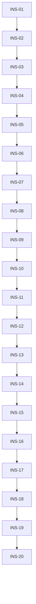

# Execution Backlog: installer-melhoria

## 1. Traceability Context
- **Source SPEC**: `.spec/backend/installer-melhoria/SPEC.md`
- **Source PLAN**: `.spec/backend/installer-melhoria/PLAN.md`
- **Goal**: Explodir INS-01..INS-20 em tickets TDD-ready com BDD sucesso/falha/borda, arquivos fisicos `installer/` + `installer/__tests__/`, R1/R3/R4 como asserts em `qa/cli.spec`. Task sem teste ou sem arquivo-alvo = defeito.

## 2. Sprint Summary
| Phase | Task ID | Type | Priority | Risk | Complexity | Status |
|---|---|---|---|---|---|---|
| F1 erro | INS-01 | Test+CLI | P0 | Med | 3 | Done |
| F1 erro | INS-02 | Test+CLI | P0 | Med | 3 | Done |
| F1 erro | INS-03 | Test+CLI | P0 | Med | 2 | Done |
| F1 erro | INS-04 | Test+CLI | P1 | Low | 1 | Done |
| F1 higiene | INS-05 | Test+CLI | P0 | High | 3 | Done |
| F1 higiene | INS-06 | Test+CLI | P0 | Med | 2 | Done |
| F2 menu | INS-07 | Test+CLI | P0 | High | 3 | Done |
| F2 menu | INS-08 | Test+CLI | P0 | High | 2 | Done |
| F2 menu | INS-09 | Test+CLI | P1 | Med | 2 | Done |
| F2 menu | INS-10 | Test+CLI | P0 | Med | 2 | Done |
| F3 doctor | INS-11 | Test+CLI | P0 | Med | 5 | Done |
| F3 doctor | INS-12 | Test+CLI | P0 | High | 3 | Done |
| F3 doctor | INS-13 | Test+CLI | P0 | Med | 2 | Done |
| F4 init | INS-14 | Test+CLI | P0 | Med | 5 | Done |
| F4 init | INS-15 | Test+CLI | P0 | Med | 3 | Done |
| F4 init | INS-16 | Test+CLI | P1 | Low | 2 | Done |
| F4 answers | INS-17 | Test+CLI | P0 | Med | 2 | Done |
| F4 answers | INS-18 | Test+CLI | P0 | Med | 3 | Done |
| F4 CLI | INS-19 | Test+CLI | P0 | Med | 3 | Done |
| Transversal | INS-20 | Test | P0 | Med | 2 | Done |

## 3. Dependency Graph

---

## 4. Task Backlog

### Task INS-01: `formatError` 4-linhas (REQ-05)
- **Constraint Ref**: REQ-05 / ADR-012 (`howToFix` `installer/install.mjs:1236-1244`)
- **Depends on (PLAN)**: None
- **Dependency Type**: Hard
- **Layer**: Application (CLI)
- **Task Type**: Test + CLI
- **Priority**: P0
- **Risk Level**: Medium
- **Parallelizable**: No
- **Artifact**: `formatError` em `installer/install.mjs`
- **Framework Detail**: Node `node:test` + `assert.match`; spec `installer/__tests__/suite.spec.mjs`

#### 📝 Context & Domain Impact
- **Description**: Criar `formatError({what, code, fix, where})` que imprime bloco §9.2; plugar nos call sites (`1263,1266,1303,1345-1346,477,483,687-698`); toda linha via `sanitizeLog`.
- **Domain Impact**: Padroniza todo erro do wizard/Q&A/checks; sem isso REQ-04/06/10/12 nao tem bloco para reusar.

#### 🛡️ Technical Enforcement (DO NOT IGNORE)
- **Rule**: Bloco sempre 4 linhas; linha 2 cita codigo real; tokens legados (`[ERRO]`, `como corrigir`) preservados como substring.
- **Failure Mode**: Bloco incompleto ou codigo inexistente (ex. menu-invalido inventado) quebra `assert.match` legado e o gate.

#### ✅ Acceptance Criteria (BDD)
- **Scenario 1 (Success)**: bloco completo para `BAD_ANSWER`
  - **Given** erro `BAD_ANSWER` com `howToFix` conhecido
  - **When** `formatError` renderiza
  - **Then** output tem `[ERRO]`, `porquê: BAD_ANSWER`, `como corrigir:`, `onde ver:` (4 linhas)
- **Scenario 2 (Failure Mode - codigo desconhecido)**: codigo fora do vocabulario
  - **Given** codigo `X_INVENTADO`
  - **When** renderiza
  - **Then** cai em `porquê: UNKNOWN` + `onde ver` generico, sem throw
- **Scenario 3 (Edge Case - segredo no texto)**: `what` contem `deployToken` canario
  - **Given** answers vigentes com token canario
  - **When** renderiza
  - **Then** canario ausente no output (via `sanitizeLog` com contexto)

#### 🛠️ Implementation Steps (TDD - Test First)
- [x] `installer/__tests__/suite.spec.mjs`: Unit — cenarios 1, 2, 3 (TDD FIRST, `assert.match`).
- [x] `installer/install.mjs`: implementar `formatError` + plugar call sites garantindo Enforcement.

#### 🏁 Definition of Done (DoD)
- [x] Test file criado ANTES da implementacao.
- [x] Codigo na camada/diretorio exato (`installer/install.mjs`).
- [x] Testes passam cobrindo Failure Mode.
- [x] No TODOs pending.

---

### Task INS-02: `runChecks` em blocos 4-linhas (REQ-06)
- **Constraint Ref**: REQ-06 / ADR-012 (`installer/install.mjs:666-701`)
- **Depends on (PLAN)**: INS-01
- **Dependency Type**: Hard
- **Layer**: Application (CLI)
- **Task Type**: Test + CLI
- **Priority**: P0
- **Risk Level**: Medium
- **Parallelizable**: No
- **Artifact**: `runChecks` (`installer/install.mjs:666-701`)
- **Framework Detail**: `installer/__tests__/checks.spec.mjs`

#### 📝 Context & Domain Impact
- **Description**: Cada `failed[]` (`manifest-missing|config-missing|json-invalid|flagged-open|literal-denied`, `669-698`) sai como bloco INS-01 com `onde ver` no manifesto/target.
- **Domain Impact**: Checks passam a ser acionaveis (onde-ver) em vez de strings soltas.

#### 🛡️ Technical Enforcement (DO NOT IGNORE)
- **Rule**: `onde ver` aponta path real verificado; `flagged[]` com `how` vazio (`open`) listado.
- **Failure Mode**: `failed[]` sem bloco ou sem `onde ver` = diagnostico cego.

#### ✅ Acceptance Criteria (BDD)
- **Scenario 1 (Success)**: target sem manifesto
  - **Given** target sem `.harness-install.json`
  - **When** `runChecks` roda
  - **Then** `failed[]` contem `manifest-missing` em bloco 4-linhas com `onde ver: <target>`
- **Scenario 2 (Failure Mode - json invalido)**: config corrompido
  - **Given** `harness.config.json` invalido
  - **When** roda
  - **Then** `json-invalid` em bloco + `como corrigir` nao vazio
- **Scenario 3 (Edge Case - tudo verde)**: target integro
  - **Given** target integro sem flags abertos
  - **When** roda
  - **Then** `failed[]` vazio e nenhum bloco `[ERRO]`

#### 🛠️ Implementation Steps (TDD - Test First)
- [x] `installer/__tests__/checks.spec.mjs`: Unit — cenarios 1, 2, 3 (TDD FIRST).
- [x] `installer/install.mjs`: `runChecks` usa `formatError` por falha.

#### 🏁 Definition of Done (DoD)
- [x] Test file criado ANTES da implementacao.
- [x] Codigo no diretorio exato.
- [x] Testes passam cobrindo Failure Mode.
- [x] No TODOs pending.

---

### Task INS-03: dry-run `NÃO EXECUTADO` (REQ-07)
- **Constraint Ref**: REQ-07 / ADR-012 (`installer/install.mjs:507-513,1364-1375`; SKILL §10/§11 `passed:null`)
- **Depends on (PLAN)**: INS-02
- **Dependency Type**: Hard
- **Layer**: Application (CLI)
- **Task Type**: Test + CLI
- **Priority**: P0
- **Risk Level**: Medium
- **Parallelizable**: No
- **Artifact**: `applyMerge` dryRun + W5/W6/W7 guards
- **Framework Detail**: `installer/__tests__/suite.spec.mjs`

#### 📝 Context & Domain Impact
- **Description**: dry-run imprime `[INFO] dry-run: NÃO EXECUTADO — nenhum write`, retorna checks `passed:null` (nunca PASS), dispensa W5, nao executa W6/W7.
- **Domain Impact**: Evita falso-verde (plano seco parecer instalado).

#### 🛡️ Technical Enforcement (DO NOT IGNORE)
- **Rule**: dry-run = zero writes incl. backup (`783-787`); `passed:null` ≠ PASS.
- **Failure Mode**: dry-run com PASS ou com write = invariante I-05 quebrado.

#### ✅ Acceptance Criteria (BDD)
- **Scenario 1 (Success)**: install `--dry-run` em fixture
  - **Given** target fixture + `--dry-run`
  - **When** executa
  - **Then** output contem `NÃO EXECUTADO`; 0 arquivos criados; checks `passed:null`
- **Scenario 2 (Failure Mode - checks como PASS)**: regressao antiga
  - **Given** dry-run com checks
  - **When** executa
  - **Then** nenhum `passed:true`; relatorio diz `plano + relatório apenas`
- **Scenario 3 (Edge Case - init dry-run)**: init em destino limpo
  - **Given** `init --dry-run` destino limpo
  - **When** executa
  - **Then** plano impresso + `NÃO EXECUTADO`, sem backup criado

#### 🛠️ Implementation Steps (TDD - Test First)
- [x] `installer/__tests__/suite.spec.mjs`: Integration (fixture `/tmp`) — cenarios 1, 2, 3 (TDD FIRST).
- [x] `installer/install.mjs`: guards dry-run em `applyMerge`/W5/W6/W7.

#### 🏁 Definition of Done (DoD)
- [x] Test file criado ANTES da implementacao.
- [x] Codigo no diretorio exato.
- [x] Testes passam cobrindo Failure Mode.
- [x] No TODOs pending.

---

### Task INS-04: pico-fim por etapa (REQ-08)
- **Constraint Ref**: REQ-08 / ADR-012 (`installer/install.mjs:1274,1342,1383-1385`)
- **Depends on (PLAN)**: INS-03
- **Dependency Type**: Hard
- **Layer**: Application (CLI)
- **Task Type**: Test + CLI
- **Priority**: P1
- **Risk Level**: Low
- **Parallelizable**: No
- **Artifact**: marcadores `[OK] <etapa>: pico-fim`
- **Framework Detail**: `installer/__tests__/suite.spec.mjs`

#### 📝 Context & Domain Impact
- **Description**: Estender `[OK]` atuais com marcador `pico-fim` por etapa verde (W0..W7, checks).
- **Domain Impact**: Sucesso passa a ser greppable por etapa.

#### 🛡️ Technical Enforcement (DO NOT IGNORE)
- **Rule**: Toda etapa verde imprime `[OK] <etapa>: pico-fim`; etapa com falha nunca imprime.
- **Failure Mode**: marcador em etapa falha = falso-verde.

#### ✅ Acceptance Criteria (BDD)
- **Scenario 1 (Success)**: W0 pre-flight verde
  - **Given** pre-flight OK
  - **When** executa
  - **Then** output contem `[OK] W0: pico-fim`
- **Scenario 2 (Failure Mode - etapa falha)**: checks com falha
  - **Given** `failed[]` nao vazio
  - **When** executa
  - **Then** sem `[OK] checks: pico-fim`; bloco `[ERRO]` presente
- **Scenario 3 (Edge Case - dry-run)**: dry-run nunca marca pico-fim de apply
  - **Given** `--dry-run`
  - **When** executa
  - **Then** sem `[OK] apply: pico-fim`

#### 🛠️ Implementation Steps (TDD - Test First)
- [x] `installer/__tests__/suite.spec.mjs`: Unit — cenarios 1, 2, 3 (TDD FIRST).
- [x] `installer/install.mjs`: marcadores nas etapas verdes.

#### 🏁 Definition of Done (DoD)
- [x] Test file criado ANTES da implementacao.
- [x] Codigo no diretorio exato.
- [x] Testes passam cobrindo Failure Mode.
- [x] No TODOs pending.

---

### Task INS-05: R1 log com contexto de segredos (REQ-14/H1)
- **Constraint Ref**: REQ-14 / R1 (`installer/install.mjs:715-723,1091,1345,1408`)
- **Depends on (PLAN)**: INS-04
- **Dependency Type**: Hard
- **Layer**: Application (CLI)
- **Task Type**: Test + CLI
- **Priority**: P0
- **Risk Level**: High
- **Parallelizable**: No
- **Artifact**: `sanitizeLog(line, answers)` + call sites
- **Framework Detail**: `installer/__tests__/qa.spec.mjs` (asserts R1)

#### 📝 Context & Domain Impact
- **Description**: Corrigir `runCli` (`1408` sem 2º arg) e auditar `1091,1345`; toda chamada passa `answers` vigente; resumo omite segredos (`1358-1359`).
- **Domain Impact**: Fecha vazamento de `deployToken` em log/output (unico segredo do CLI).

#### 🛡️ Technical Enforcement (DO NOT IGNORE)
- **Rule**: `sanitizeLog` SEMPRE com `answers`; teste canario em todo output.
- **Failure Mode**: canario em claro em qualquer output = H1 reaberto, bloqueia release.

#### ✅ Acceptance Criteria (BDD)
- **Scenario 1 (Success)**: log com token canario redigido
  - **Given** answers com `deployToken: CANARIO_X`
  - **When** qualquer `log/say` exibe linha contendo o canario
  - **Then** output nao contem `CANARIO_X`
- **Scenario 2 (Failure Mode - call sem contexto)**: chamada sem 2º arg
  - **Given** scan estatico dos call sites
  - **When** grep `sanitizeLog(s)` sem `, answers`
  - **Then** zero ocorrencias (teste de scan verde)
- **Scenario 3 (Edge Case - resumo/manifesto)**: resumo W4 + manifesto
  - **Given** answers com token
  - **When** `serializeAnswers` + resumo W4 + manifesto escrito
  - **Then** nenhum contem o canario

#### 🛠️ Implementation Steps (TDD - Test First)
- [x] `installer/__tests__/qa.spec.mjs`: Unit+scan — cenarios 1, 2, 3 (TDD FIRST, canario + grep call sites).
- [x] `installer/install.mjs`: corrigir `1408` + auditar `1091,1345`.

#### 🏁 Definition of Done (DoD)
- [x] Test file criado ANTES da implementacao.
- [x] Codigo no diretorio exato.
- [x] Testes passam cobrindo Failure Mode.
- [x] No TODOs pending.

---

### Task INS-06: R4 strip ANSI/controle (REQ-18/M4)
- **Constraint Ref**: REQ-18 / R4 (`installer/install.mjs:715-723,1303,1345-1346`)
- **Depends on (PLAN)**: INS-05
- **Dependency Type**: Hard
- **Layer**: Application (CLI)
- **Task Type**: Test + CLI
- **Priority**: P0
- **Risk Level**: Medium
- **Parallelizable**: No
- **Artifact**: filtro ANSI/controle junto a `sanitizeLog` + `out()` wizard
- **Framework Detail**: `installer/__tests__/qa.spec.mjs` (asserts R4)

#### 📝 Context & Domain Impact
- **Description**: Linha que ecoa input (menu, answers, erros) filtra escapes ANSI + controles (exceto `\n\t`) antes de exibir, alem de R1.
- **Domain Impact**: Impede escape-injection no terminal via answer maliciosa.

#### 🛡️ Technical Enforcement (DO NOT IGNORE)
- **Rule**: `\x1b[...`, `\r`, `\x00-\x08\x0b\x0c\x0e-\x1f\x7f` removidos; `\n\t` preservados.
- **Failure Mode**: `\x1b[2J` executado (limpa tela) = sanitizacao furada.

#### ✅ Acceptance Criteria (BDD)
- **Scenario 1 (Success)**: answer com `\x1b[2J` exibida sem efeito
  - **Given** answer `"\x1b[2Jola"`
  - **When** ecoada no wizard
  - **Then** output contem `ola` sem `\x1b`
- **Scenario 2 (Failure Mode - `\r` overwrite)**: answer com `\r`
  - **Given** answer `"a\rb"`
  - **When** exibida
  - **Then** sem `\r` no output
- **Scenario 3 (Edge Case - `\n\t` preservados)**: multiline legitima
  - **Given** texto com `\n\t`
  - **When** exibido
  - **Then** `\n\t` intactos, demais controles removidos

#### 🛠️ Implementation Steps (TDD - Test First)
- [x] `installer/__tests__/qa.spec.mjs`: Unit — cenarios 1, 2, 3 (TDD FIRST).
- [x] `installer/install.mjs`: filtro em `sanitizeLog` + `out()` wizard.

#### 🏁 Definition of Done (DoD)
- [x] Test file criado ANTES da implementacao.
- [x] Codigo no diretorio exato.
- [x] Testes passam cobrindo Failure Mode.
- [x] No TODOs pending.

---

### Task INS-07: W2m 5 itens produto (REQ-01)
- **Constraint Ref**: REQ-01 / ADR-011 (`installer/install.mjs:1157-1162,1294-1305`)
- **Depends on (PLAN)**: INS-06
- **Dependency Type**: Hard
- **Layer**: Application (CLI)
- **Task Type**: Test + CLI
- **Priority**: P0
- **Risk Level**: High
- **Parallelizable**: No
- **Artifact**: `WIZARD_MENU` 5 entradas + texto §9.1
- **Framework Detail**: `installer/__tests__/wizard.spec.mjs` (update `:131-142`)

#### 📝 Context & Domain Impact
- **Description**: Trocar 4 itens tecnicos por 5 rotulos produto (App Flutter / Pacote Dart / Projeto Node.js / Projeto Java+Vue / Outro) com setas `-> stack`.
- **Domain Impact**: `node-esm`/`java+vue` deixam de ser inalcançaveis; base para INS-08..10.

#### 🛡️ Technical Enforcement (DO NOT IGNORE)
- **Rule**: Exatamente 5 itens, labels byte-iguais a §9.1; hint `[i/total] escolha (q cancela)` (detalhe visual em INS-16, estrutura aqui).
- **Failure Mode**: 4 ou 6 itens = SPEC violada; label divergente quebra doc.

#### ✅ Acceptance Criteria (BDD)
- **Scenario 1 (Success)**: menu exibe 5 itens
  - **Given** wizard sem pubspec
  - **When** W2m renderiza
  - **Then** snapshot tem 5 linhas `1)..5)` com `-> stack flutter|dart|node|java+vue|outra`
- **Scenario 2 (Failure Mode - 4 itens legados)**: regressao
  - **Given** menu renderizado
  - **When** conta itens
  - **Then** `≠4` (assert trava regressao aos 4 itens)
- **Scenario 3 (Edge Case - `q` visivel)**: hint presente
  - **Given** prompt W2m
  - **When** renderiza
  - **Then** contem `(q cancela)`

#### 🛠️ Implementation Steps (TDD - Test First)
- [x] `installer/__tests__/wizard.spec.mjs`: Unit — cenarios 1, 2, 3 (TDD FIRST, update `:131-142`).
- [x] `installer/install.mjs`: `WIZARD_MENU` 5 entradas + bloco W2m.

#### 🏁 Definition of Done (DoD)
- [x] Test file criado ANTES da implementacao.
- [x] Codigo no diretorio exato.
- [x] Testes passam cobrindo Failure Mode.
- [x] No TODOs pending.

---

### Task INS-08: mapeamento sem nova key (REQ-02)
- **Constraint Ref**: REQ-02 / ADR-011 (I-01; `installer/install.mjs:245,277-281,190-239`)
- **Depends on (PLAN)**: INS-07
- **Dependency Type**: Hard
- **Layer**: Application (CLI)
- **Task Type**: Test + CLI
- **Priority**: P0
- **Risk Level**: High
- **Parallelizable**: No
- **Artifact**: mapa escolha→stack (1→flutter, 2→dart, 3→node, 4→java+vue, 5→outra)
- **Framework Detail**: `installer/__tests__/wizard.spec.mjs` + `golden.spec.mjs:64-71` (intacto)

#### 📝 Context & Domain Impact
- **Description**: Cada item aponta para stack existente; `node-esm` segue valido so em W3/`validateAnswer`/`--answers-file`.
- **Domain Impact**: Compat preservada; golden nao muda.

#### 🛡️ Technical Enforcement (DO NOT IGNORE)
- **Rule**: I-01 — `Object.keys(STACK_PROFILES).sort()` + `STACK_VALUES` byte-identicos.
- **Failure Mode**: nova key = golden vermelho + compat quebrada.

#### ✅ Acceptance Criteria (BDD)
- **Scenario 1 (Success)**: escolhas 1..5 mapeiam
  - **Given** inputs `1..5`
  - **When** resolve stack
  - **Then** `flutter|dart|node|java+vue|outra` respectivamente
- **Scenario 2 (Failure Mode - nova key)**: invariante
  - **Given** `STACK_VALUES` + keys pos-mudanca
  - **When** compara com baseline
  - **Then** identicos (golden verde sem alteracao)
- **Scenario 3 (Edge Case - `node-esm` em W3)**: digitavel mas sem item
  - **Given** W3 stack=`node-esm`
  - **When** `validateAnswer`
  - **Then** aceito; sem item proprio no W2m

#### 🛠️ Implementation Steps (TDD - Test First)
- [x] `installer/__tests__/wizard.spec.mjs`: Unit — cenarios 1, 2, 3 (TDD FIRST).
- [x] `installer/install.mjs`: mapa 1..5 + `validateAnswer` inalterado p/ `node-esm`.

#### 🏁 Definition of Done (DoD)
- [x] Test file criado ANTES da implementacao.
- [x] Codigo no diretorio exato.
- [x] Testes passam cobrindo Failure Mode.
- [x] No TODOs pending.

---

### Task INS-09: `detect()` soberano (REQ-03)
- **Constraint Ref**: REQ-03 / ADR-011 (`installer/install.mjs:1171-1222,1307-1314,1296`)
- **Depends on (PLAN)**: INS-08
- **Dependency Type**: Hard
- **Layer**: Application (CLI)
- **Task Type**: Test + CLI
- **Priority**: P1
- **Risk Level**: Medium
- **Parallelizable**: No
- **Artifact**: `detect` + skip W2m com pubspec
- **Framework Detail**: `installer/__tests__/wizard.spec.mjs`

#### 📝 Context & Domain Impact
- **Description**: Com pubspec, W2m pulado e `suggestedStack` (`1217`) vira default W3; W2m so sem pubspec (`1296`).
- **Domain Impact**: Flutter/Dart continuam auto-detectados; menu nao sobrescreve deteccao.

#### 🛡️ Technical Enforcement (DO NOT IGNORE)
- **Rule**: pubspec presente ⇒ W2m nunca exibido.
- **Failure Mode**: menu sobrescrevendo `suggestedStack` = deteccao morta.

#### ✅ Acceptance Criteria (BDD)
- **Scenario 1 (Success)**: target com pubspec flutter
  - **Given** pubspec com `flutter:` + W2m habilitado
  - **When** wizard roda
  - **Then** W2m pulado; default W3 = `flutter`
- **Scenario 2 (Failure Mode - pubspec ignorado)**: regressao
  - **Given** pubspec presente
  - **When** wizard roda
  - **Then** `suggestedStack` nao-`null` e menu nao exibido
- **Scenario 3 (Edge Case - sem pubspec)**: fluxo normal
  - **Given** sem pubspec
  - **When** wizard roda
  - **Then** W2m exibido (INS-07)

#### 🛠️ Implementation Steps (TDD - Test First)
- [x] `installer/__tests__/wizard.spec.mjs`: Integration (fixture `/tmp` com/sem pubspec) — cenarios 1, 2, 3 (TDD FIRST).
- [x] `installer/install.mjs`: guard `1296` + default `1307-1314`.

#### 🏁 Definition of Done (DoD)
- [x] Test file criado ANTES da implementacao.
- [x] Codigo no diretorio exato.
- [x] Testes passam cobrindo Failure Mode.
- [x] No TODOs pending.

---

### Task INS-10: invalida repete `[1,5]` (REQ-04)
- **Constraint Ref**: REQ-04 / ADR-011+012 (`installer/install.mjs:1299-1304`)
- **Depends on (PLAN)**: INS-09
- **Dependency Type**: Hard
- **Layer**: Application (CLI)
- **Task Type**: Test + CLI
- **Priority**: P0
- **Risk Level**: Medium
- **Parallelizable**: No
- **Artifact**: loop W2m com bloco 4-linhas
- **Framework Detail**: `installer/__tests__/wizard.spec.mjs`

#### 📝 Context & Domain Impact
- **Description**: Input fora de `[1,5]` (fechado) repete com bloco INS-01 (codigo `BAD_ANSWER`, `como corrigir` = howToFix, `onde ver` = `1294-1305`); `q` aborta `USER_ABORT`.
- **Domain Impact**: Fecha W-menu (invariante §7.2).

#### 🛡️ Technical Enforcement (DO NOT IGNORE)
- **Rule**: Invalida nunca avanca; tokens `[ERRO]`/`q` preservados.
- **Failure Mode**: `0/6/x/''/espaco` avancando = maquina de estado furada.

#### ✅ Acceptance Criteria (BDD)
- **Scenario 1 (Success)**: `7` repete
  - **Given** input `7`
  - **When** W2m le
  - **Then** bloco `[ERRO]` + `BAD_ANSWER: fora de [1,5]`; repete prompt
- **Scenario 2 (Failure Mode - avanco indevido)**: gerador invalido
  - **Given** inputs `0,6,x,'',espaco`
  - **When** cada um lido
  - **Then** nenhum avanca para W3
- **Scenario 3 (Edge Case - `q`)**: cancela sem writes
  - **Given** input `q`
  - **When** lido
  - **Then** `USER_ABORT`; 0 writes (I-05)

#### 🛠️ Implementation Steps (TDD - Test First)
- [x] `installer/__tests__/wizard.spec.mjs`: Unit (gerador `[1,5]/q/invalidos` — PBT §7.3) — cenarios 1, 2, 3 (TDD FIRST).
- [x] `installer/install.mjs`: loop W2m (`1299-1304`) com `formatError`.

#### 🏁 Definition of Done (DoD)
- [x] Test file criado ANTES da implementacao.
- [x] Codigo no diretorio exato.
- [x] Testes passam cobrindo Failure Mode.
- [x] No TODOs pending.

---

### Task INS-11: `doctor` D0–D6 (REQ-12)
- **Constraint Ref**: REQ-12 / ADR-014 (7 passos; origens `1272-1281,1171-1222,1354-1357,660-701`)
- **Depends on (PLAN)**: INS-10
- **Dependency Type**: Hard
- **Layer**: Application (CLI)
- **Task Type**: Test + CLI
- **Priority**: P0
- **Risk Level**: Medium
- **Parallelizable**: No
- **Artifact**: entrypoint `doctor` D0..D6 + relatorio
- **Framework Detail**: `installer/__tests__/cli.spec.mjs` + fixture dogfood divergente

#### 📝 Context & Domain Impact
- **Description**: D0 preflight RO → D1 inventario → D2 detect (fontes `arquivo:linha` `1198,1206,1211`) → D3 `planMerge` seco (incoming via `collectIncoming` `1354-1357`, sem `apply`) → D4 checks+scan (`isScannablePath`/`scanLiterals` `660-664`, DENYLIST `596-603`) → D5 manifesto existente (le, nunca escreve) → D6 relatorio por camada + proximos passos.
- **Domain Impact**: Diagnostico brownfield sem instalar; alimenta mensagem do gate INS-15.

#### 🛡️ Technical Enforcement (DO NOT IGNORE)
- **Rule**: 7 passos D0..D6 (nao 6); D6 lista `create|merge|flag|noop` + `checks.failed[]` em blocos §9.2.
- **Failure Mode**: passo faltante ou relatorio sem `flagged[]` = diagnostico incompleto.

#### ✅ Acceptance Criteria (BDD)
- **Scenario 1 (Success)**: dogfood divergente diagnosticado
  - **Given** copia dogfood com `.agents/rules/x.md` divergente
  - **When** `doctor --target` roda
  - **Then** D6 lista `flag` p/ `x.md` + `como corrigir` + exit 1
- **Scenario 2 (Failure Mode - passo pulado)**: sequencia
  - **Given** run instrumentado
  - **When** doctor roda
  - **Then** marcadores D0..D6 todos presentes em ordem
- **Scenario 3 (Edge Case - target limpo)**: nada a fazer
  - **Given** target limpo
  - **When** doctor roda
  - **Then** relatorio `noop` dominante; exit 0

#### 🛠️ Implementation Steps (TDD - Test First)
- [x] `installer/__tests__/cli.spec.mjs`: Integration (dogfood fixture) — cenarios 1, 2, 3 (TDD FIRST).
- [x] `installer/install.mjs`: entrypoint `doctor` + D0..D6 reusando funcoes RO.

#### 🏁 Definition of Done (DoD)
- [x] Test file criado ANTES da implementacao.
- [x] Codigo no diretorio exato.
- [x] Testes passam cobrindo Failure Mode.
- [x] No TODOs pending.

---

### Task INS-12: zero writes por construcao (REQ-13)
- **Constraint Ref**: REQ-13 / ADR-014 (I-04; `507-545,705-711,1371-1386`)
- **Depends on (PLAN)**: INS-11
- **Dependency Type**: Hard
- **Layer**: Application (CLI)
- **Task Type**: Test + CLI
- **Priority**: P0
- **Risk Level**: High
- **Parallelizable**: No
- **Artifact**: caminho doctor sem os 3 writes
- **Framework Detail**: `installer/__tests__/cli.spec.mjs` (fs-mock + scan estatico)

#### 📝 Context & Domain Impact
- **Description**: Doctor nao importa/chama `applyMerge`, `writeManifest`, `apply`; prova via scan de imports + teste fs-mock contando writes no target.
- **Domain Impact**: Garantia I-04; sem isso doctor = install disfarcado.

#### 🛡️ Technical Enforcement (DO NOT IGNORE)
- **Rule**: 0 `mkdir/writeFile` no target durante doctor; scan estatico trava regressao.
- **Failure Mode**: 1 write = invariante quebrado, task falha.

#### ✅ Acceptance Criteria (BDD)
- **Scenario 1 (Success)**: doctor em fixture = 0 writes
  - **Given** fs-mock contando writes no target
  - **When** doctor roda D0–D6
  - **Then** contador = 0
- **Scenario 2 (Failure Mode - import proibido)**: scan
  - **Given** modulo do caminho doctor
  - **When** scan por `applyMerge|writeManifest|\bapply\b`
  - **Then** zero matches no caminho
- **Scenario 3 (Edge Case - D5 com manifesto)**: leitura pura
  - **Given** `.harness-install.json` existente
  - **When** D5 le
  - **Then** conteudo exibido; mtime do arquivo inalterado

#### 🛠️ Implementation Steps (TDD - Test First)
- [x] `installer/__tests__/cli.spec.mjs`: Unit(scan)+Integration(fs-mock) — cenarios 1, 2, 3 (TDD FIRST).
- [x] `installer/install.mjs`: caminho doctor sem os 3 writes.

#### 🏁 Definition of Done (DoD)
- [x] Test file criado ANTES da implementacao.
- [x] Codigo no diretorio exato.
- [x] Testes passam cobrindo Failure Mode.
- [x] No TODOs pending.

---

### Task INS-13: R3 `--backup-dir` validado (REQ-17/M3)
- **Constraint Ref**: REQ-17 / R3 (`installer/install.mjs:135-144,909-926`)
- **Depends on (PLAN)**: INS-12
- **Dependency Type**: Hard
- **Layer**: Application (CLI)
- **Task Type**: Test + CLI
- **Priority**: P0
- **Risk Level**: Medium
- **Parallelizable**: No
- **Artifact**: `resolveBackupDir` + repasse `parseArgs`
- **Framework Detail**: `installer/__tests__/cli.spec.mjs` (asserts R3)

#### 📝 Context & Domain Impact
- **Description**: Resolve absoluto; `backupDir === target` ⇒ aborta `BACKUP_FAIL` com bloco 4-linhas; `init`/`doctor`/install repassam sem bypass.
- **Domain Impact**: Impede backup dentro do proprio alvo (auto-sobrescrita).

#### 🛡️ Technical Enforcement (DO NOT IGNORE)
- **Rule**: Comparacao pos-resolucao (absoluto); erro `BACKUP_FAIL` com `onde ver`.
- **Failure Mode**: igualdade nao detectada (relativo vs absoluto) = dados em risco.

#### ✅ Acceptance Criteria (BDD)
- **Scenario 1 (Success)**: `--backup-dir` igual ao target aborta
  - **Given** `--target /tmp/x --backup-dir /tmp/x`
  - **When** resolve
  - **Then** aborta `BACKUP_FAIL` em bloco 4-linhas
- **Scenario 2 (Failure Mode - bypass)**: repasse sem validacao
  - **Given** `init`/`doctor` com `--backup-dir`
  - **When** argv parseado
  - **Then** ambos passam por `resolveBackupDir` (sem caminho alternativo)
- **Scenario 3 (Edge Case - relativo equivalente)**: `..` normalizado
  - **Given** `--backup-dir /tmp/x/../x`
  - **When** resolve
  - **Then** detectado como igual (pos-absoluto) ⇒ `BACKUP_FAIL`

#### 🛠️ Implementation Steps (TDD - Test First)
- [x] `installer/__tests__/cli.spec.mjs`: Unit — cenarios 1, 2, 3 (TDD FIRST).
- [x] `installer/install.mjs`: `resolveBackupDir` + repasse `parseArgs`.

#### 🏁 Definition of Done (DoD)
- [x] Test file criado ANTES da implementacao.
- [x] Codigo no diretorio exato.
- [x] Testes passam cobrindo Failure Mode.
- [x] No TODOs pending.

---

### Task INS-14: `init` W0–W7 (REQ-09)
- **Constraint Ref**: REQ-09 / ADR-013 (`installer/install.mjs:1246-1390`)
- **Depends on (PLAN)**: INS-13
- **Dependency Type**: Hard
- **Layer**: Application (CLI)
- **Task Type**: Test + CLI
- **Priority**: P0
- **Risk Level**: Medium
- **Parallelizable**: No
- **Artifact**: entrypoint `init` (W0 `1272-1274` → W7 `1381-1386`)
- **Framework Detail**: `installer/__tests__/wizard.spec.mjs` (greenfield `/tmp`)

#### 📝 Context & Domain Impact
- **Description**: `init --target` executa W0 pre-flight → W1 inventario → W2 deteccao → W2m (se sem pubspec) → W3 Q&A (defaults `1308-1314`, recalc `1320-1322`) → W4 resumo+previa (`planMerge` `457-505` + `printPlan`) → W5 confirmacao por camada → W6 backup+apply → W7 manifesto+checks.
- **Domain Impact**: Caminho greenfield explicito; base do gate INS-15.

#### 🛡️ Technical Enforcement (DO NOT IGNORE)
- **Rule**: Sequencia W0..W7 sem pular etapa; W4 usa `planMerge` seco antes de qualquer write.
- **Failure Mode**: write antes de W4/W5 = I-05 quebrado.

#### ✅ Acceptance Criteria (BDD)
- **Scenario 1 (Success)**: destino limpo instala
  - **Given** `/tmp` limpo + answers validas
  - **When** `init` roda W0–W7
  - **Then** config+skills instalados; checks verdes; `[OK] *: pico-fim`; exit 0
- **Scenario 2 (Failure Mode - pre-flight falha)**: root sem flag
  - **Given** target em root sem `--allow-root`
  - **When** W0 roda
  - **Then** aborta pre-flight sem writes
- **Scenario 3 (Edge Case - stdin fechado)**: sem answers
  - **Given** stdin fechado sem `--answers-file`
  - **When** W3 precisa perguntar
  - **Then** `NO_STDIN` sem writes (`1263,1449-1452`)

#### 🛠️ Implementation Steps (TDD - Test First)
- [x] `installer/__tests__/wizard.spec.mjs`: Integration (`/tmp`) — cenarios 1, 2, 3 (TDD FIRST).
- [x] `installer/install.mjs`: entrypoint `init` reaproveitando wizard W0–W7.

#### 🏁 Definition of Done (DoD)
- [x] Test file criado ANTES da implementacao.
- [x] Codigo no diretorio exato.
- [x] Testes passam cobrindo Failure Mode.
- [x] No TODOs pending.

---

### Task INS-15: gate create-only (REQ-10)
- **Constraint Ref**: REQ-10 / ADR-013 (`planMerge` `457-505`, acoes `465-502`)
- **Depends on (PLAN)**: INS-14
- **Dependency Type**: Hard
- **Layer**: Application (CLI)
- **Task Type**: Test + CLI
- **Priority**: P0
- **Risk Level**: Medium
- **Parallelizable**: No
- **Artifact**: gate pos-W4 no `init`
- **Framework Detail**: `installer/__tests__/wizard.spec.mjs` (brownfield-abort)

#### 📝 Context & Domain Impact
- **Description**: Apos W4, se plano tem qualquer `merge|flag`, aborta com bloco (`target nao-limpo`, `rode doctor / limpe o destino`, `doctor D0–D6`); so `create|generate-overwrite|noop` passam.
- **Domain Impact**: Preserva create-only; destino quase-limpo vai ao `doctor` (friccao intencional).

#### 🛡️ Technical Enforcement (DO NOT IGNORE)
- **Rule**: Gate antes de W5 (antes de qualquer write); mensagem cita `doctor`.
- **Failure Mode**: `merge|flag` passando = init vira install destrutivo.

#### ✅ Acceptance Criteria (BDD)
- **Scenario 1 (Success)**: plano so-create passa
  - **Given** plano `[create, generate-overwrite, noop]`
  - **When** gate avalia
  - **Then** segue para W5
- **Scenario 2 (Failure Mode - divergente)**: `merge` presente
  - **Given** target com `.agents/rules/x.md` divergente
  - **When** `init` chega pos-W4
  - **Then** aborta `flagged-open` citando `doctor`; 0 writes
- **Scenario 3 (Edge Case - so flag)**: `flag` solitario tambem aborta
  - **Given** plano com 1 `flag`
  - **When** gate avalia
  - **Then** aborta idem cenario 2

#### 🛠️ Implementation Steps (TDD - Test First)
- [x] `installer/__tests__/wizard.spec.mjs`: Integration (fixture divergente) — cenarios 1, 2, 3 (TDD FIRST).
- [x] `installer/install.mjs`: gate pos-W4 sobre `planMerge`.

#### 🏁 Definition of Done (DoD)
- [x] Test file criado ANTES da implementacao.
- [x] Codigo no diretorio exato.
- [x] Testes passam cobrindo Failure Mode.
- [x] No TODOs pending.

---

### Task INS-16: contador + `q` (REQ-11)
- **Constraint Ref**: REQ-11 / ADR-013 (`ABORT_TOKENS` `1155`, leitura `1259-1269`, `QUESTIONS` `~150-181`)
- **Depends on (PLAN)**: INS-15
- **Dependency Type**: Hard
- **Layer**: Application (CLI)
- **Task Type**: Test + CLI
- **Priority**: P1
- **Risk Level**: Low
- **Parallelizable**: No
- **Artifact**: prompts W3 com `[i/total]` + `(q cancela)`
- **Framework Detail**: `installer/__tests__/wizard.spec.mjs`

#### 📝 Context & Domain Impact
- **Description**: Todo prompt W3 exibe `[i/total]` (`total = QUESTIONS.length`) + hint; `q/quit/cancel/abort` abortam `USER_ABORT` sem writes (`1265-1267`).
- **Domain Impact**: Progresso visivel + saida segura em qualquer pergunta.

#### 🛡️ Technical Enforcement (DO NOT IGNORE)
- **Rule**: `i` = indice real em `QUESTIONS`; abort sem writes (I-05).
- **Failure Mode**: contador fixo/falso ou `q` avancando = UX quebrada.

#### ✅ Acceptance Criteria (BDD)
- **Scenario 1 (Success)**: contador correto
  - **Given** W3 com N perguntas
  - **When** cada prompt renderiza
  - **Then** `[i/N]` sequencial `1..N`
- **Scenario 2 (Failure Mode - abort com writes)**: `q` na pergunta 3
  - **Given** `q` na 3ª pergunta
  - **When** lido
  - **Then** `USER_ABORT`; 0 writes
- **Scenario 3 (Edge Case - sinonimos)**: `quit/cancel/abort`
  - **Given** cada sinonimo
  - **When** lido
  - **Then** todos abrem `USER_ABORT` idem `q`

#### 🛠️ Implementation Steps (TDD - Test First)
- [x] `installer/__tests__/wizard.spec.mjs`: Unit — cenarios 1, 2, 3 (TDD FIRST).
- [x] `installer/install.mjs`: prompts W3 com contador + `ABORT_TOKENS`.

#### 🏁 Definition of Done (DoD)
- [x] Test file criado ANTES da implementacao.
- [x] Codigo no diretorio exato.
- [x] Testes passam cobrindo Failure Mode.
- [x] No TODOs pending.

---

### Task INS-17: `--answers-file` validado (REQ-15/M1)
- **Constraint Ref**: REQ-15 (`installer/install.mjs:926-937,333-340`)
- **Depends on (PLAN)**: INS-16
- **Dependency Type**: Hard
- **Layer**: Application (CLI)
- **Task Type**: Test + CLI
- **Priority**: P0
- **Risk Level**: Medium
- **Parallelizable**: No
- **Artifact**: `loadAnswersFile` + `serializeAnswers` + nota SKILL §10/§11
- **Framework Detail**: `installer/__tests__/qa.spec.mjs`

#### 📝 Context & Domain Impact
- **Description**: Rejeita JSON nao-objeto (array/primitivo) com `BAD_ANSWER`; segredo do arquivo so-memoria (`serializeAnswers` nunca serializa); documenta `chmod 600` + nao commitar.
- **Domain Impact**: Non-interactive seguro (CI) sem vazar segredo em disco.

#### 🛡️ Technical Enforcement (DO NOT IGNORE)
- **Rule**: `typeof parsed === 'object' && !Array.isArray`; token nunca em `serializeAnswers`.
- **Failure Mode**: array aceito ou token serializado = M1 reaberto.

#### ✅ Acceptance Criteria (BDD)
- **Scenario 1 (Success)**: arquivo objeto valido
  - **Given** `--answers-file` com `{stack:'node',...}`
  - **When** carrega
  - **Then** answers aplicadas; wizard pula perguntas respondidas
- **Scenario 2 (Failure Mode - array)**: arquivo `[1,2]`
  - **Given** `--answers-file` array
  - **When** carrega
  - **Then** aborta `BAD_ANSWER` em bloco 4-linhas
- **Scenario 3 (Edge Case - token no arquivo)**: segredo presente
  - **Given** arquivo com `deployToken: CANARIO_Y`
  - **When** `serializeAnswers` + resumo + manifesto
  - **Then** `CANARIO_Y` ausente em todos (so-memoria)

#### 🛠️ Implementation Steps (TDD - Test First)
- [x] `installer/__tests__/qa.spec.mjs`: Unit — cenarios 1, 2, 3 (TDD FIRST).
- [x] `installer/install.mjs`: validacao `loadAnswersFile`; filtro `serializeAnswers`.

#### 🏁 Definition of Done (DoD)
- [x] Test file criado ANTES da implementacao.
- [x] Codigo no diretorio exato.
- [x] Testes passam cobrindo Failure Mode.
- [x] No TODOs pending.

---

### Task INS-18: segredo sem eco (REQ-16/M2)
- **Constraint Ref**: REQ-16 (`installer/install.mjs:977-1029,1030-1080,1328-1334`)
- **Depends on (PLAN)**: INS-17
- **Dependency Type**: Hard
- **Layer**: Application (CLI)
- **Task Type**: Test + CLI
- **Priority**: P0
- **Risk Level**: Medium
- **Parallelizable**: No
- **Artifact**: `readSecretPrompt`/`readSecretRaw` + readline lifecycle
- **Framework Detail**: `installer/__tests__/qa.spec.mjs`

#### 📝 Context & Domain Impact
- **Description**: TTY usa leitura sem eco + mascara (guarda `canNoEcho` `977-979`); nao-TTY mantem leitor historico; apos segredo fecha-e-recria readline para nao enfileirar token na proxima pergunta.
- **Domain Impact**: Shoulder-surfing + leak entre perguntas eliminados.

#### 🛡️ Technical Enforcement (DO NOT IGNORE)
- **Rule**: Token nunca ecoado em TTY; nunca reusado como resposta seguinte.
- **Failure Mode**: eco ou replay do token = M2 reaberto.

#### ✅ Acceptance Criteria (BDD)
- **Scenario 1 (Success)**: TTY sem eco
  - **Given** TTY + prompt `deployToken`
  - **When** digita `SEGREDO`
  - **Then** output nao contem `SEGREDO`; valor capturado internamente
- **Scenario 2 (Failure Mode - replay)**: token como proxima resposta
  - **Given** token digitado + proxima pergunta `project`
  - **When** responde proxima
  - **Then** resposta ≠ token anterior (readline recriado)
- **Scenario 3 (Edge Case - pipe)**: stdin nao-TTY
  - **Given** pipe com respostas
  - **When** le segredo
  - **Then** leitor historico funciona (retrocompat), sem hang

#### 🛠️ Implementation Steps (TDD - Test First)
- [x] `installer/__tests__/qa.spec.mjs`: Unit (mock TTY/pipe) — cenarios 1, 2, 3 (TDD FIRST).
- [x] `installer/install.mjs`: `readSecretPrompt`/`readSecretRaw` + lifecycle readline.

#### 🏁 Definition of Done (DoD)
- [x] Test file criado ANTES da implementacao.
- [x] Codigo no diretorio exato.
- [x] Testes passam cobrindo Failure Mode.
- [x] No TODOs pending.

---

### Task INS-19: contrato CLI §9.5 (init/doctor argv/flags/exit/help)
- **Constraint Ref**: SPEC §9.5 (`installer/install.mjs:909-926,1393-1396,783-787`; exit `53,1404`; `NO_STDIN` `1263,1449-1452`)
- **Depends on (PLAN)**: INS-18
- **Dependency Type**: Hard
- **Layer**: Application (CLI)
- **Task Type**: Test + CLI
- **Priority**: P0
- **Risk Level**: Medium
- **Parallelizable**: No
- **Artifact**: `parseArgs` + `printUsage` + dispatch `init|doctor`
- **Framework Detail**: `installer/__tests__/cli.spec.mjs` (asserts contrato + R3 ja em INS-13)

#### 📝 Context & Domain Impact
- **Description**: `init --target <dir> [--dry-run] [--answers-file] [--yes] [--backup-dir] [--allow-root]`; `doctor --target <dir> [--answers-file] [--backup-dir] [--allow-root]`; nenhum flag novo; help com 2 entrypoints + notas create-only/read-only.
- **Domain Impact**: Contrato testavel unico para os 2 entrypoints.

#### 🛡️ Technical Enforcement (DO NOT IGNORE)
- **Rule**: Exit `0` sucesso/help puro, `1` abort (`BAD_TARGET|BAD_ANSWER|BACKUP_FAIL|NO_STDIN|USER_ABORT|flagged-open`); doctor ignora `--dry-run`/`--yes`; init dry-run sem writes nem backup.
- **Failure Mode**: exit trocado ou flag novo silencioso = CLI imprevisivel.

#### ✅ Acceptance Criteria (BDD)
- **Scenario 1 (Success)**: dispatch + help
  - **Given** `init --help` / `doctor --help`
  - **When** executa
  - **Then** uso com 1 linha por entrypoint + notas; exit 0
- **Scenario 2 (Failure Mode - sem `--target`)**: falta obrigatorio
  - **Given** `init` sem `--target`
  - **When** executa
  - **Then** `BAD_TARGET` bloco 4-linhas; exit 1
- **Scenario 3 (Edge Case - doctor com `--dry-run --yes`)**: flags ignorados
  - **Given** `doctor --dry-run --yes --target <dir>`
  - **When** executa
  - **Then** diagnostico read-only normal (flags sem efeito, sem erro, sem writes)

#### 🛠️ Implementation Steps (TDD - Test First)
- [x] `installer/__tests__/cli.spec.mjs`: Unit+Integration — cenarios 1, 2, 3 (TDD FIRST).
- [x] `installer/install.mjs`: `parseArgs` + `printUsage` + dispatch (reuso, sem flag novo).

#### 🏁 Definition of Done (DoD)
- [x] Test file criado ANTES da implementacao.
- [x] Codigo no diretorio exato.
- [x] Testes passam cobrindo Failure Mode.
- [x] No TODOs pending.

---

### Task INS-20: suite verde + barra §10 (transversal)
- **Constraint Ref**: SPEC §10 + I-01..I-06 (barra: 0 falhas, ≥90% funcoes tocadas, 0 skip)
- **Depends on (PLAN)**: INS-19
- **Dependency Type**: Hard
- **Layer**: Test
- **Task Type**: Test
- **Priority**: P0
- **Risk Level**: Medium
- **Parallelizable**: No
- **Artifact**: `installer/__tests__/` + `scripts/static-checks.mjs` + suiteFull
- **Framework Detail**: `node --test installer/__tests__/` + `node scripts/static-checks.mjs` + `harness.config.json` suiteFull

#### 📝 Context & Domain Impact
- **Description**: Roda suite completa; Greenfield `/tmp` + doctor dogfood divergente + golden/generate verdes; `defaultSuiteFor` (`1224-1234`) + `howToFix` 5 stacks intactos; V15 rede-zero; zero `pkill -f`/Lombok/skip.
- **Domain Impact**: Barra de aceite final; sem ela nada declara pronto.

#### 🛡️ Technical Enforcement (DO NOT IGNORE)
- **Rule**: 0 falhas; cobertura ≥90% (`WIZARD_MENU`, `formatError`, gate, `doctor`, `serializeAnswers`, `sanitizeLog`, `resolveBackupDir`, `loadAnswersFile`, `readSecretPrompt`); `describe.skip|it.skip` = 0.
- **Failure Mode**: 1 falha ou 1 skip = fase incompleta, volta p/ F1–F4.

#### ✅ Acceptance Criteria (BDD)
- **Scenario 1 (Success)**: suite verde
  - **Given** INS-01..19 implementados
  - **When** `node --test installer/__tests__/`
  - **Then** 0 falhas, 0 skips
- **Scenario 2 (Failure Mode - regressao golden)**: stacks tocadas
  - **Given** suite roda
  - **When** `golden.spec.mjs` + `generate.spec.mjs`
  - **Then** verdes sem alteracao (I-01/I-02)
- **Scenario 3 (Edge Case - estaticos)**: checks + V15 + higiene
  - **Given** codigo final
  - **When** `static-checks.mjs` + grep `pkill -f`/Lombok/skip + V15
  - **Then** zero hits; `install.mjs` rede-zero confirmado

#### 🛠️ Implementation Steps (TDD - Test First)
- [x] `installer/__tests__/wizard.spec.mjs` + `cli.spec.mjs` + `qa.spec.mjs` + `checks.spec.mjs` + `suite.spec.mjs`: todos os asserts INS-01..19 ja escritos ANTES do codigo (TDD FIRST — esta task so consolida).
- [x] `installer/install.mjs`: nenhum codigo novo — apenas consolidacao; evidencias de suite anexadas ao REPORT.

#### 🏁 Definition of Done (DoD)
- [x] Test files criados ANTES dos fuentes (rastreavel por task).
- [x] Cobertura ≥90% funcoes tocadas; 0 skip.
- [x] Suite + estaticos verdes.
- [x] No TODOs pending.

---

## 5. Coverage Validation
- [x] All PLAN tasks converted and mapped (INS-01..20 ↔ PLAN §8; REQ-01..18 1:1: REQ-01→07, 02→08, 03→09, 04→10, 05→01, 06→02, 07→03, 08→04, 09→14, 10→15, 11→16, 12→11, 13→12, 14/R1→05, 15→17, 16→18, 17/R3→13, 18/R4→06; §9.5→19; §10→20).
- [x] All constraints mapped to explicit BDD scenarios (cada task §4 tem Success + Failure + Edge).
- [x] All tasks include failure mode validation (Scenario 2 em toda task).
- [x] No circular dependencies in the graph (§3 linear F1→F2→F3→F4 + transversal).
- [x] No orphan tasks (todas conectadas no mermaid §3).
- [x] R1/R3/R4 como asserts em `qa/cli.spec`: R1→INS-05 `qa.spec` canario; R3→INS-13 `cli.spec` `BACKUP_FAIL`; R4→INS-06 `qa.spec` ANSI.
- [x] Arquivos-alvo nomeados por task (`installer/install.mjs:linha` + `installer/__tests__/*.spec.mjs`); barra §10 em INS-20.

## 6. Plan Feedback (Optional)
- **Identified Issues**:
  - PLAN §9 dispensa 4-tasks de evento com justificativa N/A (SPEC §6) — sem lacuna.
  - REQ-15+16 compartilham `qa.spec.mjs` mas em tasks separadas (INS-17/18) — sem colapso indevido.
  - Docs Delta (SKILL §10/§11) propositalmente fora das tasks de codigo — vao ao archive, nao ao TDD.
