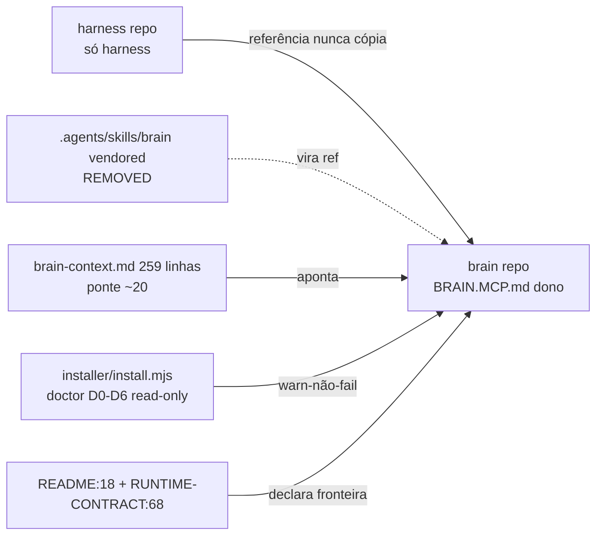
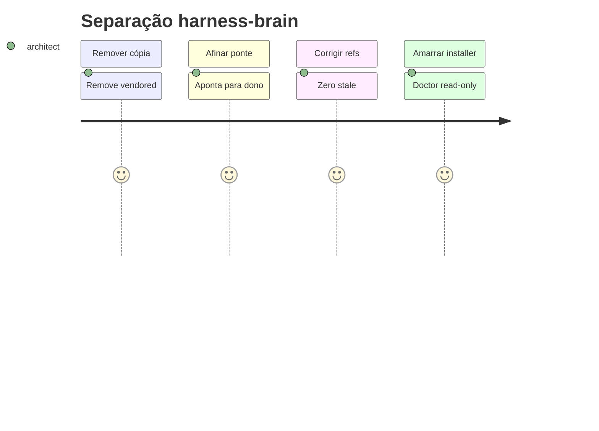

# SPEC: harness-brain-separation — decreto ownership harness×brain (governança, docs-only)

> **ID**: `harness-brain-separation`
> **Status**: `Draft → Under Review`
> **Author**: architect
> **Date**: 2026-10-14
> **Source**: `.spec/backend/harness-brain-separation/PROPOSAL.md` (PASS 11/11, 114 linhas) + continuação `harness-installer-mobile` (Completed, archive `.spec/archive/20261008-harness-installer-mobile/`)
> **Route**: Refactor governança — ZERO código produto nesta fase, só `.spec` docs
> **Template**: `.agents/skills/sdd-compiler/references/spec-template.md` + `.agents/skills/sdd-compiler/references/delta-template.md`
> **Gate**: `.agents/skills/sdd-compiler/asserts/spec-gate.md`

---

## 0. Re-encoding PICCO (Rota B 6/6)

<role>Gera SPEC prescritiva seguindo sdd-compiler generate-spec procurando requisitos verificáveis, ADRs e Delta Specs completos; defeito = RF sem critério binário grep/comando, ADR sem trade-off, Delta sem ADDED/MODIFIED/REMOVED por doc alvo</role>
<task>Entregar .spec/backend/harness-brain-separation/SPEC.md em harness-installer-mobile.</task>
<context>Projeto harness, continuação harness-installer-mobile Completed; entrada PROPOSAL.md aprovado; escopo H1-H5 docs-only; rota Refactor governança</context>
<constraints>Sempre spec-template+delta-template+spec-gate; sempre RF binário; sempre 4 ADRs; sempre Delta por doc; sempre mapear 259 linhas; sempre caminho:linha + continuação; nunca código produto; nunca B1-B3/frontend; nunca rename tools/brainStore</constraints>
<acceptance>SPEC.md criado, RFs verificáveis, ADRs, invariantes, Delta Specs, spec-gate PASS, retorno path+score</acceptance>
<open_questions></open_questions>

**Confirmação Rota B**: entendi H1-H5 docs-only + 5 nuncas, sigo para SPEC — sem código produto.

---

## 1. Architecture Decision Records (ADRs)

### ADR-001: separation — harness=só harness, brain dono da regra brain
- **Decision**: decretar fronteira ownership. Repo `harness` contém só harness (gates, installer, skills próprias). Toda regra brain (semântica `brain_search/store/read/reindex`, camadas, scopes) vive no repo brain, arquivo canônico `BRAIN.MCP.md` (dono brain). Cópia local vira referência, nunca verdade paralela.
- **Context**: `.agents/skills/brain/SKILL.md` + 4 tools vendored + `.agents/rules/brain-context.md:1-259` (259 linhas) duplicam verdade que evolui no brain. Drift duplo provado. Continuação `harness-installer-mobile` Completed — novo ciclo não toca archive `.spec/archive/20261008-harness-installer-mobile/`.
- **Trade-offs**: referência externa (`../brain/.agents/skills/brain/SKILL.md`) quebra em destino sem checkout brain vs cópia sempre disponível mas diverge. Escolhida referência + fallback doc (ponte cita URL/canônico + doctor warn-não-fail) — quebra explícita melhor que divergência silenciosa.

### ADR-002: bridge — ponte fina ~20 linhas, referência nunca cópia
- **Decision**: `.agents/rules/brain-context.md:1-259` → ponte fina ~20 linhas apontando para `BRAIN.MCP.md`. Ponte contém só: dono, link/canônico, 3 tools preservadas literalmente (`brain_search`/`brain_store`/`brain_read`), campo `brainStore`, regra busca-antes/registra-depois em 1 linha cada, fallback quando brain ausente.
- **Context**: 259 linhas mapeadas §8 (cada seção → `BRAIN.MCP.md` ou descarte justificado). Nomes preservados literalmente — rename proibido.
- **Trade-offs**: ponte perde detalhe local (exemplos Java OO, tabelas scope) vs mantém fonte única. Escolhida perda local — detalhe vive no dono; ponte nunca re-explica.

### ADR-003: installer-zero-brain — install.mjs 0 writes + doctor warn-não-fail
- **Decision**: caminho doctor (`installer/install.mjs:743-772` `runDoctor` D0-D6 + dispatch `installer/install.mjs:1797-1810`) permanece read-only por construção; brain ausente/quebrado vira warn-não-fail (veredito + `next` orientam), nunca FAIL bloqueante do doctor. Nenhum write de regra brain no destino pelo installer.
- **Context**: `installer/__tests__/doctor.spec.mjs:97` já asserta `0 writes no target durante D0-D6`; `String(runDoctor)` auditado (`:115`). Dono exato a localizar no PLAN: `runDoctor` + dispatch `1797-1810` (candidatos confirmados nesta SPEC por leitura; confirmação final = grep dono no PLAN).
- **Trade-offs**: warn mascara brain quebrado (falha silenciosa) vs fail bloqueia install saudável sem brain. Escolhido warn com motivo+caminho + evidência `brainStore` segue obrigatória no harness report (só doctor não-falha) — instalação avança, diagnóstico não some.

### ADR-004: evidence — nomes + brainStore mantidos como contrato
- **Decision**: nomes `brain_search`/`brain_store`/`brain_read` + campo `brainStore` (` .agents/schemas/harness-report.schema.json:16,57`) preservados byte-a-byte. `README.md:18` + RUNTIME-CONTRACT canônico declaram fronteira em prosa sem renomear contrato.
- **Context**: RUNTIME-CONTRACT canônico a localizar no PLAN (cópia archive `.spec/archive/20260929-harness-v7-hardening/RUNTIME-CONTRACT.md:68` linha MCP `brain` remote é referência, não canônico — watch-out PROPOSAL). Fallback: se canônico não localizado, SPEC declara archive como espelho + abre TODO PLAN-localizar.
- **Trade-offs**: manter nome legado (`brain_reindex` fora do contrato mínimo) vs renomear para clareza. Escolhido manter — evidência histórica e gates citam nomes; rename quebra `harness_status`/`code_review_status`.

---

## 2. Domain Context, Tenant Strategy & Provisioning

- **Bounded Context**: governança-de-agentes / installer. Nenhum domínio negócio (user/employee/project/team/task/workflow/kanban) tocado — domínio claro = `governanca harness×brain`.
- **System Type**: docs-only refactor. Zero runtime, zero API, zero worker.
- **Tenant Provisioning**: N/A — sem multi-tenancy (sem DB, sem isolamento; explícito).
- **Tenant Lifecycle**: N/A — sem tenant.
- **Continuação**: ciclo novo `harness-brain-separation` em `.spec/backend/` separado; archive `20261008-harness-installer-mobile` intocado; `workflow-state.json` (`current_feature: harness-installer-mobile`, `current_phase: Completed`) só atualizado em fase própria com `current_feature` distinto — âncora B preservada.

## system_overview

Decretar `harness=só harness, brain dono da regra brain`: H1 remove vendored → ref externa; H2 afina 259 linhas → ponte ~20 linhas → `BRAIN.MCP.md`; H3 corrige 7 refs stale `brain-context-protocol.md` + 2 extras; H4 amarra installer 0-writes + doctor warn-não-fail; H5 declara fronteira em README + RUNTIME-CONTRACT mantendo nomes + `brainStore`. Tudo prescrito nesta SPEC; execução em PLAN/TASKS com portão próprio; nenhum `.java/.ts/.vue/.sql` tocado.

## component_diagram



---

## 3. Identity & Access Management (IAM)

N/A — sem IdP, sem OAuth2/OIDC, sem MFA, sem JWT, sem `@HasPermission` (governança docs-only; explícito por spec-gate §1 — IAM não aplicável, sem impacto segurança).

## api_contracts

Nenhum endpoint novo/alterado. Contrato preservado (não renomeado):

| Símbolo | Tipo | Onde vive | Verificação |
|---|---|---|---|
| `brain_search` | MCP tool (dono brain) | ref `../brain/.agents/skills/brain/SKILL.md` | `grep -c brain_search .agents/rules/brain-context.md` ≥ 1 após ponte |
| `brain_store` | MCP tool (dono brain) | idem | idem |
| `brain_read` | MCP tool (dono brain) | idem | idem |
| `brainStore` | campo evidência | `.agents/schemas/harness-report.schema.json:16,57` | `grep -c brainStore .agents/schemas/harness-report.schema.json` ≥ 2 |

## 4. Security, Key Management (KMS) & Disaster Recovery

N/A — sem chaves, sem KMS, sem backups, sem RTO/RPO (docs-only; explícito). Segurança relevante: installer nunca grava regra alheia (ADR-003); refs dangling tratadas via fallback doc (risco R1 PROPOSAL).

---

## 5. Data Model & Concurrency

### data_model

Nenhuma tabela/coleção/migration Flyway. Modelo = documentos (ver Delta §9).

### Concurrency & Consistency

N/A — sem entidades, sem locks.

---

## 6. Event Model, Integrations & Messaging Isolation

N/A — sem tópicos/filas, sem outbox, sem producer/consumer. Integração única: referência doc `../brain/.agents/skills/brain/SKILL.md` (link, sem código produto nesta fase — mecanismo detalhado no PLAN).

---

## 7. Invariants & Property-Based Testing (PBT)

### 7.1 Entity Invariants

| Entidade | Propriedade (invariante) | Descrição | Verificação |
|---|---|---|---|
| ref-brain | `ref_externa_existe_e_vendored_ausente` | após execução, `.agents/skills/brain/` removido E ponte cita `../brain/.agents/skills/brain/SKILL.md` | `test ! -d .agents/skills/brain && grep -c "\.\./brain/.agents/skills/brain/SKILL.md" .agents/rules/brain-context.md` ≥ 1 |
| ponte | `ponte_fina_max_30_linhas` | ponte tem ≤30 linhas (alvo ~20) | `wc -l < .agents/rules/brain-context.md` ≤ 30 |
| nomes | `nomes_preservados` | `brain_search`, `brain_store`, `brain_read`, `brainStore` ocorrem literalmente pós-mudança | `grep -c "brain_search\|brain_store\|brain_read" .agents/rules/brain-context.md` ≥ 1 && `grep -c brainStore .agents/schemas/harness-report.schema.json` ≥ 2 |
| installer | `doctor_zero_writes` | `runDoctor` D0-D6 sem write no target | `node --test installer/__tests__/doctor.spec.mjs` verde (caso `0 writes` PASS) |
| refs | `zero_brain-context-protocol` | nenhum `brain-context-protocol.md` restante nos 9 pontos | `grep -rn "brain-context-protocol.md" .agents/` vazio |

### 7.2 Workflow & State Invariants

- **Separação**: nenhum doc `.agents/` restante contém corpo canônico brain (só ponte + link). Violação = cópia detectada por diff contra `BRAIN.MCP.md`.
- **Installer**: `runDoctor` nunca transita para write (D0-D6 read-only); dispatch `1797-1810` com `--dry-run/--yes` sem efeito no doctor.
- **Evidência**: `brainStore` segue obrigatório no harness report; doctor warn-não-fail não dispensa evidência.
- **Archive**: `harness-installer-mobile` archive intocado; `git status` do ciclo mostra só `.spec/backend/harness-brain-separation/`.

### 7.3 Generator Constraints

| Campo | Tipo | Constraint | PBT Goal |
|---|---|---|---|
| ponte linhas | int | 1–30 | nunca re-expande para full-dup |
| refs stale | int | 0 matches `brain-context-protocol.md` em `.agents/` | grep vazio |
| tools vendored | path | `test ! -d .agents/skills/brain` | remoção total incl. 4 tools |

### Test Strategy (spec-gate §3)

- Unitários: N/A (docs-only). Integração: `installer/__tests__/doctor.spec.mjs` (0-writes) + suiteFull `harness.config.json` (`node --test ".opencode/plugins/__tests__/*.spec.mjs" && node scripts/static-checks.mjs`) verde antes/depois.
- Verificação SPEC = grep/comando binário por RF (§8), sem browser (sem frontend).

---

## 8. Functional Requirements & Core Journeys (verificáveis, binário grep/comando)



### RF-H1 — remover `.agents/skills/brain/` vendored → ref externa
- **RF-H1.1**: SPEC lista `SKILL.md` + 4 tools (`tools/brain_search/`, `tools/brain_store/`, `tools/brain_read/`, `tools/brain_reindex/`) como REMOVED. Critério: `ls .agents/skills/brain/tools` hoje = 4 dirs (evidência §10); SPEC §9 Delta contém bloco REMOVED correspondente. Verificação: `ls -R .agents/skills/brain | grep -c "brain_"` == 4 (pré) + Delta REMOVED presente (pós-SPEC, binário).
- **RF-H1.2**: ponte cita ref externa `../brain/.agents/skills/brain/SKILL.md` literal + fallback doc (URL/canônico + doctor warn) para destino sem checkout brain. Critério: string `../brain/.agents/skills/brain/SKILL.md` ocorre na SPEC §9 (Delta `.agents/rules/brain-context.md` ADDED). Verificação: `grep -c "\.\./brain/.agents/skills/brain/SKILL.md" .spec/backend/harness-brain-separation/SPEC.md` ≥ 2.

### RF-H2 — `.agents/rules/brain-context.md:1-259` → ponte fina ~20 linhas → `BRAIN.MCP.md`
- **RF-H2.1**: ponte tem ≤30 linhas e cita `BRAIN.MCP.md` + `brain_search`/`brain_store`/`brain_read` + `brainStore`. Critério: conteúdo ponte prescrito no Delta §9. Verificação: bloco ponte presente via `grep -c "BRAIN.MCP.md" .spec/backend/harness-brain-separation/SPEC.md` ≥ 3.
- **RF-H2.2**: cada seção removida das 259 linhas tem destino mapeado (tabela §8.1, 100% cobertura). Critério: 12 linhas de mapeamento presentes. Verificação: `grep -c "brain-context.md:" .spec/backend/harness-brain-separation/SPEC.md` ≥ 12.

### RF-H3 — corrigir 7 refs `brain-context-protocol.md` + 2 extras
- **RF-H3.1**: 7 pontos listados com substituto (ponte `brain-context.md` ou `BRAIN.MCP.md`): `workflow-rules.md:245`, `workflow-rules.md:588`, `architect/AGENT.md:5`, `qa-engineer/AGENT.md:5`, `code-reviewer/PROMPT.md:5`, `ux-designer/AGENT.md:10`, `product-manager/AGENT.md:5`. Critério: Delta por arquivo em §9. Verificação: `grep -rn "brain-context-protocol.md" .agents/` hoje = 7 matches (evidência §10); SPEC cita os 7 `grep -c "brain-context-protocol" .spec/backend/harness-brain-separation/SPEC.md` ≥ 7.
- **RF-H3.2**: extras confirmados: `codebase-analyzer/AGENT.md:45-68` (schema `mcp_ObsidianBrain_*` + `brain/knowledge/` — stale, dono brain) + `sdd-workflow-standard.md:45` ("sistema de memória (Obsidian)" stale). Critério: ambos com destino em §8.2/§9. Verificação: `grep -c "codebase-analyzer" .spec/backend/harness-brain-separation/SPEC.md` ≥ 1 && `grep -c "sdd-workflow-standard.md:45" .spec/backend/harness-brain-separation/SPEC.md` ≥ 1.

### RF-H4 — `installer/install.mjs` 0 writes + doctor warn-não-fail (prescrito, não executado)
- **RF-H4.1**: SPEC ancora `runDoctor` `installer/install.mjs:743-772` D0-D6 read-only + dispatch `1797-1810` + teste `installer/__tests__/doctor.spec.mjs:97` (`0 writes`). Nenhum write nesta fase (`git status` só `.spec/`). Critério: citações linha-exatas presentes. Verificação: `grep -c "install.mjs:743-772" .spec/backend/harness-brain-separation/SPEC.md` ≥ 1 && `grep -c "1797-1810" .spec/backend/harness-brain-separation/SPEC.md` ≥ 1 && `grep -c "doctor.spec.mjs:97" .spec/backend/harness-brain-separation/SPEC.md` ≥ 1.
- **RF-H4.2**: doctor warn-não-fail quando brain ausente prescrito (veredito + `next` com motivo+caminho; sem FAIL bloqueante). Dono exato a confirmar no PLAN (`runDoctor` + dispatch candidatos). Critério: invariante §7.2 + Delta installer em §9. Verificação: `grep -c "warn-não-fail" .spec/backend/harness-brain-separation/SPEC.md` ≥ 3.

### RF-H5 — `README.md:18` + RUNTIME-CONTRACT declaram fronteira; nomes + `brainStore` mantidos
- **RF-H5.1**: `README.md:18` (linha skill `brain`) com texto fronteira prescrito no Delta (sem rename). Critério: Delta `README.md` MODIFIED presente. Verificação: `grep -c "README.md:18" .spec/backend/harness-brain-separation/SPEC.md` ≥ 1.
- **RF-H5.2**: RUNTIME-CONTRACT: cópia archive `:68` citada como espelho; canônico a localizar no PLAN (TODO explícito se não localizado — watch-out PROPOSAL). Nomes + `brainStore` (`harness-report.schema.json:16,57`) intactos. Critério: Delta RUNTIME-CONTRACT + proibição rename em §7/§9. Verificação: `grep -c "RUNTIME-CONTRACT.md:68" .spec/backend/harness-brain-separation/SPEC.md` ≥ 1 && `grep -c "harness-report.schema.json:16" .spec/backend/harness-brain-separation/SPEC.md` ≥ 1.

### RF-G0 — guardas de escopo (nuncas)
- **RF-G0.1**: zero edição código produto nesta fase. Verificação: `git status --porcelain | grep -v "^??" | grep -v ".spec/backend/harness-brain-separation/"` vazio (só `.spec` docs).
- **RF-G0.2**: B1-B3, frontend, rename tools/`brainStore` ausentes da SPEC como trabalho. Verificação em 2 passos: (1) `grep -n "^## Out of Scope" .spec/backend/harness-brain-separation/SPEC.md` presente; (2) `grep -ni "B1-B3\|frontend" .spec/backend/harness-brain-separation/SPEC.md` retorna só linhas de proibição/N-A/definição (`:19` constraints, `:145` sem-browser, `:186` este guarda) + Out-of-Scope (`:370-371`) — nenhuma como item de trabalho.

---

## 8. Mapeamento 259 linhas → destino (H2, cobertura total)

Fonte: `grep -n "^#\|^##\|^###" .agents/rules/brain-context.md` (evidência §10). Dono destino = `BRAIN.MCP.md` (repo brain) salvo descarte justificado.

### 8.1 Corpo `brain-context.md`

| Seção removida | Destino | Justificativa |
|---|---|---|
| `brain-context.md:5` título + `brain-context.md:1-15` header/inclusão | Descarte (metadado local) | frontmatter inclusão vira 1 linha ponte |
| `brain-context.md:16-47` Tools MCP (`brain_search` `:18`, `brain_store` `:49`, `brain_read` `:88`, `brain_reindex` `:108`) + exemplos | `BRAIN.MCP.md` (dono brain) | sintaxe/tools são verdade do dono; ponte cita só nomes |
| `brain-context.md:133-150` Regra 1 busca-antes | Ponte 1 linha + `BRAIN.MCP.md` detalhe | regra vira sentença ponte |
| `brain-context.md:150-172` Regra 2 registra-depois + `brain-context.md:172-180` Regra 2.1 scope | Ponte 1 linha + `BRAIN.MCP.md` | idem |
| `brain-context.md:180-190` Regra 3 resumo sessão | `BRAIN.MCP.md` | ciclo sessão é regra brain |
| `brain-context.md:190-215` Regra 4 estudos completos + template | `BRAIN.MCP.md` | metodologia estudo é do dono |
| `brain-context.md:215-240` Regra 5 camadas/scopes + Regra 6 duplicatas | `BRAIN.MCP.md` | taxonomia é do dono |
| `brain-context.md:240-259` Fluxo recomendado + Handoff | Ponte 1 linha (busca→implementa→registra→finaliza) + `BRAIN.MCP.md` | fluxo resume na ponte |

### 8.2 Extras H3

| Ponto | Estado | Destino |
|---|---|---|
| `.agents/agents/codebase-analyzer/AGENT.md:45-68` (schema `mcp_ObsidianBrain_*`, `brain/knowledge/`, `mcp_ObsidianBrain_update_note`) | stale confirmado | `BRAIN.MCP.md` (tooling do dono); Delta MODIFIED remove bloco ou troca por ref |
| `.agents/rules/sdd-workflow-standard.md:45` ("sistema de memória (Obsidian)") | stale confirmado | reescrita → "sistema de memória (brain, ver `BRAIN.MCP.md`)"; Delta MODIFIED |

---

## 9. Delta Specs (delta-template.md — ADDED/MODIFIED/REMOVED por doc alvo)

> **Feature ID**: `harness-brain-separation`
> **SPEC Source**: `.spec/backend/harness-brain-separation/SPEC.md`
> **Purpose**: prescrever exatamente o que muda em docs existentes quando arquivada. Execução em PLAN/TASKS; nada aplicado nesta fase.

### Delta: `.agents/skills/brain/` (vendored)

#### REMOVED
> **Seção alvo**: diretório inteiro — `.agents/skills/brain/SKILL.md` + `tools/brain_search/SKILL.md` + `tools/brain_store/SKILL.md` + `tools/brain_read/SKILL.md` + `tools/brain_reindex/SKILL.md`
> **Motivo**: cópia vendored vira referência externa `../brain/.agents/skills/brain/SKILL.md` (ADR-001). Referência nunca cópia; fallback doc cobre destino sem checkout brain (R1).

### Delta: `.agents/rules/brain-context.md`

#### MODIFIED
> **Seção alvo**: corpo `:1-259` inteiro → ponte fina ≤30 linhas
```
# 🧠 Brain — ponte (dono: repo brain, canônico `BRAIN.MCP.md`)

> Harness=só harness. Regra brain vive no dono: `../brain/.agents/skills/brain/SKILL.md` + `BRAIN.MCP.md`. Esta ponte nunca re-explica.

- Tools (nomes preservados): `brain_search` (busca antes de codificar) · `brain_store` (registra decisões; `scope` obrigatório em arquitetura/regras/estudos) · `brain_read` (lê nota; `scope` obrigatório idem).
- Evidência: campo `brainStore` em harness report (`.agents/schemas/harness-report.schema.json:16,57`) mantido.
- Fluxo: busca → implementa → registra → finaliza (detalhe no dono).
- Fallback (destino sem checkout brain / brain ausente): citar URL/canônico do `BRAIN.MCP.md`; doctor warn-não-fail (`installer/install.mjs:743-772`); nunca gravar regra alheia.
```
> **Inserir após**: n/a (substitui corpo; header título mantido)

### Delta: `.agents/rules/workflow-rules.md`

#### MODIFIED
> **Seção alvo**: `:245` (Template em `.agents/rules/brain-context-protocol.md` seção 3)
```
- Template em `.agents/rules/brain-context.md` (ponte → `BRAIN.MCP.md`) seção 3
```

#### MODIFIED
> **Seção alvo**: `:588` (tabela Documentos de Referência, linha brain-context-protocol)
```
| `.agents/rules/brain-context.md` | Ponte fina → `BRAIN.MCP.md` (dono brain) |
```

### Delta: `.agents/agents/architect/AGENT.md`

#### MODIFIED
> **Seção alvo**: `:5` (link `brain-context-protocol.md`)
```
- **Obrigatoriedade:** Você **DEVE** seguir rigorosamente o [`.agents/rules/brain-context.md`](../../rules/brain-context.md) (ponte → `BRAIN.MCP.md`, dono brain).
```

### Delta: `.agents/agents/qa-engineer/AGENT.md`

#### MODIFIED
> **Seção alvo**: `:5`
```
- **Obrigatoriedade:** Você **DEVE** seguir rigorosamente o [`.agents/rules/brain-context.md`](../../rules/brain-context.md) (ponte → `BRAIN.MCP.md`, dono brain).
```

### Delta: `.agents/agents/code-reviewer/PROMPT.md`

#### MODIFIED
> **Seção alvo**: `:5`
```
- **Obrigatoriedade:** Você **DEVE** seguir rigorosamente o [`.agents/rules/brain-context.md`](../../rules/brain-context.md) (ponte → `BRAIN.MCP.md`, dono brain).
```

### Delta: `.agents/agents/ux-designer/AGENT.md`

#### MODIFIED
> **Seção alvo**: `:10`
```
- **Obrigatoriedade:** Você **DEVE** seguir rigorosamente o [`.agents/rules/brain-context.md`](../../rules/brain-context.md) (ponte → `BRAIN.MCP.md`, dono brain).
```

### Delta: `.agents/agents/product-manager/AGENT.md`

#### MODIFIED
> **Seção alvo**: `:5`
```
- **Obrigatoriedade:** Você **DEVE** seguir rigorosamente o [`.agents/rules/brain-context.md`](../../rules/brain-context.md) (ponte → `BRAIN.MCP.md`, dono brain).
```

### Delta: `.agents/agents/codebase-analyzer/AGENT.md` (extra confirmado)

#### MODIFIED
> **Seção alvo**: `:45-68` (MCP & Obsidian Integration Schema, `mcp_ObsidianBrain_*`, `brain/knowledge/`)
```
## MCP & Brain Integration (ponte)
Use as tools `brain_search`/`brain_store`/`brain_read` do dono (ver `BRAIN.MCP.md`). Saída segue schema do dono; sem path `brain/knowledge/` hardcoded neste repo.
```

### Delta: `.agents/rules/sdd-workflow-standard.md` (extra confirmado)

#### MODIFIED
> **Seção alvo**: `:45` (§5 Persistência no Brain — "sistema de memória (Obsidian)")
```
Ao concluir as TASKS, o `planejador` deve consolidar a análise e as lições aprendidas em uma nota estruturada no sistema de memória (brain, ver `BRAIN.MCP.md`).
```

### Delta: `installer/install.mjs` (SPEC futuro, não esta fase)

#### MODIFIED
> **Seção alvo**: caminho doctor `:743-772` (`runDoctor` D0-D6) + dispatch `:1797-1810` — 0 writes + warn-não-fail quando brain ausente (veredito + `next` com motivo+caminho; `--dry-run/--yes` sem efeito no doctor). Teste âncora `installer/__tests__/doctor.spec.mjs:97` (`0 writes no target durante D0-D6`). Dono exato a confirmar no PLAN.

### Delta: `README.md`

#### MODIFIED
> **Seção alvo**: `:18` (linha skill `brain`)
```
| 8 | **Memória persistente** — decisões, erros e lições no Brain (dono brain; busca antes, registra depois; fronteira harness×brain, ver `BRAIN.MCP.md`) | skill `brain` (ref `../brain/.agents/skills/brain/SKILL.md`) |
```

### Delta: `RUNTIME-CONTRACT.md` (canônico a localizar; espelho archive `:68`)

#### MODIFIED
> **Seção alvo**: `:68` (linha MCP `brain` remote — fronteira)
```
| MCP global | `chrome-devtools` (local npx) + `brain` (remote, dono brain — fronteira harness×brain) em `~/.config/opencode/opencode.json` | [cfg] |
```
> **Nota**: cópia archive `.spec/archive/20260929-harness-v7-hardening/RUNTIME-CONTRACT.md:68` é espelho; PLAN localiza canônico (TODO se não localizado — fallback doc).

### Delta: `BRAIN.MCP.md` (dono brain, fora deste repo)

#### ADDED
```
Ponte alvo da H2 (dependência externa; conteúdo canônico vive no repo brain; citado, não copiado).
```
> **Inserir após**: n/a (externo)

---

## Resumo do Impacto

| Documento | ADDED | MODIFIED | REMOVED |
|---|---|---|---|
| `.agents/skills/brain/` vendored | 0 | 0 | 1 (diretório inteiro: SKILL.md + 4 tools) |
| `.agents/rules/brain-context.md` | 0 | 1 (corpo → ponte) | 0 |
| `.agents/rules/workflow-rules.md` | 0 | 2 (`:245`, `:588`) | 0 |
| `architect/AGENT.md` | 0 | 1 (`:5`) | 0 |
| `qa-engineer/AGENT.md` | 0 | 1 (`:5`) | 0 |
| `code-reviewer/PROMPT.md` | 0 | 1 (`:5`) | 0 |
| `ux-designer/AGENT.md` | 0 | 1 (`:10`) | 0 |
| `product-manager/AGENT.md` | 0 | 1 (`:5`) | 0 |
| `codebase-analyzer/AGENT.md` | 0 | 1 (`:45-68`) | 0 |
| `sdd-workflow-standard.md` | 0 | 1 (`:45`) | 0 |
| `installer/install.mjs` | 0 | 1 (doctor `:743-772` + `:1797-1810`) | 0 |
| `README.md` | 0 | 1 (`:18`) | 0 |
| `RUNTIME-CONTRACT.md` | 0 | 1 (`:68`) | 0 |
| `BRAIN.MCP.md` (externo) | 1 (ponte alvo) | 0 | 0 |

---

## Out of Scope (vinculante)

- B1-B3 do brain (vivem no repo brain) — fronteira decretada, evita scope creep.
- Feature nova ou frontend — rota é Refactor governança, continuação `harness-installer-mobile`.
- Edição de código produto (incl. `installer/install.mjs`, skills, rules) nesta fase — só `.spec` docs; código em TASKS/Execution com portão próprio.
- Renomear `brain_search`/`brain_store`/`brain_read` ou campo `brainStore` — proibido (contrato evidência).

## trade_offs

- Referência vs cópia: quebra explícita (fallback doc cobre) melhor que divergência silenciosa.
- Ponte fina vs full-dup: perde detalhe local, ganha fonte única.
- Warn-não-fail vs fail: instalação avança com diagnóstico preservado (motivo+caminho + `brainStore` obrigatório).
- Manter nomes vs renomear: compatibilidade evidência/histórico vence clareza.

---

## 10. Evidências pré-SPEC (leitura, sem escrita produto)

- `ls -R .agents/skills/brain` = `SKILL.md` + 4 dirs (`brain_read/`, `brain_reindex/`, `brain_search/`, `brain_store/`).
- `wc -l .agents/rules/brain-context.md` = 259.
- `grep -rn "brain-context-protocol.md" .agents/` = 7 matches (`workflow-rules.md:245,588`; `architect/AGENT.md:5`; `qa-engineer/AGENT.md:5`; `code-reviewer/PROMPT.md:5`; `ux-designer/AGENT.md:10`; `product-manager/AGENT.md:5`).
- Extras: `codebase-analyzer/AGENT.md:45-68` + `sdd-workflow-standard.md:45` confirmados stale.
- `installer/install.mjs:743-772` (`runDoctor` D0-D6) + dispatch `1797-1810`; teste `doctor.spec.mjs:97` 0-writes.
- `README.md:18` skill `brain`; archive `RUNTIME-CONTRACT.md:68` MCP `brain` remote; `harness-report.schema.json:16,57` campo `brainStore`.
- Brain: `brain_search` top-3 retornou lições `harness-installer-mobile` (mobile-profile-lessons + ADRs) — contexto continuação carregado.

---

## 11. spec-gate self-check (asserts/spec-gate.md)

| # | Item | Veredito |
|---|---|---|
| §1 | ADRs com porquê | PASS — ADR-001 separation, ADR-002 bridge, ADR-003 installer-zero-brain, ADR-004 evidence |
| §1 | DDD Modular api/impl/public | N/A justificado — docs-only governança, sem código (explícito §2) |
| §1 | Segurança/IAM JWT + `@HasPermission` | N/A justificado — sem IdP/JWT, docs-only (explícito §3) |
| §2 | ERD | N/A justificado — sem entidades (explícito §5) |
| §2 | Event Registry | N/A justificado — sem eventos (explícito §6) |
| §2 | Migrations Flyway | N/A justificado — sem DB (explícito §5) |
| §3 | Invariantes entidade | PASS — tabela §7.1 com verificação |
| §3 | Invariantes workflow | PASS — §7.2 (separação, installer, evidência, archive) |
| §3 | Test Strategy | PASS — §7.3 + suiteFull + doctor.spec (docs-only, sem browser) |
| §4 | Single File | PASS — coeso em `SPEC.md` único |
| §4 | Domínio claro | PASS — governança harness×brain (continuação harness-installer-mobile) |
| Extra | RFs binários | PASS — RF-H1..H5 + G0 todos com grep/comando |
| Extra | Delta ADDED/MODIFIED/REMOVED | PASS — 1 ADDED + 13 MODIFIED + 1 REMOVED |
| Extra | Mapeamento 259 linhas | PASS — §8.1 100% + §8.2 extras |
| Extra | caminho:linha + continuação | PASS — paths:lines em RFs/Delta/evidências + archive citado |
| Extra | zero código produto | PASS — só `.spec/backend/harness-brain-separation/SPEC.md` |

**Score: PASS 16/16 (4 N/A justificados, 0 bloqueadores).**

---

## 12. Completion Metadata

- **Archived on**: —
- **Duration**: —
- **Archive path**: —
- **Files changed**: `.spec/backend/harness-brain-separation/SPEC.md` (este arquivo; nenhum código produto)
