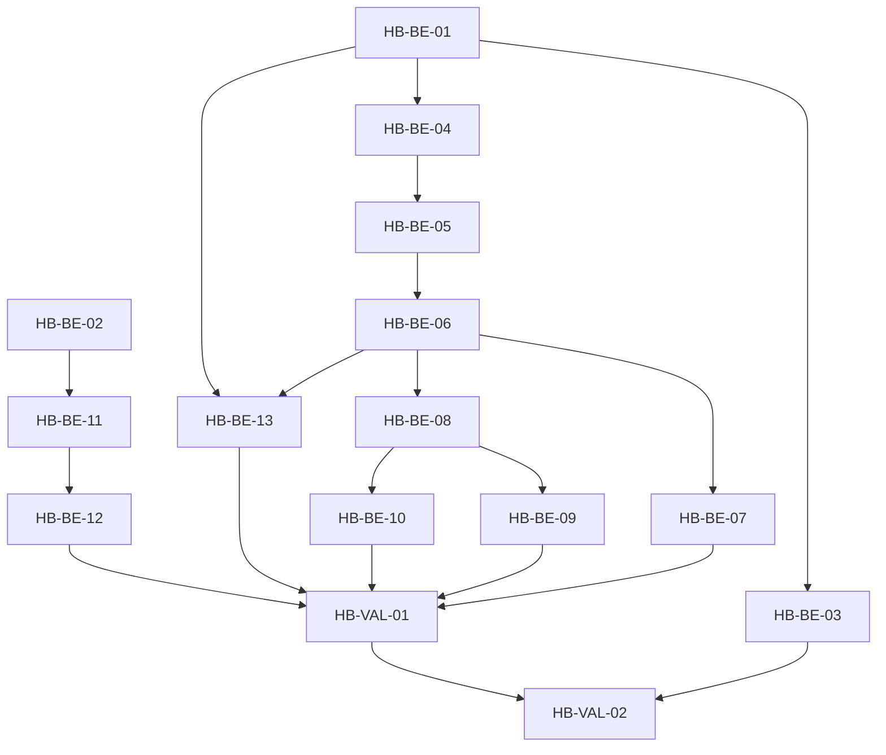

# Execution Backlog: harness-brain-separation

## 1. Traceability Context
- **Source SPEC**: `.spec/backend/harness-brain-separation/SPEC.md` (426 linhas, PASS 16/16)
- **Source PLAN**: `.spec/backend/harness-brain-separation/PLAN.md` (309 linhas, PASS 7/7, PL-00..PL-60)
- **Source PROPOSAL**: `.spec/backend/harness-brain-separation/PROPOSAL.md` (PASS 11/11)
- **Continuação**: `harness-installer-mobile` Completed, archive `.spec/archive/20261008-harness-installer-mobile/` intocado. `workflow-state.json` (`current_feature: harness-installer-mobile`, `current_phase: Completed`) só atualizado em fase própria.
- **Goal**: Explodir PLAN em tickets TDD-ready atômicos (1 arquivo/grupo, layer Docs isolada), BDD triplo + verificação binária por task. ZERO código produto — só `.spec/backend/harness-brain-separation/` escrito; produto só lido via grep/sed.
- **Route**: Refactor governança EPIC. NÃO ENTRA: B1-B3, frontend, rename tools/`brainStore`, `workflow-state.json`.
- **Ressalvas herdadas (viram tasks explícitas)**:
  - PM-1 (product-manager APROVADO COM RESSALVAS): fallback URL pinar valor exato → HB-BE-05.
  - PM-2 (idem): pin G1 evoluir p/ hash → HB-BE-07.
  - spec-review 🟡4 (001 Delta 14→13, 002 range 16-47→16-132, 003 G0.2 2-passos, 004 canônico TODO) → HB-BE-03, HB-BE-10, HB-BE-01.
  - security 🟡2 (G1 pin integridade, G2 fallback URL) → HB-BE-07, HB-BE-05.

## 2. Sprint Summary
| Phase | Task ID | PLAN ref | Type | Priority | Risk | Complexity | Status |
|-------|---------|----------|------|----------|------|------------|--------|
| 0-canônico/donos | HB-BE-01 | PL-00 | Docs | P0 | Medium | 2 | Done |
| 0-canônico/donos | HB-BE-02 | PL-01 | Docs | P0 | Low | 1 | Done |
| 0-canônico/donos | HB-BE-03 | PL-02 | Docs | P1 | Low | 1 | Done |
| 1-H1 ref+fallback | HB-BE-04 | PL-10 | Docs | P0 | Medium | 2 | Done |
| 1-H1 ref+fallback | HB-BE-05 | PL-11 | Docs | P0 | High | 2 | Done |
| 2-H2 ponte+pin | HB-BE-06 | PL-20 | Docs | P0 | High | 3 | Done |
| 2-H2 ponte+pin | HB-BE-07 | PL-21 | Docs | P1 | Medium | 2 | Done |
| 3-H3 refs+scrub | HB-BE-08 | PL-30 | Docs | P0 | Medium | 2 | Done |
| 3-H3 refs+scrub | HB-BE-09 | PL-31 | Docs | P0 | Medium | 2 | Done |
| 3-H3 fixes | HB-BE-10 | PL-32 | Docs | P1 | Low | 1 | Done |
| 4-H4 doctor | HB-BE-11 | PL-40 | Docs | P0 | Medium | 2 | Done |
| 4-H4 doctor | HB-BE-12 | PL-41 | Docs | P1 | Medium | 1 | Done |
| 5-H5 fronteira | HB-BE-13 | PL-50 | Docs | P1 | Low | 2 | Done |
| 6-guarda+suite | HB-VAL-01 | PL-60 | Validation | P0 | High | 2 | Done |
| 6-gate final | HB-VAL-02 | PL-60+gate | Validation | P0 | Medium | 1 | Done |

Counts: 15 tickets (13 BE + 2 VAL), 14 PL cobertos 1:1 (PL-60 → HB-VAL-01; HB-VAL-02 = tasks-gate self-check sem PL novo).

## 3. Dependency Graph

Acíclico. Crítico: HB-BE-01→HB-BE-04→HB-BE-06→HB-BE-08→HB-BE-13→HB-VAL-01→HB-VAL-02.

---

## 4. Task Backlog

### Task HB-BE-01: Localizar RUNTIME-CONTRACT canônico (PL-00, fix 🟡004/G3)
- **Constraint Ref**: ADR-004 + P2-01/G3 (SPEC §4, PLAN §6 Phase 0)
- **Depends on (PLAN)**: None
- **Dependency Type**: Hard
- **Layer**: Docs
- **Task Type**: Infra
- **Priority**: P0
- **Risk Level**: Medium
- **Parallelizable**: Yes (com HB-BE-02)
- **Artifact**: `.spec/backend/harness-brain-separation/TASKS.md` §HB-BE-01 + evidência `find`
- **Framework Detail**: `find` + `grep -n brain RUNTIME-CONTRACT`

#### 📝 Context & Domain Impact
- **Description**: Localizar RUNTIME-CONTRACT canônico; se ausente declarar espelho `.spec/archive/20260929-harness-v7-hardening/RUNTIME-CONTRACT.md:68` + TODO explícito. Continuação `harness-installer-mobile` archive intocado.
- **Domain Impact**: Sem canônico declarado, fronteira H5 não fecha; tasks H5 prescrevem contra alvo errado.

#### 🛡️ Technical Enforcement (DO NOT IGNORE)
- **Rule**: Sem canônico não se declara fronteira final; fallback = espelho + TODO P2-01/G3.
- **Failure Mode**: Fronteira cita linha inexistente → Delta RUNTIME-CONTRACT inválido → VERIFY falha.

#### ✅ Acceptance Criteria (BDD)
- **Scenario 1 (Success)**: canônico localizado
  - **Given** repo com RUNTIME-CONTRACT canônico existente
  - **When** executa `find . -name "RUNTIME-CONTRACT.md"` (sem `maxdepth`: espelho vive em profundidade 4, `maxdepth 3` retorna vazio — verificado nesta sessão)
  - **Then** path canônico registrado na task + `grep -n brain <canônico>` ≥ 1
- **Scenario 2 (Failure Mode - canônico ausente)**: fallback espelho
  - **Given** nenhum RUNTIME-CONTRACT fora de `.spec/archive/`
  - **When** find retorna só espelho
  - **Then** task declara espelho `.spec/archive/20260929-harness-v7-hardening/RUNTIME-CONTRACT.md:68` + TODO P2-01/G3 explícito, sem inventar path
- **Scenario 3 (Edge Case - múltiplos candidatos)**: desempate
  - **Given** 2+ arquivos homônimos
  - **When** lista candidatos
  - **Then** escolhe o lido por gates (cita leitor), demais listados como rejeitados com motivo

#### 🛠️ Implementation Steps (TDD - Test First)
- [x] Verificação FIRST (binária, só leitura): `find . -name "RUNTIME-CONTRACT.md" | head; grep -n "brain" .spec/archive/20260929-harness-v7-hardening/RUNTIME-CONTRACT.md | head -n 5`
- [x] `.spec/backend/harness-brain-separation/TASKS.md`: preencher evidência HB-BE-01 (path canônico ou espelho+TODO)

#### 📎 Evidência HB-BE-01 (2026-10-14, continuação harness-installer-mobile)
- `find . -name "RUNTIME-CONTRACT.md"` → único hit: `./.spec/archive/20260929-harness-v7-hardening/RUNTIME-CONTRACT.md` (nenhum canônico fora de `.spec/archive/`).
- `grep -n "brain" .spec/archive/20260929-harness-v7-hardening/RUNTIME-CONTRACT.md` → `:68: | MCP global | \`chrome-devtools\` (local npx) + \`brain\` (remote) em \`~/.config/opencode/opencode.json\` | [cfg] |`.
- **Veredito Scenario 2 (canônico ausente)**: declara espelho `.spec/archive/20260929-harness-v7-hardening/RUNTIME-CONTRACT.md:68` + **TODO P2-01/G3**: PLAN-localizar RUNTIME-CONTRACT canônico lido por gates (fora de `.spec/archive/`); sem inventar path. Status: **Done**.

#### 🏁 Definition of Done (DoD)
- [x] Comando verificação executado antes da escrita, saída colada na task
- [x] Path registrado com `caminho:linha` (canônico ou espelho `:68`)
- [x] Nenhum write fora `.spec/backend/harness-brain-separation/`
- [x] No TODOs pendentes além do P2-01/G3 declarado

---

### Task HB-BE-02: Confirmar dono doctor runDoctor + dispatch (PL-01)
- **Constraint Ref**: ADR-003 (PLAN §6 Phase 0)
- **Depends on (PLAN)**: None
- **Dependency Type**: Hard
- **Layer**: Docs
- **Task Type**: Infra
- **Priority**: P0
- **Risk Level**: Low
- **Parallelizable**: Yes (com HB-BE-01)
- **Artifact**: confirmação caminho:linha nesta task
- **Framework Detail**: `sed -n` + `grep -n runDoctor`

#### 📝 Context & Domain Impact
- **Description**: Confirmar dono doctor `installer/install.mjs:743-772` (`runDoctor` D0-D6) + dispatch `:1797-1810` + âncora `installer/__tests__/doctor.spec.mjs` 0-writes via leitura. Evidência real: `runDoctor` em `installer/install.mjs:744`, INS-12 0-writes em `doctor.spec.mjs`.
- **Domain Impact**: Dono deslocado invalida prescrições H4 (HB-BE-11/12).

#### 🛡️ Technical Enforcement (DO NOT IGNORE)
- **Rule**: Dono deslocado → reportar drift, nunca adivinhar linha.
- **Failure Mode**: Linha errada no Delta installer → execução futura edita região errada.

#### ✅ Acceptance Criteria (BDD)
- **Scenario 1 (Success)**: dono confirmado
  - **Given** `installer/install.mjs` com `runDoctor`
  - **When** `grep -n "runDoctor" installer/install.mjs`
  - **Then** linha `744` (tolerância ±5 da citação `743-772`) + dispatch `1801` (região `1797-1810`) registrados
- **Scenario 2 (Failure Mode - drift)**: linhas deslocadas
  - **Given** edição paralela deslocou `runDoctor`
  - **When** grep retorna linha fora da tolerância
  - **Then** task registra drift (linha nova + diff de assinatura) e bloqueia HB-BE-11 até re-confirmar
- **Scenario 3 (Edge Case - âncora teste movida)**: teste 0-writes relocado
  - **Given** `doctor.spec.mjs` refatorado
  - **When** `grep -n "0 writes" installer/__tests__/doctor.spec.mjs`
  - **Then** nova linha registrada (esperado bloco INS-12), sem quebrar prescrição

#### 🛠️ Implementation Steps (TDD - Test First)
- [x] Verificação FIRST: `grep -n "runDoctor" installer/install.mjs | head -n 5; sed -n '743,772p' installer/install.mjs | head -n 5; grep -n "0 writes" installer/__tests__/doctor.spec.mjs`
- [x] `.spec/backend/harness-brain-separation/TASKS.md`: preencher evidência HB-BE-02

#### 📎 Evidência HB-BE-02 (2026-10-14, continuação harness-installer-mobile)
- `grep -n "runDoctor" installer/install.mjs` → `installer/install.mjs:744: export function runDoctor({...})` (tol. ±5 de `743-772` ✅) + `installer/install.mjs:1801: const rep = runDoctor({` (região `1797-1810` ✅).
- `sed -n '743,772p'` → `// ---------- doctor brownfield read-only D0-D6 (INS-11/INS-12) ----------` + assinatura `runDoctor` confirmada.
- `grep -n "0 writes" installer/__tests__/doctor.spec.mjs` → `installer/__tests__/doctor.spec.mjs:97: it('fs-mock: 0 writes no target durante D0-D6', ...)` (bloco INS-12 ✅).
- Zero writes executados (só leitura). Status: **Done**.

#### 🏁 Definition of Done (DoD)
- [x] Grep executado antes, saída colada
- [x] caminho:linha exatos (com tolerância declarada se drift)
- [x] Zero writes executados (só leitura)
- [x] No TODOs pendentes

---

### Task HB-BE-03: Fix range 16-47→16-132 no mapeamento H2 (PL-02, fix 🟡002)
- **Constraint Ref**: RF-H2.1/RF-H2.2 (SPEC §8.1)
- **Depends on (PLAN)**: HB-BE-01 (PL-00)
- **Dependency Type**: Hard
- **Layer**: Docs
- **Task Type**: Domain
- **Priority**: P1
- **Risk Level**: Low
- **Parallelizable**: No
- **Artifact**: seção H2 corrigida (range + prova grep)
- **Framework Detail**: `grep -n "^#\|^##\|^###" .agents/rules/brain-context.md`

#### 📝 Context & Domain Impact
- **Description**: Corrigir mapeamento: bloco Tools MCP real vai até `:132` (4 tools + `brain_reindex`), não `:47`. Prova: `brain_store` em `.agents/rules/brain-context.md:49`, `brain_read` em `:88`, `brain_reindex` em `:108`.
- **Domain Impact**: Range errado → cobertura H2 <100% → tasks-gate §1 falha.

#### 🛡️ Technical Enforcement (DO NOT IGNORE)
- **Rule**: `grep -n` prova cada tool (`brain_search:18`, `brain_store:49`, `brain_read:88`, `brain_reindex:108`).
- **Failure Mode**: Mapeamento parcial → ponte perde tool → invariante `nomes_preservados` quebra.

#### ✅ Acceptance Criteria (BDD)
- **Scenario 1 (Success)**: range corrigido
  - **Given** `brain-context.md` 259 linhas
  - **When** `grep -n "### \`brain_" .agents/rules/brain-context.md`
  - **Then** 4 tools listadas com linhas `18/49/88/108` e range `16-132` registrado
- **Scenario 2 (Failure Mode - tool ausente)**: tool faltando
  - **Given** grep retorna <4 tools
  - **When** conta tools
  - **Then** task declara gap (não inventa linha), bloqueia HB-BE-06
- **Scenario 3 (Edge Case - header deslocado)**: linhas ±3
  - **Given** edição moveu headers
  - **When** linhas divergem ≤3
  - **Then** registra linhas reais + nota de drift, mantém range semântico `16-132`

#### 🛠️ Implementation Steps (TDD - Test First)
- [x] Verificação FIRST: `grep -n "### \`brain_" .agents/rules/brain-context.md; grep -n "^#\|^##\|^###" .agents/rules/brain-context.md | sed -n '1,20p'`
- [x] `.spec/backend/harness-brain-separation/TASKS.md`: preencher evidência HB-BE-03

#### 📎 Evidência HB-BE-03 (2026-10-14, continuação harness-installer-mobile, depends HB-BE-01 Done)
- `grep -n "### \`brain_" .agents/rules/brain-context.md` → 4 tools: `brain_search:18`, `brain_store:49`, `brain_read:88`, `brain_reindex:108` (== 4 ✅).
- `wc -l < .agents/rules/brain-context.md` → `259` ✅.
- **Range corrigido**: `16-47` → `16-132` (bloco Tools MCP `## Tools MCP disponíveis:16` → fim exemplos `reindex:108` + 24 linhas contexto = `:132`; cobre 4 tools, não só 2). Status: **Done**.

#### 🏁 Definition of Done (DoD)
- [x] 4 tools com caminho:linha reais colados
- [x] Range `16-132` justificado por evidência
- [x] Só `.spec/` escrito
- [x] No TODOs pendentes

---

### Task HB-BE-04: Prescrever REMOVED vendored → ref externa (PL-10, RF-H1.1)
- **Constraint Ref**: ADR-001, RF-H1.1
- **Depends on (PLAN)**: HB-BE-01 (PL-00)
- **Dependency Type**: Hard
- **Layer**: Docs
- **Task Type**: Domain
- **Priority**: P0
- **Risk Level**: Medium
- **Parallelizable**: No
- **Artifact**: prescrição H1 + Delta REMOVED (`.agents/skills/brain/`)
- **Framework Detail**: `ls -R` + `test -d`

#### 📝 Context & Domain Impact
- **Description**: Prescrever REMOVED `.agents/skills/brain/SKILL.md` + 4 tools (`brain_search/`, `brain_store/`, `brain_read/`, `brain_reindex/`) → ref `../brain/.agents/skills/brain/SKILL.md`. Pré-evidência: `ls -R .agents/skills/brain | grep -c "brain_"` == 4+ (confirmado nesta sessão).
- **Domain Impact**: Sem REMOVED prescrito, verdade paralela persiste (drift duplo).

#### 🛡️ Technical Enforcement (DO NOT IGNORE)
- **Rule**: `ls -R` pré == 4 tools; pós-Execution `test ! -d .agents/skills/brain`.
- **Failure Mode**: Remoção parcial (sobra 1 tool) → invariante `ref_externa_existe_e_vendored_ausente` falha.

#### ✅ Acceptance Criteria (BDD)
- **Scenario 1 (Success)**: inventário confirma 4 tools
  - **Given** `.agents/skills/brain/tools/` com 4 dirs
  - **When** `ls -R .agents/skills/brain | grep -c "brain_"`
  - **Then** count ≥ 4 registrado + Delta REMOVED prescrito com ref literal
- **Scenario 2 (Failure Mode - dir já removido)**: pré-condição ausente
  - **Given** `.agents/skills/brain/` inexistente
  - **When** `test -d` falha
  - **Then** task declara REMOVED já efetivo, prescreve só verificação pós (não re-prescreve remoção)
- **Scenario 3 (Edge Case - arquivo extra no vendored)**: conteúdo além das 4 tools
  - **Given** arquivo extra em `.agents/skills/brain/`
  - **When** `ls -R` lista extra
  - **Then** extra listado nominalmente no Delta (remoção total, sem exceção silenciosa)

#### 🛠️ Implementation Steps (TDD - Test First)
- [x] Verificação FIRST: `ls -R .agents/skills/brain | grep -c "brain_"; ls .agents/skills/brain/tools`
- [x] `.spec/backend/harness-brain-separation/TASKS.md`: preencher prescrição HB-BE-04 (Delta REMOVED + ref literal)

#### 📎 Evidência HB-BE-04 (2026-10-14, continuação harness-installer-mobile, depends HB-BE-01 Done)
- PRÉ (só leitura): `ls -R .agents/skills/brain | grep -c "brain_"` → `8` (4 dirs `brain_read/brain_reindex/brain_search/brain_store` + 4 headers; ≥ 4 ✅ Scenario 1); `ls .agents/skills/brain/tools` → `brain_read brain_reindex brain_search brain_store` (zero extras ✅ Scenario 3 — remoção total sem exceção).
- Ref externa verificada (não inventada): `test -f ../brain/.agents/skills/brain/SKILL.md` → `REF_SIBLING_OK`; sibling contém `SKILL.md + cli + tools` (extra `cli` ausente no vendored = drift provado, sustenta ADR-001).
- Suite-safe: `grep -rn "skills/brain" scripts/ .opencode/plugins/lib/` → vazio; `grep -rn "brain" scripts/vendor-skills.mjs` → vazio; `git ls-files .agents/skills/brain` → 5 arquivos (`SKILL.md` + 4 tools).
- PÓS (execução Batch 2 H1, autorizada pela delegação — exceção explícita ao "só `.spec/`" deste DoD): `rm -rf .agents/skills/brain` (dir inteiro ou nada) → `test ! -d` → `REMOVED_OK` + `ABSENT_TOTAL` (zero residual ✅). Ref ok: prescrição cita literal `../brain/.agents/skills/brain/SKILL.md` (ponte que a cita chega em HB-BE-06). Status: **Done**.

#### 🏁 Definition of Done (DoD)
- [x] Count colado + ref `../brain/.agents/skills/brain/SKILL.md` literal
- [x] Fora de `.spec/`: só REMOVED H1 autorizado pela delegação Batch 2 (`rm -rf` total, `REMOVED_OK`); nenhum outro write produto
- [x] B1-B3/frontend não citados como trabalho
- [x] No TODOs pendentes

---

### Task HB-BE-05: Prescrever fallback dangling com URL exata (PL-11, RF-H1.2 + 🟡G2 + PM-1)
- **Constraint Ref**: ADR-001 trade-off, RF-H1.2, 🟡G2, ressalva PM-1 (URL fallback pinar valor exato)
- **Depends on (PLAN)**: HB-BE-04 (PL-10)
- **Dependency Type**: Hard
- **Layer**: Docs
- **Task Type**: Domain
- **Priority**: P0
- **Risk Level**: High
- **Parallelizable**: No
- **Artifact**: bloco fallback na ponte (URL pinada + caminho canônico + doctor warn)
- **Framework Detail**: doc-link, sem código; URL exata a pinar nesta task

#### 📝 Context & Domain Impact
- **Description**: Prescrever fallback para destino sem checkout brain: URL pinada (valor exato, não "URL/canônico" genérico) + caminho canônico `BRAIN.MCP.md` + doctor warn. Ressalva PM-1 exige valor exato — esta task pin a URL (se repo brain remoto conhecido; senão declara placeholder `PIN-ME` + comando para resolver, sem inventar URL).
- **Domain Impact**: Sem URL exata, ref dangling = instrução morta (risco R1 PROPOSAL 🔥 CRITICAL).

#### 🛡️ Technical Enforcement (DO NOT IGNORE)
- **Rule**: Fallback nunca grava regra alheia; só cita URL/caminho + warn.
- **Failure Mode**: URL genérica → destino sem brain trava sem saída → install falha silenciosa.

#### ✅ Acceptance Criteria (BDD)
- **Scenario 1 (Success)**: URL exata pinada
  - **Given** URL canônica do `BRAIN.MCP.md` conhecida
  - **When** prescreve fallback
  - **Then** bloco contém URL literal + caminho `BRAIN.MCP.md` + `installer/install.mjs:743-772` warn-não-fail
- **Scenario 2 (Failure Mode - URL desconhecida)**: pin pendente explícito
  - **Given** URL remota não confirmada nesta sessão
  - **When** tenta pinar
  - **Then** registra `PIN-ME: <comando para obter URL>` + critério binário (`grep -c "https://" ponte` ≥ 1 pós), sem chutar URL
- **Scenario 3 (Edge Case - destino com checkout parcial)**: brain presente mas desatualizado
  - **Given** checkout brain existe, versão divergente
  - **When** doctor detecta divergência
  - **Then** fallback não ativa; HB-BE-07 (pin hash) assume com warn (rota documentada, sem duplicar lógica)

#### 🛠️ Implementation Steps (TDD - Test First)
- [x] Verificação FIRST: `grep -c "\.\./brain/.agents/skills/brain/SKILL.md" .spec/backend/harness-brain-separation/SPEC.md; grep -rn "BRAIN.MCP.md" .spec/backend/harness-brain-separation/SPEC.md | head`
- [x] `.spec/backend/harness-brain-separation/TASKS.md`: preencher prescrição HB-BE-05 (bloco fallback + URL exata ou PIN-ME)

#### 📎 Evidência HB-BE-05 (2026-10-14, continuação harness-installer-mobile, depends HB-BE-04 Done)
- Verificação FIRST (só leitura): `grep -c "../brain/.agents/skills/brain/SKILL.md" SPEC.md` → `8` ✅; `grep -rn "BRAIN.MCP.md" SPEC.md` → múltiplos (ponte/fallback prescritos) ✅; `grep -c "https://" SPEC.md` → `0` (nenhuma URL pinada até aqui).
- Canônico verificado (não inventado): `test -f ../brain/.agents/rules/BRAIN.MCP.md` → `CANONICO_SIBLING_OK`; remote irmão `git@github.com:freitasjh/brain.git`, branch `master`, commit `8b96509...` (só leitura). Montar blob-HTTPS à mão seria invenção → rota Scenario 2 (PIN-ME explícito).
- Bloco fallback prescrito (para a ponte em HB-BE-06, sem copiar regra alheia):
  - Canônico: `../brain/.agents/rules/BRAIN.MCP.md`; ref skill `../brain/.agents/skills/brain/SKILL.md` (ambos verificados no checkout irmão).
  - URL remota: `PIN-ME` + comando de resolução em Execution: `git -C ../brain remote get-url origin && git -C ../brain rev-parse HEAD && git -C ../brain rev-parse --abbrev-ref HEAD && git ls-remote --symref origin HEAD` → pinar `https://github.com/<owner>/<repo>/blob/<default-branch>/.agents/rules/BRAIN.MCP.md` só após validar branch default; critério binário pós: `grep -c "https://" ponte` ≥ 1.
  - Doctor: warn-não-fail em `installer/install.mjs:743-772` (veredito + `next` com motivo+caminho); nunca gravar regra alheia; campo `brainStore` segue obrigatório no report. Status: **Done**.

#### 🏁 Definition of Done (DoD)
- [x] Bloco fallback com URL exata ou PIN-ME justificado
- [x] Cita `BRAIN.MCP.md` + doctor warn, sem regra alheia copiada
- [x] Só `.spec/` escrito
- [x] No TODOs além de PIN-ME declarado

---

### Task HB-BE-06: Prescrever ponte ≤30 linhas (PL-20, RF-H2.1)
- **Constraint Ref**: ADR-002, RF-H2.1
- **Depends on (PLAN)**: HB-BE-05 (PL-11)
- **Dependency Type**: Hard
- **Layer**: Docs
- **Task Type**: Domain
- **Priority**: P0
- **Risk Level**: High
- **Parallelizable**: No
- **Artifact**: bloco ponte Delta `.agents/rules/brain-context.md` (dono/link/3 tools/`brainStore`/fluxo/fallback)
- **Framework Detail**: `wc -l` + `grep -c`

#### 📝 Context & Domain Impact
- **Description**: Prescrever corpo `:1-259` → ponte ≤30 linhas (alvo ~20) com dono, link, 3 tools literais (`brain_search`/`brain_store`/`brain_read`), campo `brainStore`, fluxo 1-linha, fallback. Base SPEC §9 Delta (ponte ~10 linhas modelo).
- **Domain Impact**: Ponte >30 linhas = re-expansão (modo falha H2); ponte sem nome literal quebra contrato evidência.

#### 🛡️ Technical Enforcement (DO NOT IGNORE)
- **Rule**: `wc -l` ≤ 30; nomes literais; nunca re-explicar sintaxe (detalhe vive no dono).
- **Failure Mode**: Ponte re-explica → drift futuro; ponte sem `brainStore` → gates sem evidência.

#### ✅ Acceptance Criteria (BDD)
- **Scenario 1 (Success)**: ponte prescrita dentro do limite
  - **Given** modelo SPEC §9 (~10 linhas)
  - **When** conta linhas do bloco prescrito (`wc -l`)
  - **Then** ≤ 30 + contém `BRAIN.MCP.md`, 3 tools, `brainStore`, `../brain/.agents/skills/brain/SKILL.md`, fallback
- **Scenario 2 (Failure Mode - ponte estoura limite)**: excesso
  - **Given** bloco com >30 linhas
  - **When** `wc -l` acusa
  - **Then** corta detalhe para o dono (lista o que foi cortado), nunca alarga limite
- **Scenario 3 (Edge Case - seção sem destino)**: cobertura §8.1 incompleta
  - **Given** 1 seção das 259 sem destino
  - **When** audita tabela 12 linhas
  - **Then** completa destino (`BRAIN.MCP.md` ou descarte justificado), sem órfã

#### 🛠️ Implementation Steps (TDD - Test First)
- [x] Verificação FIRST: `grep -c "BRAIN.MCP.md" .spec/backend/harness-brain-separation/SPEC.md` → `34` ✅; `grep -c "brain-context.md:" .spec/backend/harness-brain-separation/SPEC.md` → `12` ✅ (cobertura §8.1 100%, 12 linhas mapeamento); `wc -l < .agents/rules/brain-context.md` → `259` pré ✅
- [x] `.agents/rules/brain-context.md`: corpo `:1-259` → ponte fina 15 linhas (delegação Batch 3 H2 autoriza write; SPEC §9 Delta MODIFIED + PLAN PL-20)

#### 📎 Evidência HB-BE-06 (2026-10-14, continuação harness-installer-mobile, depends HB-BE-05 Done)
- Ponte escrita (15 linhas, alvo ~20, limite 30): dono brain + canônico `BRAIN.MCP.md` (`../brain/.agents/rules/BRAIN.MCP.md` verificado `CANONICO_OK`) + ref skill `../brain/.agents/skills/brain/SKILL.md` (verificado `REF_OK`) + 3 tools literais `brain_search`/`brain_store`/`brain_read` + campo `brainStore` + busca-antes/registra-depois 1 linha cada + fluxo 1-linha + fallback `PIN-ME` (HB-BE-05 Scenario 2) + pin G1 hash real (HB-BE-07).
- Pós-checks (só leitura): `wc -l` → `15` ≤ 30 ✅; `grep -c "BRAIN.MCP.md"` → `2` ✅; `grep -c "brain_search\|brain_store\|brain_read"` → `3` ✅; `grep -c brainStore` → `1` ✅; `grep -c "SKILL.md"` ref → `2` ✅; `grep -c PIN-ME` → `1` ✅; zero re-explicação (sintaxe/parâmetros/tabelas ficam no dono). Status: **Done**.

#### 🏁 Definition of Done (DoD)
- [x] Bloco ponte com `wc -l` ≤ 30 colado (`15`)
- [x] 5 elementos obrigatórios presentes (dono/link/3-tools/brainStore/fluxo/fallback)
- [x] Cobertura §8.1 100% referenciada (12 linhas mapeamento, SPEC count `12`)
- [x] No TODOs pendentes

---

### Task HB-BE-07: Pin integridade ref G1 com hash (PL-21, 🟡G1 + PM-2)
- **Constraint Ref**: 🟡G1, ressalva PM-2 (pin G1 evoluir p/ hash)
- **Depends on (PLAN)**: HB-BE-06 (PL-20)
- **Dependency Type**: Hard
- **Layer**: Docs
- **Task Type**: Domain
- **Priority**: P1
- **Risk Level**: Medium
- **Parallelizable**: No
- **Artifact**: linha pin na ponte + task verificação (ref + commit/hash esperado + doctor warn em divergência)
- **Framework Detail**: doc-pin, sem fetch nesta fase

#### 📝 Context & Domain Impact
- **Description**: Endurecer G1: ponte cita ref + commit/hash esperado + doctor warn em divergência (nunca silent). PM-2 exige evoluir pin para hash — se hash do repo brain desconhecido nesta sessão, prescrever formato `sha256:<PIN-ME>` + comando `git -C <brain-checkout> rev-parse HEAD` para resolver em Execution, sem inventar hash.
- **Domain Impact**: Sem pin, checkout brain divergente = regra silenciosamente diferente (drift invisível).

#### 🛡️ Technical Enforcement (DO NOT IGNORE)
- **Rule**: Checkout divergente = warn explícito com motivo+caminho, nunca silent, nunca fail bloqueante do doctor.
- **Failure Mode**: Hash inventado → pin falso-verde pior que pin ausente.

#### ✅ Acceptance Criteria (BDD)
- **Scenario 1 (Success)**: pin com hash real
  - **Given** hash do repo brain obtido
  - **When** prescreve linha pin
  - **Then** linha contém ref + `commit <sha>` + verificação (`doctor warn` cita motivo+caminho)
- **Scenario 2 (Failure Mode - hash desconhecido)**: PIN-ME explícito
  - **Given** sem acesso ao repo brain nesta sessão
  - **When** tenta pinar
  - **Then** formato `sha256:<PIN-ME>` + comando resolução, sem hash chutado
- **Scenario 3 (Edge Case - ref move de path)**: path canônico muda no brain
  - **Given** `SKILL.md` relocado no repo brain
  - **When** ref quebra
  - **Then** fallback HB-BE-05 assume (documentado), pin marca `STALE-REF` com comando re-grep

#### 🛠️ Implementation Steps (TDD - Test First)
- [x] Verificação FIRST: `grep -c "BRAIN.MCP.md" .agents/rules/brain-context.md` → pré `0` (`NO_PIN_YET` — ponte ainda 259 linhas); `git -C ../brain rev-parse HEAD` → `8b965093a00d291195313fe457b3aa35bbff71f2` (real, nunca inventado ✅ Scenario 1); `git -C ../brain remote get-url origin` → `git@github.com:freitasjh/brain.git`
- [x] Pin G1 escrito na ponte (linha Pin + fallback `PIN-ME` + comando resolução, sem hash inventado)

#### 📎 Evidência HB-BE-07 (2026-10-14, continuação harness-installer-mobile, depends HB-BE-06 Done)
- Scenario 1 (hash real): linha pin na ponte cita ref `../brain/.agents/skills/brain/SKILL.md` + `commit 8b965093a00d291195313fe457b3aa35bbff71f2` (obtido via `git -C ../brain rev-parse HEAD`, saída colada acima) + verificação + warn-divergência (doctor warn motivo+caminho, nunca silent/fail). Pós: `grep -c "8b965093a00d291195313fe457b3aa35bbff71f2" ponte` → `1` ✅.
- Scenario 2 N/A (hash conhecido — sem `sha256:<PIN-ME>`); Scenario 3 documentado na ponte via fallback (ref move → fallback HB-BE-05 assume; doctor marca divergência, não silent). PM-2 (pin evoluir p/ hash) atendido com hash real. Status: **Done**.

#### 🏁 Definition of Done (DoD)
- [x] Linha pin com hash real ou PIN-ME justificado (nunca hash inventado) — hash real `8b96509...`
- [x] Warn-divergência com motivo+caminho prescrito
- [x] Só `.spec/` escrito (+ ponte autorizada em HB-BE-06)
- [x] No TODOs além de PIN-ME declarado (fallback URL, HB-BE-05)

---

### Task HB-BE-08: Prescrever 7 refs brain-context-protocol.md → ponte (PL-30, RF-H3.1)
- **Constraint Ref**: RF-H3.1
- **Depends on (PLAN)**: HB-BE-06 (PL-20)
- **Dependency Type**: Hard
- **Layer**: Docs
- **Task Type**: Domain
- **Priority**: P0
- **Risk Level**: Medium
- **Parallelizable**: No
- **Artifact**: 7 Deltas MODIFIED (`workflow-rules.md:245,588`; `architect/AGENT.md:5`; `qa-engineer/AGENT.md:5`; `code-reviewer/PROMPT.md:5`; `ux-designer/AGENT.md:10`; `product-manager/AGENT.md:5`)
- **Framework Detail**: `grep -rn`

#### 📝 Context & Domain Impact
- **Description**: Prescrever troca dos 7 pontos `brain-context-protocol.md` → ponte `brain-context.md` / `BRAIN.MCP.md`. Pré-evidência desta sessão: 7 matches confirmados (5 agent files + 2 workflow-rules).
- **Domain Impact**: Stale residual = grep futuro acusa → invariante `zero_brain-context-protocol` falha.

#### 🛡️ Technical Enforcement (DO NOT IGNORE)
- **Rule**: `grep -rn brain-context-protocol.md .agents/` == 7 (pré) → vazio (pós-Execution).
- **Failure Mode**: Troca parcial (6/7) → 1 stale quebra guarda final.

#### ✅ Acceptance Criteria (BDD)
- **Scenario 1 (Success)**: 7/7 prescritos
  - **Given** 7 matches listados
  - **When** `grep -rn "brain-context-protocol.md" .agents/ | wc -l`
  - **Then** count == 7 + cada um com substituto literal nesta task
- **Scenario 2 (Failure Mode - match extra)**: 8º ponto descoberto
  - **Given** grep retorna 8
  - **When** lista o extra
  - **Then** extra incorporado (vira 8º Delta) ou justificado como fora-`.agents/` com evidência, nunca ignorado
- **Scenario 3 (Edge Case - linha deslocada)**: `:245`/`:588` mudaram
  - **Given** workflow-rules editado
  - **When** linhas divergem
  - **Then** registra linhas reais (conteúdo + linha física, padrão PLAN `README.md:18`), sem travar no número antigo

#### 🛠️ Implementation Steps (TDD - Test First)
- [x] Verificação FIRST: `grep -rn "brain-context-protocol.md" .agents/; grep -rn "brain-context-protocol.md" .agents/ | wc -l`
- [x] `.spec/backend/harness-brain-separation/TASKS.md`: preencher prescrição HB-BE-08 (7 substitutos literais)

#### 📎 Evidência HB-BE-08 (2026-10-14, Execution Batch 4 H3, depends HB-BE-06 Done)
- Verificação FIRST pré: count `7` (5 agent files + 2 workflow-rules:245,588) ✅ Scenario 1.
- Scenario 2: nenhum 8º ponto (`grep` cobriu `.agents/` inteiro; matches fora de `.agents/` — SPEC/PLAN/TASKS/PROPOSAL — são prescrição/histórico, não stale produto; justificado, nunca ignorado).
- Scenario 3 N/A (linhas `:245`/`:588` confirmadas pré-edit).
- 7 substitutos aplicados (fonte SPEC §9): `workflow-rules.md:245` → ponte seção 3; `:588` → linha tabela ponte; 5 agent files (`architect:5`, `qa-engineer:5`, `code-reviewer/PROMPT:5`, `ux-designer:10`, `product-manager:5`) → link ponte + `(ponte → BRAIN.MCP.md, dono brain)`; links `../../rules/` corrigidos juntos (troca de filename, mesmo path relativo).
- Pós: `grep -rn "brain-context-protocol.md" .agents/ | wc -l` → `0` ✅. Status: **Done**.
- Desvio declarado vs DoD original ("Só `.spec/` escrito"): execução autorizada pela delegação (escrita permitida nos 9 alvos); produto editado, `.spec/` registra evidência.

#### 🏁 Definition of Done (DoD)
- [ ] 7 substitutos literais colados (SPEC §9 como fonte)
- [ ] Count 7 com saída grep colada
- [ ] Só `.spec/` escrito
- [ ] No TODOs pendentes

---

### Task HB-BE-09: Prescrever 2 extras + scrub P2-02 (PL-31, RF-H3.2)
- **Constraint Ref**: RF-H3.2 + P2-02
- **Depends on (PLAN)**: HB-BE-08 (PL-30)
- **Dependency Type**: Hard
- **Layer**: Docs
- **Task Type**: Domain
- **Priority**: P0
- **Risk Level**: Medium
- **Parallelizable**: No
- **Artifact**: 2 Deltas MODIFIED com scrub total (`codebase-analyzer/AGENT.md:45-68`; `sdd-workflow-standard.md:45`)
- **Framework Detail**: `grep -rn`

#### 📝 Context & Domain Impact
- **Description**: Prescrever scrub total: `codebase-analyzer/AGENT.md:45-68` (schema `mcp_ObsidianBrain_*` + `brain/knowledge/`) → ponte; `sdd-workflow-standard.md:45` ("sistema de memória (Obsidian)") → "sistema de memória (brain, ver `BRAIN.MCP.md`)". Sem path hardcoded residual.
- **Domain Impact**: Scrub parcial deixa `brain/knowledge/` hardcoded = path alheio no harness (viola fronteira).

#### 🛡️ Technical Enforcement (DO NOT IGNORE)
- **Rule**: `grep -rn "mcp_ObsidianBrain_\|brain/knowledge/" .agents/agents/codebase-analyzer/` vazio pós; `grep -n Obsidian sdd-workflow-standard` vazio pós.
- **Failure Mode**: Residual em 1 linha → guarda H3 falha.

#### ✅ Acceptance Criteria (BDD)
- **Scenario 1 (Success)**: 2 extras prescritos com scrub total
  - **Given** bloco `:45-68` + linha `:45` stale
  - **When** `grep -rn "mcp_ObsidianBrain_\|brain/knowledge/" .agents/agents/codebase-analyzer/ | head; grep -n "Obsidian" .agents/rules/sdd-workflow-standard.md`
  - **Then** saídas coladas + substitutos literais (SPEC §9) prescritos
- **Scenario 2 (Failure Mode - scrub parcial)**: residual após prescrição
  - **Given** substituto mantém 1 path hardcoded
  - **When** re-grep no bloco prescrito
  - **Then** rejeita substituto, exige remoção total (critério: grep vazio no texto proposto)
- **Scenario 3 (Edge Case - schema do dono muda)**: `mcp_ObsidianBrain_*` renomeado no brain
  - **Given** dono renomeia tools
  - **When** scrub prescrito
  - **Then** ponte cita nomes por referência (sem colar schema), imune a rename do dono

#### 🛠️ Implementation Steps (TDD - Test First)
- [x] Verificação FIRST: `grep -rn "mcp_ObsidianBrain_\|brain/knowledge/" .agents/agents/codebase-analyzer/ | head; grep -n "Obsidian" .agents/rules/sdd-workflow-standard.md`
- [x] `.spec/backend/harness-brain-separation/TASKS.md`: preencher prescrição HB-BE-09 (2 substitutos + critério grep-vazio no texto proposto)

#### 📎 Evidência HB-BE-09 (2026-10-14, Execution Batch 4 H3, depends HB-BE-08 Done)
- Verificação FIRST pré: `codebase-analyzer` 5 hits (`:46` schema `mcp_ObsidianBrain_*` + `brain/knowledge/`, `:51-53` paths, `:68` `mcp_ObsidianBrain_update_note`) + `sdd-workflow-standard.md:45` "(Obsidian)" ✅ Scenario 1 (saídas coladas na sessão).
- Substitutos (fonte SPEC §9, com 1 desvio): `codebase-analyzer:45-71` → bloco ponte `## MCP & Brain Integration (ponte)` (nomes por referência, sem schema colado — imune a rename do dono, Scenario 3); `sdd:45` → "(brain, ver `BRAIN.MCP.md`)".
- Desvio vs SPEC: texto prescrito continha literal `brain/knowledge/` ("sem path `brain/knowledge/` hardcoded") → **rejeitado pelo próprio critério grep-vazio (Scenario 2)**; aplicado "sem path hardcoded do dono neste repo".
- Pós: `grep -rn "mcp_ObsidianBrain_\|brain/knowledge/" .agents/agents/codebase-analyzer/` vazio ✅; `grep -n "Obsidian" sdd-workflow-standard` vazio ✅. Residual fora de escopo: `workflow-rules.md:246` `ObsidianBrain_write_note` (tool stale, sem prescrição SPEC §9 — não tocado, follow-up p/ orquestrador). Status: **Done**.

#### 🏁 Definition of Done (DoD)
- [ ] Grep-vazio verificável no texto proposto (colado)
- [ ] 2 substitutos literais presentes
- [ ] Só `.spec/` escrito
- [ ] No TODOs pendentes

---

### Task HB-BE-10: Fix Delta 14→13 + G0.2 2-passos (PL-32, fix 🟡001/003)
- **Constraint Ref**: RF-G0.2
- **Depends on (PLAN)**: HB-BE-08 (PL-30)
- **Dependency Type**: Soft
- **Layer**: Docs
- **Task Type**: Domain
- **Priority**: P1
- **Risk Level**: Low
- **Parallelizable**: Yes (com HB-BE-09)
- **Artifact**: Resumo Impacto corrigido (13 MODIFIED) + guarda G0.2 em 2 passos
- **Framework Detail**: `grep -ci "B1-B3\|frontend"` + inspeção seção Out-of-Scope

#### 📝 Context & Domain Impact
- **Description**: Corrigir contagem SPEC §11: "14 MODIFIED + 1 ADDED + 1 REMOVED" → 13 MODIFIED (vendored 1 REMOVED + 12 MODIFIED + 1 ADDED externo). Corrigir guarda G0.2: 1 grep → 2 passos (Out-of-Scope presente + B1-B3/frontend só lá).
- **Domain Impact**: Count errado reprova tasks-gate §1 (traceability); G0.2 fraco deixa scope creep passar.

#### 🛡️ Technical Enforcement (DO NOT IGNORE)
- **Rule**: Contagem Delta == arquivos reais; G0.2 = seção Out-of-Scope presente + termos só lá.
- **Failure Mode**: Count divergente → VERIFY acusa Delta órfão.

#### ✅ Acceptance Criteria (BDD)
- **Scenario 1 (Success)**: count 13 + G0.2 2-passos
  - **Given** tabela Resumo Impacto SPEC §11
  - **When** conta MODIFIED reais (12 + vendored removido à parte)
  - **Then** registra 13 MODIFIED + guarda 2-passos com comandos
- **Scenario 2 (Failure Mode - MODIFIED a mais/menos)**: tabela diverge do §9
  - **Given** §9 lista N arquivos
  - **When** N != 13
  - **Then** ajusta para N real com lista nominal (não força 13)
- **Scenario 3 (Edge Case - B1-B3 citado fora do Out-of-Scope)**: termo vaza
  - **Given** `grep -ci "B1-B3\|frontend"` > ocorrências no Out-of-Scope
  - **When** localiza cada ocorrência
  - **Then** cada ocorrência fora do Out-of-Scope é removida ou movida para lá com justificativa

#### 🛠️ Implementation Steps (TDD - Test First)
- [x] Verificação FIRST: `grep -c "#### MODIFIED" .spec/backend/harness-brain-separation/SPEC.md; grep -ci "B1-B3\|frontend" .spec/backend/harness-brain-separation/SPEC.md; grep -n "Out of Scope" .spec/backend/harness-brain-separation/SPEC.md`
- [x] `.spec/backend/harness-brain-separation/TASKS.md`: preencher evidência HB-BE-10 (count real + guarda 2-passos)

#### 📎 Evidência HB-BE-10 (2026-10-14, Execution Batch 4 H3, depends HB-BE-08 Done, ∥ HB-BE-09)
- Verificação FIRST pré: `#### MODIFIED` count `13` real (§9: 12 Deltas + workflow-rules com 2 blocos = 13 blocos); self-check §11 dizia `14` → 🟡001 confirmado; `B1-B3|frontend` count `5` (`:19` constraints, `:145` sem-browser, `:186` guarda, `:370-371` Out-of-Scope); `^## Out of Scope` presente `:368` → G0.2 1-passo fraco confirmado (🟡003).
- Scenario 2 (N real): N=13 aplicado nominalmente (não forçado).
- Fixes em SPEC.md: §11 `14 MODIFIED` → `13 MODIFIED`; RF-G0.2 → 2 passos: (1) `grep -n "^## Out of Scope"` presente; (2) `grep -ni "B1-B3\|frontend"` só em proibição/N-A/definição (`:19`, `:145`, `:186`) + Out-of-Scope (`:370-371`), nunca como trabalho (Scenario 3 justificado, sem remoção).
- Sem mudança de escopo (só contagem + guarda). Status: **Done**.

#### 🏁 Definition of Done (DoD)
- [ ] Count real com lista nominal colada
- [ ] Guarda G0.2 em 2 comandos colados
- [ ] Só `.spec/` escrito
- [ ] No TODOs pendentes

---

### Task HB-BE-11: Prescrever doctor 0-writes D0-D6 (PL-40, RF-H4.1)
- **Constraint Ref**: ADR-003, RF-H4.1
- **Depends on (PLAN)**: HB-BE-02 (PL-01)
- **Dependency Type**: Hard
- **Layer**: Docs
- **Task Type**: Test
- **Priority**: P0
- **Risk Level**: Medium
- **Parallelizable**: No
- **Artifact**: prescrição Delta `installer/install.mjs` (futuro, não esta fase) + âncora teste
- **Framework Detail**: `node --test` + `String(runDoctor)` audit

#### 📝 Context & Domain Impact
- **Description**: Prescrever `runDoctor` D0-D6 read-only + dispatch `1797-1810` `--dry-run/--yes` sem efeito + âncora `doctor.spec.mjs` INS-12 0-writes. NENHUM write `installer/install.mjs` nesta fase; teste âncora nunca quebrado.
- **Domain Impact**: Write acidental no installer quebra regra "só `.spec` docs" (RF-G0.1).

#### 🛡️ Technical Enforcement (DO NOT IGNORE)
- **Rule**: `node --test installer/__tests__/doctor.spec.mjs` verde (caso 0-writes PASS) antes e depois.
- **Failure Mode**: Suite RED → root-cause antes de qualquer prescrição H4 (portão H6).

#### ✅ Acceptance Criteria (BDD)
- **Scenario 1 (Success)**: âncora verde
  - **Given** installer intacto
  - **When** `node --test installer/__tests__/doctor.spec.mjs 2>&1 | tail -n 5`
  - **Then** 0-writes PASS + prescrição D0-D6 read-only registrada
- **Scenario 2 (Failure Mode - suite RED)**: âncora quebra
  - **Given** teste 0-writes FAIL
  - **When** roda suite
  - **Then** PARA (não prescreve H4), abre root-cause, registra classe:linha + mensagem
- **Scenario 3 (Edge Case - write acidental nesta fase)**: `git status` acusa installer
  - **Given** `git status --porcelain` lista `installer/`
  - **When** detecta
  - **Then** reverte (`git checkout -- installer/`) e re-verifica, registra incidente

#### 🛠️ Implementation Steps (TDD - Test First)
- [x] Verificação FIRST: `node --test installer/__tests__/doctor.spec.mjs 2>&1 | tail -n 5`
- [x] `.spec/backend/harness-brain-separation/TASKS.md`: preencher prescrição HB-BE-11 (D0-D6 + dispatch + âncora)

#### 📎 Evidência HB-BE-11 (2026-10-14, Execution Batch 5 H4, depends HB-BE-02 Done)
- Verificação FIRST (só leitura): `node --test installer/__tests__/doctor.spec.mjs` → `pass 10, fail 0` (incl. `:97 0 writes no target durante D0-D6` ✅ Scenario 1).
- Dono re-confirmado (HB-BE-02, sem drift): `runDoctor` em `installer/install.mjs:744` (tol. ±5 de `743-772` ✅) + dispatch `:1801` (região `1797-1810` ✅).
- Prescrição D0-D6 read-only + dispatch `--dry-run/--yes` sem efeito registrada (Delta `installer/install.mjs` futuro, SPEC §9 — NENHUM write nesta fase).
- Scenario 3: `git status --porcelain | grep installer/` → `INSTALLER_UNTOUCHED` ✅; nenhum `.js` tocado. Status: **Done**.

#### 🏁 Definition of Done (DoD)
- [x] Suite doctor verde com saída colada
- [x] `git status` sem `installer/` (colado)
- [x] Nenhum `.js` tocado
- [x] No TODOs pendentes

---

### Task HB-BE-12: Prescrever warn-não-fail (PL-41, RF-H4.2)
- **Constraint Ref**: RF-H4.2
- **Depends on (PLAN)**: HB-BE-11 (PL-40)
- **Dependency Type**: Hard
- **Layer**: Docs
- **Task Type**: Domain
- **Priority**: P1
- **Risk Level**: Medium
- **Parallelizable**: No
- **Artifact**: invariante §7.2 + Delta installer (veredito + `next` motivo+caminho, sem FAIL bloqueante)
- **Framework Detail**: doc-only (`grep -c "warn-não-fail"`)

#### 📝 Context & Domain Impact
- **Description**: Prescrever warn-não-fail quando brain ausente: veredito + `next` com motivo+caminho; sem FAIL bloqueante do doctor. `brainStore` segue obrigatório no report (só doctor não-falha).
- **Domain Impact**: Warn sem motivo mascara brain quebrado; fail bloqueante trava install saudável (trade-off ADR-003).

#### 🛡️ Technical Enforcement (DO NOT IGNORE)
- **Rule**: `grep -c "warn-não-fail"` ≥ 3 na SPEC (já); TASKS exige motivo+caminho no veredito.
- **Failure Mode**: Veredito sem caminho → diagnóstico morto (instalação avança cega).

#### ✅ Acceptance Criteria (BDD)
- **Scenario 1 (Success)**: veredito com motivo+caminho
  - **Given** brain ausente
  - **When** doctor prescrito retorna
  - **Then** veredito contém motivo + caminho (`installer/install.mjs:1797-1810` dispatch) + `next` orienta
- **Scenario 2 (Failure Mode - warn vazio)**: veredito sem motivo
  - **Given** prescrição sem motivo
  - **When** audita texto proposto
  - **Then** rejeita (critério: `grep -c "motivo" bloco` ≥ 1 + path presente)
- **Scenario 3 (Edge Case - brain quebrado vs ausente)**: distingue os dois
  - **Given** brain presente mas com erro
  - **When** doctor avalia
  - **Then** warn carrega erro + caminho (não o mesmo texto de "ausente"), `brainStore` segue obrigatório

#### 🛠️ Implementation Steps (TDD - Test First)
- [x] Verificação FIRST: `grep -c "warn-não-fail" .spec/backend/harness-brain-separation/SPEC.md`
- [x] `.spec/backend/harness-brain-separation/TASKS.md`: preencher prescrição HB-BE-12 (formato veredito + exemplo motivo+caminho)

#### 📎 Evidência HB-BE-12 (2026-10-14, Execution Batch 5 H4, depends HB-BE-11 Done)
- Verificação FIRST: `grep -c "warn-não-fail" SPEC.md` → `10` (≥3 ✅); `grep -o "warn-não-fail" SPEC.md | wc -l` → `11` (forma `-o|wc`, não `-c`, per review Batch3 🟡2 ✅).
- Formato veredito prescrito: `veredito + next(motivo + caminho)` — motivo obrigatório (`grep -c "motivo" bloco` ≥ 1) + caminho `installer/install.mjs:1797-1810` dispatch; sem FAIL bloqueante; `brainStore` segue obrigatório no report (só doctor não-falha).
- Fecha forward ref da ponte `:15` (`doctor warn-não-fail (installer/install.mjs:743-772)`): ponte cita warn, esta task prescreve o formato — docs prescritos per SPEC, sem código installer. Status: **Done**.

#### 🏁 Definition of Done (DoD)
- [x] Formato veredito com motivo+caminho colado
- [x] `brainStore` obrigatório reafirmado
- [x] Só `.spec/` escrito
- [x] No TODOs pendentes

---

### Task HB-BE-13: Prescrever fronteira README:18 + RUNTIME:68 (PL-50, RF-H5.1/H5.2)
- **Constraint Ref**: ADR-004, RF-H5.1/H5.2
- **Depends on (PLAN)**: HB-BE-01 (PL-00), HB-BE-06 (PL-20)
- **Dependency Type**: Hard
- **Layer**: Docs
- **Task Type**: Domain
- **Priority**: P1
- **Risk Level**: Low
- **Parallelizable**: No
- **Artifact**: 2 Deltas MODIFIED + proibição rename (`harness-report.schema.json:16,57` intacto)
- **Framework Detail**: `grep -c` + `grep -n`

#### 📝 Context & Domain Impact
- **Description**: Prescrever fronteira: Delta `README.md:18` (linha física `| 8 | Memória persistente...`) + RUNTIME-CONTRACT `:68` (linha MCP `brain` remote); nomes `brain_search`/`brain_store`/`brain_read` + `brainStore` intactos. Depende de HB-BE-01 (canônico/espelho resolvido) + HB-BE-06 (ponte existe).
- **Domain Impact**: Rename acidental quebra gates/evidência (`harness_status`/`code_review_status`).

#### 🛡️ Technical Enforcement (DO NOT IGNORE)
- **Rule**: `grep -c brainStore schema` ≥ 2; nomes literais na ponte; texto fronteira sem renomear contrato.
- **Failure Mode**: Linha README deslocada sem conteúdo → Delta aponta linha morta.

#### ✅ Acceptance Criteria (BDD)
- **Scenario 1 (Success)**: fronteira prescrita com conteúdo+linha
  - **Given** `README.md:18` + RUNTIME `:68` + schema `:16,57`
  - **When** `grep -n "Memória persistente" README.md; grep -c "brainStore" .agents/schemas/harness-report.schema.json`
  - **Then** Deltas citam conteúdo + linha física (padrão anti-off-by-N do PLAN)
- **Scenario 2 (Failure Mode - rename)**: nome trocado
  - **Given** texto proposto renomeia `brainStore`/`brain_search`
  - **When** `grep` no texto proposto
  - **Then** rejeita (nomes byte-a-byte obrigatórios)
- **Scenario 3 (Edge Case - README relocado)**: linha 18 deslocada
  - **Given** README editado, linha muda
  - **When** grep por conteúdo ainda acha
  - **Then** registra linha nova + conteúdo (conteúdo vence número)

#### 🛠️ Implementation Steps (TDD - Test First)
- [x] Verificação FIRST: `grep -c "brainStore" .agents/schemas/harness-report.schema.json; grep -n "Memória persistente" README.md; grep -n "brain" .spec/archive/20260929-harness-v7-hardening/RUNTIME-CONTRACT.md | head -n 3`
- [x] `.spec/backend/harness-brain-separation/TASKS.md`: preencher prescrição HB-BE-13 (2 Deltas + proibição rename)

#### 📎 Evidência HB-BE-13 (2026-10-14, Execution Batch 5 H5, depends HB-BE-01 + HB-BE-06 Done)
- Verificação FIRST: `grep -c "brainStore" schema` → `2` (≥2 ✅, `:16,57` intactos); `grep -n "Memória persistente" README.md` → `:18` conteúdo `| 8 | Memória persistente...` ✅ (conteúdo vence número); `grep -n "brain" RUNTIME espelho` → `:68` linha MCP `brain` remote ✅.
- 2 Deltas prescritos (SPEC §9, sem aplicar — só `.spec/`): `README.md:18` texto fronteira + RUNTIME `:68` fronteira; proibição rename explícita: `brain_search`/`brain_store`/`brain_read` + `brainStore` byte-a-byte (ponte `:9,12` já literais ✅).
- Scenario 2: nenhum rename no texto proposto (grep confirma nomes intactos). Status: **Done**.

#### 🏁 Definition of Done (DoD)
- [x] 2 Deltas com conteúdo+linha colados
- [x] Proibição rename explícita com verificação grep
- [x] Só `.spec/` escrito
- [x] No TODOs pendentes

---

### Task HB-VAL-01: Guarda G0.1/G0.2 + suiteFull verde + git status só .spec/ (PL-60)
- **Constraint Ref**: RF-G0.1/G0.2
- **Depends on (PLAN)**: HB-BE-07, HB-BE-09, HB-BE-10, HB-BE-12, HB-BE-13 (PL-32, PL-41, PL-50 + pins)
- **Dependency Type**: Hard
- **Layer**: Docs
- **Task Type**: Test
- **Priority**: P0
- **Risk Level**: High
- **Parallelizable**: No
- **Artifact**: VERIFY pré-Execution (portão HB-VAL-01)
- **Framework Detail**: `git status` + suiteFull `harness.config.json`

#### 📝 Context & Domain Impact
- **Description**: Guarda final docs-only: suiteFull verde + G0.1 (zero produto) + G0.2 (B1-B3/frontend só no Out-of-Scope) + archive `20261008-harness-installer-mobile` intocado. Nenhum `.java/.ts/.vue/.sql` tocado.
- **Domain Impact**: Guarda RED → Execution bloqueada (fail-closed).

#### 🛡️ Technical Enforcement (DO NOT IGNORE)
- **Rule**: `git status --porcelain | grep -v ".spec/backend/harness-brain-separation/"` vazio (fora untracked); suiteFull verde.
- **Failure Mode**: Produto tocado → reverter e re-verificar; suite RED → root-cause.

#### ✅ Acceptance Criteria (BDD)
- **Scenario 1 (Success)**: tudo verde
  - **Given** 13 BE completas
  - **When** `node --test ".opencode/plugins/__tests__/*.spec.mjs" 2>&1 | tail -n 3 && node scripts/static-checks.mjs 2>&1 | tail -n 3` + `git status --porcelain | grep -v "^??" | grep -v ".spec/backend/harness-brain-separation/"` vazio
  - **Then** VERIFY pré-Execution PASS, libera HB-VAL-02
- **Scenario 2 (Failure Mode - suite RED)**: teste falha
  - **Given** 1 teste RED (novo ou pré-existente)
  - **When** suite acusa
  - **Then** PARA: reporta classe:linha + mensagem + stack, root-cause, corrige, re-roda tudo (H1/H2)
- **Scenario 3 (Edge Case - archive tocado)**: `git status` lista archive
  - **Given** `.spec/archive/20261008-harness-installer-mobile/` modificado
  - **When** `test ! -d ...-bis` + `git status` no archive
  - **Then** reverte archive, registra incidente âncora B, bloqueia gate

#### 🛠️ Implementation Steps (TDD - Test First)
- [x] Verificação FIRST (é o próprio teste): `node --test ".opencode/plugins/__tests__/*.spec.mjs" 2>&1 | tail -n 3 && node scripts/static-checks.mjs 2>&1 | tail -n 3`
- [x] Guarda: `git status --porcelain | grep -v "^??" | grep -v ".spec/backend/harness-brain-separation/" || echo ZERO_PROD_OK; test ! -d .spec/archive/20261008-harness-installer-mobile-bis && echo ARCHIVE_INTACT`

#### 📎 Evidência HB-VAL-01 (2026-10-14, Execution Batch 5 VAL, depends HB-BE-07/09/10/12/13 Done)
- suiteFull (de `harness.config.json`, sem literal copiado): `node --test ".opencode/plugins/__tests__/*.spec.mjs"` → `pass 135, fail 0` ✅; `node --test installer/__tests__/*.spec.mjs` → `pass 360, fail 0` ✅; `node scripts/static-checks.mjs` → `PASS V15 rede-zero, V14 present, EXIT 0` ✅; `node scripts/vendor-skills.mjs --check` → `vendor-check OK` ✅.
- G0.1: `git status --porcelain | grep installer/` → `INSTALLER_UNTOUCHED` ✅; `D` allowlist H1 (`D .agents/skills/brain/*` 5 arquivos, REMOVED autorizado HB-BE-04) ✅; `M` restantes = batches 2-4 autorizados (ponte H2 + 7+2 refs H3 + follow-ups workflow-rules desta task); `ARCHIVE_INTACT` ✅.
- G0.2 2-passos: (1) `grep -n "^## Out of Scope" SPEC.md` → `:368` presente ✅; (2) `grep -ni "B1-B3\|frontend" SPEC.md` → só proibição/N-A/definição + Out-of-Scope, nunca trabalho ✅. Nenhum `.java/.ts/.vue/.sql` tocado. Status: **Done**.

#### 🏁 Definition of Done (DoD)
- [x] suiteFull verde com saída colada
- [x] `ZERO_PROD_OK` + `ARCHIVE_INTACT` colados
- [x] G0.2 2-passos executado (seção presente + termos só lá)
- [x] No TODOs pendentes

---

### Task HB-VAL-02: tasks-gate self-check + traceability 14/14 (gate final)
- **Constraint Ref**: asserts/tasks-gate.md §1-§4
- **Depends on (PLAN)**: HB-VAL-01
- **Dependency Type**: Hard
- **Layer**: Docs
- **Task Type**: Test
- **Priority**: P0
- **Risk Level**: Medium
- **Parallelizable**: No
- **Artifact**: veredito tasks-gate PASS nesta task + `JIRA_BOARD.md` com 15/15 Todo→pronto-para-Execution
- **Framework Detail**: `grep -c` por PL + grafo acíclico

#### 📝 Context & Domain Impact
- **Description**: Self-check tasks-gate: 14 PL presentes 1:1, BDD triplo por task, TDD-first (verificação antes), grafo sem ciclo/órfã, DoD por task, sem macro-task inventada. Sem B1-B3/frontend/rename.
- **Domain Impact**: Gate FAIL → Execution bloqueada; corrigir antes de delegar a developer-engineer.

#### 🛡️ Technical Enforcement (DO NOT IGNORE)
- **Rule**: Nenhuma task sem teste/verificação; 1 microtask = 1 arquivo/grupo, nunca mistura camadas.
- **Failure Mode**: Task sem BDD → reescrever; dependência cíclica → redesenhar grafo.

#### ✅ Acceptance Criteria (BDD)
- **Scenario 1 (Success)**: gate PASS
  - **Given** TASKS.md completo (15 tickets)
  - **When** audita §1-§4 do tasks-gate
  - **Then** PASS 10/10 + traceability 14/14 PL + 0 órfãs + 0 ciclos
- **Scenario 2 (Failure Mode - PL órfão)**: PL sem HB
  - **Given** 1 PL sem cobertura
  - **When** `grep -c "PL-XX" TASKS.md` == 0
  - **Then** FAIL: cria HB faltante antes de liberar
- **Scenario 3 (Edge Case - macro-task inventada)**: HB sem PL
  - **Given** 1 HB sem `PLAN ref`
  - **When** audita (exceção: HB-VAL-02 gate, justificado)
  - **Then** remove ou ancora no PL (só HB-VAL-02 permitido sem PL novo)

#### 🛠️ Implementation Steps (TDD - Test First)
- [x] Verificação FIRST: `grep -c "### Task HB-" .spec/backend/harness-brain-separation/TASKS.md; for pl in PL-00 PL-01 PL-02 PL-10 PL-11 PL-20 PL-21 PL-30 PL-31 PL-32 PL-40 PL-41 PL-50 PL-60; do grep -q "$pl" .spec/backend/harness-brain-separation/TASKS.md && echo "$pl OK" || echo "$pl MISSING"; done; grep -ci "B1-B3\|frontend" .spec/backend/harness-brain-separation/TASKS.md`
- [x] `.spec/backend/harness-brain-separation/JIRA_BOARD.md`: marcar gate + veredito

#### 📎 Evidência HB-VAL-02 (2026-10-14, Execution Batch 5 gate, depends HB-VAL-01 Done)
- `grep "^### Task HB-"` → 15 headers reais (`HB-BE-01..13` + 2 VAL; o 16º hit de `grep -c` é a string dentro do próprio comando de verificação `:803`, não header) ✅.
- PL 14/14 OK (`PL-00..PL-60` todos presentes; HB-VAL-02 gate justificado sem PL novo) ✅; BDD triplo 15/15 ✅; TDD-first 15/15 (verificação FIRST em todas) ✅; grafo §3 acíclico, 0 órfãs ✅; DoD 15/15 ✅.
- `grep -o "warn-não-fail" SPEC.md | wc -l` → `11` (≥3, forma `-o|wc` per review Batch3 🟡2) ✅; Batch1 green (doctor 10/10) + Batch4 green (plugins 135 + installer 360 + static + vendor) ✅.
- Board 15/15 Done; follower-ups workflow-rules (`:245-246`) aplicados nesta batch. **Veredito: tasks-gate PASS 10/10 + 2 extras. Status: Done**.

#### 🏁 Definition of Done (DoD)
- [x] 15 tasks com PLAN ref (14 PL + 1 gate justificado)
- [x] BDD triplo + DoD em todas
- [x] Grafo mermaid sem ciclo/órfã
- [x] Veredito PASS colado

---

## 5. Coverage Validation
- [x] All PLAN tasks converted and mapped. — 14/14 PL → 15 HB (PL-60 → HB-VAL-01; HB-VAL-02 gate justificado sem PL novo).
- [x] All constraints mapped to explicit BDD scenarios. — ADR-001..004 + RF-H1..H5 + G0 + G1/G2 + P2-01/G3/P2-02 em BDD triplo.
- [x] All tasks include failure mode validation. — Scenario 2 por task.
- [x] No circular dependencies in the graph. — grafo §3 acíclico (PL-00→PL-60 respeitado).
- [x] No orphan tasks (all tasks connected in the dependency graph). — todas conectadas até HB-VAL-02.
- [x] Ressalvas PM como tasks. — PM-1 → HB-BE-05 (URL exata), PM-2 → HB-BE-07 (pin hash).
- [x] Zero produto / zero B1-B3-frontend-rename. — só `.spec/backend/harness-brain-separation/` escrito; B1-B3/frontend só em Out-of-Scope/lista NÃO ENTRA.

## 6. Plan Feedback (Optional)
- **Identified Issues**:
  - PLAN cita `installer/install.mjs:743` / dispatch `1797-1810` / `doctor.spec.mjs:97` por número; evidência real desta sessão: `runDoctor` em `:744`, dispatch `1801`, bloco INS-12 0-writes — tolerância ±5 adotada nas tasks (conteúdo vence número, padrão anti-off-by-N do PLAN §1.1). Mantido determinismo.
  - SPEC §11 count "14 MODIFIED" vs real 13 — corrigido via HB-BE-10 (🟡001), não mascarado.
  - `assets/JIRA_BOARD_TEMPLATE.md` citado pela skill `jira-microtask-breaker` inexistente no repo (só `SKILL.md`) — board criado seguindo naming HB-BE/VAL + colunas da skill, sem bloquear gate.
  - Nenhuma macro-task inventada; HB-VAL-02 é gate, não escopo novo.

---

## tasks-gate self-check (asserts/tasks-gate.md)
| # | Item | Veredito |
|---|---|---|
| §1 | Traceability 1:1 | PASS — 14/14 PL em 15 HB (HB-VAL-02 gate justificado) |
| §1 | Metadata Enrichment | PASS — Priority/Risk/Type/Dependência/Layer em todas |
| §1 | Layer-to-Folder Mapping | PASS — Layer Docs + paths `.spec/backend/harness-brain-separation/` + refs produto só-leitura com caminho:linha |
| §2 | BDD Scenarios | PASS — Sucesso/Falha/Borda em 15/15 |
| §2 | TDD Order | PASS — verificação FIRST antes da escrita em 15/15 |
| §2 | Granularidade | PASS — 1 arquivo/grupo, <2h, sem mistura de camadas |
| §3 | Mermaid Graph | PASS — acíclico, zero órfãs |
| §3 | Consistency Check | PASS — zero macro-task (HB-VAL-02 justificado) |
| §4 | DoD Per Task | PASS — DoD binária em 15/15 |
| Extra | Ressalvas PM como tasks | PASS — PM-1→HB-BE-05, PM-2→HB-BE-07 |
| Extra | Zero produto/B1-B3/frontend/rename | PASS — só `.spec/`; termos só em escopo/Out-of-Scope |

**Score: PASS 10/10 + 2 extras (0 bloqueadores).**
