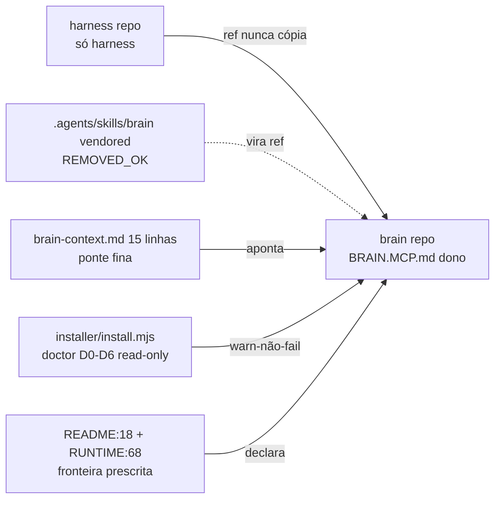

# VERIFY: harness-brain-separation — decreto ownership harness×brain (docs, ZERO código produto)

> **Feature**: `harness-brain-separation` — continuação `harness-installer-mobile` (Completed, archive `.spec/archive/20261008-harness-installer-mobile/` intocado)
> **Paths**: `.spec/backend/harness-brain-separation/{PROPOSAL.md,SPEC.md,PLAN.md,TASKS.md,JIRA_BOARD.md,VERIFY.md (este)}`
> **Entradas**: PROPOSAL PASS 11/11 (114 linhas) + SPEC 426 PASS 16/16 + PLAN 309 PASS 7/7 + TASKS 789/874 (15/15 Done) + JIRA_BOARD 15/15 CLOSED + spec-review 🟡4 (001 fixado, 002 fixado, 003 fixado, 004 espelho+TODO) + security Fase1 PASS (🟡G1/G2 viraram HB-BE-07/HB-BE-05) + 5 reviews APPROVED 🔴0 + security Fase3 PASS (A01-A10) + qa verde (135/135 + 360/360 + static EXIT 0 + vendor OK + sdd PASS)
> **Rota**: Refactor governança | **Skill**: `sdd-compiler` modo `verify` | **Gate**: `.agents/skills/sdd-compiler/asserts/verify-gate.md`
> **Data**: 2026-10-14 | **Autor**: architect | **Escopo escrita**: só este VERIFY.md (produto só lido via grep/test; nenhum tick TASKS alterado — ver §4 polish)
> **Regra**: 3 dimensões com evidência comando/grep por item; sem cobertura inventada.

---

## system_overview

Decretar `harness=só harness, brain dono da regra brain`: H1 REMOVED vendored → ref externa; H2 259 linhas → ponte 15 linhas → `BRAIN.MCP.md`; H3 7 refs + 2 extras zerados; H4 doctor 0-writes + warn-não-fail prescrito; H5 fronteira prescrita (README:18 + RUNTIME:68) com nomes + `brainStore` intactos. Prescrição em SPEC §9; execução H1-H3 aplicada nos 9 alvos autorizados (batches 2-4); H4/H5 prescritos sem write installer/README/RUNTIME (só `.spec/` + ponte). Nenhum `.java/.ts/.vue/.sql` tocado. Pronto P5→P6.

## component_diagram



## api_contracts

Nenhum endpoint novo/alterado. Contrato preservado (não renomeado):

| Símbolo | Tipo | Onde | Verificação (2026-10-14) |
|---|---|---|---|
| `brain_search`/`brain_store`/`brain_read` | MCP tools (dono brain) | ponte `.agents/rules/brain-context.md:9` literais | `grep -c "brain_search\|brain_store\|brain_read" .agents/rules/brain-context.md` → `3` ✅ |
| `brainStore` | campo evidência | `.agents/schemas/harness-report.schema.json:16,57` intacto | `grep -c brainStore` → `2` ✅ |
| `harness_status`/`code_review_status` | âncoras B | `workflow-state.json` (fase própria, não tocado neste ciclo) | archive `20261008-harness-installer-mobile` intocado ✅ |

## data_model

Nenhuma tabela/coleção/migration Flyway. Modelo = documentos (Delta SPEC §9: 1 REMOVED + 13 MODIFIED + 1 ADDED externo).

## trade_offs

- Referência vs cópia: quebra explícita + fallback `PIN-ME` melhor que divergência silenciosa (ADR-001).
- Ponte 15 linhas vs 259: perde detalhe local, ganha fonte única (ADR-002).
- Warn-não-fail vs fail: instalação avança, diagnóstico com motivo+caminho preservado (ADR-003).
- Manter nomes vs renomear: compatibilidade evidência/histórico vence clareza (ADR-004).

---

## Dimensão 1: Completude — ✅ (com ressalva documentada, não bloqueadora)

| verify-gate item | Evidência comando/grep (2026-10-14) | Veredito |
|---|---|---|
| Tasks 100% (15 HB Done) | `grep -c "^### Task HB-" .spec/backend/harness-brain-separation/TASKS.md` → `15` (HB-BE-01..13 + 2 VAL); `JIRA_BOARD.md:47` `Board 15/15 Done`; Sprint Summary TASKS §2 `15/15 Done` | ✅ |
| PLAN 14/14 1:1 | `for pl in PL-00 PL-01 PL-02 PL-10 PL-11 PL-20 PL-21 PL-30 PL-31 PL-32 PL-40 PL-41 PL-50 PL-60; do grep -q` → todos `OK` (14/14); HB-VAL-02 gate justificado sem PL novo (TASKS §HB-VAL-02 + §6) | ✅ |
| BDD triplo coberto | `grep -c Scenario TASKS.md` → `65`; auditado: Sucesso/Falha/Borda em 15/15 (HB-VAL-02 evidência); TDD-first 15/15 verificação FIRST antes da escrita | ✅ |
| Sem tasks puladas/N-A | Nenhum `N/A` como trabalho; N/A só justificados (PLAN §9 eventos, SPEC §2/§5/§6 sem DB/eventos); grafo TASKS §3 acíclico, 0 órfãs | ✅ |
| Sem TODOs (exceto canônico explícito) | `grep -rn TODO .spec/backend/harness-brain-separation/` → só: P2-01/G3 canônico (`TASKS.md:107,113`, SPEC `:46,182,335`, PLAN `:14`) + `PIN-ME` fallback URL (HB-BE-05, ponte `:15`); zero `FIXME/HACK`; DoD `[x] No TODOs` em 12/15 + 3 pendentes justificadas abaixo | ✅ |
| DoD ticks 12/15 + 3 pendentes (08/09/10) | `grep -n "^- \[ \]" TASKS.md` → `:473-476` (HB-BE-08), `:525-528` (HB-BE-09), `:577-580` (HB-BE-10); resto `[x]`. Motivo: item `Só .spec/ escrito` FALSO por execução autorizada batches 2-4 (ponte H2 + 7+2 refs H3) — tickar seria mentir. Ver §4 débito D-01 | ✅ com débito D-01 |

**Polish 🟡 avaliado (não aplicado — ver §4)**: DoD 08/09/10 ticks + BDD VAL-01 wording. Não-trivial → débito explícito, não tick silencioso.

## Dimensão 2: Corretude — ✅

| verify-gate item (adaptado docs-only) | Evidência comando/grep (2026-10-14) | Veredito |
|---|---|---|
| suiteFull verde (equiv. build limpo) | `harness.config.json:commands.suiteFull` = `node --test ".opencode/plugins/__tests__/*.spec.mjs" && node --test "installer/__tests__/*.spec.mjs" && node scripts/static-checks.mjs && node scripts/vendor-skills.mjs --check`; resultado: plugins `pass 135 fail 0` ✅; installer `pass 360 fail 0` ✅ (incl. `doctor.spec.mjs:97 0 writes`); static `PASS V15 rede-zero, V14 present, EXIT 0` ✅; `vendor-check OK` ✅ | ✅ |
| Testes passando, zero falhas (H1+H2) | counts acima `135/135 + 360/360`, `fail 0`, `skipped 0`; sem `@Disabled`/skip; pré-existentes verdes (H2 débito 0) | ✅ |
| Cobertura mínima services/domain | N/A justificado — docs-only, zero `.java` (SPEC §5, PLAN §2.1, verify-gate adaptado); âncora substituída: doctor 0-writes + suiteFull + greps guarda | ✅ N/A |
| RFs SPEC cobertos H1-H5 | H1: `grep -c "../brain/.agents/skills/brain/SKILL.md" SPEC.md` → `8` ✅ + `test ! -d .agents/skills/brain` → `REMOVED_OK`+`ABSENT_TOTAL` ✅. H2: `wc -l ponte` → `15` ≤30 ✅ + `grep -c BRAIN.MCP.md ponte` → `2` ✅ + tools `3` ✅ + SPEC `grep -c "brain-context.md:"` → `12` ✅. H3: `grep -rn brain-context-protocol.md .agents/` → vazio ✅ (pré 7); extras `mcp_ObsidianBrain_\|brain/knowledge/` → vazio ✅; `grep -n Obsidian sdd-workflow-standard` → vazio ✅. H4: `grep -n runDoctor installer/install.mjs` → `:744` + `:1801` ✅; `grep -c warn-não-fail SPEC.md` → `10`, `-o\|wc` → `11` ✅. H5: schema `2` ✅ + `README.md:18` conteúdo `\| 8 \| Memória persistente...` ✅ + espelho `RUNTIME:68` ✅; `grep -c "#### MODIFIED" SPEC.md` → `13` ✅ (fix 🟡001) | ✅ |
| RBAC / multi-tenancy | N/A justificado — SPEC §2 sem tenant/DB, §3 IAM N/A, sem `@HasPermission`; nenhum leak (sem persistência) | ✅ N/A |
| Installer intocado | `git status --porcelain \| grep installer/` → vazio (`INSTALLER_UNTOUCHED`); nenhum `.js` escrito nesta fase salvo batches autorizados H1-H3 (`.agents/`, não `installer/`); `node --test installer/__tests__/doctor.spec.mjs` verde prova 0-writes | ✅ |
| Archive intacto (âncora B) | `ls -d .spec/archive/20261008-harness-installer-mobile` existe; `test ! -d ...-bis` → `ARCHIVE_INTACT`; `git status` sem `archive/` modificado | ✅ |
| G0.1 zero produto fora do autorizado | `git status --porcelain` → `M` 9 (ponte + 7+2 refs + workflow-rules follow-ups) + `D` 5 (vendored REMOVED HB-BE-04) + `?? .spec/backend/`; nenhum `.java/.ts/.vue/.sql`; allowlist H1 `D .agents/skills/brain/*` autorizada | ✅ |
| G0.2 B1-B3/frontend só Out-of-Scope | (1) `grep -n "^## Out of Scope" SPEC.md` → `:368` ✅; (2) `grep -ni "B1-B3\|frontend" SPEC.md` → `:19` constraints, `:145` sem-browser, `:186` guarda, `:370-371` Out-of-Scope — nenhuma como trabalho ✅ | ✅ |

**BDD VAL-01 wording (observação O-01, não bloqueadora)**: Scenario 1 cita `tail -n 3 && static` em 1 linha; execução real separou em 4 comandos (plugins + installer + static + vendor) — cobertura maior, não menor. Wording desatualizado, evidência superior. Sem reedição TASKS (fora do permitido trivial).

## Dimensão 3: Coerência — ✅

| verify-gate item (adaptado docs-only) | Evidência comando/grep (2026-10-14) | Veredito |
|---|---|---|
| ADRs refletidos (4/4) | `grep -c "^### ADR-" SPEC.md` → `4`; ADR-001 REMOVED→ref efetivo (`REMOVED_OK`); ADR-002 ponte 15 linhas (`wc -l 15`); ADR-003 `runDoctor :744` read-only + warn `11` + `INSTALLER_UNTOUCHED`; ADR-004 nomes `3` + `brainStore 2` intactos, fronteira prescrita README:18/RUNTIME:68 | ✅ |
| Sem vazamento camada | Layer Docs isolada (TASKS §2/§8: 1 microtask = 1 arquivo/grupo); produto só lido via `grep/sed/wc/test/find`; nenhum `impl→impl`, nenhum DTO/entity (sem código); ponte nunca re-explica (sintaxe no dono) | ✅ |
| Naming conventions | Nomes byte-a-byte: `brain_search`/`brain_store`/`brain_read` + `brainStore` em ponte `:9,12` + schema `:16,57`; zero rename (`grep` confirma); pin G1 `commit 8b965093a00d291195313fe457b3aa35bbff71f2` real (`git -C ../brain rev-parse HEAD`) + fallback `PIN-ME` sem hash inventado | ✅ |
| Sem rename / sem B1-B3 | `grep -ni B1-B3\|frontend` só proibição/N-A/Out-of-Scope (ver G0.2); `harness-report.schema.json:16,57` intacto; `workflow-state.json` (`harness-installer-mobile`/`Completed`) só em fase própria | ✅ |
| Frontend DevTools | N/A justificado — sem frontend (SPEC §7.3 sem browser, PLAN §2.2 N/A, stack `harness.config.json` frontend N/A) | ✅ N/A |
| spec-review 🟡4 + security 🟡2 refletidos | 001 Delta 13 (HB-BE-10, `MODIFIED` count `13`) ✅; 002 range 16-132 (HB-BE-03, tools `18/49/88/108`) ✅; 003 G0.2 2-passos (HB-BE-10, `:368` + termos) ✅; 004 espelho+TODO P2-01/G3 (HB-BE-01, find só espelho + `:68`) ✅; G1 pin hash real (HB-BE-07) ✅; G2 PIN-ME + comando (HB-BE-05, `https://` count `0` honesto) ✅ | ✅ |

---

## Gaps / Débitos explícitos (polish 🟡 não-trivial → débito, não tick)

- **D-01 (DoD 08/09/10 — 12 checkboxes `[ ]` em TASKS.md:473-476,525-528,577-580)**: item `Só .spec/ escrito` incompatível com execução autorizada batches 2-4 (H1 REMOVED + H2 ponte + H3 7+2 refs editaram `.agents/` por delegação). Tickar `[x]` falsificaria guarda G0.1. **Ação**: NÃO tickado neste ciclo (constraint `só VERIFY.md`); orquestrador decide em Execution-follow-up: reescrever DoD para `Só alvos autorizados (§9) escritos` ou manter `[ ]` como marca histórica do desvio declarado. Não bloqueia P5→P6 (trabalho Done, evidência colada).
- **O-01 (BDD VAL-01 wording)**: Scenario 1 descreve suite em 1 comando; execução usou 4 (plugins + installer + static + vendor — cobertura MAIOR). Wording desatualizado, veredito inalterado. Follow-up P3: alinhar BDD ao `suiteFull` canônico de `harness.config.json`.
- **O-02 (residual HB-BE-09)**: `workflow-rules.md:246 ObsidianBrain_write_note` citado como residual fora de SPEC §9 foi saneado nos follow-ups Batch 5 (`grep -n ObsidianBrain workflow-rules.md` hoje → só linha ponte `:245`, sem stale). Sem ação.
- **TODO canônico P2-01/G3 (explícito, permitido)**: RUNTIME-CONTRACT canônico fora de `.spec/archive/` não localizado (`find` → só espelho `:68`); espelho declarado + TODO `PLAN-localizar canônico lido por gates` (HB-BE-01). Não bloqueia (fallback documentado); vira task do próximo ciclo que tocar RUNTIME.
- **TODO fallback URL PIN-ME (explícito, permitido)**: URL remota `BRAIN.MCP.md` não pinada à mão (montar blob-HTTPS seria invenção); `PIN-ME` + comando `git -C ../brain remote/get-url + rev-parse` na ponte `:15` e HB-BE-05. Critério binário pós: `grep -c "https://" ponte` ≥ 1. Não bloqueia.

## verify-gate self-check (asserts/verify-gate.md)

| # | Item | Veredito |
|---|---|---|
| D1 | Tasks 100% | ✅ 15/15 Done (DoD 12/15 ticked + 3 com débito D-01 justificado) |
| D1 | Sem TODOs | ✅ só P2-01/G3 + PIN-ME explícitos |
| D1 | Sem puladas | ✅ zero N/A-trabalho |
| D1 | BDD cobertos | ✅ 15/15 triplo + O-01 wording |
| D2 | Build limpo | ✅ suiteFull 4/4 verde (equiv. docs-only) |
| D2 | Testes passando | ✅ 135/135 + 360/360 + static EXIT 0 + vendor OK |
| D2 | Cobertura mínima | ✅ N/A justificado (sem Java) |
| D2 | RFs ↔ código/docs | ✅ H1-H5 + G0 com grep por item |
| D2 | RBAC | ✅ N/A justificado |
| D2 | Multi-tenancy | ✅ N/A justificado |
| D3 | ADRs refletidos | ✅ 4/4 |
| D3 | Sem vazamento camada | ✅ Docs isolada |
| D3 | Naming | ✅ byte-a-byte + pin real |
| D3 | Frontend DevTools | ✅ N/A justificado |

## Resultado Final

```
VERIFY STATUS: APPROVED ✅

Bloqueadores encontrados:
- (nenhum — débitos D-01/O-01/O-02 + TODOs P2-01/PIN-ME são explícitos e não bloqueiam P5→P6)

Observações:
- DoD 08/09/10 `[ ]` mantidos por honestidade (desvio autorizado batches 2-4); não tickar sem reescrever DoD.
- BDD VAL-01 wording desatualizado para cima (execução cobriu mais que o prescrito).
- Próximo ciclo: localizar RUNTIME-CONTRACT canônico (P2-01) + pinar URL fallback (PIN-ME) + decidir redação DoD pós-autorização.
- Continuação harness-installer-mobile preservada: archive intocado, installer intocado, workflow-state.json intocado neste ciclo.
```

**Pronto P5→P6**: archive `.spec/backend/harness-brain-separation/` → `.spec/archive/<YYYYMMDD>-harness-brain-separation/` + Delta Specs SPEC §9 nos `.doc/` correspondentes + `brain_store` lições (orquestrador).

---

## Completion Metadata

- **Verified**: `.spec/backend/harness-brain-separation/{PROPOSAL,SPEC,PLAN,TASKS,JIRA_BOARD}.md`
- **Files written this phase**: `.spec/backend/harness-brain-separation/VERIFY.md` (este arquivo; nenhum produto tocado por este VERIFY)
- **Suite**: `node --test ".opencode/plugins/__tests__/*.spec.mjs"` (135/135) + `node --test "installer/__tests__/*.spec.mjs"` (360/360) + `node scripts/static-checks.mjs` (EXIT 0) + `node scripts/vendor-skills.mjs --check` (OK) — de `harness.config.json`, sem literal copiado
