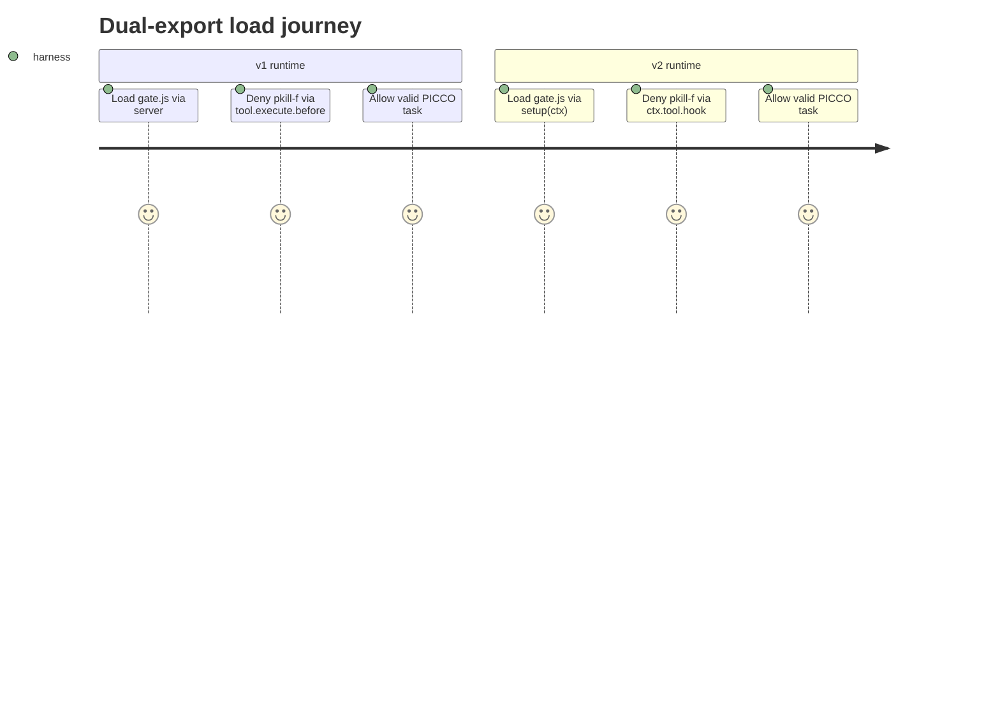

# Architecture & Software Specification: Migração Plugins Opencode v1 → v2 (dual-export)

> **ID**: `opencode-v2-plugin-migration`
> **Status**: `SPEC`
> **Author**: architect (subagent)
> **Date**: 2026-10-15
> **Source**: `.spec/backend/opencode-v2-plugin-migration/PROPOSAL.md` (aprovado)
> **Type**: refactor (SPEC apenas, sem PLAN/TASKS/implementação)
> **Scope**: adapter dual v1+v2 sem mudar semântica deny; núcleos puros invariantes

---

## 0. Contexto & Escopo

### 0.1 Problema (do PROPOSAL)

Harness registra gates em `opencode.json` no formato v1 (`"plugin"`, `"permission.task"`,
`"agent.{name}.prompt"`) e implementa o núcleo em `.opencode/plugins/gate.js`
(933 linhas, entry `export default { id: "harness-gate", server: HarnessGate }` —
`.opencode/plugins/gate.js:933`), com satélites `.opencode/plugins/harness-validator.js`
(no-op) e `.opencode/plugins/hitl-guardrail.js` (no-op). Doc oficial v2 declara
plugins v1 **não rodam** em v2. Sem migração, ao adotar runtime v2 os gates
GATE-01..GATE-05 silenciosamente deixam de carregar — enforcement some sem log de deny.

### 0.2 In Scope

- Adapter dual-export (`server` v1 mantido + `setup(ctx)` v2 via `Plugin.define`)
  em `.opencode/plugins/gate.js`, `.opencode/plugins/harness-validator.js`,
  `.opencode/plugins/hitl-guardrail.js` — sem mudar lógica de gates.
- Migração compatível de `opencode.json` (`opencode.json:3,7-9,13`):
  `plugin`→`plugins`, `permission`→`permissions`, `agent.*.prompt`→`agents.*.system`,
  com leitura dual v1+v2 durante transição.
- Matriz de verificação: suíte `.opencode/plugins/__tests__/*.spec.mjs` verde +
  smoke load v1 (1.18.30) e v2.

### 0.3 Out of Scope

- Alterar GATE-01..GATE-05, `DenyError`/fail-open (ADR-006), kill-switch
  `HARNESS_GATES=off` (ADR-009) — núcleos puros invariantes.
- Criar novos gates, mudar `harness.config.json`, `lib/config.mjs`, `lib/seal.mjs`.
- Remover suporte v1, reescrever testes, tocar em `src/` backend/frontend, migrations.
- PLAN/TASKS/implementação — SPEC apenas. **Nunca editar plugins ou `opencode.json` nesta fase.**

---

## 1. Architecture Decision Records (ADRs)

### ADR-001: Dual-export v1+v2 (manter `{ id, server }` + adicionar `setup` via `Plugin.define`)

- **Decision**: Cada um dos 3 plugins expõe **ambos** os entries: o export v1
  `export default { id, server }` intacto (`.opencode/plugins/gate.js:933`) **e**
  um entry v2 `Plugin.define({ id, setup(ctx) })` (suporte desde 1.18.29+, alvo
  1.18.30). O loader v1 usa `server`; o runtime v2 usa `setup`. Nenhum arquivo
  `.v2.js` separado.
- **Context**: Rewrite v2-only quebra runtime v1; fork duplica 933 linhas e diverge
  núcleos. Doc v2 `migrate-v1`: `Plugin.define({ id, setup(ctx) })`,
  `ctx.tool.hook` / `ctx.session.hook` / `ctx.event.subscribe`; config
  `plugin`→`plugins` (objetos), `permission`→`permissions`,
  `agent.prompt`→`agents.system`.
- **Trade-offs**: +compat retroativa total, +single source of truth; −payload de
  registro duplicado (2 call sites de wiring por hook, lógica compartilhada);
  −risco de config ignorada por um dos runtimes (mitigado por config dual §4 + teste loader).
- **Consequence**: `grep "server:" .opencode/plugins/*.js` = 3 ocorrências;
  `grep "setup" .opencode/plugins/*.js` ≥ 3 ocorrências + smoke load v1 e v2 sem erro.

### ADR-002: Adapter fino — `server` e `setup` delegam aos mesmos núcleos puros

- **Decision**: Camada fina de adaptação: o dispatcher v1 (`HarnessGate`,
  `.opencode/plugins/gate.js:854`) e o registro v2 (`setup` via `ctx.tool.hook` /
  `ctx.session.hook` / `ctx.event.subscribe`) chamam **os mesmos** núcleos puros:
  `decide` (`gate.js:156`), `gatePiccoTask` (`:323`), `gateCompletionAnchorA` (`:592`),
  `gatePhaseAnchorB` (`:682`), `gateHitlBatch` (`:755`), `gateShellHygiene` (`:813`),
  `HarnessGate`, `CORE_GATES` + `registerCoreGate` (`:176-187`), `loadConfigOrDeny` /
  `ensureConfig` (`:215-237`). Zero lógica de deny no adapter; adapter só traduz
  envelope `{tool,sessionID,callID,args}` v1 ↔ payload v2.
- **Context**: KISS + DRY; qualquer semântica deny duplicada diverge (fail-open
  ADR-006 viraria fail-inconsistente entre runtimes).
- **Trade-offs**: +garantia 1:1 deny/allow; +testes existentes cobrem ambos os
  entries sem duplicação; −adapter precisa de shim de normalização de args
  (string vs objeto, `args.filePath`/`args.patchText`, dois shapes de `write` — H6).
- **Consequence**: Invariante INV-01..INV-05 (§7); suíte `__tests__/*.spec.mjs`
  como gate verde obrigatório.

### ADR-003: Config dual `opencode.json` (chaves v1+v2 legíveis nos dois runtimes)

- **Decision**: `opencode.json` carrega **ambas** as chaves durante a transição:
  `plugin` (array de paths v1, `opencode.json:3`) **e** `plugins` (objetos v2);
  `permission: { task: "ask" }` (`opencode.json:7-9`) **e**
  `permissions: { subagent: "ask", shell: <equiv> }` (`task`→`subagent`, `bash`→`shell`);
  `agent.*.prompt: "{file:...}"` (`opencode.json:13`) **e** `agents.*.system`
  (mesmo `{file:...}`). Loader (`loadConfigOrDeny`/`ensureConfig`,
  `.opencode/plugins/gate.js:215-237`) lê qualquer shape; precedência documentada:
  chave v2 vence quando ambas presentes, v1 como fallback.
- **Context**: Runtime antigo ignora chaves novas e vice-versa; remover v1 quebra
  1.18.30; remover v2 quebra runtime v2.
- **Trade-offs**: +transição sem flag day; −duplicação temporária de config
  (removal só em PROPOSAL/SPEC futuro pós-verificação v2-only); −risco de
  divergência entre chaves (mitigado por teste de loader nos dois shapes + lint
  de paridade).
- **Consequence**: Teste de loader: mesma decisão deny/allow lendo shape v1 e shape v2.

### ADR-004 (herdado, reafirmado): Fail-open tipado ADR-006 + kill-switch ADR-009 intactos

- **Decision**: Preservar 1:1: só `throw new DenyError(reason, details)`
  (`gate.js:61`) nega; qualquer outro erro → log `error` + allow (fail-open);
  kill-switch **somente** env host `HARNESS_GATES=off` (`gate.js:54-55,70`);
  `gates.*` em `harness.config.json` é informativo e **nunca** desliga.
- **Context**: Sem este invariante a migração vira mudança de política de segurança.
- **Consequence**: INV-03, INV-04 (§7); nenhum `catch` novo no adapter que converta
  erro genérico em deny.

---

## 2. Domain Context, Tenant Strategy & Provisioning

- **Bounded Context**: `harness-plugin-runtime` — adaptação de carregamento de
  plugins opencode. Não é domínio de negócio; não cria entidades, endpoints, filas.
- **System Type**: Plugin host-local (JS ESM, Node). Sem backend Java/Vue, sem DB.
- **Tenant Provisioning / Lifecycle**: N/A — plugins são locais ao repo, sem
  isolamento de tenant (conforme PROPOSAL §4). Nenhuma decisão multi-tenant.
- **DDD Modular**: N/A (sem `api/`/`impl/`/`public`). Equivalente respeitado:
  núcleos puros (`decide`, `gate*`) = domínio; `server`/`setup` = adapters;
  adapter nunca contém regra de negócio.

---

## 3. Identity & Access Management (IAM)

N/A para spec-gate JWT/`@HasPermission` (sem endpoints, sem Keycloak/Auth0).
Modelo de autorização aplicável = enforcement dos gates via `DenyError`:

| Role (agente) | Recurso | Efeito | Mecanismo |
|---|---|---|---|
| `orchestrator`/`code-reviewer`/`ux-designer` | paths fora da allowlist | deny `orch-write-outside-allowlist` / `write-denied-for-role` | `gate.js:434` `checkWriteAccess`, `gate.js:465` `isCompletionWrite` (I5, I9) |
| qualquer agente | `bash` com `pkill -f` | deny `pkill-f` | `gate.js:813` `gateShellHygiene`, `isPkillF` (I7) |
| qualquer agente | `bash` com redirect/tee em path protegido | deny `protected-path-write` | `gate.js:813` `bashProtectedWrites` (I9) |
| qualquer agente | `task` sem PICCO válido | deny `picco-tag-absent`/`nonempty` | `gate.js:323` `gatePiccoTask` (I1) |
| qualquer agente | `Completed` sem evidência/contraprova | deny `completed-no-evidence`/`contraprove-divergent`/`timeout`/`prev-cycle-not-completed` | `gate.js:592,682` âncoras A+B (I2) |
| qualquer agente | batch sem pausa HITL | deny `hitl-pause-required` | `gate.js:755` `gateHitlBatch` (I6) |

Kill-switch: `HARNESS_GATES=off` no processo host desliga enforcement (KILL).
Sessão→agente resolvido via `sessionAgentMap` (`gate.js:237-250`), alimentado por
`chat.params`/`chat.message` (I11).

---

## 4. Config Migration Contract (`opencode.json`)

### 4.1 Tabela de chaves v1 → v2 (dual durante transição)

| # | Chave v1 (atual, `opencode.json`) | Chave v2 (alvo) | Regra dual |
|---|---|---|---|
| C1 | `"plugin": [...]` (`opencode.json:3`, array de paths) | `"plugins": [...]` (array de **objetos**) | manter ambas; v2 vence se ambas presentes |
| C2 | `"permission": { "task": "ask" }` (`opencode.json:7-9`) | `"permissions": { "subagent": "ask", "shell": <equiv> }` | `task`→`subagent`, `bash`→`shell`; manter ambas |
| C3 | `"agent": { "<name>": { "prompt": "{file:...}" } }` (`opencode.json:10-92`) | `"agents": { "<name>": { "system": "{file:...}" } }` | mesmo `{file:...}` nos dois; `prompt`→`system`; manter ambas |
| C4 | `tools: { write/edit/bash }` por agente (`opencode.json:14-18` e demais) | inalterado (camada nativa, I5) | sem mudança; `bash` contorna `write/edit:false` — declarado (I5 🟠) |

### 4.2 Precedência e loader

- `loadConfigOrDeny` (`gate.js:215`) / `ensureConfig` (`gate.js:225`) **inalterados**;
  resolvem comandos sempre do `harness.config.json` (nunca literal copiado).
- Loader de `opencode.json`: ler shape v1 **ou** v2; se ambos presentes, v2 vence,
  v1 é fallback. Teste de paridade: mesma fixture deny/allow passa nos dois shapes.
- Remoção das chaves v1: **fora de escopo** — exige PROPOSAL/SPEC futuro.

---

## 5. Hook Registry: mapeamento V1 → V2 (H1–H6 obrigatório)

Fonte v1 confirmada: `HarnessGate` retorna
`{ "tool.execute.before": runGates, "chat.params": ..., "chat.message": ... }`
(`.opencode/plugins/gate.js:893-913`); dispatcher `runGates` itera `CORE_GATES`
(`gate.js:901`); mapa sessão→agente via `noteChatParams`/`recordSessionAgent`
(`gate.js:239-257`); fronteira de turno humano via `isHumanMessage`/`resetHitlTracker`
(`gate.js:260-752`). Proibições herdadas: nunca `ask` (H1), nunca scalar
system-transform (H2/G14), nunca filtrar evento de bus inexistente (H3/N7) —
comentários `.opencode/plugins/gate.js:22-24`, `.opencode/plugins/harness-validator.js:1-14`,
`.opencode/plugins/hitl-guardrail.js:1-14`.

| Hook ID | Semântica (RUNTIME-CONTRACT) | Registro v1 (atual) | Registro v2 (alvo) | Núcleo invocado | Proibição |
|---|---|---|---|---|---|
| H1 | `permission.ask` **NÃO EXISTE** (0 call sites). Nenhum gate o usa | ausente (correto) | **não registrar** `ctx.tool.hook("ask",…)` nem `ctx.event.subscribe("ask",…)` — asserção `permission-ask-absent` | nenhum | 🔴 registrar H1 = defeito bloqueador |
| H2 | `output.system = string` **não propaga** (system-transform scalar). Re-injeção de prosa = no-op silencioso (G14/N5) | ausente (removido em FIX-01) | **não registrar** transform de sistema que atribui scalar; nenhum `ctx.session.hook` que re-injete regra em prosa | nenhum (`harness-validator.js`, `hitl-guardrail.js` seguem no-op) | 🔴 re-injetar prosa = defeito (vira no-op divergente) |
| H3 | evento de bus `tool.execute.after` **NÃO EXISTE** (N7); observação usa o hook confirmado `tool.execute.after` (7 call sites) | ausente (removido em FIX-01; contraprova observer futuro só no hook confirmado) | `ctx.event.subscribe` **somente** em nomes confirmados; **nunca** filtrar nome inexistente (`bus-event-dead-handler` nunca dispara) | nenhum nesta fase (contraprova observer = futuro, fora de escopo) | 🔴 filtrar evento inexistente = defeito silencioso |
| H4 | `permission.bash` casa **comando**, não alvo; parse `gateShellHygiene` é evadível (`bash -c`, `python -c`), backstop = CI (ADR-007) | `tool.execute.before: runGates` → `gateShellHygiene` (`gate.js:813`, `SHELL_TOOLS`, `extractBashCommand`, `isPkillF`, `bashProtectedWrites`) | `ctx.tool.hook("bash"‖shell-tool, "before", shim)` → mesmo `gateShellHygiene` com envelope normalizado `{tool,args,sessionID}`; nome da tool v2 `shell` mapeado para `SHELL_TOOLS` | `gateShellHygiene` + `decide` | declarar garantia 🟢 = defeito; garantia correta 🟠 parcial/CI |
| H5 | **Prosa não é negada.** Nenhum hook bloqueia declaração em linguagem natural | nenhum (correto) | **não criar** hook que alegue bloquear prosa; fuga de prosa coberta por processo + âncora B | nenhum | 🔴 afirmar bloqueio de prosa = gate órfão |
| H6 | Deny primitivo = `throw` em `tool.execute.before`; âncora A checa paths em `args.filePath`/`args.patchText` (dois shapes de `write`); mapa sessão→agente via `chat.params`; fronteira de turno humano via `chat.message` | `tool.execute.before: runGates` (deny via `throw DenyError`, `gate.js:854-901`); `chat.params: noteChatParams` (`gate.js:907`); `chat.message: resetHitlTracker` se `isHumanMessage` (`gate.js:910-919`) | `ctx.tool.hook(<tool>, "before", runGatesShim)` para cada tool com gate (incl. `task`, `write`, `bash`/`shell`); `ctx.session.hook("params"‖equiv, noteChatParamsShim)`; `ctx.session.hook("message"‖equiv, humanBoundaryShim)`; alternativamente `ctx.event.subscribe(<nome-confirmado>, …)` **somente** se o nome constar no RUNTIME-CONTRACT §2 | `decide` + `CORE_GATES` (`gatePiccoTask`, `gateCompletionAnchorA`, `gatePhaseAnchorB`, `gateHitlBatch`, `gateShellHygiene`); `modeForGate`/`resolveMode` (`gate.js:76-95`); `sessionAgentMap` (`gate.js:237-250`); `hitlTrackerFor`/`resetHitlTracker` (`gate.js:744-752`) | usar hook fora do §2 = defeito; atribuir output scalar = defeito (G14/H2) |

**Regra de ouro**: hook sem equivalente v2 confirmado ⇒ **não registrar em silêncio**;
diagnóstico fail-closed visível (erro/log) + smoke v2 que asserta cada gate registrado
(risco PROPOSAL §6 linha 2). Mapear hook inexistente = defeito bloqueador.

### 5.1 Shims v2 (assinatura prescrita, sem lógica de deny)

- `runGatesShim(v2Payload)` → normaliza para `{tool, sessionID, callID, args,
  config/statePath/configPath/env/report/sessionAgent}` idêntico ao `base`/`ctx`
  de `HarnessGate` (`gate.js:860-919`) e chama o mesmo loop `decide`.
- `noteChatParamsShim` → `noteChatParams` (`gate.js:253`) + `recordSessionAgent` (`:239`).
- `humanBoundaryShim` → `isHumanMessage` (`gate.js:260`) + `resetHitlTracker` (`:750`).
- Normalização H6: `args` string vs objeto, `extractPromptText` (`gate.js:284`),
  `extractWriteTargets` (`:411`), `extractBashCommand` (`:775`), `normalizePath`/`matchGlob`
  (`:341-351`).

---

## 6. Data Model, Event Model & Migrations

- **ERD**: N/A — sem entidades, sem persistência, sem tenant_id.
- **Event Registry**: N/A para negócio. Registro de hooks = §5 acima (único produtor/
  consumidor: runtime opencode → adapter → núcleos puros; idempotência N/A).
- **Migrations**: N/A — nenhum SQL/Flyway. Mudança de config (`opencode.json`)
  versionada em git; rollback = revert + `HARNESS_GATES=off` (runtime, ADR-009).

---

## 7. Invariantes (propriedades testáveis)

| ID | Propriedade (sempre verdadeira) | Mecanismo | Teste |
|---|---|---|---|
| INV-01 | Dual-export: `server` v1 intacto **e** `setup` v2 presente nos 3 plugins | ADR-001 | `grep "server:" .opencode/plugins/*.js` = 3; `grep "setup" .opencode/plugins/*.js` ≥ 3; load v1 1.18.30 + load v2 sem `Plugin export is not a function` |
| INV-02 | Paridade deny/allow: mesma fixture nega/permite identicamente via `server` e via `setup` para ao menos 1 DenyError e 1 allow | ADR-002 | matriz v1/v2: `gatePiccoTask` deny sem PICCO + allow com PICCO válido; `gateShellHygiene` deny `pkill -f` |
| INV-03 | Fail-open: só `DenyError` nega; erro genérico ⇒ allow + log `error` (I8) | ADR-004, `decide` `gate.js:156` | fixture throw `Error` genérico ⇒ allow; `DenyError` ⇒ deny (ambos os entries) |
| INV-04 | Kill-switch: só `HARNESS_GATES=off` (host env) desliga; `gates.*` config nunca desliga (KILL) | ADR-004, `isKillSwitchOff` `gate.js:70` | `HARNESS_GATES=off` ⇒ allow; `gates.*=off` em config ⇒ ainda deny |
| INV-05 | Núcleos puros intactos: `decide`, `gate*`, `HarnessGate`, `lib/config.mjs`, `lib/seal.mjs` byte-idênticos (exceto registro) | ADR-002 | diff de funções puras vazio; suíte `__tests__/*.spec.mjs` 100% verde |
| INV-06 | No-ops seguem no-ops: `harness-validator.js`, `hitl-guardrail.js` sem enforcement divergente | constraint 5 | suíte verde + grep sem `DenyError` nesses 2 arquivos |
| INV-07 | Hooks proibidos ausentes: sem `ask` (H1), sem scalar system-transform (H2), sem filtro de evento inexistente (H3), sem bloqueio de prosa (H5) | §5 | grep negativo nos 3 plugins + smoke v2 assertando registro por gate |
| INV-08 | Config dual legível: mesma decisão lendo shape v1 e shape v2 (C1–C3, §4) | ADR-003 | teste loader: fixture deny/allow com `plugin` vs `plugins`, `permission.task` vs `permissions.subagent/shell`, `agent.*.prompt` vs `agents.*.system` |

### Workflow & State Invariants

- `Completed` exige escrita via estruturada + contraprova + `prev-cycle-completed`
  (I2, âncoras A+B) — inalterado, só re-registrado em v2.
- Batch exige pausa HITL exceto loop `developer-engineer → code-reviewer` 2 calls
  (I6) — inalterado.

---

## 8. Functional Requirements & Core Journeys

### RF-01 — Adapter dual em `gate.js`
**Dado** runtime v1 (1.18.30) **quando** carrega `.opencode/plugins/gate.js`
**então** `server(HarnessGate)` registra `tool.execute.before`/`chat.params`/`chat.message`
e nega/permite 1:1 com o baseline. **E dado** runtime v2 **quando** carrega o mesmo
arquivo **então** `setup(ctx)` registra `ctx.tool.hook`/`ctx.session.hook`/
`ctx.event.subscribe` (§5) e nega/permite 1:1 (INV-02).
*Teste*: load v1 + load v2 + matriz deny/allow.

### RF-02 — Dual-export nos satélites no-op
**Dado** `harness-validator.js` / `hitl-guardrail.js` **quando** carregados em v1 ou v2
**então** carregam sem erro e **não** negam nada (INV-06).
*Teste*: load + chamada retorna `{}`/allow.

### RF-03 — Config dual `opencode.json`
**Dado** `opencode.json` com chaves v1+v2 (§4 C1–C3) **quando** lido por runtime v1
**então** usa `plugin`/`permission`/`agent.*.prompt`; **quando** lido por v2
**então** usa `plugins`/`permissions`/`agents.*.system`; ambos produzem mesma decisão
(INV-08). Precedência: v2 vence se ambas presentes.
*Teste*: loader parity nos dois shapes.

### RF-04 — Smoke dual v1/v2
**Dado** suíte `.opencode/plugins/__tests__/*.spec.mjs` verde (INV-05)
**quando** executado smoke de matriz **então** ≥1 DenyError e ≥1 allow idênticos
em v1 e v2, sem `Plugin export is not a function`, sem gate silenciosamente ausente
(hook sem equivalente ⇒ erro visível, §5 regra de ouro).
*Teste*: script de matriz v1/v2.

### RF-05 — Proibições (defeitos bloqueadores)
Adapter **não deve**: mapear hook inexistente (H1/H3/H5), re-injetar prosa via
scalar (H2), tocar em núcleo puro, remover `server`, ativar enforcement nos no-ops,
nem alegar garantia 🟢 para H4/H6-parcial (I7 🟠, I9 🔴/🟠).
*Teste*: greps negativos + revisão de diff (só adapter + registro).



---

## 9. Test Strategy

- **Unitários (núcleos, inalterados)**: `node --test ".opencode/plugins/__tests__/*.spec.mjs"`
  (`gate.spec.mjs`, `config-loader.spec.mjs`, `seal.spec.mjs`, `dogfood.spec.mjs`,
  `sdd-checks.spec.mjs`, `report-schema.spec.mjs`) — 100% verde antes e depois (INV-05).
  Comandos/portas de `harness.config.json`, nunca literal copiado.
- **Paridade adapter (novo, prescrito para PLAN/TASKS)**: matriz v1(`server`)×v2(`setup`)
  × {deny PICCO, allow PICCO, deny `pkill -f`, allow bash limpo, fail-open genérico,
  kill-switch `off` vs `gates.*`}; loader parity v1-shape×v2-shape (C1–C3);
  greps negativos H1/H2/H3/H5.
- **Smoke load**: `node -e import()` dos 3 plugins em modo v1 (1.18.30) e stub v2
  (`{tool:{hook},session:{hook},event:{subscribe}}`) sem throw de registro.
- **Estático**: `node scripts/static-checks.mjs` (suiteFull em `harness.config.json`
  + CI `harness-integrity.yml`); V3 sem literais de projeto; V15 em `installer/` se tocado
  (não previsto).
- **Cobertura mínima**: núcleos 100% preservados (diff vazio); adapter coberto pela
  matriz (deny+allow por entry).

---

## 10. Non-Functional Requirements

- **Segurança**: enforcement preservado 1:1; fail-open ADR-006 + kill-switch ADR-009
  intactos; sem segredo em log (scrub, I10); sem nova permissão; risco = ausência
  silenciosa de gates — mitigado por smoke dual + diagnóstico fail-closed visível.
  Detalhe: §11 Security Assessment.
- **Observabilidade**: deny com `reason` acionável (comando, exit code, contagens,
  tag ausente); logs via `toLogger` (`gate.js:838-852`, best-effort, nunca quebra call);
  `service: "harness-gate"`, níveis `warn`/`error`.
- **Performance**: adapter O(1) por hook (só normalização de envelope); sem I/O novo;
  contraprova mantém `contraproveTimeoutMs` ⇒ deny `contraprove-timeout` (TIME).
- **Rollback**: `HARNESS_GATES=off` (runtime) ou revert do commit + chaves v1 ainda
  presentes (config dual). Sem migração de dados.
- **SLA**: sem degradação vs baseline (mesmo loop `decide`, mesmos gates).

---

## 11. Security Assessment — Fase 1 (security-review)

### Threat Model (STRIDE)

| Threat | Flow | Risk | Mitigation (nesta SPEC) |
|---|---|---|---|
| Spoofing (sessão→agente forjado) | `chat.params` v1 → `ctx.session.hook` v2 (I11) | Medium | shim chama `noteChatParams`/`recordSessionAgent` 1:1 (`gate.js:239-257`); sem nova fonte de identidade; `resolveSessionAgent` (`:243`) inalterado |
| Tampering (config dual divergente) | `opencode.json` C1–C3 (§4) | Medium | precedência v2-vence documentada; teste parity INV-08; `gates.*` nunca desliga (ADR-009/INV-04); comandos sempre do `harness.config.json` |
| Tampering (núcleo alterado) | adapter em `gate.js` | High | núcleos byte-idênticos (INV-05); diff restrito a registro; suíte verde obrigatória |
| Repudiation (deny sem rastro) | deny/allow nos dois entries | Low | `reason` acionável + `toLogger` preservados; `report`/`publishedSeal` (`gate.js:579,694`) inalterados |
| Information Disclosure (segredo em log) | `DenyError.details` em v2 | Medium | scrub antes do log (I10) mantido; shims não logam `args` brutos; log só `reason` + metadados |
| Denial of Service (adapter crash paralisa loop) | `setup` throw no registro | Medium | registro nunca `throw` para negar; `decide` fail-open preservado (INV-03); `toLogger` best-effort; smoke de load |
| Elevation of Privilege (gate ausente em v2 ⇒ allow silencioso) | H1–H6 remapeamento (§5) | **High** | regra de ouro: hook sem equivalente ⇒ erro visível; smoke v2 asserta cada gate registrado (RF-04); proibições H1/H2/H3/H5 como defeitos bloqueadores (INV-07) |
| Elevation (kill-switch via config gravável por `bash`) | `gates.*` vs env | High | ADR-009 reafirmado: só host env desliga (INV-04); fato documentado (KILL) |

### Requirements Coverage (Fase 1 checklist adaptado a plugins locais)

- [x] Enforcement preservado 1:1 (deny só `DenyError`, fail-open genérico) — INV-03
- [x] Kill-switch server-side (host env, não config gravável) — INV-04
- [x] Input handling: normalização de `args` sem `eval`, sem concatenação em query (N/A SQL; parse `bashProtectedWrites` com regex bounded) — shims §5.1
- [x] Sem segredo em código/log (`I10` scrub; sem credenciais nesta SPEC)
- [x] Sem rede nova (`installer/` intocado; V15 N/A)
- [x] Sem nova superfície de permissão (config C4 inalterada)
- [x] Rollback/kill-switch operacional (§10)
- [x] N/A: JWT/`@HasPermission`, TLS, rate-limit, actuator/Swagger (sem endpoints/rede)

### Gaps

- 🔴 Critical: none (nenhum endpoint, nenhum segredo, nenhum hook novo com poder de deny além do 1:1).
- 🟠 High: H-elevate (gate ausente em v2) — mitigado por RF-04 + INV-07, verificação obrigatória no PLAN (smoke por gate).
- 🟡 Medium: I-disclosure via `details` — mitigado por scrub herdado; PLAN deve incluir caso de teste "deny não vaza path absoluto/segredo".
- 🟢 Low: divergência futura das chaves duais — removal fora de escopo, com PROPOSAL futuro.

### Verdict

- **pass** (Fase 1) — sem 🔴; 🟠/🟡 com mitigação prescrita e teste correspondente.

---

## 12. Constraints (máx. 10)

1. Dual-export obrigatório: manter `{ id, server }` v1 + adicionar `setup(ctx)` v2; nunca remover v1 nesta migração.
2. Núcleos puros intactos: `decide`, `gatePiccoTask`, `gateCompletionAnchorA/B`, `gateHitlBatch`, `gateShellHygiene`, `HarnessGate`, `CORE_GATES`, `lib/config.mjs`, `lib/seal.mjs`.
3. Fail-open ADR-006 e kill-switch `HARNESS_GATES=off` ADR-009 intactos; `gates.*` nunca desliga.
4. `harness-validator.js` e `hitl-guardrail.js` seguem no-op (sem `DenyError`).
5. Mapear hooks somente aos confirmados em RUNTIME-CONTRACT §2 (H1–H6, §5); hook sem equivalente ⇒ erro visível, nunca silêncio.
6. Nunca: re-injetar prosa via scalar (H2), filtrar evento inexistente (H3), usar `ask` (H1), afirmar bloqueio de prosa (H5).
7. Citar paths com linha (`opencode.json:3`, `.opencode/plugins/gate.js:933`, etc.).
8. Nunca editar plugins ou `opencode.json` nesta fase (SPEC apenas).
9. Suíte `__tests__/*.spec.mjs` 100% verde como invariante + smoke dual v1/v2.
10. Delta ADDED/MODIFIED/REMOVED preenchida (§13); SPEC single-file.

---

## 13. Delta Specs

> **Feature ID**: `opencode-v2-plugin-migration`
> **SPEC Source**: `.spec/backend/opencode-v2-plugin-migration/SPEC.md`
> **Purpose**: Rastrear exatamente o que muda em documentos existentes quando esta feature for arquivada.

---

## Delta: `.agents/rules/workflow-rules.md`

### MODIFIED
> **Seção alvo**: `## 5. Harness Contínuo` — Anexo A (comandos) + nota de registro de plugins
```
> Nota dual-runtime (opencode v2): os gates Harness carregam em dual-export
> v1 (`server`, `.opencode/plugins/gate.js:933`) + v2 (`setup` via `Plugin.define`,
> `ctx.tool.hook` / `ctx.session.hook` / `ctx.event.subscribe`). Registro v1:
> `opencode.json` chaves `plugin` / `permission.task` / `agent.*.prompt`;
> registro v2: `plugins` (objetos) / `permissions` (`subagent`, `shell`) /
> `agents.*.system`. Durante a transição ambas as chaves coexistem (v2 vence).
> Mapeamento hook-a-hook H1–H6: `.spec/backend/opencode-v2-plugin-migration/SPEC.md` §5.
> Proibido: `ask` (H1), scalar system-transform (H2), filtro de evento inexistente (H3).
```

### ADDED
```
> **Inserir após**: `### Anexo A — Comandos`
> #### Anexo A.1 — Smoke dual v1/v2 (migração opencode v2)
> Suite: `node --test ".opencode/plugins/__tests__/*.spec.mjs"` verde +
> smoke load v1 (1.18.30) e v2 por plugin + matriz deny/allow
> (`gatePiccoTask`, `gateShellHygiene` pkill-f) idêntica nos dois entries.
> Hook sem equivalente v2 ⇒ erro visível (nunca silêncio).
```

### REMOVED
> **Seção alvo**: nenhuma nesta SPEC
> **Motivo**: N/A — remoção das chaves v1 só em SPEC futura pós-verificação v2-only.

---

## Delta: `.agents/rules/gate-contract.md`

### MODIFIED
> **Seção alvo**: `## 1. Onde mora cada negação` — coluna Mecanismo (linhas I1–I9, I11, KILL)
```
> Coluna Mecanismo passa a citar os dois registros: v1
> (`tool.execute.before` / `chat.params` / `chat.message` via `server(HarnessGate)`,
> `.opencode/plugins/gate.js:854-919`) e v2 (`ctx.tool.hook(_, "before", …)` /
> `ctx.session.hook(…)` / `ctx.event.subscribe(<nome-confirmado>)` via `setup`,
> mesmos núcleos `decide` + `CORE_GATES`). Semântica deny 1:1 (só `DenyError` nega,
> ADR-006; kill-switch só `HARNESS_GATES=off`, ADR-009). Tabela H1–H6 v1→v2:
> `.spec/backend/opencode-v2-plugin-migration/SPEC.md` §5.
```

### ADDED
```
> **Inserir após**: `## 2. Não-promessas explícitas`
> 6. **Dual-export não duplica poder de deny.** `server` e `setup` chamam os mesmos
>    núcleos (`decide`, `gate*`, `HarnessGate`); adapter sem lógica de deny, só
>    normalização de envelope (RUNTIME-CONTRACT H6). Divergência deny/allow entre
>    entries = defeito bloqueador (SPEC §7 INV-02).
```

### REMOVED
> **Seção alvo**: nenhuma nesta SPEC
> **Motivo**: N/A.

---

## Delta: `AGENTS.md` (raiz — `spec-developed.md` vigente; re-apontar se `AGENTS.md` existir)

### ADDED
```
> **Inserir após**: seção de plugins/config do `spec-developed.md`/`AGENTS.md`
> ### Plugins opencode: dual v1+v2 (migração)
> - Registro v1: `opencode.json` `plugin` (paths), `permission.task`, `agent.*.prompt`.
> - Registro v2: `plugins` (objetos), `permissions` (`subagent`, `shell`), `agents.*.system`.
> - Transição: ambas presentes (v2 vence); núcleos puros e fail-open inalterados.
> - Ver: `.spec/backend/opencode-v2-plugin-migration/SPEC.md` §§4–5.
```

### MODIFIED
> **Seção alvo**: seção de plugins/config (`opencode.json`: `plugins`, `permissions`, `agents.system`)
```
> (quando a seção existir apenas com chaves v1, atualizá-la para documentar as
> chaves duais conforme ADDED acima, mantendo os paths com linha.)
```

### REMOVED
> **Seção alvo**: nenhuma nesta SPEC
> **Motivo**: N/A.

---

## Resumo do Impacto

| Documento | ADDED | MODIFIED | REMOVED |
|---|---|---|---|
| `.agents/rules/workflow-rules.md` | 1 (Anexo A.1 smoke dual) | 1 (§5 nota dual-runtime) | 0 |
| `.agents/rules/gate-contract.md` | 1 (item 6 dual-export) | 1 (§1 mecanismos v1+v2) | 0 |
| `AGENTS.md` (`spec-developed.md` vigente) | 1 (seção dual v1+v2) | 1 (seção plugins/config) | 0 |

---

## 14. Success Criteria (testáveis)

- [ ] SPEC existe em `.spec/backend/opencode-v2-plugin-migration/SPEC.md` single-file, com ADRs ≥ 3 (§1), mapeamento H1–H6 completo (§5), invariantes (§7), RFs (§8), Delta ADDED/MODIFIED/REMOVED (§13).
- [ ] `grep "server:" .opencode/plugins/*.js` = 3 ocorrências (prescrito, não executado nesta fase).
- [ ] `grep "setup" .opencode/plugins/*.js` ≥ 3 ocorrências pós-implementação futura (prescrito).
- [ ] Suíte `.opencode/plugins/__tests__/*.spec.mjs` 100% verde (INV-05).
- [ ] Smoke dual prescrito (RF-04): ≥1 DenyError + ≥1 allow idênticos em v1 e v2.
- [ ] Loader parity prescrito (INV-08): mesma decisão nos shapes v1 e v2.
- [ ] Zero 🔴 em spec-review + security-review (ver §15).

---

## 15. Self-Review (spec-gate + security)

### spec-gate (`.agents/skills/sdd-compiler/asserts/spec-gate.md`)

- [x] **ADRs**: §1 com 4 (3 novos + 1 herdado reafirmado) — porquê documentado.
- [x] **DDD Modular**: §2 — N/A justificado (sem camadas Java); equivalência núcleo/adapters.
- [x] **Segurança/IAM**: §3 matriz de enforcement + §11 STRIDE — sem JWT/`@HasPermission` por N/A justificado (sem endpoints).
- [x] **ERD**: §6 N/A justificado (sem persistência).
- [x] **Event Registry**: §5 tabela H1–H6 (produtor/consumidor = runtime→adapter→núcleos) + §6 N/A negócio.
- [x] **Migrations**: §6 N/A justificado (sem SQL; rollback via git + kill-switch).
- [x] **Invariantes de Entidade**: §7 INV-01..INV-08 (propriedades + testes).
- [x] **Invariantes de Workflow**: §7 (Completed/contraprova, HITL) + I1–I12/KILL referenciados.
- [x] **Test Strategy**: §9 (unit + paridade + smoke + estático + cobertura).
- [x] **Single File**: este documento único.
- [x] **Domínio claro**: `harness-plugin-runtime` (refactor, §0–§2).

### security-review (Fase 1)

- Status **pass** (§11); 🔴 0; 🟠 1 com mitigação+teste; 🟡 1 com mitigação+teste.
- ASVS L2 (aplicável a plugin local): input handling (shims sem eval) ✅, controle de
  acesso server-side (deny só `DenyError`, kill-switch host env) ✅, sem cripto/sessão
  nova ✅, log sem segredo (scrub I10) ✅, sem rede ✅, rollback ✅.

---

## 16. Referências

- PROPOSAL: `.spec/backend/opencode-v2-plugin-migration/PROPOSAL.md`
- Núcleo: `.opencode/plugins/gate.js` (entry `:933`, dispatcher `:854-919`, núcleos `:156,:323,:592,:682,:755,:813`, mapa `:237-257`, HITL `:744-752`, logger `:838-852`)
- Satélites: `.opencode/plugins/harness-validator.js` (no-op), `.opencode/plugins/hitl-guardrail.js` (no-op)
- Config: `opencode.json:3` (`plugin`), `opencode.json:7-9` (`permission.task`), `opencode.json:10-92` (`agent.*.prompt`)
- Contrato: `.agents/rules/gate-contract.md` (§1 I1–I12/KILL, §2 não-promessas H1–H5)
- Regras: `.agents/rules/workflow-rules.md` (§5 H0–H7), `harness.config.json` (comandos/portas)
- Libs invariantes: `.opencode/plugins/lib/config.mjs`, `.opencode/plugins/lib/seal.mjs`
- Testes: `.opencode/plugins/__tests__/*.spec.mjs`
