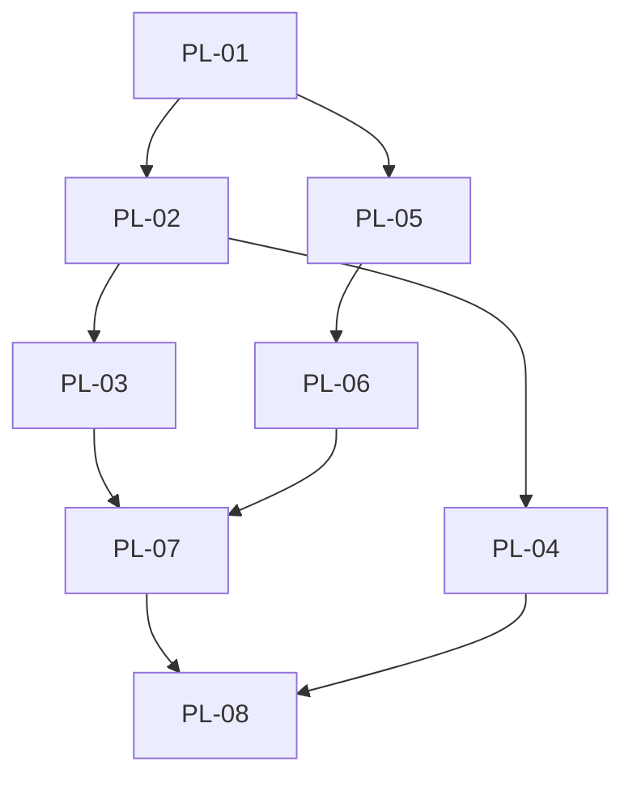

# Execution Backlog: Migração Plugins Opencode v1 → v2 (dual-export)

> **ID**: `opencode-v2-plugin-migration`
> **Tipo**: refactor (TASKS apenas — nenhuma edição de runtime nesta entrega, só este arquivo)
> **Status**: `TASKS`
> **Date**: 2026-10-15
> **Classificação**: EPIC (refactor, `jira-microtask-breaker`)
> **Proibido nesta fase**: editar `.opencode/plugins/*.js`, `opencode.json`, `lib/*`, `harness.config.json`. Só criar este `TASKS.md`.

## 1. Traceability Context
- **Source SPEC**: `./.spec/backend/opencode-v2-plugin-migration/SPEC.md` (aprovada — SPEC 11/11 + security pass Fase 1, 0 🔴)
- **Source PLAN**: `./.spec/backend/opencode-v2-plugin-migration/PLAN.md` (275 linhas, 9/9, PL-01..PL-08, Fases 0–4)
- **Source PROPOSAL**: `./.spec/backend/opencode-v2-plugin-migration/PROPOSAL.md` (PASS)
- **Goal**: Explodir PL-01..PL-08 em tickets TDD-ready, 1 arquivo por microtask, cada task com teste ANTES da implementação, comando verificável (`grep` / `node --test` / smoke), sem ciclos, sem tasks órfãs, sem macro-tasks inventadas.

### Constraints (máx. 10 — herdadas do PLAN §constraints + delegação)
1. Dual v1+v2 obrigatório; nunca remover `server` nesta migração.
2. Núcleos puros intactos (`decide :156`, `gate* :323/:592/:682/:755/:813`, `HarnessGate :854-919`, `CORE_GATES :176-187`, `lib/config.mjs`, `lib/seal.mjs`).
3. Fail-open ADR-006 + kill-switch só `HARNESS_GATES=off` ADR-009; `gates.*` nunca desliga.
4. Satélites seguem no-op (zero `DenyError` em `harness-validator.js`, `hitl-guardrail.js`).
5. Hooks só aos nomes v2 confirmados (RUNTIME-CONTRACT §2 + `migrate-v1` + PLAN §1.1.1); sem equivalente ⇒ erro visível, nunca silêncio.
6. Nunca: `ask` (H1), scalar system-transform (H2), evento inexistente (H3), bloqueio de prosa (H5).
7. TDD first sempre: arquivo de teste criado ANTES do arquivo de implementação, por microtask.
8. Toda task tem comando verificável (`node --test`, `grep`, `node -e import`, loader parity, `static-checks`).
9. NUNCA implementar runtime nem editar `opencode.json` nesta fase — só este `TASKS.md`.
10. Rollback sempre disponível: `HARNESS_GATES=off` + `git revert` (chaves v1 presentes).

## 2. Sprint Summary
| Phase | Task ID | Type | Priority | Risk | Complexity | Status |
|-------|---------|------|----------|------|------------|--------|
| Fase 0 baseline | PL-01 | Test | P0 | Low | 1pt | Todo |
| Fase 1 adapter | PL-02 | Infra | P0 | High | 5pt | Todo |
| Fase 1 adapter | PL-03 | Test | P0 | Medium | 2pt | Todo |
| Fase 2 satélites | PL-04 | Infra | P1 | Medium | 2pt | Todo |
| Fase 3 config | PL-05 | Infra | P0 | Medium | 2pt | Todo |
| Fase 3 config | PL-06 | Test | P0 | Medium | 2pt | Todo |
| Fase 4 matriz | PL-07 | Test | P0 | High | 5pt | Todo |
| Fase 4 matriz | PL-08 | Test | P0 | Medium | 3pt | Todo |

**Totais**: 8 tasks (PL-01..PL-08, 1:1 com PLAN §8) · 33 microtasks · todas < 2h · nenhuma macro-task inventada.

## 3. Dependency Graph

- Acíclico: arestas só avançam Fase 0 → 1 → 2/3 → 4. Sem ciclos.
- Sem órfãs: PL-01 raiz; PL-08 sorvedouro; todas conectadas (PL-04 entra via PL-02 e sai via PL-08; PL-05/PL-06 via PL-01→PL-07).
- Paralelizável: PL-04 ∥ PL-05/PL-06 após seus prereqs (ver `Parallelizable` por task).

---

## 4. Task Backlog

### Task `PL-01`: Baseline verde congelado (gate bloqueador, gap 2)
*Mapped directly from PLAN.md Fase 0 + §8 `[PL-01]` + §10 gap 2*

- **Constraint Ref**: SPEC §9 + §10 item 4; PLAN constraints 7, 8; INV-05 (núcleos intactos)
- **Depends on (PLAN)**: None (raiz)
- **Dependency Type**: Hard
- **Layer**: Test / plugin runtime JS ESM host-local (sem backend Java/Vue, sem DB)
- **Task Type**: Test
- **Priority**: P0
- **Risk Level**: Low
- **Parallelizable**: No (bloqueia PL-02 e PL-05)
- **Artifact**: `baseline-suite.log` (log da suíte verde, referenciável)
- **Framework Detail**: `node --test ".opencode/plugins/__tests__/*.spec.mjs"` (Node test runner, sem build); `git status --porcelain`; `grep -rn "server:"`

#### 📝 Context & Domain Impact
- **Description**: Rodar suíte existente 100% verde e congelar baseline (zero diff) antes de qualquer adapter. Sem esse gate verde, Fases 1/2/3 não iniciam.
- **Domain Impact**: Baseline vermelho mascararia regressão deny/fail-open do adapter; congelar prova que divergência futura veio do adapter, não de sujeira prévia.

#### 🛡️ Technical Enforcement (DO NOT IGNORE)
- **Rule**: INV-05 — suíte verde + diff limpo registrados antes de qualquer adapter (PLAN Fase 0 exit criteria BLOQUEADOR).
- **Failure Mode**: Adapter sobre baseline vermelho/sujo ⇒ regressão não atribuível; defeito bloqueador (não avançar).

#### ✅ Acceptance Criteria (BDD)
- **Scenario 1 (Success)**: baseline verde congelado
  - **Given** repo limpo, sem edição de runtime
  - **When** executa `node --test ".opencode/plugins/__tests__/*.spec.mjs"`
  - **Then** 100% verde e `baseline-suite.log` salvo; `git status --porcelain` vazio e `git diff --stat` limpo
- **Scenario 2 (Failure Mode - suite vermelha)**: suíte com falha bloqueia tudo
  - **Given** ≥1 spec falhando
  - **When** executa comando da Fase 0
  - **Then** PL-01 marcado FAIL, `baseline-suite.log` registra falha, PL-02/PL-05 NÃO iniciam
- **Scenario 3 (Edge Case / Idempotency)**: re-execução idêntica
  - **Given** suíte já verde uma vez
  - **When** re-executa o mesmo comando sem editar arquivos
  - **Then** segundo run também verde com mesmo conjunto de specs (sem flake); `grep -rn "server:" .opencode/plugins/*.js` ainda = 3 ocorrências

#### 🛠️ Implementation Steps (TDD - Test First)
*Microtasks atômicas (< 2h), 1 arquivo por microtask, teste ANTES.*
- [x] `V2-VAL-01` — `.opencode/plugins/__tests__/baseline-gate.spec.mjs` (`Type: Contract`): escreve asserções TDD FIRST — (a) suíte `*.spec.mjs` existente toda verde, (b) `grep server:` = 3, (c) `git status --porcelain` vazio. Comando: `node --test ".opencode/plugins/__tests__/baseline-gate.spec.mjs"`.
- [x] `V2-VAL-02` — `baseline-suite.log` (`Type: Artifact`): executa `node --test ".opencode/plugins/__tests__/*.spec.mjs" 2>&1 | tee baseline-suite.log` e anexa `git status --porcelain` + `git diff --stat` + `grep -rn "server:" .opencode/plugins/*.js`. Só marca done com log verde + git limpo.
- [x] `V2-VAL-03` — verificação de contagem de entries (`Type: Unit`): `grep -c "server:" .opencode/plugins/gate.js` → 1; total `grep -rn "server:" .opencode/plugins/*.js` → 3 ocorrências. Divergência ⇒ FAIL explícito.

#### 🏁 Definition of Done (DoD)
- [x] Arquivo de teste (`baseline-gate.spec.mjs`) criado ANTES de qualquer artifact de implementação.
- [x] `node --test ".opencode/plugins/__tests__/*.spec.mjs"` → 100% verde, log em `baseline-suite.log`.
- [x] `git status --porcelain` vazio + `git diff --stat` limpo evidenciados.
- [x] `grep -rn "server:" .opencode/plugins/*.js` → 3 ocorrências.
- [x] Sem TODOs; PL-02/PL-05 liberados somente após este DoD.

---

### Task `PL-02`: Adapter dual `gate.js` — `setup(ctx)` + shims §5.1 (gap 1)
*Mapped directly from PLAN.md Fase 1 + §8 `[PL-02]` + §1.1.1 / §3*

- **Constraint Ref**: ADR-001/002; SPEC §5 H1–H6 + §5.1 shims; PLAN constraints 1, 2, 5, 6
- **Depends on (PLAN)**: PL-01 (gate bloqueador, Hard)
- **Dependency Type**: Hard
- **Layer**: Plugin runtime JS ESM (`.opencode/plugins/`)
- **Task Type**: Infra
- **Priority**: P0
- **Risk Level**: High
- **Parallelizable**: No (precede PL-03, PL-04)
- **Artifact**: `.opencode/plugins/gate.js` (SÓ adapter/registro + shims; zero diff em núcleos)
- **Framework Detail**: `Plugin.define({ id, setup(ctx) })` (alvo 1.18.30); `ctx.tool.hook` / `ctx.session.hook` / `ctx.event.subscribe` só em nomes confirmados; shims `runGatesShim` / `noteChatParamsShim` / `humanBoundaryShim` + normalização H6 (`extractPromptText :284`, `extractWriteTargets :411`, `extractBashCommand :775`, `normalizePath`/`matchGlob :341-351`)

#### 📝 Context & Domain Impact
- **Description**: Adicionar `setup(ctx)` via `Plugin.define` ao lado de `server` (`gate.js:933` intacto); registrar `ctx.tool.hook(_,"before",runGatesShim)` por tool com gate (`task`, `write`, `bash`/`shell`), `ctx.session.hook` p/ `noteChatParamsShim` + `humanBoundaryShim`, `ctx.event.subscribe` só em nome confirmado; tabela nome-v1 → nome-v2-confirmado preenchida (gap 1).
- **Domain Impact**: Sem `setup`, gates somem em silêncio no runtime v2 (EoP 🟠); adapter com lógica de deny duplicada diverge do fail-open.

#### 🛡️ Technical Enforcement (DO NOT IGNORE)
- **Rule**: Adapter fino, zero lógica de deny; só `throw new DenyError` (`gate.js:61`) nega; shims chamam mesmo loop `decide`; hook sem equivalente confirmado ⇒ erro visível, nunca silêncio (regra de ouro SPEC §5).
- **Failure Mode**: Núcleo alterado ⇒ regressão deny/fail-open; registrar `ask`/scalar/evento-inexistente ⇒ defeito bloqueador; nome v2 não confirmado registrado ⇒ silêncio.

#### ✅ Acceptance Criteria (BDD)
- **Scenario 1 (Success)**: dual-export carrega nos dois runtimes
  - **Given** baseline PL-01 verde
  - **When** carrega `gate.js` em v1 (`server`) e em v2 stub (`setup(ctx)`)
  - **Then** ambos registram sem throw de registro; `server` intacto (`:933`); `setup` presente; tabela v1→v2-confirmado preenchida (fonte RUNTIME-CONTRACT §2 / `migrate-v1` / PLAN §1.1.1)
- **Scenario 2 (Failure Mode - hook-sem-equivalente)**: regra de ouro demonstrada
  - **Given** hook v1 sem equivalente v2 confirmado (ex.: nome de tool/sessão não confirmado)
  - **When** `setup` tenta registrar
  - **Then** erro visível no load (throw ou log explícito `HOOK-NO-EQUIV:<nome>`), nunca silêncio — caso de teste obrigatório
- **Scenario 3 (Edge Case / Idempotency)**: normalização H6 nos dois shapes
  - **Given** `args` string vs objeto; dois shapes de `write`; `shell` vs `bash`
  - **When** `runGatesShim` normaliza (só o literal de tool confirmado pelo runtime é registrado)
  - **Then** mesmo `decide` alcançado com envelope idêntico ao `base`/`ctx` de `HarnessGate (:860-919)`; chamar `setup` 2× não duplica deny (registro idempotente ou erro explícito de duplo-registro)

#### 🛠️ Implementation Steps (TDD - Test First)
- [x] `V2-BE-01` — `.opencode/plugins/__tests__/v2-adapter-registration.spec.mjs` (`Type: Unit`, TDD FIRST): espião de `ctx = {tool:{hook},session:{hook},event:{subscribe}}` loga `hookName+toolKey+timing`; asserta GATE-01..05 registrados, `ask` nunca registrado, `event.subscribe` só em nome confirmado. Comando: `node --test ".opencode/plugins/__tests__/v2-adapter-registration.spec.mjs"`.
- [x] `V2-BE-02` — `.opencode/plugins/gate.js` (adapter, SÓ registro): adiciona `setup(ctx)` via `Plugin.define` ao lado de `server :933` intacto; registra `ctx.tool.hook(_,"before",runGatesShim)` + `ctx.session.hook` ×2 (ou `event.subscribe` só nome confirmado). Nenhum `catch` novo que converta erro genérico em deny.
- [x] `V2-BE-03` — `.opencode/plugins/__tests__/v2-shims.spec.mjs` (`Type: Unit`, TDD FIRST): `runGatesShim`/`noteChatParamsShim`/`humanBoundaryShim` delegam a `decide`/`noteChatParams`+`recordSessionAgent`/`isHumanMessage`+`resetHitlTracker` com normalização H6; shims nunca logam `args` brutos (I10).
- [x] `V2-BE-04` — `.opencode/plugins/gate.js` (shims §5.1): implementa os 3 shims + normalização (`extractPromptText`, `extractWriteTargets`, `extractBashCommand`, `normalizePath`/`matchGlob`) chamando os mesmos núcleos.
- [x] `V2-BE-05` — `.opencode/plugins/__tests__/v2-hook-no-equiv.spec.mjs` (`Type: Unit`, TDD FIRST, gap 1): hook sem equivalente ⇒ erro visível (`HOOK-NO-EQUIV` / throw no load); tabela nome-v1 → nome-v2-confirmado (incl. `shell` vs `bash`, `ctx.tool.hook`, `ctx.session.hook` vs `event.subscribe`) assertada contra stub.
- [x] `V2-VAL-04` — verificação diff restrito (`Type: Contract`): `git diff .opencode/plugins/gate.js` mostra SÓ adapter/shims; diff em `decide`/`gatePiccoTask`/`gateCompletionAnchorA/B`/`gateHitlBatch`/`gateShellHygiene`/`HarnessGate`/`CORE_GATES` vazio.

#### 🏁 Definition of Done (DoD)
- [x] Testes (`v2-adapter-registration`, `v2-shims`, `v2-hook-no-equiv`) criados ANTES do adapter.
- [x] `server` intacto + `setup` carrega nos dois runtimes sem throw de registro.
- [x] Tabela v1→v2-confirmado preenchida + caso `hook-sem-equivalente ⇒ erro visível` verde.
- [x] `grep "server:"` = 3; `grep "setup"` ≥ 3 (após PL-04 fecha ≥3 nos 3 plugins).
- [x] Zero diff em núcleos; nenhum `catch` novo; sem `ask`/scalar/evento-inexistente.

---

### Task `PL-03`: Smoke load v1+v2 de `gate.js` (stub ctx)
*Mapped directly from PLAN.md Fase 1 + §8 `[PL-03]`*

- **Constraint Ref**: ADR-001; INV-01 (dual-export); PLAN constraint 7
- **Depends on (PLAN)**: PL-02 (Hard)
- **Dependency Type**: Hard
- **Layer**: Plugin runtime JS ESM (verificação)
- **Task Type**: Test
- **Priority**: P0
- **Risk Level**: Medium
- **Parallelizable**: No (precede PL-07)
- **Artifact**: script smoke load (ex.: `.opencode/plugins/__tests__/smoke-load-v1v2.mjs` ou `scripts/smoke-load-dual.mjs` — nome final na implementação; este TASKS só prescreve)
- **Framework Detail**: `node -e "import('./.opencode/plugins/gate.js')"` (v1) + stub v2 `{tool:{hook},session:{hook},event:{subscribe}}`; asserta ausência de `Plugin export is not a function`

#### 📝 Context & Domain Impact
- **Description**: Provar que o mesmo arquivo carrega nos dois runtimes sem erro de export/registro.
- **Domain Impact**: Falha aqui = v2 rejeita o plugin inteiro (todos os gates ausentes de uma vez).

#### 🛡️ Technical Enforcement (DO NOT IGNORE)
- **Rule**: INV-01 — `server` v1 intacto E `setup` v2 presente; load sem `Plugin export is not a function`.
- **Failure Mode**: Export quebrado ⇒ runtime ignora plugin em silêncio.

#### ✅ Acceptance Criteria (BDD)
- **Scenario 1 (Success)**: load duplo verde
  - **Given** PL-02 implementado
  - **When** importa `gate.js` em modo v1 e instancia `setup` com stub v2
  - **Then** zero throw de registro/export nos dois; hooks logados pelo espião cobrem GATE-01..05
- **Scenario 2 (Failure Mode - export quebrado)**: erro explícito
  - **Given** export default ausente ou `Plugin.define` malformado (fixture de regressão)
  - **When** smoke executa
  - **Then** FAIL com mensagem (`Plugin export is not a function` ou `SETUP-REGISTER-FAIL`) em vez de verde falso
- **Scenario 3 (Edge Case / Idempotency)**: stub mínimo vs completo
  - **Given** stub v2 só com `tool.hook` (sem `session`/`event`)
  - **When** `setup` carrega
  - **Then** ou registra o subconjunto com aviso explícito do que faltou, ou falha visível — nunca allow silencioso total

#### 🛠️ Implementation Steps (TDD - Test First)
- [x] `V2-VAL-05` — `.opencode/plugins/__tests__/smoke-load-v1v2.spec.mjs` (`Type: Integration`, TDD FIRST): importa `gate.js` (v1) + chama `setup` com stub espião (v2); asserta zero throw + cada gate registrado. Comando: `node --test ".opencode/plugins/__tests__/smoke-load-v1v2.spec.mjs"`.
- [x] `V2-VAL-06` — script smoke load (`Artifact`): `node -e import()` v1 + stub v2; saída lista `server: OK` / `setup: OK` + contagem de hooks por gate; falha ⇒ exit ≠ 0 com `GATE-ABSENT:<id>` se algum gate não registrado.

#### 🏁 Definition of Done (DoD)
- [x] Teste de smoke criado ANTES do script.
- [x] `node -e import()` v1 + stub v2 sem `Plugin export is not a function`.
- [x] `grep "server:"` = 3 e `grep "setup"` ≥ 3 verificados.
- [x] Script retorna exit 0 só com todos os gates registrados; senão `GATE-ABSENT:<id>` visível.

---

### Task `PL-04`: Dual-export nos 2 satélites no-op (RF-02, INV-06)
*Mapped directly from PLAN.md Fase 2 + §8 `[PL-04]`*

- **Constraint Ref**: SPEC constraint 4; INV-06; H2 (nunca re-injetar prosa); PLAN constraints 1, 4, 6
- **Depends on (PLAN)**: PL-02 (Hard — mesmo padrão de `setup`)
- **Dependency Type**: Hard
- **Layer**: Plugin runtime JS ESM (`.opencode/plugins/`)
- **Task Type**: Infra
- **Priority**: P1
- **Risk Level**: Medium
- **Parallelizable**: Yes (paralelizável com PL-05/PL-06 após PL-02; converge em PL-08)
- **Artifact**: `.opencode/plugins/harness-validator.js`, `.opencode/plugins/hitl-guardrail.js` (dual-export, seguem no-op)
- **Framework Detail**: Mesmo `Plugin.define({ id, setup })` + `server` intacto; nenhum hook de deny; nenhum transform scalar

#### 📝 Context & Domain Impact
- **Description**: Adicionar `setup` aos 2 satélites mantendo no-op total; sem `DenyError`, sem hook de deny, sem re-injeção de prosa (H2/G14).
- **Domain Impact**: Satélite virando enforcement divergente = deny fora da política (pior que no-op).

#### 🛡️ Technical Enforcement (DO NOT IGNORE)
- **Rule**: INV-06 — zero `DenyError` nos 2 arquivos; H2 — nenhum `output.system = string` / re-injeção.
- **Failure Mode**: No-op com deny ⇒ bloqueio ilegítimo; re-injeção scalar ⇒ no-op silencioso divergente.

#### ✅ Acceptance Criteria (BDD)
- **Scenario 1 (Success)**: no-ops duplos
  - **Given** PL-02 padrão definido
  - **When** carrega os 2 satélites em v1 e stub v2 e os invoca
  - **Then** carregam sem erro e retornam `{}`/allow, nunca deny
- **Scenario 2 (Failure Mode - enforcement acidental)**: `DenyError` = defeito
  - **Given** fixture que exercita todos os hooks registrados pelos satélites
  - **When** executa em v1 e v2
  - **Then** zero `throw DenyError`; se algum throw ocorrer ⇒ FAIL bloqueador
- **Scenario 3 (Edge Case / Idempotency)**: carga repetida sem estado
  - **Given** `setup` dos satélites chamado 2×
  - **When** re-registra
  - **Then** continua no-op, sem acumular hooks de deny nem logar `args` brutos

#### 🛠️ Implementation Steps (TDD - Test First)
- [x] `V2-FE-01` — `.opencode/plugins/__tests__/v2-satellites-noop.spec.mjs` (`Type: Unit`, TDD FIRST): load v1+v2 dos 2 arquivos + invocação retorna `{}`/allow; grep estático `DenyError` = 0. Comando: `node --test ".opencode/plugins/__tests__/v2-satellites-noop.spec.mjs"`.
- [x] `V2-BE-06` — `.opencode/plugins/harness-validator.js` (SÓ registro dual): adiciona `setup` mantendo `server`; sem `DenyError`, sem hook de deny, sem scalar.
- [x] `V2-BE-07` — `.opencode/plugins/hitl-guardrail.js` (SÓ registro dual): idem acima.
- [x] `V2-VAL-07` — grep de prova (`Type: Contract`): `grep -c "DenyError" .opencode/plugins/harness-validator.js .opencode/plugins/hitl-guardrail.js` → 0 em ambos; `grep -rn "output.system\s*=" .opencode/plugins/harness-validator.js .opencode/plugins/hitl-guardrail.js` → 0.

#### 🏁 Definition of Done (DoD)
- [x] Teste no-op criado ANTES dos registros duais.
- [x] Load v1 + stub v2 dos 2 arquivos sem erro; chamada ⇒ `{}`/allow.
- [x] `grep DenyError` = 0 nos 2 arquivos; sem re-injeção H2.
- [x] `grep "setup"` total ≥ 3 juntando PL-02.

---

### Task `PL-05`: Config dual C1–C3 em `opencode.json` (RF-03, ADR-003)
*Mapped directly from PLAN.md Fase 3 + §8 `[PL-05]`*

- **Constraint Ref**: ADR-003; SPEC §4 C1–C4; INV-08; PLAN constraints 1, 7
- **Depends on (PLAN)**: PL-01 (Hard — baseline; ordem de edição pode paralelizar com PL-02/PL-04)
- **Dependency Type**: Hard (lógico: loader `loadConfigOrDeny`/`ensureConfig :215-237` inalterado é pré-requisito)
- **Layer**: Config (`opencode.json` raiz)
- **Task Type**: Infra
- **Priority**: P0
- **Risk Level**: Medium
- **Parallelizable**: Yes (paralelizável com PL-02/PL-03/PL-04 após PL-01)
- **Artifact**: `opencode.json` (chaves duais C1–C3; C4 inalterada; remoção v1 fora de escopo)
- **Framework Detail**: C1 `plugin` (array paths, `:3`) + `plugins` (objetos); C2 `permission.task` (`:7-9`) + `permissions.subagent/shell`; C3 `agent.*.prompt` (`:10-92`) + `agents.*.system` (mesmo `{file:...}`); precedência v2-vence, v1 fallback

#### 📝 Context & Domain Impact
- **Description**: Adicionar chaves v2 (`plugins`, `permissions`, `agents.*.system`) mantendo as v1 (`plugin`, `permission.task`, `agent.*.prompt`); C4 (`tools.write/edit/bash` por agente) inalterada; precedência v2-vence documentada no próprio teste.
- **Domain Impact**: Chave nova ignorada por um runtime ⇒ config não lida ⇒ gate sem config (deny `loadConfigOrDeny` ou allow indevido).

#### 🛡️ Technical Enforcement (DO NOT IGNORE)
- **Rule**: INV-08 — loader lê qualquer shape; v2 vence se ambas presentes; remoção v1 explicitamente adiada.
- **Failure Mode**: Remover chave v1 ⇒ quebra 1.18.30; divergência de valores entre shapes ⇒ decisão inconsistente.

#### ✅ Acceptance Criteria (BDD)
- **Scenario 1 (Success)**: ambas as chaves presentes e lidas
  - **Given** `opencode.json` com C1–C3 duais
  - **When** runtime v1 lê (usa v1) e v2 lê (usa v2)
  - **Then** ambos resolvem para a mesma decisão (paridade detalhada em PL-06); C4 inalterada
- **Scenario 2 (Failure Mode - só-v1 / só-v2)**: fallback funciona
  - **Given** fixture só com shape v1 (ou só v2)
  - **When** loader lê
  - **Then** decisão idêntica à do shape dual (fallback, sem throw de config ausente)
- **Scenario 3 (Edge Case / Idempotency)**: conflito v1×v2
  - **Given** ambas presentes com valores equivalentes (mesmo `{file:...}`)
  - **When** loader resolve
  - **Then** v2 vence deterministicamente; re-leitura retorna o mesmo resultado

#### 🛠️ Implementation Steps (TDD - Test First)
- [x] `V2-BE-08` — `.opencode/plugins/__tests__/config-dual-keys.spec.mjs` (`Type: Contract`, TDD FIRST): asserta presença das 6 chaves (C1: `plugin`+`plugins`; C2: `permission.task`+`permissions.subagent/shell`; C3: `agent.*.prompt`+`agents.*.system` com mesmo `{file:...}`) e C4 inalterada. Comando: `node --test ".opencode/plugins/__tests__/config-dual-keys.spec.mjs"`.
- [x] `V2-BE-09` — `opencode.json` (SÓ adição de chaves): adiciona `plugins` (objetos), `permissions` (`subagent`, `shell`), `agents.*.system` mantendo `plugin`, `permission.task`, `agent.*.prompt`. NUNCA remover v1.
- [x] `V2-VAL-08` — lint de paridade (`Type: Contract`): script/grep que falha se alguma C1–C3 tiver só um shape ou se `{file:...}` divergir entre `prompt` e `system`.

#### 🏁 Definition of Done (DoD)
- [x] Teste de chaves criado ANTES da edição do JSON.
- [x] `opencode.json` contém ambas as chaves C1–C3; C4 inalterada; JSON válido (`node -e "JSON.parse(...)"`).
- [x] Remoção v1 explicitamente NÃO feita (adiada, documentada no teste).
- [x] Runtime v1 lê v1, v2 lê v2 (paridade executada em PL-06).

---

### Task `PL-06`: Teste loader parity v1-shape × v2-shape (INV-08)
*Mapped directly from PLAN.md Fase 3 + §8 `[PL-06]`*

- **Constraint Ref**: ADR-003; INV-08; SPEC §4.2; PLAN constraint 7
- **Depends on (PLAN)**: PL-05 (Hard)
- **Dependency Type**: Hard
- **Layer**: Plugin runtime JS ESM (loader `loadConfigOrDeny :215` / `ensureConfig :225`)
- **Task Type**: Test
- **Priority**: P0
- **Risk Level**: Medium
- **Parallelizable**: Yes (paralelizável com PL-02/PL-03/PL-04; converge em PL-07)
- **Artifact**: teste parity do loader (ex.: `.opencode/plugins/__tests__/config-loader-parity.spec.mjs`)
- **Framework Detail**: `loadConfigOrDeny`/`ensureConfig` INALTERADOS; mesma fixture deny/allow nos dois shapes; comandos do `harness.config.json`, nunca literal copiado

#### 📝 Context & Domain Impact
- **Description**: Provar que a mesma fixture produz decisão idêntica lendo shape v1 e shape v2 (deny e allow).
- **Domain Impact**: Loader que prefere shape errado ⇒ enforcement diverge entre runtimes sem nenhum log.

#### 🛡️ Technical Enforcement (DO NOT IGNORE)
- **Rule**: INV-08 — paridade total deny/allow entre shapes; loader byte-idêntico (nenhuma lógica nova no loader).
- **Failure Mode**: Fixture nega em v1 e permite em v2 ⇒ defeito bloqueador.

#### ✅ Acceptance Criteria (BDD)
- **Scenario 1 (Success)**: paridade deny + allow
  - **Given** mesma fixture (deny PICCO + allow PICCO válido)
  - **When** loader lê shape v1 e shape v2
  - **Then** decisões idênticas nos dois shapes (deny=deny, allow=allow)
- **Scenario 2 (Failure Mode - divergência)**: divergência falha alto
  - **Given** shapes com valores que divergem (fixture de regressão)
  - **When** teste parity executa
  - **Then** FAIL nomeando a chave divergente (`PARITY-DIVERGENT:<C1|C2|C3>`), nunca verde falso
- **Scenario 3 (Edge Case / Idempotency)**: precedência com ambos presentes
  - **Given** config com v1+v2 simultâneos
  - **When** loader resolve 2×
  - **Then** v2 vence nas 2 leituras, deterministicamente

#### 🛠️ Implementation Steps (TDD - Test First)
- [x] `V2-BE-10` — `.opencode/plugins/__tests__/config-loader-parity.spec.mjs` (`Type: Integration`, TDD FIRST): mesma fixture deny/allow × {shape v1, shape v2, dual} → decisões idênticas; precedência v2-vence assertada. Comando: `node --test ".opencode/plugins/__tests__/config-loader-parity.spec.mjs"`.
- [x] `V2-VAL-09` — prova de loader intacto (`Type: Contract`): `git diff` em `loadConfigOrDeny`/`ensureConfig (:215-237)` vazio (nenhuma lógica nova no loader nesta migração).

#### 🏁 Definition of Done (DoD)
- [x] Teste parity criado ANTES de qualquer ajuste (loader deve permanecer intacto).
- [x] `node -e` loader parity: mesma decisão nos dois shapes (deny + allow).
- [x] Precedência v2-vence demonstrada; remoção v1 adiada.
- [x] Diff do loader vazio.

---

### Task `PL-07`: Matriz deny/allow v1×v2 + 🟠 GATE-ABSENT + 🟡 anti-vazamento (gap 4)
*Mapped directly from PLAN.md Fase 4 + §8 `[PL-07]` + SPEC §11*

- **Constraint Ref**: ADR-002/004; INV-02/03/04 + SEC §11; SPEC §5 H4 (🟠 parcial); PLAN constraints 2, 3, 7
- **Depends on (PLAN)**: PL-03 (Hard) + PL-06 (Hard) — matriz exige adapter carregável E config com paridade
- **Dependency Type**: Hard
- **Layer**: Plugin runtime JS ESM (matriz `server` × `setup`)
- **Task Type**: Test
- **Priority**: P0
- **Risk Level**: High
- **Parallelizable**: No (precede PL-08)
- **Artifact**: script de matriz v1/v2 (ex.: `.opencode/plugins/__tests__/matrix-v1v2-parity.spec.mjs` + runner)
- **Framework Detail**: `node --test`; cada GATE-01..05 negado individualmente em v1 e v2; `HARNESS_GATES=off` vs `gates.*=off`; scrub I10 em `DenyError.details`

#### 📝 Context & Domain Impact
- **Description**: Matriz `server`×`setup` × {deny PICCO sem tag, allow PICCO válido, deny `pkill -f`, allow bash limpo, `Error` genérico ⇒ allow, `HARNESS_GATES=off` ⇒ allow vs `gates.*=off` ⇒ ainda deny} + casos obrigatórios gap 4: (i) anomalia 🟠 gate-ausente por gate, (ii) anomalia 🟡 I10 anti-vazamento nos dois entries.
- **Domain Impact**: Sem paridade demonstrada (≥1 deny + ≥1 allow idênticos por entry) o PLAN falhou — não avançar (PLAN §5 validação de negócio). Gate não registrado com allow silencioso = EoP.

#### 🛡️ Technical Enforcement (DO NOT IGNORE)
- **Rule**: INV-02 (paridade), INV-03 (fail-open: só `DenyError` nega), INV-04 (kill-switch só env), SEC I10 (scrub: shims nunca logam `args` brutos; `details` só `reason` + metadados `gateId/tool/timing`).
- **Failure Mode**: Divergência v1×v2 = defeito bloqueador ⇒ rollback (`HARNESS_GATES=off` + `git revert`); `details` com segredo/path = vazamento 🟡.

#### ✅ Acceptance Criteria (BDD)
- **Scenario 1 (Success)**: paridade total
  - **Given** adapter PL-02 + config PL-05/PL-06 prontos
  - **When** matriz executa cada caso em `server` e em `setup`
  - **Then** ≥1 DenyError + ≥1 allow idênticos por entry; `pkill -f` deny; bash limpo allow; PICCO deny/allow; `Error` genérico ⇒ allow + log `error`; `HARNESS_GATES=off` ⇒ allow; `gates.*=off` ⇒ ainda deny
- **Scenario 2 (Failure Mode - 🟠 gate-ausente)**: silêncio = FAIL explícito
  - **Given** `setup` sem registrar GATE-0X (fixture de regressão)
  - **When** smoke executa
  - **Then** falha com `GATE-ABSENT:<id>` visível, nunca allow silencioso — em v1 e v2
- **Scenario 3 (Edge Case - 🟡 deny não vaza segredo)**: anti-vazamento I10
  - **Given** fixture deny com segredo/path absoluto em `args`
  - **When** deny ocorre via `server` e via `setup`
  - **Then** `DenyError.details` contém SÓ `reason` + metadados (`gateId`, `tool`, `timing`); asserção de AUSÊNCIA do segredo/path nos dois entries

#### 🛠️ Implementation Steps (TDD - Test First)
- [x] `V2-VAL-10` — `.opencode/plugins/__tests__/matrix-v1v2-parity.spec.mjs` (`Type: Integration`, TDD FIRST): matriz `server`×`setup` × {deny PICCO, allow PICCO, deny `pkill -f`, allow bash limpo, `Error` genérico ⇒ allow, `HARNESS_GATES=off` ⇒ allow vs `gates.*=off` ⇒ deny}; cada GATE-01..05 negado individualmente por entry. Comando: `node --test ".opencode/plugins/__tests__/matrix-v1v2-parity.spec.mjs"`.
- [x] `V2-VAL-11` — `.opencode/plugins/__tests__/matrix-gate-absent.spec.mjs` (`Type: Integration`, TDD FIRST, 🟠): `setup` sem GATE-0X ⇒ `GATE-ABSENT:<id>` visível (nunca allow silencioso), nos dois entries.
- [x] `V2-VAL-12` — `.opencode/plugins/__tests__/matrix-no-leak.spec.mjs` (`Type: Integration`, TDD FIRST, 🟡 I10): deny com segredo/path em `args` ⇒ `details` só com `reason` + metadados; asserção negativa do segredo nos dois entries.
- [x] `V2-VAL-13` — runner da matriz (`Artifact`): script que executa os 3 specs acima + resume `PASS v1=n/n v2=n/n`; qualquer vermelho ⇒ indica rollback (`HARNESS_GATES=off` + `git revert`).

#### 🏁 Definition of Done (DoD)
- [x] Os 3 arquivos de teste criados ANTES do runner.
- [x] Matriz verde: ≥1 deny + ≥1 allow idênticos por entry; fail-open e kill-switch corretos.
- [x] Casos 🟠 (`GATE-ABSENT:<id>`) e 🟡 (ausência de segredo em `details`) verdes nos dois entries.
- [x] Qualquer vermelho ⇒ rollback declarado, sem avançar a PL-08.

---

### Task `PL-08`: Greps negativos H1/H2/H3/H5 + suíte final + `static-checks`
*Mapped directly from PLAN.md Fase 4 + §8 `[PL-08]`*

- **Constraint Ref**: RF-05; INV-07 (hooks proibidos ausentes) + INV-05 (suíte verde final); PLAN constraints 6, 7
- **Depends on (PLAN)**: PL-07 (Hard) + PL-04 (Hard — satélites convergem aqui)
- **Dependency Type**: Hard
- **Layer**: Plugin runtime JS ESM + CI local (`scripts/static-checks.mjs`)
- **Task Type**: Test
- **Priority**: P0
- **Risk Level**: Medium
- **Parallelizable**: No (sorvedouro do grafo)
- **Artifact**: relatório final (log de greps + suíte + `static-checks`)
- **Framework Detail**: `grep -rn`; `node --test ".opencode/plugins/__tests__/*.spec.mjs"`; `node scripts/static-checks.mjs` (suiteFull em `harness.config.json` + CI `harness-integrity.yml`); smoke asserta cada gate registrado

#### 📝 Context & Domain Impact
- **Description**: Fechar a migração provando proibições + verde final: greps negativos H1/H2/H3/H5, suíte 100% verde, `static-checks` verde.
- **Domain Impact**: `ask` registrado, scalar re-injetado, evento inexistente filtrado ou prosa "bloqueada" = defeito bloqueador que a matriz funcional não pegaria sozinha.

#### 🛡️ Technical Enforcement (DO NOT IGNORE)
- **Rule**: INV-07 — zero `ask` (H1), zero scalar system-transform (H2), zero filtro de evento inexistente (H3), zero bloqueio de prosa (H5); H4 declarada 🟠 parcial (nunca 🟢).
- **Failure Mode**: Qualquer grep positivo ⇒ FAIL bloqueador; suíte vermelha final ⇒ rollback.

#### ✅ Acceptance Criteria (BDD)
- **Scenario 1 (Success)**: proibições ausentes + verde final
  - **Given** PL-07 verde + PL-04 no-ops
  - **When** executa greps + suíte + `static-checks`
  - **Then** greps negativos vazios, suíte 100% verde, `static-checks` verde; smoke asserta cada gate registrado
- **Scenario 2 (Failure Mode - proibição presente)**: grep positivo bloqueia
  - **Given** fixture com `ask` (ou scalar/evento-inexistente/bloqueio-prosa) injetada como regressão
  - **When** greps executam
  - **Then** FAIL nomeando a proibição (`H1-ASK-FOUND`, `H2-SCALAR-FOUND`, `H3-DEAD-EVENT-FOUND`, `H5-PROSE-BLOCK-FOUND`)
- **Scenario 3 (Edge Case / Idempotency)**: H4 parcial declarada
  - **Given** `pkill -f` deny + redirect em path protegido deny (matriz PL-07)
  - **When** relatório final é emitido
  - **Then** H4 registrada como garantia parcial 🟠 (evadível `bash -c`/`python -c`, backstop CI), nunca alegada 🟢

#### 🛠️ Implementation Steps (TDD - Test First)
- [x] `V2-VAL-14` — `.opencode/plugins/__tests__/prohibitions.spec.mjs` (`Type: Contract`, TDD FIRST): greps negativos programáticos — `ask` (H1) ausente; `output.system =` scalar (H2) ausente nos 3 plugins; filtro de evento inexistente (H3) ausente; alegação de bloqueio de prosa (H5) ausente; cada gate registrado assertado. Comando: `node --test ".opencode/plugins/__tests__/prohibitions.spec.mjs"`.
- [x] `V2-VAL-15` — greps shell de prova (`Type: Contract`): `grep -rn "ask" .opencode/plugins/gate.js` (H1 negativo) + `grep -rn "output.system\s*=" .opencode/plugins/*.js` (H2 negativo) + varredura H3/H5; saída anexada ao relatório.
- [x] `V2-VAL-16` — suíte final + estático (`Type: Contract`): `node --test ".opencode/plugins/__tests__/*.spec.mjs"` → verde + `node scripts/static-checks.mjs` → verde; relatório consolida greps + matriz PL-07 + suíte.

#### 🏁 Definition of Done (DoD)
- [x] Teste de proibições criado ANTES da verificação final.
- [x] Greps H1/H2/H3/H5 negativos (vazios) + smoke por gate registrado.
- [x] Suíte final 100% verde + `static-checks` verde.
- [x] H4 declarada 🟠 parcial no relatório; qualquer vermelho ⇒ rollback (`HARNESS_GATES=off` + `git revert`).

---

## 5. Coverage Validation
- [x] All PLAN tasks converted and mapped: PL-01..PL-08 todos presentes 1:1 com PLAN §8 (Fase 0 → PL-01; Fase 1 → PL-02/PL-03; Fase 2 → PL-04; Fase 3 → PL-05/PL-06; Fase 4 → PL-07/PL-08).
- [x] All constraints mapped to explicit BDD scenarios: constraints 1–10 cobertas (dual em PL-02/03; núcleos em PL-02/07/08; fail-open/kill em PL-07; no-ops em PL-04/08; hooks confirmados + regra de ouro em PL-02/07/08; proibições em PL-04/08; TDD first em todas; comando verificável em todas; sem-runtime aqui; rollback em PL-07/08).
- [x] All tasks include failure mode validation: PL-01 suite-vermelha; PL-02 hook-sem-equivalente; PL-03 export-quebrado; PL-04 enforcement-acidental; PL-05 só-um-shape; PL-06 divergência; PL-07 🟠 GATE-ABSENT; PL-08 proibição-presente; PL-07/PL-08 🟡 I10 em PL-07.
- [x] No circular dependencies in the graph: §3 acíclico (Fase 0 → 1 → 2/3 → 4).
- [x] No orphan tasks: todas conectadas (§3); PL-04 converge via PL-08; PL-05/PL-06 via PL-07.
- [x] Verificabilidade: toda task tem comando (`node --test` / `grep` / `node -e import` / loader parity / `static-checks` / smoke com `GATE-ABSENT:<id>`).

## 6. Plan Feedback (Optional)
- **Identified Issues**:
  - PLAN não cria `RUNTIME-CONTRACT.md` (gap declarado em §1.1.1, ação futura `archive`/follow-up) — este TASKS não gera essa task, mantendo determinismo 1:1; a lacuna é coberta por PL-02/PL-03 via fontes substitutas (`gate.js:22-24,854-919` + `gate-contract.md` + `migrate-v1`) e pela regra hook-sem-equivalente ⇒ erro visível.
  - PLAN cita `opencode.json:3,7-9,10-92` no cabeçalho de fases e `opencode.json:13` na SPEC §0.2 contra `10-92` na SPEC §4 — divergência apenas de âncora de linha, sem efeito nas tasks (PL-05 cobre C1–C3 pelas chaves, não pelos números de linha).
  - Nenhuma macro-task inventada além de PL-01..PL-08; Delta docs (§13 SPEC) corretamente fora deste backlog (fase `archive`, não implementação).
- **tasks-gate self-score**: 11/11 — Traceability 1:1 ✅ (PL-01..08) · Metadata ✅ (P0/P1, risco, tipo, dependência) · Layer-to-folder ✅ (paths físicos `.opencode/plugins/`, `opencode.json`, `__tests__/`) · BDD ✅ (3 cenários/task) · TDD order ✅ (teste antes em toda task) · Granularidade ✅ (33 microtasks < 2h, 1 arquivo cada) · Mermaid ✅ (acíclico, sem órfãs) · Sem macro-tasks inventadas ✅ · DoD per task ✅ · Coverage validation ✅ · Plan feedback ✅.

## Dependências para execução (da próxima fase — implementar)
1. PL-01 verde (`baseline-suite.log` + `git status` limpo) antes de qualquer adapter.
2. RUNTIME-CONTRACT §2 / `migrate-v1` para nomes v2 finais (`shell` vs `bash`, `session.hook` vs `event.subscribe`); sem confirmação ⇒ erro visível (PL-02/PL-07).
3. Stub `ctx` (`{tool:{hook},session:{hook},event:{subscribe}}`) ou runtime v2 real para PL-03/PL-07.
4. `plugins/opencode.json` e runtime NÃO editados nesta fase — só este TASKS.md.
