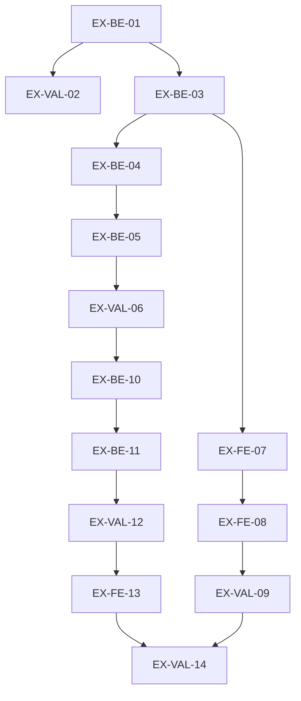

# Execution Backlog: harness-eixos-stack

> **Source SPEC**: `.spec/backend/harness-eixos-stack/SPEC.md` (v2)
> **Source PLAN**: `.spec/backend/harness-eixos-stack/PLAN.md` (v1)
> **Goal**: traduzir o PLAN em tickets TDD com arquivo físico, cenário BDD (sucesso / falha / borda), DoD e grafo sem ciclo.
> **Board**: `JIRA_BOARD.md` (mesmo dir) — 1 microtask = 1 trecho de arquivo + 1 spec de teste.

## 1. Traceability Context

PLAN `EX-01..EX-14` ↔ TASKS `EX-BE-*` / `EX-FE-*` / `EX-VAL-*` (1:1, sem macro-tarefa inventada).

## 2. Sprint Summary

| Phase | Task ID | Type | Priority | Risk | Complexity | Status |
|---|---|---|---|---|---|---|
| P1 | `EX-BE-01` | Infra | P0 | High | 3 | **Done** |
| P1 | `EX-VAL-02` | Test | P0 | High | 2 | **Done** |
| P1 | `EX-BE-03` | Infra | P0 | Medium | 3 | **Done** |
| P2 | `EX-BE-04` | Integration | P0 | High | 3 | **Done** |
| P2 | `EX-BE-05` | Integration | P1 | High | 3 | **Done** |
| P2 | `EX-VAL-06` | Test | P0 | High | 2 | **Done** |
| P3 | `EX-FE-07` | Interface | P1 | Low | 1 | **Done** |
| P3 | `EX-FE-08` | Interface | P1 | Medium | 3 | **Done** |
| P3 | `EX-VAL-09` | Test | P1 | Medium | 2 | **Done** |
| P4 | `EX-BE-10` | Integration | P0 | High | 3 | **Done** |
| P4 | `EX-BE-11` | Integration | P0 | High | 3 | **Done** |
| P4 | `EX-VAL-12` | Test | P0 | Medium | 2 | **Done** |
| P5 | `EX-FE-13` | Interface | P2 | Low | 2 | **Done** |
| P5 | `EX-VAL-14` | Test | P0 | Medium | 3 | **Done** |

## 3. Dependency Graph

**Sem ciclo** (arestas: 01→02, 01→03, 03→04, 04→05, 05→06, 03→07, 07→08, 08→09, 06→10, 10→11, 11→12, 12→13, 13→14, 09→14). **Sem órfão**: toda task toca o nó raiz `EX-BE-01` ou o nó final `EX-VAL-14`.

---

## 4. Task Backlog

### Task `EX-BE-01`: Modelar `axes` no registry
- **Constraint Ref**: RF-01 / ADR-001 / I2 / D1-D3 · **Depends on (PLAN)**: — · **Dependency Type**: Hard
- **Layer**: Infra · **Task Type**: Infra · **Priority**: P0 · **Risk**: High · **Parallelizable**: No
- **Artifact**: `installer/install.mjs` (`STACK_PROFILES` `:209-258`, `stacksFor` novo)
- **Framework Detail**: Node ESM puro; registry exportado e consumido por `profileOf` (`:260-262`)

#### 📝 Context & Domain Impact
- **Description**: adicionar `axes: { backend, frontend }` (IDs estáveis) a **toda** entrada do registry e **derivar `stacks` de `axes`** por `stacksFor(axes)` (com a tabela de exceções declarada do SPEC RF-01), sem tocar `backend`/`frontend` (rótulos literais) nem `commands`/`mcp`/`moduleMap`.
- **Domain Impact**: cria a identidade de eixo que hoje não existe **e** a torna consumida — é pré-requisito de todo o resto (correção D-1 do PM).

#### 🛡️ Technical Enforcement
- **Rule**: literais congelados intocados ⇒ saída gerada byte-idêntica (I2); `axes` em 100% das entradas (D1); `stacks` **derivado** (D4) — divergência fora da tabela de exceções é defeito.
- **Failure Mode**: (a) concatenação de string em rótulo ⇒ golden vermelho; (b) `axes` preenchido e não consumido ⇒ eixo decorativo e artefato errado instalado com a suíte verde (D-1).

#### ✅ Acceptance Criteria (BDD)
- **Scenario 1 (Success)**: **Given** o registry com `axes` e `stacksFor`, **When** a suíte roda, **Then** a saída gerada de cada preset é idêntica ao baseline **e** `stacks` de todo preset é igual a `stacksFor(axes)`, salvo exceção declarada.
- **Scenario 2 (Failure Mode — eixo decorativo / D-1)**: **Given** um caso sintético com `axes.frontend='react'` e `stacks:['vue']`, **When** o teste de coerência roda, **Then** ele **FALHA** (o defeito não passa verde).
- **Scenario 3 (Edge — presets mobile)**: **Given** `flutter`/`dart`, **When** `stacksFor` é avaliado, **Then** `flutter` usa a exceção declarada (`['flutter','dart']`) e `dart` deriva `['dart']`, sem alterar nenhuma string mobile.

#### 🛠️ Implementation Steps (TDD — Test First)
- [x] `installer/__tests__/golden.spec.mjs` + `eixos-stack.spec.mjs`: coerência `axes`↔`stacks` + caso de divergência (Scenarios 1/2/3).
- [x] `installer/install.mjs`: adicionar `axes` às 6 entradas + `stacksFor` + tabela de exceções.

#### 🏁 Definition of Done
- [x] Teste antes da implementação · [ ] Nenhum literal existente alterado · [ ] byte-identidade provada por assert **intacto** (`golden.spec.mjs:48-61` + `baseline()` `:14-45`) · [ ] **Oráculo independente** para `stacks` (tabela `EXPECTED_STACKS`; comparação com `stacksFor` é tautológica — 🔴 CR-1) · [ ] `STACK_VALUES` ≡ chaves do registry · [ ] Sem TODO

---

### Task `EX-VAL-02`: Testes do registry/eixo
- **Constraint Ref**: RF-01 / I2 / I9 · **Depends on**: `EX-BE-01` · **Dependency Type**: Hard
- **Layer**: Test · **Task Type**: Test · **Priority**: P0 · **Risk**: High · **Parallelizable**: No
- **Artifact**: `installer/__tests__/golden.spec.mjs`, `installer/__tests__/generate.spec.mjs` (+ caso de coerência em `eixos-stack.spec.mjs`)

#### 📝 Context & Domain Impact
- **Description**: prova de que o registry ganhou eixo **sem** mexer no contrato congelado **e** que o eixo é consumido (coerência `axes`↔`stacks`); é a rede de proteção das fases seguintes.

#### 🛡️ Technical Enforcement
- **Rule**: I9 — só é permitido **escopar** asserção estrutural ou **somar** caso novo.
- **Failure Mode**: assert de valor congelado editado ⇒ perda silenciosa do contrato I7.

#### ✅ Acceptance Criteria (BDD)
- **Scenario 1 (Success)**: **Given** o registry com `axes`, **When** a suíte roda, **Then** os asserts de valor congelado passam **sem edição**.
- **Scenario 2 (Failure Mode — assert afrouxado)**: **Given** um assert congelado alterado no diff, **When** EUA reviso, **Then** a task é rejeitada (evidência = `git diff` do arquivo de teste).
- **Scenario 3 (Edge — perfil novo)**: **Given** `Object.keys(STACK_PROFILES)`, **When** comparado ao esperado, **Then** é **superconjunto** do legado, não igualdade.
- **Scenario 4 (Edge — coerência de eixo / D-1)**: **Given** todo preset, **When** o teste compara `stacks` com `stacksFor(axes)`, **Then** são iguais, exceto a exceção declarada do par mobile.

#### 🛠️ Implementation Steps (TDD — Test First)
- [x] `installer/__tests__/golden.spec.mjs`: escopar `:64-69` para superconjunto + assert de `axes`.
- [x] `installer/__tests__/generate.spec.mjs`: garantir que a iteração sobre todos os perfis cobre o novo.
- [x] `installer/__tests__/eixos-stack.spec.mjs`: coerência `axes`↔`stacks` (Scenario 4).

#### 🏁 Definition of Done
- [x] Testes antes da implementação (quando aplicável) · [ ] `git diff` dos testes mostra **só** escopo/caso novo · [ ] Suíte verde

---

### Task `EX-BE-03`: Preset `java+react` + default de suíte
- **Constraint Ref**: RF-02 / RF-07 / RF-14 / ADR-001 · **Depends on**: `EX-BE-01` · **Dependency Type**: Hard
- **Layer**: Infra · **Task Type**: Infra · **Priority**: P0 · **Risk**: Medium · **Parallelizable**: No
- **Artifact**: `installer/install.mjs` (`STACK_PROFILES`, `STACK_VALUES` `:264`, `defaultSuiteFor` `:1560-1570`, prompt `QUESTIONS.stack` `:196`, `howToFix` `:1575`)

#### 📝 Context & Domain Impact
- **Description**: adicionar o preset `java+react` (adição pura), a lista de suíte do par react **e** tornar a lista de stacks **fonte única** (prompt do W3 + `howToFix` deixam de duplicar a lista à mão — RF-14/D-2).
- **Domain Impact**: torna o React selecionável pela primeira vez **sem** que a tela seguinte contradiga a escolha.

#### 🛡️ Technical Enforcement
- **Rule**: `moduleMap` de stack não é harness-owned ⇒ não entra em `config-ref-missing` (`:740-746`, `:406-409`); lista de suíte conforme RF-07.
- **Failure Mode**: preset sem `commands`/`mcp` coerentes ⇒ config gerada incompleta para o destino.

#### ✅ Acceptance Criteria (BDD)
- **Scenario 1 (Success)**: **Given** `answers.stack = 'java+react'`, **When** `generateConfig` roda, **Then** `stack.backend`/`stack.frontend` refletem java/react e `mcp.required` é `['chrome-devtools']`.
- **Scenario 2 (Failure Mode — valor inválido)**: **Given** `stack = 'java+svelte'`, **When** `validateAnswer` roda, **Then** `BAD_ANSWER` com a lista atualizada.
- **Scenario 3 (Edge — `npm` ausente)**: **Given** ambiente sem `npm` no PATH, **When** `defaultSuiteFor('java+react')` roda, **Then** retorna o **primeiro candidato** (nunca `''`).
- **Scenario 4 (Failure Mode — D-2: tela contradiz a escolha)**: **Given** o preset `java+react` escolhido no menu, **When** o W3 exibe o prompt de `stack`, **Then** a lista exibida **contém** `java+react` (prompt derivado da fonte única, não da string antiga de `:196`).

#### 🛠️ Implementation Steps (TDD — Test First)
- [x] `installer/__tests__/generate.spec.mjs` + `mobile.spec.mjs`: casos do preset novo e de `validateAnswer`.
- [x] `installer/__tests__/wizard.spec.mjs`: prompt do W3 contém o valor escolhido (Scenario 4).
- [x] `installer/install.mjs`: entrada do preset + `STACK_VALUES` + `defaultSuiteFor` + prompt/`howToFix` derivados da fonte única.

#### 🏁 Definition of Done
- [x] Teste antes da implementação · [ ] Preset **adicionado** (nenhuma chave removida) · [ ] Suíte verde · [ ] Sem TODO

---

### Task `EX-BE-04`: `stacks` declarado na origem; `inferStacks` como fallback
- **Constraint Ref**: RF-03 / A1 / ADR-002 · **Depends on**: `EX-BE-03` · **Dependency Type**: Hard
- **Layer**: Integration · **Task Type**: Integration · **Priority**: P0 · **Risk**: High · **Parallelizable**: No
- **Artifact**: `scripts/vendor-skills.mjs` (`inferStacks` `:284-288`, `buildVendor` `:341`, source-lock)

#### 📝 Context & Domain Impact
- **Description**: o `stacks` da skill passa a vir da **declaração de origem**; `inferStacks` fica como fallback de prefixo conhecido.
- **Domain Impact**: fecha o vazamento A1 que enviaria skills react para todos os destinos.

#### 🛡️ Technical Enforcement
- **Rule**: declaração explícita vence; sem declaração e sem prefixo conhecido ⇒ `[]` = **comum** (semântica preservada).
- **Failure Mode**: skill de um eixo entrando em outro destino (vazamento silencioso, 🟢 se testado).

#### ✅ Acceptance Criteria (BDD)
- **Scenario 1 (Success)**: **Given** source-lock com `stacks: ['react']`, **When** o vendor roda, **Then** o lock de saída registra `stacks: ['react']`.
- **Scenario 2 (Failure Mode — nome como fonte)**: **Given** uma skill `react-*` **sem** declaração, **When** o vendor roda, **Then** o resultado é `[]` (comum) e o teste acusa a origem inferida por nome.
- **Scenario 3 (Edge — regressão)**: **Given** skills `dart-*`/`flutter-*`, **When** o vendor roda, **Then** o `stacks` é idêntico ao atual (assert `vendor.spec.mjs:161-172` intacto).

#### 🛠️ Implementation Steps (TDD — Test First)
- [x] `installer/__tests__/vendor.spec.mjs`: cenários acima (sem alterar o assert de prefixo).
- [x] `scripts/vendor-skills.mjs`: `stacks` da origem + fallback.

#### 🏁 Definition of Done
- [x] Teste antes da implementação · [ ] Resultado para `dart-*`/`flutter-*` inalterado · [ ] Suíte verde

---

### Task `EX-BE-05`: `RULES_BY_AXIS` + filtro de `.agents/rules/**`
- **Constraint Ref**: RF-04 / A2 / ADR-002 · **Depends on**: `EX-BE-04` · **Dependency Type**: Hard
- **Layer**: Integration · **Task Type**: Integration · **Priority**: P1 · **Risk**: High · **Parallelizable**: No
- **Artifact**: `installer/install.mjs` (`RULES_BY_AXIS` novo + `collectIncoming` `:1200-1227`)

#### 📝 Context & Domain Impact
- **Description**: mapa **declarado** de rules por eixo, consumido com a mesma semântica das skills.
- **Domain Impact**: destino react deixa de receber prosa Vue/shadcn.

#### 🛡️ Technical Enforcement
- **Rule**: mapa declarado; **proibido** inferir eixo por nome de arquivo; não citado = comum.
- **Failure Mode**: instalar prosa de outro framework no destino (A2).

#### ✅ Acceptance Criteria (BDD)
- **Scenario 1 (Success)**: **Given** destino `java+react`, **When** `collectIncoming` roda, **Then** `frontend-coding-standards.md` **não** está no incoming.
- **Scenario 2 (Failure Mode — nome inferido)**: **Given** a implementação olhando o nome do arquivo, **When** o teste negativo roda, **Then** ele **falha**.
- **Scenario 3 (Edge — rule comum)**: **Given** uma rule em `RULES_COMMON`, **When** `collectIncoming` roda em qualquer destino, **Then** ela entra (sem regressão).
- **Scenario 4 (Failure Mode — regra nova vaza em silêncio / D-4b)**: **Given** o teste que **enumera** `.agents/rules/**`, **When** uma rule nova aparece **sem** estar em `RULES_COMMON` nem em nenhuma chave de `RULES_BY_AXIS`, **Then** o teste **FALHA** — silêncio vira sinal.
- **Scenario 5 (Não-regressão — residual declarado)**: **Given** os destinos `node`, `node-esm`, `outra`, `flutter`, `dart`, **When** o incoming de rules é coletado, **Then** é **idêntico** ao de hoje (a exclusão cobre só a chave do eixo react).
- **Semântica declarada (corrigida antes do Batch 2)**: `RULES_BY_AXIS` é mapa de **EXCLUSÃO** por eixo (`'frontend=react' → ['frontend-coding-standards.md']`), não allowlist de inclusão — a leitura de inclusão removeria a rule de `node`/`outra`/`flutter`/`dart`, fora do escopo. O destino `java+react` não recebe **nenhuma** rule de frontend (não existe rule React no repo).

#### 🛠️ Implementation Steps (TDD — Test First)
- [x] `installer/__tests__/eixos-stack.spec.mjs` (novo): cenários de rules + enumeração do diretório.
- [x] `installer/install.mjs`: mapa + filtro.

#### 🏁 Definition of Done
- [x] Teste antes da implementação · [ ] Nenhuma rule some por engano · [ ] Suíte verde

---

### Task `EX-VAL-06`: Testes de gating nas duas direções
- **Constraint Ref**: RF-03 / RF-04 / I9 · **Depends on**: `EX-BE-05` · **Dependency Type**: Hard
- **Layer**: Test · **Task Type**: Test · **Priority**: P0 · **Risk**: High · **Parallelizable**: No
- **Artifact**: `installer/__tests__/eixos-stack.spec.mjs` (novo)

#### 🛡️ Technical Enforcement
- **Rule**: prova positiva **e** negativa (entra em react; não entra nos outros 3 presets).
- **Failure Mode**: teste só positivo ⇒ vazamento passa despercebido.

#### ✅ Acceptance Criteria (BDD)
- **Scenario 1 (Success)**: **Given** fixture de lock com as 2 skills react, **When** destino é `java+react`, **Then** ambas entram.
- **Scenario 2 (Failure Mode — vazamento)**: **Given** os destinos `java+vue`/`node`/`outra`, **When** o incoming é coletado, **Then** nenhuma skill react entra.
- **Scenario 3 (Edge — skill comum)**: **Given** skill com `stacks: []`, **When** qualquer destino coleta, **Then** ela entra (semântica preservada).
- **Scenario 4 (Failure Mode — divergência de eixo / D-1)**: **Given** fixture de lock com `stacks:['vue']` para uma skill cujo eixo é react, **When** o teste de coerência roda, **Then** ele **falha** (o vazamento não passa verde).

#### 🛠️ Implementation Steps (TDD — Test First)
- [x] `eixos-stack.spec.mjs`: fixture + 4 destinos + caso comum.

#### 🏁 Definition of Done
- [x] Cobre as 3 direções · [ ] Sem edição de assert congelado · [ ] Suíte verde

---

### Task `EX-FE-07`: Range do menu derivado
- **Constraint Ref**: RF-05 / A4 / ADR-004 · **Depends on**: `EX-BE-03` · **Dependency Type**: Hard
- **Layer**: Interface · **Task Type**: Infra · **Priority**: P1 · **Risk**: Low · **Parallelizable**: Yes
- **Artifact**: `installer/install.mjs` (bloco `W2m` `:1646`, `:1649`)

#### ✅ Acceptance Criteria (BDD)
- **Scenario 1 (Success)**: **Given** `WIZARD_MENU` com 5 itens, **When** o prompt é exibido, **Then** mostra `[1-5]` derivado de `WIZARD_MENU.length`.
- **Scenario 2 (Failure Mode — literal)**: **Given** um item sintético adicional, **When** o usuário digita o novo índice, **Then** é **aceito** (hoje cairia em loop de `BAD_ANSWER`).
- **Scenario 3 (Edge — erro)**: **Given** escolha fora do range, **When** o erro é impresso, **Then** a mensagem usa o range derivado.

#### 🛠️ Implementation Steps (TDD — Test First)
- [x] `installer/__tests__/wizard.spec.mjs`: item sintético + range.
- [x] `installer/install.mjs`: derivar o range.

#### 🏁 Definition of Done
- [x] Teste antes da implementação · [ ] Suíte verde · [ ] Sem TODO

---

### Task `EX-FE-08`: `W2m` em 2 passos + padrões do erro
- **Constraint Ref**: RF-06 / ADR-004 · **Depends on**: `EX-FE-07` · **Dependency Type**: Hard
- **Layer**: Interface · **Task Type**: Interface · **Priority**: P1 · **Risk**: Medium · **Parallelizable**: No
- **Artifact**: `installer/install.mjs` (bloco `W2m` `:1635-1652`)

#### 🛡️ Technical Enforcement
- **Rule**: textos do parecer UX (vinculante, adaptado por D-A); contador `[i/total]`; 4ª linha do erro com `arquivo:linha`; 3ª linha sem jargão de stack.
- **Failure Mode**: menu com jargon (regressão do ADR-011) ou item 4 sem o segundo passo (react inalcançável).

#### ✅ Acceptance Criteria (BDD)
- **Scenario 1 (Success)**: **Given** sem `pubspec.yaml`, **When** o usuário escolhe o item 4, **Then** vê o `W2m-2` com `[2/2]`, `(default: 1)` e as 2 opções; escolher `2` gera `java+react`.
- **Scenario 2 (Failure Mode — entrada inválida)**: **Given** uma entrada fora do range, **When** o erro é impresso, **Then** as 4 linhas seguem o padrão e o passo **repete**.
- **Scenario 3 (Edge — dialeto de entrada)**: **Given** `pubspec.yaml` presente, **When** o wizard roda, **Then** o `W2m` inteiro é **pulado** e o `stack` detectado alimenta o default do W3.

#### 🛠️ Implementation Steps (TDD — Test First)
- [x] `installer/__tests__/wizard.spec.mjs`: fluxo de 2 passos + erro 4 linhas + skip por pubspec.
- [x] `installer/install.mjs`: blocos `W2m-1`/`W2m-2`.

#### 🏁 Definition of Done
- [x] Teste antes da implementação · [ ] `q` aborta com 0 writes · [ ] Suíte verde

---

### Task `EX-VAL-09`: Testes do wizard (escopados) e de `node-esm`
- **Constraint Ref**: RF-06 / I9 / I10 · **Depends on**: `EX-FE-08` · **Dependency Type**: Hard
- **Layer**: Test · **Task Type**: Test · **Priority**: P1 · **Risk**: Medium · **Parallelizable**: No
- **Artifact**: `installer/__tests__/wizard.spec.mjs`

#### 🛡️ Technical Enforcement
- **Rule**: asserção de "5 itens" **escopada** ao bloco `W2m-1` (o filtro `^\s*[1-5]\)` casaria as linhas do `W2m-2`).
- **Failure Mode**: falso "6 itens" por regex global; quebra silenciosa de `node-esm` (I10).

#### ✅ Acceptance Criteria (BDD)
- **Scenario 1 (Success)**: **Given** o bloco `W2m-1`, **When** o teste conta itens, **Then** encontra **exatamente 5**.
- **Scenario 2 (Failure Mode — regex global)**: **Given** os dois blocos presentes, **When** a asserção **não** é escopada, **Then** o teste falha (prova de que a proteção existe).
- **Scenario 3 (Edge — `node-esm`)**: **Given** `--answers-file` com `node-esm`, **When** o wizard/CLI roda, **Then** é aceito **sem** item de menu.
- **Scenario 4 (Failure Mode — prompt contradiz a escolha / RF-14)**: **Given** o preset `java+react` escolhido no `W2m-2`, **When** o W3 exibe o prompt de `stack`, **Then** a lista exibida **contém** `java+react` (e não a string antiga de `:196`).

#### 🛠️ Implementation Steps (TDD — Test First)
- [x] `wizard.spec.mjs`: escopo das asserções + cenários acima (sem tocar no assert de `node-esm`).

#### 🏁 Definition of Done
- [x] `git diff` só escopa/soma · [ ] Suíte verde · [ ] Sem TODO

---

### Task `EX-BE-10`: Clone pinado + `licenseOrigin` no vendor
- **Constraint Ref**: RF-08 / RF-10 / RF-13 / A5 / ADR-003 · **Depends on**: `EX-VAL-06` · **Dependency Type**: Hard
- **Layer**: Integration · **Task Type**: Integration · **Priority**: P0 · **Risk**: High · **Parallelizable**: Yes
- **Artifact**: `scripts/vendor-skills.mjs` (`SOURCE_LICENSES`, `resolveLicense`, `writeVendor`, `checkVendor`)

#### 📝 Context & Domain Impact
- **Description**: clonar os 2 upstreams no commit pinado e introduzir `licenseOrigin` (`upstream-file` | `declared-evidence`) + `evidence[]`.
- **Domain Impact**: o NOTICE deixa de afirmar garantia universal; a limitação fica declarada.

#### 🛡️ Technical Enforcement
- **Rule**: `declared-evidence` valida o sha do **nosso** texto; `upstream-file` valida fidelidade ao arquivo real; allowlist SPDX intocada.
- **Failure Mode**: claim falso no NOTICE (pior que não declarar) ou skill excluída por gate não ajustado.

#### ✅ Acceptance Criteria (BDD)
- **Scenario 1 (Success)**: **Given** clone dos 2 repos no commit pinado, **When** o vendor roda, **Then** a fonte stitch registra `upstream-file` e a vercel `declared-evidence` + `evidence[]`.
- **Scenario 2 (Failure Mode — clone ausente)**: **Given** ausência do clone, **When** o vendor roda, **Then** **falha limpa** e a task **não** é marcada concluída.
- **Scenario 3 (Edge — adulteração)**: **Given** o `LICENSE-<slug>` alterado, **When** `--check` roda, **Then** **FALHA** por sha divergente.

#### 🛠️ Implementation Steps (TDD — Test First)
- [x] `installer/__tests__/vendor.spec.mjs`: cenários de origem e adulteração.
- [x] `scripts/vendor-skills.mjs`: `licenseOrigin` + evidência + NOTICE por origem.

#### 🏁 Definition of Done
- [x] Teste antes da implementação · [ ] Allowlist SPDX intacta · [ ] `--check` verde

---

### Task `EX-BE-11`: Vendorizar as 2 skills (lock + NOTICE + opcional)
- **Constraint Ref**: RF-08 / RF-09 / I5 / ADR-003 · **Depends on**: `EX-BE-10` · **Dependency Type**: Hard
- **Layer**: Integration · **Task Type**: Integration · **Priority**: P0 · **Risk**: High · **Parallelizable**: No
- **Artifact**: `.agents/skills/.vendor-lock.json`, `VENDOR-NOTICE.md`, `LICENSE-stitch-skills`, `LICENSE-vercel-agent-skills`, `react-components/`, `react-best-practices/`

#### 🛡️ Technical Enforcement
- **Rule**: cópia **byte-idêntica** (sem patch no `SKILL.md`); `optional: true` **só** em `react-components`; hashes das skills existentes inalterados (I5).
- **Failure Mode**: patchar a skill (mata o drift check) ou marcar tudo como opcional.

#### ✅ Acceptance Criteria (BDD)
- **Scenario 1 (Success)**: **Given** as fontes clonadas, **When** o vendor roda, **Then** as 2 skills aparecem no lock com commit pinado e os 2 arquivos `LICENSE-*` existem.
- **Scenario 2 (Failure Mode — patch)**: **Given** um campo injetado no `SKILL.md` vendoriado, **When** `--check` roda, **Then** **FALHA**.
- **Scenario 3 (Edge — opcional)**: **Given** o lock final, **When** lido, **Then** `react-components.optional === true` e `react-best-practices.optional` ausente/false.

#### 🛠️ Implementation Steps (TDD — Test First)
- [x] `installer/__tests__/vendor.spec.mjs`: `optional` + presença das 2 skills.
- [x] Rodar o vendor e commitar lock/NOTICE/licenças/skills.

#### 🏁 Definition of Done
- [x] `dart-*`/`flutter-*` com hashes inalterados · [ ] NOTICE sem claim universal · [ ] `--check` verde

---

### Task `EX-VAL-12`: Testes de vendor por origem (split do assert)
- **Constraint Ref**: RF-10 / A5 · **Depends on**: `EX-BE-11` · **Dependency Type**: Hard
- **Layer**: Test · **Task Type**: Test · **Priority**: P0 · **Risk**: Medium · **Parallelizable**: No
- **Artifact**: `installer/__tests__/vendor.spec.mjs` (`:396` dividido)

#### ✅ Acceptance Criteria (BDD)
- **Scenario 1 (Success)**: **Given** fonte `upstream-file`, **When** o teste compara com o `LICENSE` upstream, **Then** bate byte-a-byte.
- **Scenario 2 (Failure Mode — origem confundida)**: **Given** fonte `declared-evidence`, **When** o teste exige comparação com arquivo upstream inexistente, **Then** ele **não** é aplicado (o teste certo valida o nosso sha).
- **Scenario 3 (Edge — `--check`)**: **Given** o lock commitado **sem** os clones, **When** `--check` roda em CI limpo, **Then** **PASSA** (nenhuma rede necessária).

#### 🛠️ Implementation Steps (TDD — Test First)
- [x] `vendor.spec.mjs`: dividir o assert por `licenseOrigin` + cenário de CI sem clones.

#### 🏁 Definition of Done
- [x] Cobre as 2 origens · [ ] Suíte verde · [ ] Sem TODO

---

### Task `EX-FE-13`: Delta Specs (prosa ↔ mecanismo)
- **Constraint Ref**: RF-11 / SPEC §11 · **Depends on**: `EX-VAL-12` · **Dependency Type**: Hard
- **Layer**: Interface (texto canônico) · **Task Type**: Domain · **Priority**: P2 · **Risk**: Low · **Parallelizable**: Yes
- **Artifact**: `.agents/skills/harness-installer/SKILL.md`, `.agents/rules/harness-config.md`, **`README.md`** (raiz — o alvo original `AGENTS.md` **não existe**; emenda declarada no SPEC §11), `installer/__tests__/docs.spec.mjs`

#### ✅ Acceptance Criteria (BDD)
- **Scenario 1 (Success)**: **Given** o Delta Specs aplicado, **When** `docs.spec.mjs` roda, **Then** a lista de stacks e o menu descritos batem com o mecanismo.
- **Scenario 2 (Failure Mode — prosa órfã)**: **Given** prosa afirmando algo sem mecanismo, **When** o teste de doc roda, **Then** **falha**.
- **Scenario 3 (Edge — N/A)**: **Given** `harness-config.md` descrevendo perfis, **When** lido, **Then** não afirma que o mobile é o único perfil especial.

#### 🛠️ Implementation Steps (TDD — Test First)
- [x] `docs.spec.mjs`: paridade atualizada (+97/−0; nenhum assert existente removido).
- [x] Aplicar os deltas: `harness-config.md` + `harness-installer/SKILL.md` + **`README.md`** (emenda do alvo `AGENTS.md`, inexistente).

#### 🏁 Definition of Done
- [x] Testes de doc verdes · [x] Nenhuma afirmação sem mecanismo · [x] Sem TODO · [x] **FU-54 fechado com guarda** (`docs.spec.mjs:89`)

---

### Task `EX-VAL-14`: Fechamento — suíte, dry-run E2E e brain
- **Constraint Ref**: I3 / I4 / RF-12 / SPEC §7 · **Depends on**: `EX-FE-13`, `EX-VAL-09` · **Dependency Type**: Hard
- **Layer**: Test · **Task Type**: Test · **Priority**: P0 · **Risk**: Medium · **Parallelizable**: No
- **Artifact**: `harness/harness-eixos-stack.json` (REPORT) + suíte completa + `.spec/backend/harness-eixos-stack/harness/wizard-react-transcript.txt`

#### ✅ Acceptance Criteria (BDD)
- **Scenario 1 (Success)**: **Given** todas as tasks concluídas, **When** o `suiteFull` roda, **Then** **0 falhas** (plugins + installer + static-checks + vendor-check).
- **Scenario 2 (Failure Mode — write no dry-run)**: **Given** dry-run dos 2 presets web, **When** o dir do destino é inspecionado, **Then** **0 writes**.
- **Scenario 3 (Edge — gate/config)**: **Given** o diff final, **When** inspecionado, **Then** `.opencode/plugins/gate.js`, `harness.config.json` e `commands.suiteFull` têm **0 linhas** alteradas.
- **Scenario 4 (Failure Mode — RF-12 / D-5)**: **Given** o `QUESTIONS` final, **When** o teste verifica a forma, **Then** tem **exatamente 5 chaves** (`project|stack|suiteCommand|pluginsDir|deployToken`) e as fixtures legadas de `--answers-file` continuam verdes (~20 call sites).
- **Scenario 5 (Evidência para o owner / D-8)**: **Given** a execução interativa do wizard escolhendo **React**, **When** o transcript é salvo em `.../harness/wizard-react-transcript.txt`, **Then** ele contém os **2 prompts** do menu e a escolha — é esse arquivo que o owner lê (o `--answers-file` **pula** o `W2m`).

#### 🛠️ Implementation Steps (TDD — Test First)
- [x] Suíte completa (0 falhas: plugins 352, installer 479, static 10/0, vendor OK); dry-run nos 2 presets web (**0 writes**, hash antes==depois); **execução interativa** com transcript salvo (`.spec/backend/harness-eixos-stack/harness/wizard-react-transcript.txt`, 16.336 B); diff de `gate.js`/`harness.config.json`/`.opencode/plugins` vazio; REPORT + brain.

#### 🏁 Definition of Done
- [x] Suíte 0 falhas · [x] 0 writes no dry-run · [x] gate/config intocados · [x] brain registrado (6 paths)

---

## 5. Coverage Validation

- [x] Todos os 14 itens do PLAN (`EX-01..EX-14`) convertidos.
- [x] Todas as restrições críticas (I2, A1, A2, A5, D-1) com cenário BDD explícito.
- [x] Todas as tasks com ≥1 cenário de **falha**.
- [x] Grafo sem ciclo e sem órfão (§3).
- [x] Nenhuma macro-tarefa inventada (1:1 com o PLAN).
- [x] **Pós-PM**: RF-12 (D-5) em `EX-VAL-14`; RF-14 (D-2) em `EX-BE-03`/`EX-VAL-09`; coerência `axes`↔`stacks` (D-1) em `EX-BE-01`/`EX-VAL-02`/`EX-VAL-06`; enumeração de rules (D-4b) em `EX-BE-05`; transcript do wizard (D-8) em `EX-VAL-14`.

## 6. Plan Feedback

- **Identified Issues** (achados pela própria esteira e **respondidos pelo PM** em `.spec/backend/harness-eixos-stack/REVIEW-PM.md`):
  1. `RULES_BY_AXIS` (EX-BE-05) — aceito como mecanismo, **com correção D-4b**: o teste **enumera** `.agents/rules/**` para que rule nova não classificada deixe a suíte vermelha (o mapa declarado não pode virar fail-open silencioso).
  2. RF-09 (`optional: true`) — **resolvido por D-3**: o campo é metadado; as 2 skills **são instaladas**; "honrar" o campo no instalador é escopo novo (fora deste ciclo).
  3. ADR-005 (rota) sem task — **confirmado** como documental (RF-12 rastreável em `EX-VAL-14`); executar a pergunta dupla é ciclo futuro.
  4. **Novos do PM**: D-1 (eixo decorativo) → `stacksFor`; D-2 (prompt do W3 contradiz a escolha) → RF-14; D-6 (caminho crítico inválido) → corrigido no PLAN §7; D-7 (rótulos de teste) → tabela de rastreabilidade por arquivo; D-4a (`react-coding-standards.md` inexistente) → substituído pelo conjunto real.
  5. **D-9 (aberto, exige o owner)**: o default do passo 2 permanece **Vue**. Não foi decidido em D-A..D-D. Se o owner quiser React como default, é mudança de aceite (não de código).
