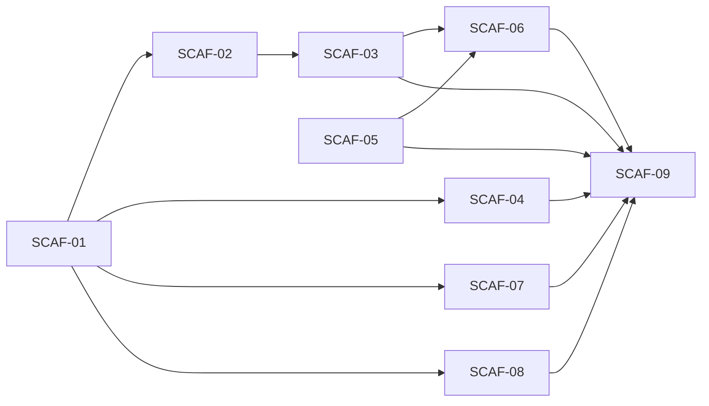

<!-- scope: adr/ADR-001 -->
# TASKS — ADR-001: scaffold de identidade com seção gerenciada

Backlog TDD-ready. Cada RF/NFR da `SPEC.md` vira pelo menos uma task. Teste **antes** da implementação. IDs no formato `[A-Z]+-\d+`.

## Tasks

### SCAF-01 — Classes de path PRÓPRIO/ANEXADO
- [x] Concluída (review APPROVED, aceite 14/14).
- **RF**: RF-01 · **Prioridade**: P0 · **Risco**: Low · **Tipo**: refactor · **Depende**: —
- **Arquivos**: `scripts/harness-sync.mjs`, `scripts/__tests__/sync.spec.mjs`
- **BDD**: Dado um plano com os 7 paths; quando classificar; então 5 são `owned` (3 `project-*.md` + `tokens/*.json`) e 2 `attached` (`AGENTS.md`, `DESIGN.md`), nenhum outro.
- **Falha**: path fora da lista ⇒ `TypeError` fail-closed. **Borda**: token fora de `tokens/` ⇒ não é PRÓPRIO.
- **Teste primeiro**: tabela de classificação com 9 casos (7 válidos + 2 inválidos).
- **DoD**: constante `PATH_CLASSES` exportada; teste verde; nenhum path novo sem classe.

### SCAF-02 — Gramática do marcador e append byte-seguro
- [x] Concluída (review APPROVED, aceite 14/14).
- **RF**: RF-02 · **P0** · **Risco**: High · **Tipo**: feat · **Depende**: SCAF-01
- **Arquivos**: `scripts/harness-sync.mjs`, `scripts/__tests__/sync.spec.mjs`
- **BDD**: Dado `AGENTS.md` sem par; quando gerar; então `OPEN`/`LF`/`BODY`/`LF`/`CLOSE` no fim e prefixo byte-idêntico. Dado arquivo sem LF final; quando anexar; então 1 LF inserido antes de `OPEN`, nenhum outro byte normalizado.
- **Falha**: `<!--harness:v2:start-->` sem espaços não é reconhecido ⇒ 0 pares ⇒ append (não erro). **Borda**: `CLOSE` antes de `OPEN` ⇒ `malformed`.
- **Teste primeiro**: 6 fixtures de gramática (0 par, 1 par, 2 pares, ordem invertida, linha duplicada dentro do BODY, sem LF final).
- **DoD**: `markerState(text)` puro e testado; prefixo comparado por hash.

### SCAF-03 — Máquina de estados por path
- [x] Concluída (review APPROVED, aceite 14/14).
- **RF**: RF-03 · **P0** · **Risco**: High · **Tipo**: feat · **Depende**: SCAF-01, SCAF-02
- **Arquivos**: `scripts/harness-sync.mjs`, `scripts/__tests__/sync.spec.mjs`
- **BDD**: 6 estados exercitados; `preserved`/`divergent` nunca viram `update`; reexecução após `created`/`appended` ⇒ `skip`.
- **Falha**: BODY divergente ⇒ `divergent` + WARN, zero escrita. **Borda**: contagem ≠1 ⇒ `malformed` + exit 1.
- **Teste primeiro**: tabela estado × ação (12 linhas).
- **DoD**: enum fechado; transição `divergent → update` impossível por construção (teste de mutação).

### SCAF-04 — Manifesto e doctor: PRÓPRIOS dentro, ANEXADOS fora
- [x] Concluída (review APPROVED, aceite 14/14).
- **RF**: RF-04 · **P0** · **Risco**: High · **Tipo**: feat · **Depende**: SCAF-01
- **Arquivos**: `scripts/harness-sync.mjs`, `scripts/__tests__/sync.spec.mjs`
- **BDD**: Dado init em fixture; quando ler manifesto; então `project-*.md`/tokens presentes e `AGENTS.md`/`DESIGN.md` ausentes; edição manual de ANEXADO não muda `doctor`.
- **Falha**: PRÓPRIO corrompido ⇒ `doctor` exit 1. **Borda**: ANEXADO apagado pelo usuário ⇒ `doctor` segue verde.
- **Teste primeiro**: 4 asserções de manifesto + 2 de doctor.
- **DoD**: gancho `inManifest:false` existente reutilizado; nenhuma nova via de escrita.

### SCAF-05 — Flags de stack e recusa sem sinal
- [x] Concluída (review APPROVED, aceite 14/14).
- **RF**: RF-05 · **P0** · **Risco**: Medium · **Tipo**: feat · **Depende**: —
- **Arquivos**: `scripts/harness-sync.mjs`, `scripts/__tests__/sync.spec.mjs`, `docs/ref/sync.md`
- **BDD**: Dado alvo sem stack e sem flag; quando `init`; então exit 1, zero escrita/backup, mensagem literal de I5. Dado `--frontend vue`; quando detectar; então `project-frontend.md` e `stack origem=flag`.
- **Falha**: `--frontend solid` ⇒ mesma recusa com valor nomeado. **Borda**: detection + flag ⇒ flag vence e origem reportada.
- **Teste primeiro**: 5 casos de resolução (detectada, flag, override, nulo, inválida).
- **DoD**: mensagem byte-idêntica à I5; nenhum `project-fullstack.md` inventado.

### SCAF-06 — Relatório determinístico e dry-run = apply
- [x] Concluída (review APPROVED, aceite 14/14).
- **RF**: RF-06 · **P0** · **Risco**: Medium · **Tipo**: feat · **Depende**: SCAF-03, SCAF-05
- **Arquivos**: `scripts/harness-sync.mjs`, `scripts/__tests__/sync.spec.mjs`
- **BDD**: Dado plano com 1 `created`, 1 `divergent`, 1 `skip`; quando imprimir; então linhas na ordem de I6 (stack, paths ordenados, WARN, resumo), `WARN` não altera exit, `ERROR` altera.
- **Falha**: `malformed` ⇒ `ERROR seção malformada <path>` + exit 1. **Borda**: `--dry-run` imprime as mesmas linhas sem escrever.
- **Teste primeiro**: comparação string-equal entre stdout de dry-run e apply.
- **DoD**: nenhuma linha fora do formato de I6.

### SCAF-07 — Via única de escrita
- [x] Concluída (review APPROVED, aceite 14/14).
- **RF**: RF-07 · **P0** · **Risco**: High · **Tipo**: refactor · **Depende**: SCAF-01..04
- **Arquivos**: `scripts/harness-sync.mjs`, `scripts/__tests__/sync.spec.mjs`
- **BDD**: Dado qualquer path novo (PRÓPRIO, ANEXADO, manifesto); quando gravar; então sempre por `writeGuarded`.
- **Falha**: plantar symlink no `.tmp-<pid>` ⇒ exit 1 sem byte fora. **Borda**: `--backup-dir` symlinkado ⇒ recusa antes do plano.
- **Teste primeiro**: grep estrutural + mutação (remover guard ⇒ SYNC-14/18/20 caem).
- **DoD**: `grep writeFileSync` só dentro de `writeAtomic`.

### SCAF-08 — Templates da skill `design-system`, sem token inventado
- [x] Concluída (review APPROVED, aceite 14/14).
- **RF**: RF-08 · **P1** · **Risco**: Low · **Tipo**: feat · **Depende**: SCAF-01
- **Arquivos**: `scripts/harness-sync.mjs`, `.agents/skills/design-system/templates/DESIGN.md`
- **BDD**: Dado `DESIGN.md` a gerar; quando copiar; então bytes vêm do template da skill; nenhum hex/fonte literal no gerador.
- **Falha**: template ausente ⇒ exit 1 sem criar arquivo vazio. **Borda**: perfil `shadcn|claude` não escolhido por palpite — exigir flag ou detector explícito em ADR separado (fora desta ADR).
- **Teste primeiro**: comparação sha256 between template e destino.
- **DoD**: nenhuma paleta no código do gerador.

### SCAF-09 — Clean-room estendido + contraprova
- [x] Concluída (review APPROVED, aceite 14/14).
- **RF**: RF-09, NFR-01..04 · **P0** · **Risco**: Medium · **Tipo**: test · **Depende**: SCAF-01..08
- **Arquivos**: `scripts/acceptance-clean-room.mjs`, `scripts/__tests__/acceptance-clean-room.spec.mjs`, `harness/acceptance-clean-room.json`
- **BDD**: (1) fixture sem `AGENTS.md` ⇒ 3 artefatos `created`; (2) 2º run ⇒ 0 writes; (3) `AGENTS.md` pré-existente ⇒ byte-idêntico + 1 bloco; (4) `project-backend.md` do maintainer ⇒ `preserved`; (5) doctor recompute + symlink ⇒ FAIL; (6) dry-run = apply; (7) suiteFull continua sendo a contraprova.
- **Falha**: gate no-op ⇒ aceite FAIL (anti-vacuidade existente). **Borda**: selo recalculado se comando mudar.
- **Teste primeiro**: 7 novos cenários A8..A14 antes do código de produção.
- **DoD**: `node scripts/acceptance-clean-room.mjs` exit 0 com 14/14; `commands.suiteFull` inalterado nesta ADR.

## Grafo de dependências

## Sprint summary

| ID | RF | Prioridade | Depende |
|---|---|---|---|
| SCAF-01 | RF-01 | P0 | — |
| SCAF-02 | RF-02 | P0 | SCAF-01 |
| SCAF-03 | RF-03 | P0 | SCAF-01, SCAF-02 |
| SCAF-04 | RF-04 | P0 | SCAF-01 |
| SCAF-05 | RF-05 | P0 | — |
| SCAF-06 | RF-06 | P0 | SCAF-03, SCAF-05 |
| SCAF-07 | RF-07 | P0 | SCAF-01..04 |
| SCAF-08 | RF-08 | P1 | SCAF-01 |
| SCAF-09 | RF-09/NFR | P0 | SCAF-03..08 |
