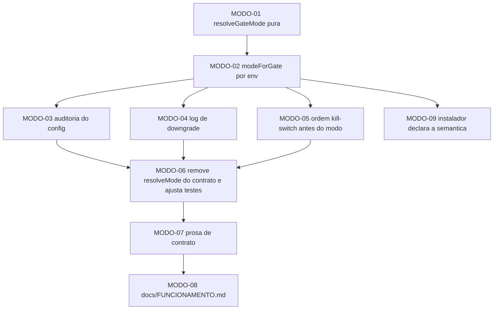

# PLAN — Modo efetivo de um gate vive no env do processo host

> Entrada: `SPEC.md` (ciclo `prd-garantias-runtime` / ADR-001) · Saída: `TASKS.md`
> Repo sem backend Java/frontend: o "backend" aqui é o runtime do plugin (Node ESM) e o
> "frontend" é a prosa que o operador lê (`reason` do deny = a interface).

## 1. Traceabilidade 1:1 (SPEC → PLAN → TASKS)

| Req | Restrição | Tarefas do PLAN | Tasks |
|---|---|---|---|
| RF-01 | config não altera modo | P1 (resolução pura) + P3 (limpeza do contrato) | `MODO-01`, `MODO-02`, `MODO-06` |
| RF-05 | rebaixamento logado, nunca silencioso | P2 (observabilidade) | `MODO-03`, `MODO-04` |
| C3 (RF implícito) | `HARNESS_GATES=off` precede o modo | P3 (ordem) | `MODO-05` |
| RF-04 | prosa cita lastro e nível | P4 (prosa) | `MODO-07`, `MODO-08` |
| C5/C6 | sem deny novo; suíte verde | transversal a todas | `MODO-01`..`MODO-09` |
| ADR-001 item 8 | config gerado mantém a forma | P4 (propagação) | `MODO-09` |

## 2. Constraint mapping

| Restrição | Enforcement | Failure mode |
|---|---|---|
| Modo default é `enforce` | `resolveGateMode` env ausente ⇒ `enforce` (SPEC 3.2) | ausente por bug ⇒ gate deixa de negar; coberto por teste unitário |
| Rebaixamento exige motivo | env `warn` sem `_REASON` ⇒ `enforce` + WARN | motivo vazio ⇒ sem rebaixamento; coberto por teste |
| Valor inválido não rebaixa | valor fora do domínio ⇒ `enforce` + WARN | typo no env ⇒ gate continua negando |
| Config é auditado, não decidido | 1 WARN por `gates[k]` ≠ `enforce` | auditoria silenciosa ⇒ bypass invisível; coberto por teste |
| Kill-switch precede o modo | ordem fixa no dispatcher | ordem invertida ⇒ `HARNESS_GATES=off` deixa de cortar; coberto por teste de integração |
| `decide()` não muda | assinatura e semântica intactas | mudança acidental ⇒ fail-open; coberto por diff + suite |
| Nenhum deny novo | diff + `R-NODENY` (sdd-checks) | deny novo ⇒ superfície ampliada; `R-NODENY` reprova |
| Forma do config não muda | golden `installer/__tests__/golden.spec.mjs:40` | mudança de forma ⇒ quebra o config do destino |

## 3. Grafo de execução (ordem)

## 4. Caminho crítico

`MODO-01` → `MODO-02` → `MODO-06` → `MODO-07` → `MODO-08`.
É o caminho mínimo para a garantia estar fechada **e** narrada. `MODO-03`/`MODO-04`
(auditoria + log) são o que impede o rebaixamento de ser silencioso — entram antes
de `MODO-06` por dependerem do mesmo ponto de resolução. `MODO-09` é independente
do caminho crítico (propagação para o config do destino).

## 5. Fases

| Fase | Tasks | Saída |
|---|---|---|
| 1 — núcleo puro | `MODO-01`, `MODO-02` | modo resolvido por env; config fora da decisão |
| 2 — observabilidade | `MODO-03`, `MODO-04` | rebaixamento e config auditado, ambos com WARN |
| 3 — ordem e limpeza | `MODO-05`, `MODO-06` | ordem correta; `resolveMode` removido; testes ajustados |
| 4 — prosa e propagação | `MODO-07`, `MODO-08`, `MODO-09` | prosa no mesmo alcance do código; instalador declara a semântica |

## 6. Ciclo de vida de eventos

**N/A justificado** — o plugin não emite eventos; o deny é síncrono, dentro do hook
`execute.before`. Não há Producer/Outbox/Broker/Consumer.

## 7. Tarefas de verificação

| Tipo | Task | O que prova |
|---|---|---|
| Teste unitário | `MODO-01`, `MODO-02`, `MODO-03`, `MODO-04` | as 5 regras de resolução, a auditoria e o log |
| Teste de integração (runtime) | `MODO-05`, `MODO-06` | ordem kill-switch → modo → gates; `HARNESS_GATES=off` corta mesmo com rebaixamento pedido |
| Failure mode | `MODO-01`, `MODO-04` | env inválido, motivo ausente, valor nonsense |
| Idempotência | **N/A justificado** | a resolução é pura e sem estado (exceto o cache de 1 WARN por par, que é idempotente por construção) |
| Regressão | `MODO-06` | os 895 testes e o golden do installer continuam verdes |

## 8. Riscos de execução

| Risco | Mitigação |
|---|---|
| `gate.spec.mjs` e `matrix-v1v2-parity.spec.mjs` fixam o comportamento de `gates.*` | `MODO-06` trata explicitamente os trechos `:144-149`, `:1007-1024`, `:197-206` |
| O golden do installer exige igualdade byte-a-byte do config gerado | `MODO-09` só toca o comentário/semântica; a chave e o formato ficam idênticos |
| Ordem de avaliação invertida deixa o kill-switch inoperante | `MODO-05` fixa e fixa por teste de integração |
| Prosa e código divergirem de novo | `MODO-07`/`MODO-08` exigem o mesmo alcance; o instrumento (`V18`) é `ADR-004` |
