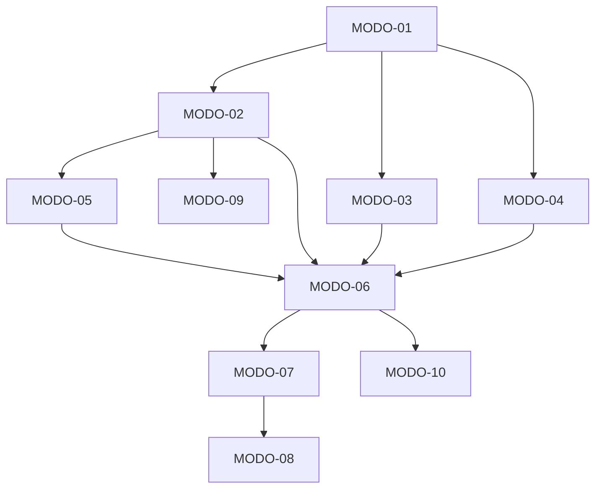

# TASKS — Modo efetivo de um gate vive no env do processo host

> Entrada: `PLAN.md` · Ciclo `prd-garantias-runtime` / ADR-001 · branch `adr/prd-garantias-runtime/01-modo-gate-no-env`
> TDD: o teste vem ANTES da implementação em toda task. Granularidade < 2h. ID no formato `<PREFIXO>-<NN>`.

## Sprint summary

| Phase | ID | Título | Prioridade | Risco | Tipo | Depende de |
|---|---|---|---|---|---|---|
| Phase 1 | `MODO-01` | Função pura `resolveGateMode(gateName, env)` | P0 | Low | code+test | — |
| Phase 1 | `MODO-02` | `modeForGate(gateFn, env)` resolve por env | P0 | Medium | code+test | `MODO-01` |
| Phase 2 | `MODO-03` | Auditoria do config `gates.*` (1 WARN por chave) | P1 | Low | code+test | `MODO-01` |
| Phase 2 | `MODO-04` | Log de rebaixamento (1 WARN por par gate+motivo) | P0 | Low | code+test | `MODO-01` |
| Phase 3 | `MODO-05` | Ordem: kill-switch antes da resolução de modo | P0 | Medium | code+test | `MODO-02` |
| Phase 3 | `MODO-06` | Remover `resolveMode(config,…)` e ajustar os testes que o fixam | P0 | High | refactor+test | `MODO-02`, `MODO-03`, `MODO-04`, `MODO-05` |
| Phase 4 | `MODO-07` | Prosa de contrato (gate-contract, harness-config, README) | P1 | Low | doc | `MODO-06` |
| Phase 4 | `MODO-08` | `docs/FUNCIONAMENTO.md`: §3, §4.7, §10 `a7` | P1 | Low | doc | `MODO-07` |
| Phase 4 | `MODO-09` | Instalador declara a semântica de `gates.*` (formato inalterado) | P2 | Low | doc+test | `MODO-02` |
| Phase 4 | `MODO-10` | Prosa residual falsificada pelo ciclo (`config.mjs`, `orchestrator/AGENT.md`) | P1 | Low | doc | `MODO-06` |

## Grafo de dependências

---

### MODO-01 — Função pura `resolveGateMode(gateName, env)`

**Prioridade** P0 · **Risco** Low · **Tipo** code+test · **Depende de** — · **Fecha** RF-01 (parte), SPEC 3.1/3.2

**Arquivos**: `.opencode/plugins/gate.js` (nova função pura), `.opencode/plugins/__tests__/gate.spec.mjs`

**Passos (TDD)**
1. Escrever o teste unitário da função pura: env ausente ⇒ `{mode:"enforce",source:"default",envVar:null,reason:null}`; `"enforce"` ⇒ `source:"env"`; `"warn"`+`_REASON` ⇒ `mode:"warn"` com o motivo; `"warn"` sem motivo ⇒ `enforce`; valor inválido ⇒ `enforce`.
2. Verificar que o teste **falha** (a função não existe).
3. Implementar `resolveGateMode(gateName, env)` como função pura (sem I/O, sem log interno — só o retorno).
4. O log de "motivo ausente"/"valor inválido" é emitido pelo chamador (task `MODO-04`).
5. Rodar o teste ⇒ verde.

**BDD**
- *Sucesso*: dado `env = {HARNESS_GATE_PICCO:"warn", HARNESS_GATE_PICCO_REASON:"debug"}`, quando `resolveGateMode("picco", env)`, então `mode === "warn"` e `reason === "debug"`.
- *Falha*: dado `env = {HARNESS_GATE_PICCO:"warn"}` (sem motivo), quando resolve, então `mode === "enforce"` e `source === "default"`.
- *Borda*: dado `env = {HARNESS_GATE_PICCO:"ENFORCE"}` (maiúsculas) ou `{"off"}`, quando resolve, então `mode === "enforce"` (domínio é estrito: `enforce`|`warn`).

**DoD**: função pura exportada; 5 casos de teste verdes; nenhuma linha de log dentro da função; `decide()` intocada.

---

### MODO-02 — `modeForGate(gateFn, env)` resolve por env

**Prioridade** P0 · **Risco** Medium · **Tipo** code+test · **Depende de** `MODO-01` · **Fecha** RF-01, SPEC 3.3

**Arquivos**: `.opencode/plugins/gate.js`, `.opencode/plugins/__tests__/gate.spec.mjs`

**Passos (TDD)**
1. Escrever teste: `modeForGate(gatePiccoTask, {HARNESS_GATE_PICCO:"warn", HARNESS_GATE_PICCO_REASON:"x"})` ⇒ `mode === "warn"`; `modeForGate(gateShellHygiene, {})` ⇒ `mode === "enforce"` (gate sem `gateName` ⇒ `DEFAULT_MODE`).
2. Verificar que o teste falha.
3. Alterar `modeForGate` para resolver pelo env (passando `env` em vez de `config`); manter o `DEFAULT_MODE` para gate sem chave própria.
4. Não remover ainda `resolveMode` (a remoção é `MODO-06`, junto do ajuste dos testes).
5. Rodar o teste ⇒ verde.

**BDD**
- *Sucesso*: dado `HARNESS_GATE_EVIDENCE=warn` + motivo, quando `modeForGate(gateCompletionAnchorA, env)`, então `mode === "warn"`.
- *Falha*: dado env vazio, quando `modeForGate(gatePiccoTask, env)`, então `mode === "enforce"`.
- *Borda*: dado um gate sem `gateName` (higiene), quando resolve com env que não o nomeia, então `mode === "enforce"`.

**DoD**: `modeForGate` lê env; `DEFAULT_MODE` preservado; testes verdes; `decide()` com a mesma assinatura.

---

### MODO-03 — Auditoria do config `gates.*`

**Prioridade** P1 · **Risco** Low · **Tipo** code+test · **Depende de** `MODO-01` · **Fecha** SPEC 3.4

**Arquivos**: `.opencode/plugins/gate.js` (ponto de carga do config), `.opencode/plugins/__tests__/gate.spec.mjs`

**Passos (TDD)**
1. Escrever teste: config com `gates: {picco:"warn", evidence:"enforce"}` ⇒ **1** WARN de auditoria (contendo chave, valor, modo efetivo `enforce` e "gate registrado: sim"); a chave `evidence` **não** gera log.
2. Verificar que o teste falha.
3. Implementar a auditoria no ponto em que o config é carregado (1 WARN por chave ≠ `enforce`).
4. Não alterar a resolução (o config já não participa desde `MODO-02`).
5. Rodar o teste ⇒ verde.

**BDD**
- *Sucesso*: dado `gates:{picco:"warn"}`, quando o config é carregado, então 1 WARN com a chave `picco` e o modo efetivo `enforce`.
- *Falha*: dado `gates:{picco:"enforce"}`, quando o config é carregado, então **zero** WARN.
- *Borda*: dado `gates:{chaveDesconhecida:"warn"}`, quando o config é carregado, então 1 WARN com "gate registrado: não".

**DoD**: auditoria com exatamente 1 WARN por chave não-`enforce`; nenhum WARN para `enforce`; log sem path do arquivo.

---

### MODO-04 — Log de rebaixamento (1 WARN por par gate+motivo)

**Prioridade** P0 · **Risco** Low · **Tipo** code+test · **Depende de** `MODO-01` · **Fecha** RF-05, SPEC 3.2/INV-3

**Arquivos**: `.opencode/plugins/gate.js`, `.opencode/plugins/__tests__/gate.spec.mjs`

**Passos (TDD)**
1. Escrever teste: rebaixamento em vigor ⇒ 1 WARN contendo gate, nome da env e motivo; duas resoluções do mesmo par ⇒ **não** duplica (1 por par, por processo).
2. Verificar que o teste falha.
3. Implementar o log no ponto de resolução, com cache do par já anunciado.
4. Também emitir o WARN de recusa (motivo ausente / valor inválido) — 1 por ocorrência de recusa.
5. Rodar o teste ⇒ verde.

**BDD**
- *Sucesso*: dado `HARNESS_GATE_PICCO=warn` + motivo, quando resolve, então 1 WARN com gate+env+motivo.
- *Falha*: dado `HARNESS_GATE_PICCO=warn` sem motivo, quando resolve, então 1 WARN de recusa e **nenhum** WARN de rebaixamento.
- *Borda*: dado o mesmo par resolvido 2×, quando resolve, então 1 único WARN de rebaixamento.

**DoD**: rebaixamento nunca silencioso; recusa sempre anunciada; 1 WARN por par (gate, motivo).

---

### MODO-05 — Ordem: kill-switch antes da resolução de modo

**Prioridade** P0 · **Risco** Medium · **Tipo** code+test · **Depende de** `MODO-02` · **Fecha** C3, SPEC 3.5/INV-4

**Arquivos**: `.opencode/plugins/gate.js` (dispatcher), `.opencode/plugins/__tests__/matrix-v1v2-parity.spec.mjs`

**Passos (TDD)**
1. Escrever teste de integração: `HARNESS_GATES=off` + `HARNESS_GATE_PICCO=warn` ⇒ **allow** em `task`, `write` e `bash`; sem o kill-switch, a mesma config de env nega.
2. Verificar que o teste falha (se a ordem estiver invertida).
3. Fixar a ordem no dispatcher: corte de suíte → resolução de modo → loop de gates.
4. Não criar deny novo; o corte continua sendo o early-return já existente.
5. Rodar o teste ⇒ verde.

**BDD**
- *Sucesso*: dado `HARNESS_GATES=off`, quando qualquer tool é chamada, então `verdict === "allow"` com `via:"kill-switch"`.
- *Falha*: dado `HARNESS_GATES=off` **ausente** e `HARNESS_GATE_PICCO=warn`+motivo, quando `task` sem PICCO é chamada, então **deny**.
- *Borda*: dado `HARNESS_GATES=off` e config ausente, quando `write` é chamada, então **allow** — o corte precede a **resolução de modo**; a carga/auditoria do config vem antes do corte por ser fato de config, não resolução (SPEC §3.5; review do batch 3, A3).

**DoD**: ordem fixa e verificada por teste; `via:"kill-switch"` inalterado; nenhum deny novo.

---

### MODO-06 — Remover `resolveMode(config,…)` e ajustar os testes que o fixam

**Prioridade** P0 · **Risco** High · **Tipo** refactor+test · **Depende de** `MODO-02`, `MODO-03`, `MODO-04`, `MODO-05` · **Fecha** RF-01, ADR-001 item 4

**Arquivos**: `.opencode/plugins/gate.js`, `.opencode/plugins/__tests__/gate.spec.mjs` (`:144-149`, `:1007-1024`), `.opencode/plugins/__tests__/matrix-v1v2-parity.spec.mjs` (`:197-206`), `.opencode/plugins/__tests__/config-loader.spec.mjs` (nome do `it(...)`, se mencionar `resolveMode`)

**Passos (TDD)**
1. Escrever/adjustar o teste que **prova a remoção**: para todo `k` e todo `v`, `resolveGateMode(k, {env:{}}).mode === "enforce"` — ou seja, o config não participa (RF-01).
2. Verificar que o teste falha enquanto `resolveMode` existir.
3. Remover `resolveMode` do código e todas as chamadas; ajustar os pontos que o importavam.
4. Atualizar os trechos de teste que fixam `gates.*` como decidedor: `gate.spec.mjs:144-149` (o caso "off/unknown never disables" passa a ser "o config nunca decide o modo") e `:1007-1024`; em `matrix-v1v2-parity.spec.mjs:197-206`, o caso "GATES-OFF" perde objeto — passa a provar que `gates.*=off` **não muda nada** (o downgrade real vem do env).
5. Rodar a suite do plugin ⇒ verde, com **o mesmo número de testes** (379).

**BDD**
- *Sucesso*: dado `config.gates = {picco:"warn", evidence:"off"}` e env vazio, quando um gate resolve, então `mode === "enforce"`.
- *Falha*: dado `resolveMode` ainda exportado, quando o teste importa, então o import falha (a remoção é observável).
- *Borda*: dado `gates` com chave desconhecida e valor não-`enforce`, quando o config é carregado, então há WARN de auditoria mas o modo efetivo é `enforce`.

**DoD**: `resolveMode` não existe mais no código; `resolveGateMode` é o único resolvedor; 379 testes verdes (mesma contagem); `R-NODENY` PASS.

---

### MODO-07 — Prosa de contrato (gate-contract, harness-config, README)

**Prioridade** P1 · **Risco** Low · **Tipo** doc · **Depende de** `MODO-06` · **Fecha** RF-04, ADR-001 item 9

**Arquivos**: `.agents/rules/gate-contract.md` (rows `RF-01/RF-02` e `KILL` da §1), `.agents/rules/harness-config.md` (linha `gates.*` + seção Kill-switch), `README.md` (funcionalidade #7)

**Passos**
1. Reescrever a row `RF-01/RF-02`: "nenhuma chave do config altera o modo efetivo; o rebaixamento vive em `HARNESS_GATE_<GATE>` + `HARNESS_GATE_<GATE>_REASON` (motivo obrigatório)".
2. Reescrever a row `KILL`: distinguir o corte de suíte (`HARNESS_GATES=off`) do rebaixamento de um gate (env por gate).
3. `harness-config.md`: linha `gates.*` ⇒ "informativo/auditado; rebaixamento vive no env"; seção Kill-switch ⇒ canal por gate + motivo obrigatório + auditoria.
4. `README.md`: funcionalidade #7 ⇒ "o config nunca desliga a suíte; rebaixar um gate exige env do processo host + motivo".
5. Cada afirmação nova cita `arquivo:linha` do mecanismo e o nível real (🟢/🟠/🟡/🔴).
6. Rodar `node scripts/static-checks.mjs` e `node scripts/sdd-checks.mjs` ⇒ verdes (os checks leem prosa).

**BDD**
- *Sucesso*: dado a row `RF-01/RF-02`, quando lida, então cita `gate.js` (linha da função nova) e o nível real.
- *Falha*: se a prosa afirmar que o config decide o modo, quando o `V18` existir (§`ADR-004`), então reprova.
- *Borda*: a prosa pode declarar "rebaixamento auditado, não aplicável ao config" — desde que o alcance corresponda ao código.

**DoD**: 4 trechos reescritos com lastro; zero afirmação que o config decide modo; checks verdes.

---

### MODO-08 — `docs/FUNCIONAMENTO.md`: §3, §4.7, §10 `a7`

**Prioridade** P1 · **Risco** Low · **Tipo** doc · **Depende de** `MODO-07` · **Fecha** RF-04, ADR-001 item 9

**Arquivos**: `docs/FUNCIONAMENTO.md`

**Passos**
1. §3 (funcionalidades): atualizar a linha #7 (kill-switch) para refletir o canal por gate no env.
2. §4.2 (dispatcher): remover a citação a `resolveMode` (removido em MODO-06) e descrever a ordem carga+auditoria → corte de suíte → resolução de modo.
3. §4.7 (config fail-closed, kill-switch e selo): descrever a resolução por env, a auditoria do config e a ordem de avaliação.
4. §10 `a7`: mudar de "achado" para "implementado em 2026-10-22 (ADR-001)" — mantendo o lastro e o nível.
5. Preservar a contagem de linhas do arquivo (as ~120 citações `arquivo:linha` do doc dependem dela) — ajuste 1:1.
6. Validar os 7 diagramas Mermaid (nenhum label com `<`/`>` novo).

**BDD**
- *Sucesso*: dado §10 `a7`, quando lida, então diz "implementado" e aponta o ADR-001.
- *Falha*: se o doc disser que o config rebaixa o gate, quando lido contra o código, então contradiz.
- *Borda*: o doc pode manter a nota histórica ("o código permitia…") desde que marque como resolvido.

**DoD**: 3 trechos atualizados; `wc -l` inalterado; nenhum lastro quebrado.

---

### MODO-09 — Instalador declara a semântica de `gates.*`

**Prioridade** P2 · **Risco** Low · **Tipo** doc+test · **Depende de** `MODO-02` · **Fecha** ADR-001 item 8

**Arquivos**: `installer/install.mjs` (comentário/semântica do config gerado), `installer/__tests__/golden.spec.mjs` (só se a forma mudar — **não deve** mudar)

**Passos**
1. Escrever/verificar o teste: o config gerado mantém `gates` com as mesmas 4 chaves e o mesmo formato (golden byte-a-byte) — o teste **não** muda.
2. Adicionar/ajustar o comentário em `installer/install.mjs:664` declarando que `gates.*` é **informativo/auditado** e que o rebaixamento real vive no env do processo host.
3. Não alterar o objeto gerado (o `deepEqual` do golden em `golden.spec.mjs:135` continua valendo).
4. Rodar `node --test "installer/__tests__/*.spec.mjs"` ⇒ 516 verdes.

**BDD**
- *Sucesso*: dado o config gerado, quando o golden compara, então igualdade byte-a-byte.
- *Falha*: se o instalador passar a escrever `gates` com outro formato, quando o golden compara, então reprova.
- *Borda*: o instalador pode omitir `gates.*` por completo — mas isso quebraria o golden e o config do destino; **não** é o caminho escolhido.

**DoD**: formato do config inalterado; 516 testes verdes; semântica declarada no instalador.

---

### MODO-10 — Prosa residual falsificada pelo ciclo

**Prioridade** P1 · **Risco** Low · **Tipo** doc · **Depende de** `MODO-06` · **Fecha** RF-04 (lacuna de escopo detectada no code review do batch 1)

**Arquivos**: `.opencode/plugins/lib/config.mjs` (comentário `:35-37`), `.agents/agents/orchestrator/AGENT.md` (bullet `:629`)

**Por que existe**: o batch 1 (MODO-01/MODO-02) tornou `gates.*` inócuo, mas duas afirmações de prosa ainda dizem o contrário e **nenhuma task de MODO-07/MODO-08 as cobre** — MODO-07 lista só `gate-contract.md`/`harness-config.md`/`README.md`, MODO-08 só `docs/FUNCIONAMENTO.md`. Sem esta task, o ciclo fecharia com prosa falsa no próprio repo.

**Passos**
1. `.opencode/plugins/lib/config.mjs:35-37`: o comentário diz "per gate it downgrades — resolveMode honors only 'enforce'". Reescrever para a verdade do ADR-001: `gates.*` nunca decide modo; o rebaixamento vive no env do processo host (`HARNESS_GATE_<GATE>` + `_REASON`).
2. `.agents/agents/orchestrator/AGENT.md:629`: o bullet diz "`gates.*` do config não desliga a suíte, mas rebaixa um gate isolado para `warn`". Reescrever: não desliga a suíte **nem** rebaixa gate; o rebaixamento vive no env do processo host e exige motivo.
3. Preservar a contagem de linhas dos 2 arquivos (ajuste 1:1) — as citações `arquivo:linha` do `docs/FUNCIONAMENTO.md` e do `gate-contract.md` dependem delas.
4. Rodar `node scripts/static-checks.mjs` e `node scripts/sdd-checks.mjs` ⇒ verdes.

**BDD**
- *Sucesso*: dado `config.mjs:35-37`, quando lido, então afirma que `gates.*` não decide modo e que o canal é o env.
- *Falha*: se a prosa disser que o config rebaixa o gate, quando lida contra `modeForGate` (que só lê `gateFn.gateName`), então contradiz.
- *Borda*: a prosa pode registrar o histórico ("o config decidia modo antes do ADR-001") desde que o presente seja o correto.

**DoD**: 2 trechos reescritos; `wc -l` inalterado nos 2 arquivos; checks verdes.
