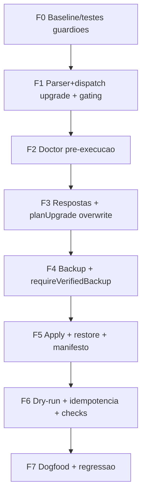

# Implementation Plan: `upgrade` no instalador do harness

## 1. Context & SPEC Traceability

- **Target Specification**: `.spec/backend/installer-upgrade/SPEC.md`
- **Goal**: Converter RF-01..RF-19, INV-01..INV-09 e ADR-001..ADR-009 em um plano executável, seguro e idempotente para `installer/install.mjs` + `installer/__tests__/`, sem merge e sem detalhamento de microtasks (apenas esboços `PL-*`).
- **Feature type**: feature · **single file afetado**: `installer/install.mjs` (delta aditiva) · **testes**: `installer/__tests__/upgrade.spec.mjs` (novo) + delta condicional em `cli.spec.mjs`/`golden.spec.mjs`.
- **Plan-gate target**: 9/9 (self-check na §10).

### 1.1 SPEC Validation Report

- **Status**: Strictly Validated (SPEC §12: spec-gate ~92%, 0 críticos; proposal-gate retroativo justificado em SPEC §13).
- **Identified Gaps/Warnings** (bloqueadores: nenhum):
  - Eventos/mensageria N/A (§8 do PLAN: tabela de lifecycle dispensada com justificativa).
  - Multi-tenancy/JWT/DB N/A (CLI local single-target; invariantes INV-* são os constraints testáveis).
  - Restore hook é best-effort (gap médio SPEC §8.2) — PL-UPG-52 cobre falha dupla, sem transação de SO.
  - `runDoctor` retorna veredito quebrado mas **não** aborta o upgrade (T-21) — decisão vinculante do SPEC.
- **Assumptions Made**:
  1. `planUpgrade` pode **ler** disco (classificador com I/O de leitura), mas não escreve nem tem sink; scheduler/display fica no chamador (`runUpgrade`).
  2. `buildManifest` ganha parâmetros opcionais novos; quando não informados, as chaves delta são **omitidas** (regressão segura para init/golden).
  3. `upgrade` real com plano 100% `noop` curto-circuita **antes** do backup — zero writes, exit 0 (idempotência operacional INV-06).
  4. `backupDir` permanece a única exceção da fence `assertInside` (FU-22 documentado e testado).

## 2. Technical Strategy

### 2.1 Backend Strategy

- **Runtime**: Node ESM, zero deps, função pura + efeitos separados; padrão do repositório (SPEC pai).
- **Padrão**: classificador puro (`planUpgrade`, sem sink, sem escrita) → efeitos isolados (`backup`, `applyUpgrade`, `writeManifest`, `runChecks`).
- **Bluebrints rodativo (TDD)**: cada `PL-*` começa com teste vermelho em `upgrade.spec.mjs` (ou `cli.spec.mjs`), depois código mínimo; uma preocupação por microtask/arquivo. Tasks detalhadas (testes BDD) ficam para `TASKS.md`, não aqui.

### 2.2 Frontend Strategy

- N/A — sem frontend no escopo.

### 2.3 Infrastructure Strategy

- **Deployment**: CLI local, `--target <dir>`. Zero rede/git (ADR-009).
- **CI/CD**: `node --test installer/__tests__/` + `scripts/static-checks.mjs` (`harness.config.json#commands.suiteFull`).

## 3. Architecture Realization & Constraint Mapping

| SPEC Ref | Constraint | Enforcement Point | Failure Mode | Implementation Strategy |
|---|---|---|---|---|
| RF-02/15, INV-02 | Gating idêntico + fence | `preflight({ skipManifestGuard:true })`, `assertInside` por path do plano | `BAD_TARGET`, `OUTSIDE_TARGET`, `NODE_MIN`, `UID_ROOT` | reusa preflight/zone; `backupDir` é a única exceção documentada (FU-22) |
| RF-03, ADR-003 | Manifesto próprio/parseável | gate em `runUpgrade` (U0) | `NOT_INSTALLED`, `MANIFEST_INVALID`, `FOREIGN_MANIFEST` (0 writes) | lê+valida JSON; aborta em corrupção |
| RF-04 | Doctor pré-execução read-only | `runDoctor` (U1) saída D0..D6 | diagnóstico jamais bloqueia; veredito em `doctorPre` | doctor não chama `writeManifest`/`apply` (por construção) |
| RF-05, ADR-008, INV-07 | Respostas preservadas | `manifest.answers` ± `--answers-file` + `collectAnswers` + `generateConfig` | `BAD_ANSWER` em JSON inválido/ausente | answers-file sobrepõe **inteiramente**; config sempre gerado |
| RF-06, ADR-002/005 | Overwrite gerenciado sem merge | classificador puro `planUpgrade` | ações só `create`/`overwrite`/`noop`/`remove`; nunca `merge`/`flag` | sem `mergeOpencodeJson`/`mergeAgentFile` no caminho upgrade |
| RF-07 | Confirmação por camada | `confirmByLayer` (reuse) | `USER_ABORT`, `NO_STDIN` | `--yes` dispensa; dry-run dispensa |
| RF-08/09, INV-01 | Backup verificado antes de escrever | `backup` + `requireVerifiedBackup` (U5) | `BACKUP_FAIL`, `BACKUP_UNVERIFIED` (0 writes) | cobre 100% das camadas + manifesto; dir fora do target |
| RF-10, FU-21 | Apply sem write vazio silencioso | `applyUpgrade` write incoming | `MISSING_INCOMING` | recusa `typeof incoming !== 'string'` |
| RF-11, ADR-006, INV-09 | Restore hook em falha | `applyUpgrade` envolto por journal + rollback do backup | `RESTORED` exit 3; falha dupla documentada com `backupDir` | restaura backup rastreado + remove criados; best-effort |
| RF-12, INV-05 | Manifesto pós-upgrade atual | `buildManifest` delta (último passo) | nunca versão anterior; `upgradedFrom`/`backups[]` | `version`/`source`/`date`/`fileHashes` recomputados |
| RF-13, INV-06 | Idempotência | `planUpgrade` compara bytes + short-circuit real | 2ª run zero writes, exit 0 | all-`noop` ⇒ pula backup/apply/manifesto |
| RF-14, INV-04 | Dry-run read-only | curto-circuito (sem backup/apply/manifesto/checks) | `passed: null`, `ran:false`, `skipped:true` | `dryRunNotice()` no stdout; exit 0 |
| RF-16 | Exit codes | `runCli`/`runUpgrade` | 0 sucesso/dry-run · 1 abort · 2 checks FAIL · 3 rollback | return `{ exitCode }` |
| RF-17 | Erros 4-linhas | `ERROR_CODES` + `formatError` | códigos novos no vocabulário | adiciona `NOT_INSTALLED`, `MANIFEST_INVALID`, `RESTORED` |
| RF-18, INV-08 | Segredo nunca persiste | `serializeAnswers` + `sanitizeLog` (reuse) | canário no fixture | `deployToken` ausente em manifesto/config/log |
| RF-19 | Dogfood guard | `assertDogfoodTarget` (reuse) | `DOGFOOD_GUARD` fora de `/tmp` sem confirmação | `--target` explícito + confirmado |
| ADR-004, FU-22 | Backup fora da fence | `resolveBackupDir` (exceção documentada) | `BACKUP_FAIL` se igual/aninhado (realpath incluído) | não altera a regra; apenas documenta |
| ADR-005, OUT-2 | Prune só do inventariado | `planUpgrade` remove | arquivo fora do inventário é user-owned (não removido; colisão vira overwrite + `collisions[]`) | testes T-06/T-07/T-08/T-18 |
| ADR-009 | Zero rede/git | `collectIncoming(INSTALLER_ROOT)` (reuse) | bloco usage + `docs/INSTALACAO.md` §3 | conteúdo sempre do harness em disco |

## 4. Module & Code Structure

| Module | Responsibilities | Boundaries |
|---|---|---|
| `installer/install.mjs` | dispatch `upgrade`, gate de manifesto, `runUpgrade`, `planUpgrade` puro, `applyUpgrade` com journal/rollback, delta do manifesto | mantém init/doctor intactos; funções puras exportáveis; nenhum write fora de `main`/`runUpgrade` |
| `installer/__tests__/upgrade.spec.mjs` | T-01..T-21 (positivo + negativo) em `os.tmpdir()`, nunca no repo real | um arquivo por feature; TDD red-first |
| `installer/__tests__/cli.spec.mjs` | delta condicional: dispatch `upgrade` + posicional extra | golden intocável salvo `printUsage` |
| Matriz de rastreio | RF→fase→PL na §6 e §8 | zero RF órfão |

## 5. Risks & Complexity Analysis

- 🔥 **CRITICAL — escrever antes de backup verificado**: mitigado por INV-01 + teste snapshot (T-02) e `requireVerifiedBackup`.
- 🔥 **CRITICAL — remover arquivo user-owned**: mitigado por prune só de `installed[]`/`merged[]` do manifesto anterior (ADR-005) + T-07/T-18.
- 🔥 **CRITICAL — dry-run que escreve**: mitigado por curto-circuito antes de `backup`/`apply`/`writeManifest` + T-03.
- 🔥 **CRITICAL — estado híbrido após falha parcial**: mitigado por journal + restore hook + exit 3 (T-10/T-11); residual: rollback best-effort.
- **HIGH — colisão silenciosa em camada gerenciada**: mitigado por overwrite + `collisions[]` + hashes (T-08).
- **MED — manifesto velho após upgrade**: mitigado por rewrite por último + INV-05 (T-01).
- **MED — idempotência falsa por mtime**: comparado por bytes `sha256`, não mtime (T-05).
- **LOW — atalho/symlink no caminho**: reusa `zone.mjs` + dogfood (T-12).

## 6. Implementation Phases & Dependencies

### Phase F0 — Baseline & testes guardiões (nenhuma write de produto)
- **Dependencies**: None.
- **Scope** (PL-UPG-00): congelar baseline (`node --test` verde), criar esqueleto de `upgrade.spec.mjs`, adicionar cenário dispatch de `upgrade` em `cli.spec.mjs`, validar `assertDogfoodTarget`.
- **Verify**: `node --test installer/__tests__/suite.spec.mjs installer/__tests__/golden.spec.mjs installer/__tests__/cli.spec.mjs`

### Phase F1 — Parser + dispatch `upgrade` e gating (U0)
- **Dependencies**: F0.
- **Scope** (PL-UPG-01..03): `CLI_COMMANDS.add('upgrade')`; `printUsage` com linha `upgrade`; `runCli` branch `upgrade` (pré-existente U0); gate de manifesto `NOT_INSTALLED`/`MANIFEST_INVALID`/`FOREIGN_MANIFEST`; `ERROR_CODES` +3; fence `assertInside` por path.
- **RF cobertos**: RF-01, RF-02, RF-03, RF-15, RF-17.
- **Verify**: `node --test installer/__tests__/cli.spec.mjs`

### Phase F2 — Doctor pré-execução (U1)
- **Dependencies**: F1.
- **Scope** (PL-UPG-04): `runUpgrade` chama `runDoctor` (read-only), imprime `D0..D6` em ordem, captura `verdict/counts/failed` em `doctorPre`; doctor quebrado não aborta.
- **RF cobertos**: RF-04 (T-21).
- **Verify**: `node --test installer/__tests__/doctor.spec.mjs installer/__tests__/upgrade.spec.mjs`

### Phase F3 — Respostas + planner puro de overwrite (U2/U3)
- **Dependencies**: F2.
- **Scope** (PL-UPG-05..07): base `manifest.answers`; `--answers-file` sobrepõe inteiramente + `collectAnswers`/`validateAnswer`; `generateConfig`; `planUpgrade` puro (ações `create`/`overwrite`/`noop`/`remove`), prune só do inventário, `collision` metadata; sem I/O de escrita.
- **RF cobertos**: RF-05, RF-06, RF-18 (parte answers), ADR-005, ADR-008.
- **Verify**: `node --test installer/__tests__/upgrade.spec.mjs`

### Phase F4 — Backup + `ensureVerifiedBackup` (U4 parcial/U5 pré-condição)
- **Dependencies**: F3.
- **Scope** (PL-UPG-08..09): `backup` (100% gerenciados + manifesto) em `--backup-dir` ou ao lado (nunca dentro — realpath); `requireVerifiedBackup`; bloqueio ante falha.
- **RF cobertos**: RF-08, RF-09, INV-01.
- **Verify**: `node --test installer/__tests__/upgrade.spec.mjs`

### Phase F5 — Apply overwrite + restore + manifesto (U5)
- **Dependencies**: F4.
- **Scope** (PL-UPG-10..13): `applyUpgrade` (overwrite sem merge, `MISSING_INCOMING`), remove stale, journal em memória, restore hook (exit `RESTORED`/3), `writeManifest` por último com delta (`upgradedFrom`, `removed[]`, `collisions[]`, `backups[]`, `answersSource`, `doctorPre`, `checks`), `runChecks` pós-apply, exit codes 0/1/2/3.
- **RF cobertos**: RF-10, RF-11, RF-12, RF-16, RF-18 (parte log/manifesto).
- **Verify**: `node --test installer/__tests__/upgrade.spec.mjs`

### Phase F6 — Dry-run + idempotência + checks (finalização técnica)
- **Dependencies**: F5.
- **Scope** (PL-UPG-14..16): curto-circuito read-only (backup/apply/manifesto/checks), `dryRunNotice`, idempotência all-`noop` zero writes (real), checks pós-upgrade (exit 2 se FAIL), confirmação por camada.
- **RF cobertos**: RF-07, RF-13, RF-14, RF-16 (complemento).
- **Verify**: `node --test installer/__tests__/upgrade.spec.mjs`

### Phase F7 — Testes dogfood e regressão (release gate)
- **Dependencies**: F6.
- **Scope** (PL-UPG-17..19): roteiro dogfood em `/tmp` (init→edit→doctor→dry-run→upgrade→upgrade (0 writes)→restore por backup), assert repo-harness intocado, suite regressão `init`/`doctor`/legado verde.
- **RF cobertos**: RF-19 + V1..V9.
- **Verify**: `node --test installer/__tests__/upgrade.spec.mjs installer/__tests__/dogfood*.spec.mjs && node --test installer/__tests__/`

## 7. Critical Execution Path

`F0` → `F1 (PL-UPG-01 dispatch/map)` → `F2 (PL-UPG-04 doctor)` → `F3 (PL-UPG-07 planUpgrade)` → `F4 (PL-UPG-09 backup verificado)` → `F5 (PL-UPG-11 apply + manifest)` → `F6 (PL-UPG-16 idempotencia)` → `F7 (PL-UPG-19 regressao)`

Mínimo para MVP core: dispatch + gate de manifesto + `planUpgrade` + backup verificado + apply overwrite + manifesto + idempotência.

## 8. Atomic Task Breakdown & Execution Graph (esboço `PL-*` — detalhes em TASKS.md)

- **[PL-UPG-00]** Baseline rodativo (tests first, 0 produto) — `upgrade.spec.mjs` esqueleto
- **[PL-UPG-01]** dispatch `upgrade` + `printUsage` + posicional extra (F1)
- **[PL-UPG-02]** gate de manifesto U0 (`NOT_INSTALLED`/`MANIFEST_INVALID`/`FOREIGN_MANIFEST`) (F1)
- **[PL-UPG-03]** fence `assertInside` em toda escrita + dogfood (F1)
- **[PL-UPG-04]** doctor pré-execução U1 + `doctorPre` (F2)
- **[PL-UPG-05]** respostas: base `manifest.answers` ± `--answers-file` (F3)
- **[PL-UPG-06]** `generateConfig` no caminho upgrade (F3)
- **[PL-UPG-07]** `planUpgrade` puro: `create`/`overwrite`/`noop`/`remove`, prune inventariado, collision metadata (F3)
- **[PL-UPG-08]** `resolveBackupDir`/`backup` já existentes — cobertura upgrade 100% rastreado (F4)
- **[PL-UPG-09]** `requireVerifiedBackup` antes de qualquer write (F4)
- **[PL-UPG-10]** `applyUpgrade` overwrite sem merge, `MISSING_INCOMING` (F5)
- **[PL-UPG-11]** journal em memória + restore hook → `RESTORED` exit 3 (F5)
- **[PL-UPG-12]** `buildManifest` delta (novos campos opcionais, omitidos se ausentes) (F5)
- **[PL-UPG-13]** `runChecks` pós-upgrade + exit 2 em FAIL (F5)
- **[PL-UPG-14]** dry-run curto-circuito + `dryRunNotice` (F6)
- **[PL-UPG-15]** confirmação por camada (`confirmByLayer`) (F6)
- **[PL-UPG-16]** idempotência all-`noop` zero writes, real (F6)
- **[PL-UPG-17]** testes T-01..T-21 (positivo + negativo) (F7)
- **[PL-UPG-18]** dogfood roteiro §9.2 (F7)
- **[PL-UPG-19]** regressão `init`/`doctor`/legado + suite completa (F7)

### Event Implementation Mapping (MANDATORY)

N/A justificado — SPEC: instalador é linear e local, sem eventos/mensageria, sem Outbox/Broker/Consumer. Sem tabela; nenhum task de evento gerado (determinismo preservado).

| Event Name | Producer Task ID | Outbox Task ID | Broker Task ID | Consumer Task ID |
|---|---|---|---|---|
| N/A (SPEC §6/ADR-009) | N/A | N/A | N/A | N/A |

## 9. Execution Readiness Checklist

- [x] All tasks have valid dependencies (sem ciclos — grafo §6 linear).
- [x] All SPEC events generated the 4 mandatory tasks (N/A justificado §8).
- [x] Mandatory testing tasks created for critical constraints (T-01..T-21 na F7; TDD em cada `PL-*`).
- [x] Base infra tasks explicitly defined (F0 guardiões + F1 preflight antes do domínio).
- [x] Critical Execution Path maps only the core flow (§7).

## 10. Plan-Gate Self-Check (9/9)

- [x] **Traceability 1:1** — cada RF-01..RF-19 está mapeado para ao menos um `PL-*` e fase na §6/§8; RF→phase listado em cada fase.
- [x] **Constraint Mapping** — tabela completa §3 (Constraint→Enforcement→Failure Mode→Strategy).
- [x] **Infra Bootstrap First** — F0/F1 preflight, fencing e guardiões antes de `planUpgrade`/`apply`.
- [x] **Execution Graph** — fases F0→F7 respeitam Infra→Domain (classificador)→Data/IO (backup/apply)→App (CLI).
- [x] **Critical Execution Path** — §7 lista apenas o fluxo core.
- [x] **4-Task Event Lifecycle** — N/A justificado §8 (sem eventos, sem mensageria).
- [x] **Mandatory Testing Tasks** — `PL-UPG-17/18/19` + TDD red-first em cada `PL-*`.
- [x] **Failure Mode Testing** — T-02/T-03/T-04/T-10/T-11/T-12/T-16 cobrem falha antes/ao escrever.
- [x] **Idempotency Validation** — T-05/T-13 (2× run) + `passed:null` em dry-run (T-03).

**Score plan-gate: 9/9.**

## 11. Gaps

1. Restore hook é **best-effort**: disco realmente cheio pode deixar destino parcial — gap médio declarado; mitigado por bloco 4-linhas com `backupDir` e restore manual em `docs/INSTALACAO.md` §3.
2. Manifesto inválido no destino bloqueia upgrade (`MANIFEST_INVALID`) — escolha deliberada; humano resolve.
3. `planUpgrade` é classificado puro mas **lê** disco — testes precisam fixture estável; não há sink.
4. Possível divergência entre inventário do manifesto e arquivos removidos manualmente ⇒ tratado como `noop`/preservado (OUT-2), nunca apaga user-owned.
5. `buildManifest` delta é condicional para preservar regressão do init/golden; TASKS deve validar ausência das chaves novas no manifesto de `init`.
6. Sem `uninstall`, sem migração de `manifestSchemaVersion`, sem upgrade remoto (OUT-3/4/5) — fora do escopo por decisão vinculante.

## 12. Fases (resumo executivo)

| Fase | Objetivo | Verify |
|---|---|---|
| F0 | Baseline + guardiões | `node --test suite.spec golden.spec cli.spec` |
| F1 | Dispatch `upgrade` + gating + gate manifesto | `node --test cli.spec` |
| F2 | Doctor pré-execução U1 | `node --test doctor.spec upgrade.spec` |
| F3 | Respostas + `planUpgrade` overwrite | `node --test upgrade.spec` |
| F4 | Backup verificado | `node --test upgrade.spec` |
| F5 | Apply + restore + manifesto delta | `node --test upgrade.spec` |
| F6 | Dry-run + idempotência + checks | `node --test upgrade.spec` |
| F7 | Dogfood + regressão total | `node --test upgrade.spec dogfood*.spec && node --test installer/__tests__/` |

**Grafo (acíclico)**: F0→F1→F2→F3→F4→F5→F6→F7 (mermaid na §6). **Critical path**: §7. **Gaps**: §11.
