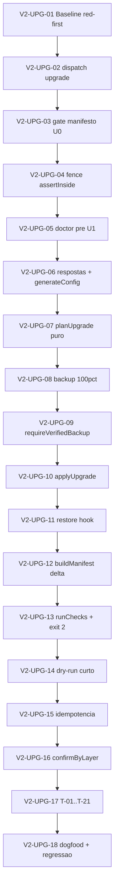

# Execution Backlog: `upgrade` no instalador do harness (V2-UPG)

> **ID**: `installer-upgrade`
> **Tipo**: feature
> **Status**: `TASKS`
> **Date**: 2026-10-15
> **Classificação**: TASKS (microtasks TDD-ready)
> **Plano-fonte**: `./.spec/backend/installer-upgrade/PLAN.md`
> **SPEC-fonte**: `./.spec/backend/installer-upgrade/SPEC.md`
> **Epic**: V2-UPG (`upgrade` overwrite-gerenciado, backup-first, idempotente)
> **Proibido nesta fase**: editar `installer/install.mjs` ou qualquer runtime. Só criar este `TASKS.md`.

## 1. Traceability Context

- **Source SPEC**: `.spec/backend/installer-upgrade/SPEC.md` (SPEC §12 spec-gate ~92%, 0 críticos; T-01..T-21).
- **Source PLAN**: `.spec/backend/installer-upgrade/PLAN.md` (plan-gate 9/9; PL-UPG-00..PL-UPG-19; F0→F7).
- **Source asserts**: `.agents/skills/sdd-compiler/asserts/tasks-gate.md`.
- **Goal**: explodir o PLAN em microtasks V2-UPG atômicas (1 arquivo por microtask), TDD-first, sem ciclos/órfãs, 12–18 microtasks, rastreáveis 1:1 aos fases PL-UPG.

### Constraints (máx. 10 — herdadas do PLAN + SPEC)

1. Somente `upgrade.spec.mjs` ou deltas em `cli.spec.mjs`/`golden.spec.mjs` para testes; `install.mjs` continua single-file.
2. Overwrite gerenciado **sem merge** (RF-06): nunca `mergeOpencodeJson`/`mergeAgentFile` no caminho upgrade.
3. Backup verificado antes de qualquer write (INV-01/RF-09).
4. Dry-run zero writes, nem backup (INV-04/RF-14).
5. Prune apenas inventoried (`installed[]`/`merged[]`); nunca apagar user-owned (ADR-005/INV-03/OUT-2).
6. Manifesto original fonte de `answers`; `--answers-file` sobrepõe inteiramente (ADR-008/RF-05).
7. Restore hook best-effort + `backupDir` no bloco de erro duplo (RF-11/§8.2).
8. TDD first: arquivo de teste antes de código, por microtask.
9. Toda microtask tem comando verificável (`node --test`, snapshot de árvore, grep).
10. Nenhuma edição de runtime nesta fase; só este `TASKS.md`.

## 2. Sprint Summary

| Phase | Microtask ID | Concern | Type | Priority | Risk | Status |
|---|---|---|---|---|---|---|
| F0 baseline | V2-UPG-01 | Esqueleto red-first de `upgrade.spec.mjs` | Test | P0 | Low | Todo |
| F1 dispatch | V2-UPG-02 | `upgrade` em `CLI_COMMANDS` + `printUsage` + posicional extra | Impl | P0 | Low | Todo |
| F1 gating | V2-UPG-03 | Gate U0 (NOT_INSTALLED/MANIFEST_INVALID/FOREIGN_MANIFEST) | Impl | P0 | High | Todo |
| F1 fence | V2-UPG-04 | `assertInside` por path do plano + dogfood guard | Test/Impl | P0 | Medium | Todo |
| F2 doctor | V2-UPG-05 | Doctor pré-execução U1 + `doctorPre` | Impl | P0 | Medium | Todo |
| F3 respostas | V2-UPG-06 | `manifest.answers` ± `--answers-file` + `generateConfig` | Impl | P0 | Medium | Todo |
| F3 planner | V2-UPG-07 | `planUpgrade` puro (create/overwrite/noop/remove) | Impl | P0 | High | Todo |
| F4 backup | V2-UPG-08 | `backup` 100% rastreado + dir fora do target | Test/Impl | P0 | High | Todo |
| F4 verify | V2-UPG-09 | `requireVerifiedBackup` antes de write | Test/Impl | P0 | High | Todo |
| F5 apply | V2-UPG-10 | `applyUpgrade` overwrite + `MISSING_INCOMING` | Impl | P0 | High | Todo |
| F5 restore | V2-UPG-11 | Journal + restore hook (`RESTORED` exit 3) | Impl | P0 | High | Todo |
| F5 manifesto | V2-UPG-12 | `buildManifest` delta (novo, omitido se absent) | Impl | P0 | Medium | Todo |
| F5 checks | V2-UPG-13 | `runChecks` pós-apply + exit 2 | Impl | P0 | Medium | Todo |
| F6 dry-run | V2-UPG-14 | Curto-circuito read-only + `dryRunNotice` | Impl | P0 | High | Todo |
| F6 idempotência | V2-UPG-15 | all-`noop` zero writes (real) | Test | P0 | Medium | Todo |
| F6 confirmação | V2-UPG-16 | `confirmByLayer` (USER_ABORT/NO_STDIN) | Test/Impl | P1 | Medium | Todo |
| F7 TDD total | V2-UPG-17 | T-01..T-21 em `upgrade.spec.mjs` | Test | P0 | High | Todo |
| F7 dogfood | V2-UPG-18 | Dogfood `/tmp` + regressão init/doctor | Test | P0 | Low | Todo |

**Totais**: 18 microtasks (V2-UPG-01..V2-UPG-18), todas < 2h, 1 arquivo primário por microtask, 0 macro-tasks inventadas.

## 3. Dependency Graph

- Acíclico: F0 → F1 → F2 → F3 → F4 → F5 → F6 → F7 (PLAN §6).
- Sem órfãs: U01 raiz; U18 sorvedouro; todas conectadas.
- Paralelizável: U06 ∥ (leitura de `collectAnswers`) após U05; U14/U15 compartilham curto-circuito (sequenciais por segurança).

---

## 4. Task Backlog

### Task `V2-UPG-01`: Baseline red-first (F0)

- **Constraint Ref**: PLAN F0; SPEC V1..V3; assets/tasks-gate §2.
- **Depends on (PLAN)**: None (raiz).
- **Dependency Type**: Hard.
- **Layer**: Test (`installer/__tests__/`).
- **Task Type**: Test.
- **Priority**: P0.
- **Risk Level**: Low.
- **Parallelizable**: No (bloqueia U02 e U03).
- **Artifact**: `installer/__tests__/upgrade.spec.mjs` (esqueleto) + `cli.spec.mjs` delta.
- **Framework Detail**: `node --test installer/__tests__/upgrade.spec.mjs installer/__tests__/cli.spec.mjs`.

#### Context
- **Description**: Criar esqueleto red-first do novo spec, import/export placeholder de `runUpgrade`/`planUpgrade`, asserção mínima de export; adicionar cenário dispatch `upgrade` em `cli.spec.mjs`. Nenhuma write de produto.
- **PL cobertos**: PL-UPG-00.
- **RF/INV**: RF-01 (preparação), INV-02 (gating idêntico).

#### BDD
- **S1 Success**: esqueleto carrega, teste falha vermelho controlado (`not implemented`).
- **S2 Failure**: export ausente ⇒ falha explícita `MODULE_EXPORT_MISSING`.
- **S3 Edge**: reexecução idêntica (sem flake), sem tocar repo real.

#### TDD Steps
- [ ] `V2-UPG-01` — `installer/__tests__/upgrade.spec.mjs` (`Type: Unit`, TDD FIRST): imports `runUpgrade`, `planUpgrade`; `node --test installer/__tests__/upgrade.spec.mjs` vermelho esperado.
- [ ] smoke de dispatch em `cli.spec.mjs`: `parseArgs(['upgrade','--target','x'])` ainda pode falhar até F1 (registrar expectativa).

#### DoD
- [ ] Arquivo de teste criado antes de qualquer implementação.
- [ ] `node --test installer/__tests__/cli.spec.mjs` verde (baseline atual).
- [ ] Plan up-to-date com `exports` esperados.

---

### Task `V2-UPG-02`: Dispatch `upgrade` + `printUsage` (F1)

- **Constraint Ref**: RF-01, RF-15, RF-17; PLAN F1.
- **Depends on (PLAN)**: U01 (Hard).
- **Artifact**: `installer/install.mjs` (`CLI_COMMANDS`, `printUsage`, posicional extra).
- **PL cobertos**: PL-UPG-01.

#### Context
- **Description**: Adicionar `upgrade` a `CLI_COMMANDS`; linha de uso no `printUsage`; posicional extra ⇒ `BAD_ANSWER`; reusar flags existentes (sem flag nova).

#### BDD
- **S1**: `parseArgs(['upgrade','--target','x'])` aceita; `printUsage` contém `upgrade`.
- **S2**: posicional extra ⇒ `BAD_ANSWER`.
- **S3**: `--help` lista exatamente o vocabulário herdado.

#### TDD Steps
- [ ] Teste em `cli.spec.mjs` (TDD FIRST) para aceite/rejeição.
- [ ] Implementar em `install.mjs` mínimo.

#### DoD
- [ ] `node --test installer/__tests__/cli.spec.mjs` verde.
- [ ] `printUsage` tem linha `upgrade` (string assert).

---

### Task `V2-UPG-03`: Gate de manifesto U0 (F1)

- **Constraint Ref**: RF-02, RF-03, RF-15, INV-02; ERROR_CODES +3.
- **Depends on (PLAN)**: U02 (Hard).
- **Artifact**: `installer/install.mjs` (`runUpgrade`, `ERROR_CODES`).
- **PL cobertos**: PL-UPG-02.

#### Context
- **Description**: U0 lê+valida `.harness-install.json` do target: ausente ⇒ `NOT_INSTALLED`; JSON inválido ⇒ `MANIFEST_INVALID`; manifesto estrangeiro/odd-schema ⇒ `FOREIGN_MANIFEST`; zero writes em todos.

#### BDD
- **S1**: manifesto próprio/parseável passa U0.
- **S2**: ausente/inválido/estrangeiro ⇒ códigos correspondentes, 0 writes.
- **S3**: validate fenced; symlink no caminho ⇒ `OUTSIDE_TARGET`.

#### TDD Steps
- [ ] `upgrade.spec.mjs` (TDD FIRST) com 3 fixtures (ausente/inválido/estrangeiro).
- [ ] Implementar U0 + adicionar códigos a `ERROR_CODES` + `formatError`.

#### DoD
- [ ] Códigos novos presentes no vocabulário (`grep`).
- [ ] 0 writes comprovado por snapshot de árvore.

---

### Task `V2-UPG-04`: Fence `assertInside` por path (F1)

- **Constraint Ref**: RF-02, RF-15, INV-02, ADR-004/FU-22.
- **Depends on (PLAN)**: U03 (Hard).
- **Artifact**: `installer/install.mjs` + `installer/zone.mjs` (reuso).
- **PL cobertos**: PL-UPG-03.

#### Context
- **Description**: Aplicar `assertInside` em todo path do plano; `backupDir` permanece única exceção documentada (FU-22); bloquear `..`, symlink, atalho antes de write.

#### BDD
- **S1**: plan paths dentro do target passam.
- **S2**: `..`, symlink/atalho ⇒ `OUTSIDE_TARGET` antes de write.
- **S3**: `backupDir` igual/aninhado (realpath) ⇒ `BACKUP_FAIL`/`BACKUP_UNVERIFIED`.

#### TDD Steps
- [ ] Teste em `upgrade.spec.mjs` (TDD FIRST) reusando `zone.mjs`.
- [ ] Invocar guard por path (não alterar regra).

#### DoD
- [ ] Teste verde; nenhuma write fora comprovado.

---

### Task `V2-UPG-05`: Doctor pré-execução U1 (F2)

- **Constraint Ref**: RF-04, T-21; doctor read-only.
- **Depends on (PLAN)**: U04 (Hard).
- **Artifact**: `installer/install.mjs` (`runUpgrade` chama `runDoctor`).
- **PL cobertos**: PL-UPG-04.

#### Context
- **Description**: `runUpgrade` chama `runDoctor` (read-only), imprime `D0..D6` em ordem, captura `verdict/counts/failed` em `doctorPre`; doctor quebrado **não** aborta.

#### BDD
- **S1**: upgrade imprime `D0..D6`, grava `doctorPre`, zero writes do doctor.
- **S2**: doctor com veredito quebrado não bloqueia pipeline.
- **S3**: mtime do target intacto pelo doctor.

#### TDD Steps
- [ ] `upgrade.spec.mjs` (TDD FIRST) com mock doctor.
- [ ] Implementar chamada e captura (doctor não chama write/apply).

#### DoD
- [ ] `doctor.spec.mjs` + `upgrade.spec.mjs` verdes.

---

### Task `V2-UPG-06`: Respostas + `generateConfig` (F3)

- **Constraint Ref**: RF-05, RF-18, ADR-008, INV-07.
- **Depends on (PLAN)**: U05 (Hard).
- **Artifact**: `installer/install.mjs`.
- **PL cobertos**: PL-UPG-05, PL-UPG-06.

#### Context
- **Description**: base `manifest.answers`; `--answers-file` sobrepõe inteiramente (`loadAnswersFile` + `collectAnswers`); `generateConfig` no caminho upgrade; `harness.config.json` sempre gerado; segredo nunca persistido.

#### BDD
- **S1**: sem answers-file, config baseado em `manifest.answers`.
- **S2**: com answers-file válido, sobrescreve inteiramente; inválido ⇒ `BAD_ANSWER`.
- **S3**: `deployToken` ausente em manifesto/config/stdout.

#### TDD Steps
- [ ] `upgrade.spec.mjs` (TDD FIRST) T-09/T-14/T-15.
- [ ] Implementar merge de respostas + generate.

#### DoD
- [ ] Testes verdes; `grep deployToken` vazio nos artefatos.

---

### Task `V2-UPG-07`: `planUpgrade` puro (F3)

- **Constraint Ref**: RF-06, RF-10, ADR-005, INV-03; classificador puro (lê disco, não escreve).
- **Depends on (PLAN)**: U06 (Hard).
- **Artifact**: `installer/install.mjs` (`planUpgrade`).
- **PL cobertos**: PL-UPG-07.

#### Context
- **Description**: Classificador puro com ações `create`/`overwrite`/`noop`/`remove`; prune apenas inventoried; collision metadata; nunca `merge`/`flag`; recusa `MISSING_INCOMING` quando incoming não string.

#### BDD
- **S1**: plano com 4 ações conforme incoming/destino/inventário.
- **S2**: usuário-owned não inventariado não removido; stale inventoried ⇒ `remove`.
- **S3**: colisão user-owned == incoming ⇒ `overwrite` + `collisions[]`; idempotência compara bytes sha256.

#### TDD Steps
- [ ] `upgrade.spec.mjs` (TDD FIRST) T-01/T-05/T-06/T-07/T-08/T-17/T-18.
- [ ] Implementar classificador mínimo somente leitura.

#### DoD
- [ ] Testes verdes; `planUpgrade` não chama write.

---

### Task `V2-UPG-08`: Backup 100% rastreado (F4)

- **Constraint Ref**: RF-08, RF-09, ADR-004, INV-01.
- **Depends on (PLAN)**: U07 (Hard).
- **Artifact**: `installer/install.mjs` (`backup`, `resolveBackupDir` cobertura upgrade).
- **PL cobertos**: PL-UPG-08.

#### Context
- **Description**: Backup de 100% das camadas gerenciadas + manifesto em `--backup-dir` ou ao lado (nunca dentro — realpath); cobrir todos `installed[]`/`merged[]`.

#### BDD
- **S1**: backup contém todas camadas + manifesto.
- **S2**: falha/inexequível ⇒ `BACKUP_FAIL`, zero writes.
- **S3**: dir igual/aninhado ao target (realpath) recusado.

#### TDD Steps
- [ ] `upgrade.spec.mjs` (TDD FIRST) T-02.
- [ ] Reusar `backup`/`resolveBackupDir`, garantir cobertura total.

#### DoD
- [ ] Backup verificado por snapshot comparativo.

---

### Task `V2-UPG-09`: `requireVerifiedBackup` (F4)

- **Constraint Ref**: RF-09, INV-01, R1.
- **Depends on (PLAN)**: U08 (Hard).
- **Artifact**: `installer/install.mjs`.
- **PL cobertos**: PL-UPG-09.

#### Context
- **Description**: Bloquear apply/manifesto se backup não verificado; 0 writes caso falhe.

#### BDD
- **S1**: backup OK ⇒ prossegue.
- **S2**: backup não verificado ⇒ `BACKUP_UNVERIFIED`, 0 writes.
- **S3**: retry com dir válido ⇒ passa.

#### TDD Steps
- [ ] `upgrade.spec.mjs` (TDD FIRST) cenário de falha injetada.
- [ ] Implementar gate antes de `apply`.

#### DoD
- [ ] Nenhuma write pré-backup.

---

### Task `V2-UPG-10`: `applyUpgrade` overwrite (F5)

- **Constraint Ref**: RF-10, INV-03; `MISSING_INCOMING`.
- **Depends on (PLAN)**: U09 (Hard).
- **Artifact**: `installer/install.mjs` (`applyUpgrade`).
- **PL cobertos**: PL-UPG-10.

#### Context
- **Description**: Apply sem merge, write incoming (recusa `typeof incoming !== 'string'` ⇒ `MISSING_INCOMING`), remove stale inventariado, journal em memória.

#### BDD
- **S1**: bytes == incoming após apply.
- **S2**: `MISSING_INCOMING` ⇒ nenhuma write.
- **S3**: arquivos user-owned não inventariados preservados.

#### TDD Steps
- [ ] `upgrade.spec.mjs` (TDD FIRST) T-17.
- [ ] Implementar apply mínimo (sem merge).

#### DoD
- [ ] Byte-compare verde; sem calls de merge.

---

### Task `V2-UPG-11`: Restore hook (F5)

- **Constraint Ref**: RF-11, INV-09, ADR-006, §8.2 gap.
- **Depends on (PLAN)**: U10 (Hard).
- **Artifact**: `installer/install.mjs`.
- **PL cobertos**: PL-UPG-11.

#### Context
- **Description**: Envolver `apply` por journal + rollback do backup; falha no meio ⇒ restaura árvore (hash idêntico ao pré-upgrade), exit `RESTORED`/3, `backupDir` no bloco; falha dupla ⇒ aviso explícito + instrução manual.

#### BDD
- **S1**: falha no N-ésimo write ⇒ rollback OK, exit 3, `RESTORED`.
- **S2**: falha dupla ⇒ mensagem contém `backupDir`, nunca silêncio.
- **S3**: sucesso ⇒ nenhum rollback, exit 0.

#### TDD Steps
- [ ] `upgrade.spec.mjs` (TDD FIRST) T-10/T-11 com `fsImpl` injetável.
- [ ] Implementar journal + hook.

#### DoD
- [ ] Hash pré/pós idêntico em falha; bloco 4-linhas com `backupDir`.

---

### Task `V2-UPG-12`: `buildManifest` delta (F5)

- **Constraint Ref**: RF-12, INV-05, OUT-5; delta condicional.
- **Depends on (PLAN)**: U11 (Hard).
- **Artifact**: `installer/install.mjs` (`buildManifest`).
- **PL cobertos**: PL-UPG-12.

#### Context
- **Description**: Parâmetros opcionais novos (`upgradedFrom`, `removed[]`, `collisions[]`, `backups[]`, `answersSource`, `doctorPre`, `checks`); quando ausentes, chaves delta omitidas (regressão segura); manifesto pós-upgrade nunca versão anterior.

#### BDD
- **S1**: upgrade reescreve manifesto com campos delta.
- **S2**: `init` continua sem chaves novas (grep golden).
- **S3**: 2ª run `fileHashes` idênticos.

#### TDD Steps
- [ ] Teste em `merge-manifest.spec.mjs`/`upgrade.spec.mjs` (TDD FIRST).
- [ ] Implementar params opcionais.

#### DoD
- [ ] Delta condicional comprovado; golden intacto salvo printUsage.

---

### Task `V2-UPG-13`: `runChecks` pós-apply (F5)

- **Constraint Ref**: RF-16, RF-12; exit codes.
- **Depends on (PLAN)**: U12 (Hard).
- **Artifact**: `installer/install.mjs` (`runChecks`).
- **PL cobertos**: PL-UPG-13.

#### Context
- **Description**: Checks pós-upgrade; FAIL ⇒ exit 2 (diferenciável de abort =1 e rollback=3).

#### BDD
- **S1**: checks OK ⇒ exit 0 + `checks.passed === true`.
- **S2**: plugin corrompido ⇒ exit 2.
- **S3**: ordem de códigos de saída documentada (0/1/2/3).

#### TDD Steps
- [ ] `upgrade.spec.mjs` (TDD FIRST) T-16.
- [ ] Implementar checks + retorno `{ exitCode }`.

#### DoD
- [ ] Exit 2 coberto por teste.

---

### Task `V2-UPG-14`: Dry-run curto-circuito (F6)

- **Constraint Ref**: RF-14, INV-04; R5.
- **Depends on (PLAN)**: U13 (Hard).
- **Artifact**: `installer/install.mjs`.
- **PL cobertos**: PL-UPG-14.

#### Context
- **Description**: Curto-circuito read-only antes de `backup`/`apply`/`writeManifest`/`checks`; `passed: null`, `ran: false`, `skipped: true`; `dryRunNotice()` stdout; exit 0.

#### BDD
- **S1**: nenhum write (backup, manifesto, camadas), `passed === null`, aviso `NÃO EXECUTADO`.
- **S2**: snapshot mtime/readdir idêntico.
- **S3**: exit 0.

#### TDD Steps
- [ ] `upgrade.spec.mjs` (TDD FIRST) T-03.
- [ ] Implementar early return.

#### DoD
- [ ] Zero writes comprovado por snapshot.

---

### Task `V2-UPG-15`: Idempotência real (F6)

- **Constraint Ref**: RF-13, INV-06; T-05/T-13 (2× run).
- **Depends on (PLAN)**: U14 (Hard).
- **Artifact**: `installer/install.mjs` (`planUpgrade` short-circuit).
- **PL cobertos**: PL-UPG-16.

#### Context
- **Description**: Upgrade real com plano 100% `noop` curto-circuita antes do backup ⇒ zero writes, exit 0; hash da árvore antes/depois idêntico.

#### BDD
- **S1**: 2 runs consecutivos ⇒ 2ª run 0 writes.
- **S2**: `fileHashes` idênticos.
- **S3**: mtime preservado (usa bytes sha256).

#### TDD Steps
- [ ] `upgrade.spec.mjs` (TDD FIRST) T-05.
- [ ] Implementar short-circuit all-noop.

#### DoD
- [ ] Hash da árvore idêntico comprovado.

---

### Task `V2-UPG-16`: Confirmação por camada (F6)

- **Constraint Ref**: RF-07; `confirmByLayer` reuse.
- **Depends on (PLAN)**: U15 (Hard).
- **Artifact**: `installer/install.mjs`.
- **PL cobertos**: PL-UPG-15.

#### Context
- **Description**: Reusar `confirmByLayer`; sem `--yes` e stdin recusando ⇒ `USER_ABORT`, 0 writes; dry-run dispensa; leitor injetável.

#### BDD
- **S1**: stdin afirma ⇒ aplica.
- **S2**: stdin recusa ⇒ `USER_ABORT`, 0 writes.
- **S3**: `--yes` ou dry-run ⇒ dispensa.

#### TDD Steps
- [ ] `upgrade.spec.mjs` (TDD FIRST) T-19.
- [ ] Implementar reuse (sem lógica nova).

#### DoD
- [ ] `USER_ABORT` coberto por teste.

---

### Task `V2-UPG-17`: T-01..T-21 em `upgrade.spec.mjs` (F7)

- **Constraint Ref**: SPEC §9.1, T-01..T-21; R1..R8.
- **Depends on (PLAN)**: U16 (Hard).
- **Artifact**: `installer/__tests__/upgrade.spec.mjs`.
- **PL cobertos**: PL-UPG-17 (T-01..T-20), PL-UPG-18 (dogfood integrado).

#### Context
- **Description**: Consolidar cenários positivo+negativo: happy path, backup verified, dry-run, manifesto ausente/inválido/estrangeiro, idempotência, prune, user-owned, colisão, respostas, restore, falha dupla, fence, gating, answers-file inválido, segredo, checks, MISSING_INCOMING, stale/user-owned plugins, confirmação, usage/dispatch, doctor pré.

#### BDD
- **S1**: todos T-01..T-21 verdes.
- **S2**: falha em qualquer T ⇒ backlog não avança (release bloqueado).
- **S3**: nenhuma escrita no repo real (tmpdir fixtures).

#### TDD Steps
- [ ] Finalizar `upgrade.spec.mjs` com todos os cenários.
- [ ] Rodar `node --test installer/__tests__/upgrade.spec.mjs`.

#### DoD
- [ ] 100% verde; fixtures em `os.tmpdir()`.

---

### Task `V2-UPG-18`: Dogfood + regressão (F7)

- **Constraint Ref**: RF-19, V1..V9, docs delta.
- **Depends on (PLAN)**: U17 (Hard).
- **Artifact**: `installer/__tests__/upgrade.spec.mjs` (dogfood) + `docs/INSTALACAO.md` delta (fora da execução do código).
- **PL cobertos**: PL-UPG-19 (regressão init/doctor/legado) — PL-UPG-18 segue em U17/U18.

#### Context
- **Description**: Roteiro dogfood em `/tmp` (init → edit → doctor → dry-run → upgrade → upgrade 0 writes → restore por backup); assert repo-harness intocado; suite regressão `init`/`doctor`/legado verde.

#### BDD
- **S1**: dogfood verde; repo intocado.
- **S2**: regressão de init/doctor/legado verde.
- **S3**: static checks + suite completa verdes.

#### TDD Steps
- [ ] Adicionar cenário dogfood + regressão.
- [ ] `node --test installer/__tests__/` + `node scripts/static-checks.mjs`.

#### DoD
- [ ] Suite completa verde; grafo/documentação sem drift.

## 5. Coverage Validation

- **PL 1:1** (PLAN §8 → microtask):
  - PL-UPG-00 → U01; PL-UPG-01 → U02; PL-UPG-02 → U03; PL-UPG-03 → U04.
  - PL-UPG-04 → U05; PL-UPG-05/06 → U06; PL-UPG-07 → U07.
  - PL-UPG-08 → U08; PL-UPG-09 → U09; PL-UPG-10 → U10; PL-UPG-11 → U11.
  - PL-UPG-12 → U12; PL-UPG-13 → U13; PL-UPG-14 → U14; PL-UPG-15 → U16; PL-UPG-16 → U15.
  - PL-UPG-17/18 → U17; PL-UPG-19 → U18.
- **RF cobertura**: RF-01..RF-19 mapeados nas fases/tasks correspondentes (PLAN §6).
- **INV cobertura**: INV-01 (U08/U09), INV-02 (U03/U04), INV-03 (U07/U10), INV-04 (U14), INV-05 (U12), INV-06 (U15), INV-07 (U06), INV-08 (U06), INV-09 (U11).
- **Ciclos**: nenhum (§3).
- **Órfãs**: nenhuma (§3).
- **Macros inventadas**: nenhuma além de PL-UPG-* mapeados.
- **1 arquivo por microtask**: `upgrade.spec.mjs`, `cli.spec.mjs`, `install.mjs`, `zone.mjs` reuso.
- **DoD por task**: presente em todos (§4).

## 6. Plan Feedback

- PLAN F7 junta dogfood + regressão; aqui separados pragmaticamente em U17 (testes T-01..T-21) e U18 (dogfood/regressão) para manter ≤2h/microtask.
- `buildManifest` delta opcional pode exigir ajuste em `golden.spec.mjs` apenas se printUsage mudar.
- Restore hook best-effort permanece gap médio declarado (PLAN §11.1).
- Sem edição de runtime nesta fase.

## 7. tasks-gate self-check

- Traceability 1:1 ✅ (PL-UPG-00..19 todos mapeados).
- Metadata ✅ (P0/P1, risco, tipo, dependência) por task.
- Layer-to-folder ✅ (`installer/install.mjs`, `installer/__tests__/upgrade.spec.mjs`, `cli.spec.mjs`, `zone.mjs`).
- BDD ✅ (S1 success, S2 failure mode, S3 edge) em todos.
- TDD order ✅ (teste antes da implementação em cada task).
- Granularidade ✅ (18 microtasks < 2h, 1 arquivo/microtask).
- Mermaid ✅ (acíclico, sem órfãs).
- Sem macro-tasks inventadas ✅.
- DoD per task ✅.
- Coverage validation ✅.

**Total de microtasks: 18** (`V2-UPG-01` … `V2-UPG-18`).
