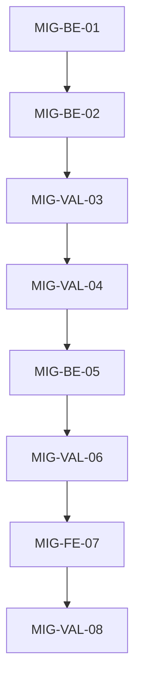

# Execution Backlog: opencode-v2-only

> **Fonte**: `SPEC.md` + `PLAN.md` (mesmo dir) · **Board**: batches com pausa HITL
> **Regra**: 1 task = 1 artefato-alvo + 1 teste. Task sem arquivo-alvo = defeito.

## 1. Sprint Summary

| Fase | Task | Tipo | Prioridade | Risco | Status |
|---|---|---|---|---|---|
| 1 | `MIG-BE-01` | Integration | P0 | **High** | Done |
| 1 | `MIG-BE-02` | Integration | P0 | Medium | Done |
| 1 | `MIG-VAL-03` | Test | P0 | **High** | Done |
| 1 | `MIG-VAL-04` | Test | P0 | Medium | Done |
| 2 | `MIG-BE-05` | Integration | P0 | High | Done |
| 2 | `MIG-VAL-06` | Test | P0 | Medium | Done |
| 3 | `MIG-FE-07` | Interface | P2 | Low | In progress (Batch 3) |
| 3 | `MIG-VAL-08` | Test | P0 | Medium | Todo |

## 2. Grafo

## 3. Tasks (TDD-ready)

### Task `MIG-BE-01` — `gate.js` no contrato v2 (`{id, setup}` → hooks)
- **Constraint Ref**: RF-01, RF-02, I1 · **Deps**: — · **Layer**: Integration · **Priority**: P0 · **Risk**: High
- **Artefato**: `.opencode/plugins/gate.js` (**só o adapter**)
- **Descrição (contrato MEDIDO, corrigido no Batch 3)**: exportar **`export default { id, setup }`** (objeto) com `setup(ctx)` **retornando `undefined`** em todos os caminhos, registrando via `ctx.tool.hook("execute.before", h)` (deny por `throw` de `DenyError`) e `ctx.event.subscribe(t)`. Payload medido: `{tool,sessionID,agent,messageID,id,input}`. Núcleos puros (`decide`, `gate*`, `CORE_GATES`, `loadConfigOrDeny`, `ensureConfig`, `DenyError`) **byte-idênticos**.
- **Enforcement**: hook sem equivalente confirmado ⇒ **erro visível** (nunca hook morto).
- **Falha**: `setup()` retornando valor **truthy** ⇒ o runtime **chama** o retorno ⇒ `TypeError: t is not a function` ⇒ `failed to reload plugins` ⇒ registry global de agentes cai (RT-02).
- **BDD**:
  - **Sucesso**: `await setup(ctx)` **não lança** e devolve **`undefined`**; os hooks são registrados; o envelope medido entra pelo handler e produz veredito.
  - **Falha**: ctx sem campo esperado ⇒ erro claro, nunca registro silencioso.
  - **Borda**: `DenyError` propagado continua negando; erro comum continua allow+log.
- **Steps (TDD)**: [x] `opencode-v2-adapter.spec.mjs` (contrato, entra pela entrada real) · [x] adapter em `gate.js` · [x] `git diff` dos núcleos = vazio.
- **DoD**: [x] teste antes · [x] núcleos diff vazio · [x] suíte verde · [x] sem TODO

### Task `MIG-BE-02` — os outros 2 plugins
- **Constraint Ref**: RF-01 · **Deps**: MIG-BE-01 · **Layer**: Integration · **Priority**: P0
- **Artefato**: `.opencode/plugins/harness-validator.js`, `.opencode/plugins/hitl-guardrail.js`
- **BDD**: [x] cada um exporta **objeto** `{id, setup}`; `setup()` devolve `undefined`; não lança · [x] comportamento atual preservado (fronteira HITL; validação)
- **DoD**: [x] teste antes · [x] suíte verde · [x] sem TODO

### Task `MIG-VAL-03` — Contrato do adapter + matriz deny/allow
- **Constraint Ref**: RF-02, I1 · **Deps**: MIG-BE-02 · **Layer**: Test · **Priority**: P0 · **Risk**: High
- **Artefato**: `.opencode/plugins/__tests__/opencode-v2-adapter.spec.mjs` (**novo**) + `gate.spec.mjs`
- **BDD**:
  - [x] **Sucesso**: matriz com ≥1 deny + ≥1 allow por gate, **mesmo veredito**, entrando pela **entrada de produção**
  - [x] **Falha**: mutação que afrouxa o deny ⇒ vermelho (evidência: batch-1 `m2 decide fail-open => 321/47`)
  - [x] **Borda**: o feed real (`payload.agent` no envelope + `noteTurnBoundary`) alimenta os gates — sem seam
- **DoD**: [x] núcleos com diff vazio provado · [x] suíte verde

### Task `MIG-VAL-04` — Verificação de runtime (plugins carregam)
- **Constraint Ref**: RF-01, RF-07 · **Deps**: MIG-VAL-03 · **Layer**: Test · **Priority**: P0
- **Artefato**: evidência em `harness/` (log filtrado) + `workflow-state.json`
- **BDD**: [x] **Sucesso**: após tocar o arquivo (hot reload), o log **não** traz `failed to reload plugins` · [x] `debug agents` segue com os **19** (9 do harness + 10 de outros agentes do ambiente)
- **DoD**: [x] evidência com timestamp · [x] RF-07 declarado no state

### Task `MIG-BE-05` — Merge do `opencode.json` v2-only no destino
- **Constraint Ref**: RF-04, I5 · **Deps**: MIG-VAL-04 · **Layer**: Integration · **Priority**: P0 · **Risk**: High
- **Artefato**: `installer/install.mjs` (merge do `opencode.json`)
- **Descrição**: o merge **substitui** o bloco gerenciado e **remove** chave obsoleta (`agents`, `permissions`, `plugin` com caminho local).
- **BDD**:
  - [x] **Sucesso**: destino **com** shape v1/dual ⇒ sai **v2-only**
  - [x] **Falha**: merge puramente aditivo ⇒ teste vermelho (prova o defeito de produto)
  - [x] **Borda**: destino **sem** `opencode.json` continua recebendo o template
- **DoD**: [x] teste antes · [x] `commands.suiteFull` intacto · [x] suíte verde

### Task `MIG-VAL-06` — Testes do merge + instalação nova
- **Constraint Ref**: RF-04, RF-05 · **Deps**: MIG-BE-05 · **Layer**: Test · **Priority**: P0
- **Artefato**: `installer/__tests__/*` (merge) + evidência da instalação em dir temporário
- **BDD**: [x] merge em destino temp ⇒ `opencode.json` v2-only (T1/T2 de `merge-v2-only.spec.mjs`) · [x] sem WARN de `conflict`/`malformed` no merge
- **DoD**: [x] evidência salva · [x] suíte verde

### Task `MIG-FE-07` — Prosa e supersession
- **Constraint Ref**: RF-06 · **Deps**: MIG-VAL-06 · **Layer**: Interface · **Priority**: P2
- **Artefato**: `.agents/rules/gate-contract.md` (I5) + declaração de supersession (SPEC/PROPOSAL novo + `workflow-state.json`)
- **BDD**: [ ] I5 cita `permission.edit` (não `tools`) · [ ] ciclo antigo declarado superseded **sem** editar os artefatos dele
- **DoD**: [ ] `docs.spec.mjs` verde · [ ] sem TODO

### Task `MIG-VAL-08` — Fechamento (VERIFY)
- **Constraint Ref**: RF-05, I2 · **Deps**: MIG-FE-07 · **Layer**: Test · **Priority**: P0
- **BDD**: [ ] suíte selada 0 falhas · [ ] selo intacto · [ ] VERIFY 3 dimensões · [ ] brain + state
- **DoD**: [ ] VERIFY.md · [ ] evidência do runtime · [ ] `code_review_status`/`harness_status`

### Task `MIG-BE-09` — `opencode.json` v2-only (config + autoridade dos agentes)
- **Constraint Ref**: RF-03 · **Deps**: — · **Layer**: Integration · **Priority**: P0 · **Risk**: High
- **Artefato**: `opencode.json`
- **Descrição**: shape v2-only (9 agentes com `description` **obrigatória** + `permission`; sem `agents`/`system`; `permissions` malformado removido; `plugin`/`plugins` vazios — plugin local é auto-carregado de `.opencode/plugins/`; `$comment` descreve o contrato medido). Autoridade final: **5 `edit: deny`** (orchestrator, code-reviewer, ux-designer, codebase-analyzer, security-engineer) / **4 `edit: allow`** (developer-engineer, product-manager, architect, qa-engineer), após F1 (D-17) e N1 (D-19).
- **BDD**: [x] `opencode debug agents` registra os 9 do harness (19 no ambiente) · [x] reload limpo (0 `failed to reload plugins`) · [x] autoridade medida em 3 vias (`opencode.json`, `debug config`, `debug agents`) com 5 deny / 4 allow
- **DoD**: [x] sem `tools`/`agents`/`system`/`permissions` · [x] `plugin`/`plugins` vazios · [x] reload sem erro fatal

## 4. Coverage

- [x] Todos os RF (RF-01..RF-07) com ≥1 task
- [x] Grafo sem ciclo e sem órfão
- [x] Núcleos puros explicitamente fora do escopo de edição
