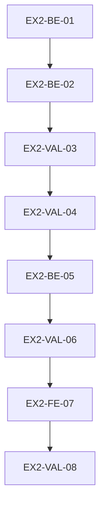

# Execution Backlog: opencode-v2-only

> **Fonte**: `SPEC.md` + `PLAN.md` (mesmo dir) · **Board**: batches com pausa HITL
> **Regra**: 1 task = 1 artefato-alvo + 1 teste. Task sem arquivo-alvo = defeito.

## 1. Sprint Summary

| Fase | Task | Tipo | Prioridade | Risco | Status |
|---|---|---|---|---|---|
| 1 | `EX2-BE-01` | Integration | P0 | **High** | Todo |
| 1 | `EX2-BE-02` | Integration | P0 | Medium | Todo |
| 1 | `EX2-VAL-03` | Test | P0 | **High** | Todo |
| 1 | `EX2-VAL-04` | Test | P0 | Medium | Todo |
| 2 | `EX2-BE-05` | Integration | P0 | High | Todo |
| 2 | `EX2-VAL-06` | Test | P0 | Medium | Todo |
| 3 | `EX2-FE-07` | Interface | P2 | Low | Todo |
| 3 | `EX2-VAL-08` | Test | P0 | Medium | Todo |

## 2. Grafo

## 3. Task `EX2-BE-01` — `gate.js` no contrato v2 (função → hooks)
- **Constraint Ref**: RF-01, RF-02, I1 · **Deps**: — · **Layer**: Integration · **Priority**: P0 · **Risk**: High
- **Artefato**: `.opencode/plugins/gate.js` (**só o adapter**)
- **Descrição**: exportar **função** (`async (ctx) => ({ hooks })`) mapeando: gates de tool → `tool.execute.before` (deny por `throw` de `DenyError`); observação → `tool.execute.after`/`event`; mapa `sessionID → agente` **se** houver hook v2 equivalente confirmado. Núcleos puros (`decide`, `gate*`, `CORE_GATES`, `loadConfigOrDeny`, `ensureConfig`, `DenyError`) **byte-idênticos**.
- **Enforcement**: hook sem equivalente confirmado ⇒ **erro visível** (nunca hook morto).
- **Falha**: export objeto ⇒ `TypeError` no loader (o defeito atual).
- **BDD**:
  - **Sucesso**: `await gatePlugin(ctx)` devolve objeto com os hooks esperados, sem lançar.
  - **Falha**: ctx sem campo esperado ⇒ erro claro, nunca registro silencioso.
  - **Borda**: `DenyError` propagado continua negando; erro comum continua allow+log.
- **Steps (TDD)**: [ ] `opencode-v2-adapter.spec.mjs` (contrato) · [ ] adapter em `gate.js` · [ ] `git diff` dos núcleos = vazio.
- **DoD**: [ ] teste antes · [ ] núcleos diff vazio · [ ] suíte verde · [ ] sem TODO

## 4. Task `EX2-BE-02` — os outros 2 plugins
- **Constraint Ref**: RF-01 · **Deps**: EX2-BE-01 · **Layer**: Integration · **Priority**: P0
- **Artefato**: `.opencode/plugins/harness-validator.js`, `.opencode/plugins/hitl-guardrail.js`
- **BDD**: [ ] cada um exporta função; devolve hooks; não lança · [ ] comportamento atual preservado (fronteira HITL; validação)
- **DoD**: [ ] teste antes · [ ] suíte verde · [ ] sem TODO

## 5. Task `EX2-VAL-03` — Contrato do adapter + matriz deny/allow
- **Constraint Ref**: RF-02, I1 · **Deps**: EX2-BE-02 · **Layer**: Test · **Priority**: P0 · **Risk**: High
- **Artefato**: `.opencode/plugins/__tests__/opencode-v2-adapter.spec.mjs` (**novo**) + `gate.spec.mjs`
- **BDD**:
  - [ ] **Sucesso**: matriz com ≥1 deny + ≥1 allow por gate, **mesmo veredito** antes/depois
  - [ ] **Falha**: mutação que afrouxa o deny ⇒ vermelho
  - [ ] **Borda**: `chat.message`/`chat.params` (mapa de agente) alimentam os gates que dependem dele
- **DoD**: [ ] núcleos com diff vazio provado · [ ] suíte verde

## 6. Task `EX2-VAL-04` — Verificação de runtime (plugins carregam)
- **Constraint Ref**: RF-01, RF-07 · **Deps**: EX2-VAL-03 · **Layer**: Test · **Priority**: P0
- **Artefato**: evidência em `harness/` (log filtrado) + `workflow-state.json`
- **BDD**: [ ] **Sucesso**: após tocar o arquivo (hot reload), o log **não** traz `failed to reload plugins` · [ ] `debug agents` segue com os 9
- **DoD**: [ ] evidência com timestamp · [ ] RF-07 declarado no state

## 7. Task `EX2-BE-05` — Merge do `opencode.json` v2-only no destino
- **Constraint Ref**: RF-04, I5 · **Deps**: EX2-VAL-04 · **Layer**: Integration · **Priority**: P0 · **Risk**: High
- **Artefato**: `installer/install.mjs` (merge do `opencode.json`)
- **Descrição**: o merge **substitui** o bloco gerenciado e **remove** chave obsoleta (`agents`, `permissions`, `plugin` com caminho local).
- **BDD**:
  - [ ] **Sucesso**: destino **com** shape v1/dual ⇒ sai **v2-only**
  - [ ] **Falha**: merge puramente aditivo ⇒ teste vermelho (prova o defeito de produto)
  - [ ] **Borda**: destino **sem** `opencode.json` continua recebendo o template
- **DoD**: [ ] teste antes · [ ] `commands.suiteFull` intacto · [ ] suíte verde

## 8. Task `EX2-VAL-06` — Testes do merge + instalação nova
- **Constraint Ref**: RF-04, RF-05 · **Deps**: EX2-BE-05 · **Layer**: Test · **Priority**: P0
- **Artefato**: `installer/__tests__/*` (merge) + evidência da instalação em dir temporário
- **BDD**: [ ] `init` em dir temp ⇒ `opencode.json` v2-only · [ ] `opencode debug config` **sem** WARN de `conflict`/`malformed`
- **DoD**: [ ] evidência salva · [ ] suíte verde

## 9. Task `EX2-FE-07` — Prosa e supersession
- **Constraint Ref**: RF-06 · **Deps**: EX2-VAL-06 · **Layer**: Interface · **Priority**: P2
- **Artefato**: `.agents/rules/gate-contract.md` (I5) + declaração de supersession (SPEC/PROPOSAL novo + `workflow-state.json`)
- **BDD**: [ ] I5 cita `permission.edit` (não `tools`) · [ ] ciclo antigo declarado superseded **sem** editar os artefatos dele
- **DoD**: [ ] `docs.spec.mjs` verde · [ ] sem TODO

## 10. Task `EX2-VAL-08` — Fechamento (VERIFY)
- **Constraint Ref**: RF-05, I2 · **Deps**: EX2-FE-07 · **Layer**: Test · **Priority**: P0
- **BDD**: [ ] suíte selada 0 falhas · [ ] selo intacto · [ ] VERIFY 3 dimensões · [ ] brain + state
- **DoD**: [ ] VERIFY.md · [ ] evidência do runtime · [ ] `code_review_status`/`harness_status`

## 11. Coverage

- [x] Todos os RF (RF-01..RF-07) com ≥1 task
- [x] Grafo sem ciclo e sem órfão
- [x] Núcleos puros explicitamente fora do escopo de edição
