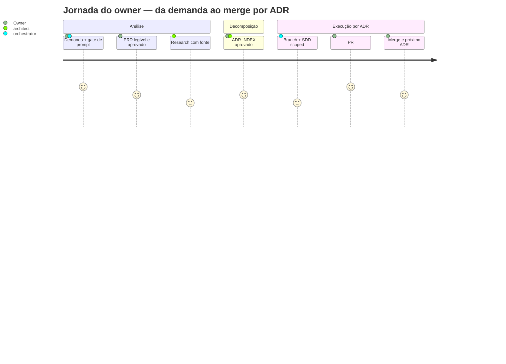

# Architecture & Software Specification: Esteira PRD → ADR → SDD no harness

> **ID**: `prd-adr-pipeline`
> **Versão**: v1
> **Data**: 2026-10-15
> **Base**: `PROPOSAL.md` (`.spec/backend/prd-adr-pipeline/`)
> **Autor**: orchestrator · pareceres: `architect`, `product-manager` (Fase 1)

---

## 0. Contexto & Escopo

### 0.1 Problema (do PROPOSAL)

Não existe artefato de negócio aprovado pelo humano **antes** do design. O que se aprova é `SPEC.md`/`PLAN.md`/`TASKS.md` — escritos para o compilador, não para quem decide — e o desalinhamento aparece no merge. Evidência: 0 ocorrências de "PRD" em `.agents/**`; `pending_actions` com trabalho não fechado; FU-32 escalado com 4 iterações de review.

### 0.2 In Scope

Ver `PROPOSAL.md §3`. Resumo operacional:

| # | Entrega | Path |
|---|---------|------|
| E1 | Regra descritiva da esteira | `.agents/rules/prd-adr-pipeline.md` (novo) |
| E2 | Skill + templates + módulo de checks | `.agents/skills/prd-adr-pipeline/**` (novo) |
| E3 | Template ADR canônico (conserta ref órfã `SKILL.md:36`) | `.agents/skills/sdd-architecture-board/templates/ADR_TEMPLATE.md` (novo) |
| E4 | Guard do resolver + wiring dos checks | `scripts/sdd-checks.mjs`, `scripts/static-checks.mjs` |
| E5 | Wiring de agentes + vocabulário + conserto de drift | `.agents/agents/**`, `.agents/rules/workflow-rules.md` |
| E6 | Testes dos 3 checks | `.opencode/plugins/__tests__/*.spec.mjs` |

### 0.3 Out of Scope

`gate.js` · `commands.suiteFull` · PRD/ADR para bug · dogfood externo (ECM) · propagação de `scripts/`+`.github/` pelo installer · republicação do seal · Brain MCP · nova chave em `moduleMap`.

---

## 1. Architecture Decision Records (ADRs)

### ADR-P01: `.spec/prd/**` é bucket **non-cycle** no resolver

- **Decision**: `SPEC_NON_CYCLE` (const em `scripts/sdd-checks.mjs`) passa a incluir `"prd"`. A árvore PRD sai da detecção de ciclo SDD; a validação dos ADRs é feita por check dedicado (`ADR-01`/`ADR-02`), **não** pelo `SDD-02`.
- **Context**: `resolveSddCycle` trata todo bucket de `.spec/` fora de `SPEC_NON_CYCLE` como grupo de ciclo (`sddCycleCandidates`/`resolveSddCycle` em `scripts/sdd-checks.mjs`), e `SDD_ARTIFACTS` exige `PROPOSAL.md`. O layout PRD não tem `PROPOSAL.md`.
- **Trade-offs**: **ganha** — elimina duas falhas provadas: (a) vermelho por drift quando `current_feature == prd-id` (`:286-298`); (b) **verde-falso**, em que o resolver cai no próximo candidato completo e valida o `TASKS.md` de **outro** ciclo enquanto o ADR ativo não é validado. **perde** — o `SDD-02` deixa de validar a coerência 1:1 de seções de `TASKS.md` dentro de um ADR; essa coerência passa a ser responsabilidade do `ADR-01` (presença) e do `code-reviewer` (conteúdo).
- **Precedente**: FU-40 aplicou exatamente este tratamento a `tech-debts` (mesmo const `SPEC_NON_CYCLE` em `scripts/sdd-checks.mjs`).

### ADR-P02: Módulo de checks vive no path **propagável**

- **Decision**: os checks `PRD-01`/`ADR-01`/`ADR-02` são implementados em `.agents/skills/prd-adr-pipeline/checks.mjs` (puro, exporta funções). `scripts/static-checks.mjs` **importa e chama**. Nada de lógica nova em `scripts/`.
- **Context**: `INCOMING_ROOTS` do installer (`installer/install.mjs:1159`) propaga `.agents/agents`, `.agents/rules`, `.agents/skills`, `.opencode/plugins`, `opencode.json` — **não** `scripts/`, **não** `.github/`. Check que viva só em `scripts/` vira **gate órfão** no repo-destino: a regra propaga prometendo enforcement que não existe lá.
- **Trade-offs**: **ganha** — o check propaga de graça e o repo-destino pode executá-lo com uma linha. **perde** — o módulo passa a ser parte do vendor de skills e é scanneado pela DENYLIST do installer (`install.mjs:669`), então não pode conter termos `taskflow`/`vuetify`/`primevue`/`lombok`/`mapstruct`/`restassured`.

### ADR-P03: Enforcement = suite + CI, **nunca** runtime

- **Decision**: nenhum deny novo em `gate.js`. Os checks entram pelo `static-checks.mjs`, que o `commands.suiteFull` já executa (`harness.config.json:14`). Nível de garantia declarado: **🟢 neste repo** (roda no `suiteFull` e no CI), **🟡 processo** em repo-destino (o check propaga, mas o CI do destino não é instalado).
- **Context**: `R-NODENY` (check em `scripts/sdd-checks.mjs`) falha se `gate.js` ganhar `DENY_SDD`/`DENY_ARTIFACT`/`artifact-gate`. Alterar `commands.suiteFull` mudaria o selo e quebraria o contraprova.
- **Trade-offs**: **ganha** — zero risco de deny falso-positivo bloqueando trabalho legítimo; respeita a decisão #2 do owner. **perde** — nada impede, no runtime, começar a implementar sem PRD; quem impede é apenas o check no momento do CI.

### ADR-P04: `ADR.md` é a unidade; o SDD dentro do ADR é **scoped** e não é ciclo autônomo

- **Decision**: cada `ADRs/ADR-00N-{slug}/` contém `ADR.md` + `SPEC.md` + `PLAN.md` + `TASKS.md` + `VERIFY.md`. O `ADR.md` carrega os campos mínimos: decisão, motivo, alternativas descartadas + fonte, `depende-de`, **interface congelada**, fora desta decisão, consequências se estiver errado, status.
- **Context**: sem `depende-de` + interface congelada, "ADRs independentes" é aspiração — o ADR-2 quebra no merge porque herdou contrato implícito do ADR-1.
- **Trade-offs**: **ganha** — independência verificável por campo obrigatório. **perde** — dois níveis de `SPEC.md` no repo (feature e ADR); mitigado por `ADR-INDEX.md` como ledger único.

### ADR-P05: Fases da esteira são **rótulos**, mapeados para o vocabulário canônico

- **Decision**: nenhum valor novo em `current_phase`. `PRD`/`RESEARCH` → `Discovery`; `ADR-DECOMP`/`TASKS` → `Planning`; execução por ADR → `Execution`; review/harness → `Testing`; fim → `Completed`. A tabela V17 de `workflow-rules.md` ganha as linhas novas mantendo os marcadores existentes.
- **Context**: `gate.js` valida só o canônico (I2) e `V17` exige a tabela (check em `scripts/sdd-checks.mjs`).
- **Trade-offs**: **ganha** — zero mudança no runtime. **perde** — o `workflow-state.json` não distingue "fazendo PRD" de "explorando" sem ler o artefato.

---

## 2. Domain Context, Tenant Strategy & Provisioning

- **Bounded Context**: `governanca-de-agentes`. O harness é o produto: regras (`.agents/rules`), skills (`.agents/skills`), agentes (`.agents/agents`), plugins/gates (`.opencode/plugins`), checks (`scripts/`), instalador (`installer/`).
- **System Type**: toolchain determinística de governança + instalador repo→repo. Não é serviço, não tem estado de execução.
- **Tenant Provisioning**: **N/A** — não há multi-tenancy. O análogo é o **repo-destino** do installer; a esteira entra nele por `.agents/rules` + `.agents/skills` + `opencode.json` (`install.mjs:1159`).
- **Tenant Lifecycle**: **N/A**. Equivalente: ciclo de vida do repo-destino = `init` (greenfield) · `doctor` (brownfield, read-only) · `upgrade` (overwrite gerenciado) — todos já existentes, **nenhum tocado** neste ciclo.

---

## 3. Authorization & Write-Scope Model (substitui IAM)

Não há IdP/RBAC. O modelo real é o de escrita por agente, imposto em `gate.js:487-516`:

| Agente | Pode escrever | Mecanismo | Nível |
|--------|---------------|-----------|-------|
| `orchestrator` | `.spec/**`, `workflow-state.json` | `isOrchAllowlisted` (`gate.js:391-398`, deny `:501-502`) | 🟢 runtime |
| `developer-engineer` | qualquer path, inclusive **protegido** | exceção explícita (`gate.js:494`); trailer cobrado pelo CI | 🟢 runtime + 🟠 CI |
| `qa-engineer` | apenas `harness/**` | `isHarnessScoped` (deny `:504-505`) | 🟢 runtime |
| `code-reviewer`, `ux-designer` | nada | deny `:507-513` | 🟢 runtime |
| `product-manager`, `architect` | **qualquer path** | — (sem escopo) | ⚠️ lacuna |

- **Lacuna registrada (D11 do parecer de arquitetura)**: `product-manager` e `architect` não têm escopo de escrita. A esteira atribui a eles escrita em `.spec/prd/**`, mas o runtime **não** impõe isso. Fechar a lacuna exige editar `gate.js` — **fora de escopo** (ADR-P03). Mitigação: regra de processo declarando o escopo esperado + revisão humana no PR.
- **Patrol de paths protegidos**: `.opencode/plugins/**`, `.agents/rules/**`, `.agents/schemas/**`, `.agents/agents/**`, `.github/workflows/**`, `.githooks/**`, `opencode.json`, `harness.config.json` (`harness.config.json:27-37`). **`.agents/skills/**` NÃO é protegido** — por isso o grosso da entrega (E2, E3) não exige trailer.
- **Trailer obrigatório** para commits que tocam path protegido: `Harness-Gate-Change: <aprovador>` (`.github/workflows/harness-integrity.yml:44`) ou `HARNESS_GATE_APPROVER` no pre-commit (`.githooks/pre-commit:20`). Afetados: E1 e E5.

---

## 4. Config & Layout Contract

### 4.1 Layout de artefatos (SSoT)

```
.spec/prd/{prd-id}/
├── PRD.md                 # 16 seções; artefato de aprovação humana
├── RESEARCH.md            # ≥2 alternativas com fonte + trade-off + 1 recomendação
├── ADR-INDEX.md           # ledger 1:1 com disco
└── ADRs/
    └── ADR-00N-{slug}/
        ├── ADR.md         # decisão + depende-de + interface congelada (ADR-P04)
        ├── SPEC.md        # sdd-compiler generate-spec, scoped ao ADR
        ├── PLAN.md
        ├── TASKS.md
        └── VERIFY.md
```

**Direção obrigatória**: `PRD aprovado → RESEARCH → ADR-INDEX → ADR → branch → SDD`. Nenhum `ADRs/**` nasce antes do bloco de aprovação do PRD estar preenchido.

### 4.2 Contrato de `ADR-INDEX.md` (validado pelo `ADR-01`)

| Coluna | Tipo | Regra |
|--------|------|-------|
| `order` | inteiro | ordem de merge; sem buraco a partir de 1 |
| `id` | `ADR-00N` | único |
| `title` | texto | não-vazio |
| `status` | enum | `todo` \| `in-progress` \| `merged` \| `dropped` |
| `depends_on` | `ADR-00N` ou `—` | declarado (não inferido) |
| `dir` | path | `ADRs/ADR-00N-{slug}/` — deve existir |
| `branch` | texto | `adr/{prd-id}/{nn}-{slug}` |
| `merge` | sha ou `—` | obrigatório quando `status=merged` |

**Escopo normativo desta tabela (evita overclaim):** os checks de `§5` impõem **somente**:

- presença de `order` **inteiro ≥ 1** e `status` dentro do enum;
- `id` único;
- `dir` **preenchido** e no padrão `ADRs/ADR-00N-{slug}/`;
- `branch` **preenchida** e casando o regex de `§5`;
- `merge` **preenchido** quando `status=merged`.

São **descritivos** (a tabela declara a forma esperada; os checks **não** impõem): o texto de `title`, o conteúdo de `depends_on`, o formato exato de `merge` (só exige preenchido), a unicidade/continuidade de `order` (buraco não é reprovado), e a coerência `id` × `dir`. Declarar isso aqui é o que impede o `detail` de afirmar conformidade sobre o que não foi avaliado — o defeito que o review pegou duas vezes (célula malformada desarmando condição).

### 4.3 Campos aditivos em `workflow-state.json`

**Aditivo, nunca destrutivo** — o runtime lê `current_phase`, `current_feature`, `harness_status`, `code_review_status` (`gate.js:705-743`) e `SDD-03` exige `gates.P1_P2` e `gates.P2_P3` (check em `scripts/sdd-checks.mjs`).

```json
"prd_adr": {
  "prd_id": "{prd-id}",
  "prd_status": "draft | approved | archived",
  "active_adr": "ADR-00N | null",
  "adr_order": ["ADR-001", "ADR-002"],
  "snapshots": [
    { "adr": "ADR-00N", "follow_ups_count": 43, "escalations_count": 3, "at": "AAAA-MM-DD" }
  ]
}
```

`snapshots[]` é o que torna **SM-3** medível por ADR (Δ de retrabalho após cada merge) e alimenta o gatilho de pivot descrito em `§14.1`. Gravado pelo orquestrador no merge de cada ADR (mesmo dono do bloco).

### 4.4 Decisões de cerimônia (limites explícitos)

Sem estes limites, a esteira vira a dor que ela existe para resolver (`PROPOSAL §6`, risco "cerimônia vira a nova dor").

| Decisão | Regra | Justificativa |
|---------|-------|---------------|
| **Limiar de isenção** | **Não** gera PRD nem ADR: typo · texto de documentação · rename interno · formatação · refactor interno **sem** mudança de comportamento observável · atualização de dependência de patch. Gera ADR sem PRD quando a mudança é arquitetural mas sem valor de produto novo. | Correção pequena não pode virar 5 documentos |
| **Teto de ADRs por PRD** | **5**. Acima disso, o PRD é grande demais e se divide em dois PRDs com escopos separados | Gargalo de revisão é 1 humano, 1 merge por vez |
| **Destino do PRD concluído** | Todos os ADRs `merged` ⇒ PRD vai para `.spec/archive/[YYYYMMDD]-prd-{prd-id}/` com os ADRs. `prd_status: archived` só é escrito **depois** do move | Evita candidato vivo eterno no resolver |
| **ADR leve** | **Não existe nesta versão.** Todo ADR carrega `ADR.md` + `SPEC.md` + `PLAN.md` + `TASKS.md` + `VERIFY.md` — **exceto** os ADRs da regra abaixo | Uma forma só; duas formas = dois checks = mais superfície |
| **ADR cujo SDD é o próprio ciclo em curso** | **Exceção declarada.** Um ADR que decide sobre a feature cujo ciclo SDD **já é** o ciclo corrente (caso dos 5 ADRs P01..P05 desta própria SPEC, documentados aqui e em `PLAN`/`TASKS`) é **decision-only**: contém apenas `ADR.md`. Dá-lo um SDD próprio seria recursão — o SDD dele é este ciclo. `ADR-01` valida `ADR.md` + o 1:1 com o índice; a composição de 5 arquivos **não** é exigida neste caso | Sem esta linha, o dogfood (`PAP-11`) contradiz `ADR-P04`/`§4.1`; com ela, a exceção é declarada em **um lugar** e é generalizável (não é "exceção de teste") |
| **Subconjunto obrigatório do PRD** | §1, §2, **§5**, §6, §7, §9, §16 são obrigatórias; §3, §4, §8, §10–§15 são recomendadas. `PRD-01` só exige as obrigatórias — e **§5 entrou no obrigatório** justamente para o requisito de métrica não ficar condicional | Check rígido é cerimônia; NFR-5 manda o PRD caber em ≤120 linhas. A métrica com "como medir" é a única linha que o dono do produto consegue cobrar depois |
| **Mapa de seções do PRD** | O **template** produzido em `PAP-05` é o **SSoT** da numeração das 16 seções. `PRD-01` valida os **números** das seções obrigatórias (§1, §2, §5, §6, §7, §9, §16) — o **texto do título é irrelevante** para o check. Toda referência a "§N" nesta SPEC usa essa numeração | Sem um SSoT do mapa, SPEC e template divergem sobre o que é "a §7" e o check vira inverificável. O check valida número (não título) porque título acoplaria o módulo puro ao path do template do harness, violando `NFR-1` |
| **Colisão `ADR-00N` × `TASK_ID_SRC`** | **Fechado por análise.** Candidatos de ciclo do `sdd-checks` são `.spec/<bucket>` e `.spec/<bucket>/<name>` (2 níveis) — `ADRs/ADR-00N/**` **nunca** vira candidato; `extractTaskSections` lê apenas o `TASKS.md` do ciclo resolvido, e os `ADR-00N` vivem em `.spec/prd/**` | Registra a **prova** do fechamento; antes era só afirmação do orquestrador |

---

## 5. Checks Contract

Cada check é **determinístico e estrutural**: presença, campo obrigatório, orfandade. Sem denylist, sem varredura semântica, sem deny. **Vacuous-safe**: PASS quando o alvo não existe (repo-destino sem `.spec/prd/**`), FAIL apenas quando o alvo existe e está malformado.

| Check | Entrada | Falha quando |
|-------|---------|--------------|
| **PRD-01** | `.spec/prd/{prd-id}/PRD.md` | falta **seção obrigatória** do subconjunto mínimo (§1, §2, §5, §6, §7, §9, §16); §7 ("NÃO entra") ausente ou vazia; nenhuma métrica da §5 com coluna "como medir" preenchida; story da §10 presente e sem `Dado`/`Quando`/`Então`; bloco §16 sem veredito **ou** sem data; **seção obrigatória sem a linha de pergunta fechada `> ❓ Validação:`**; **§15 (PICCO) presente com `<task>` ou `<context>` vazio**; **existe `ADRs/**` com §16 ainda sem veredito preenchido** |
| **ADR-01** | `ADR-INDEX.md` × `ADRs/**` | dir em `ADRs/` sem linha no índice (órfão); linha no índice sem dir; `id` duplicado; `ADR.md` sem `depende-de` ou sem interface congelada; `dir` fora do padrão `ADRs/ADR-00N-{slug}/`; **`RESEARCH.md` ausente, ou com menos de 2 fontes (`http`), quando existe qualquer `ADRs/**`** |
| **ADR-02** | `ADR-INDEX.md` | ≥2 linhas `in-progress`; linha `merged` sem campo `merge` preenchido; ADR com `order=N` em `in-progress` enquanto `order<N` não está `merged` (pulo de sequência); **`branch` fora do padrão `^adr/[a-z0-9-]+/\d{2}-[a-z0-9-]+$`** |

**Saída**: `{ ok: boolean, results: [{ id, status: PASS|FAIL, detail }] }` — mesma forma de relatorio de `scripts/sdd-checks.mjs`, para o relatório ficar homogêneo.

**Wiring**: `scripts/static-checks.mjs` importa `runPrdChecks()` de `.agents/skills/prd-adr-pipeline/checks.mjs` e registra no mesmo relatório; `commands.suiteFull` **não muda**.

---

## 6. Data Model, Event Model & Migrations

- **Data Model**: os artefatos são markdown + JSON. O único schema com contrato é o de `workflow-state.json` (§4.3, aditivo) e o de retorno dos checks (§5).
- **Event Model**: **N/A** — sem mensageria, sem outbox, sem eventos de domínio.
- **Migrations**: **N/A** — sem banco. O análogo (migração de layout `.spec/`) é **aditivo**: `.spec/backend/**`, `.spec/frontend/**`, `.spec/bugs/**`, `.spec/tech-debts/**` e `.spec/archive/**` permanecem válidos; `.spec/prd/**` é bucket novo, non-cycle.
- **Compatibilidade retroativa**: ciclos SDD existentes com `PROPOSAL/SPEC/PLAN/TASKS` seguem funcionando; `SDD-02` continua resolvendo o ciclo correto quando `.spec/prd/**` existe (garantido por ADR-P01 e coberto por teste de regressão).

---

## 7. Invariantes (propriedades testáveis)

### 7.1 Entity Invariants

| Entidade | Invariante | Como é provada |
|----------|-----------|----------------|
| `PRD.md` | §7 ("NÃO entra") é não-vazia | `PRD-01` |
| `PRD.md` | Bloco de aprovação tem veredito **e** data, ou não há ADR | `PRD-01` + `ADR-01` |
| `ADR-INDEX.md` | 1:1 com o disco — zero órfãos em ambas as direções | `ADR-01` |
| `ADR.md` | `depende-de` declarado (pode ser `—`) | `ADR-01` |
| `.spec/prd/**` | Nunca é reconhecido como ciclo SDD | `isNonCycleRel(".spec/prd/x") === true` |

### 7.2 Workflow & State Invariants

- **INV-1 — Um ADR por vez**: no máximo 1 `in-progress` em `ADR-INDEX.md`. Provado por `ADR-02`.
- **INV-2 — Sequência sem pulo**: `ADR-00N` só passa a `in-progress` quando todo `order < N` está `merged`. Provado por `ADR-02`.
- **INV-3 — PRD antes de ADR**: não existe `ADRs/**` sem bloco de aprovação preenchido. Provado por `ADR-01` + `PRD-01`.
- **INV-4 — Bucket PRD é invisível ao SDD-02**: com `.spec/prd/{id}` existente e incompleto, `SDD-02` resolve outro ciclo **sem** acusar drift. Provado por teste de regressão.
- **INV-5 — Nenhum deny novo**: `gate.js` não contém `DENY_SDD`/`DENY_ARTIFACT`/`artifact-gate`. Provado por `R-NODENY` (já existente).
- **INV-6 — Um `current_feature` por feature**: o valor literal de `current_feature` aparece em toda prompt de `task` do ciclo, sob pena de `prev-cycle-not-completed` (`gate.js:724-743`).
- **INV-7 — Bug fora do funil**: `type=bug` nunca exige `.spec/prd/**`. Provado pelo cenário de bug de `PAP-02` (fixture com `type: "bug"` e ausência de `.spec/prd/**` ⇒ os 3 checks PASS com `N/A` e nenhum critério de PRD é exigido).

### 7.3 Generator Constraints (dados de teste)

| Campo | Tipo | Restrição | Alvo |
|-------|------|-----------|------|
| `prd-id` | string | kebab-case, `[a-z0-9-]+` | fixture |
| `ADR-00N` | string | regex `^ADR-\d{3}$` | `ADR-01` |
| `status` | enum | `todo\|in-progress\|merged\|dropped` | `ADR-01`/`ADR-02` |
| `slug` | string | kebab-case, casa com o nome do dir | `ADR-01` |

---

## 8. Functional Requirements & Core Journeys



### RF-01 — Guard do resolver (bloqueante)
`SPEC_NON_CYCLE` inclui `"prd"`. `isNonCycleRel(".spec/prd/x") === true`. Teste de regressão cobre: `.spec/prd/{current_feature}/` existente e incompleto **não** produz drift e **não** faz o `SDD-02` mudar de alvo.

### RF-02 — Módulo de checks puro e propagável
`.agents/skills/prd-adr-pipeline/checks.mjs` exporta `runPrdChecks(root)` sem I/O de rede, sem MCP, sem escrita. Proibido conter termos da DENYLIST do installer.

### RF-03 — PRD-01 / ADR-01 / ADR-02
Conforme §5, vacuous-safe, com fixture PASS e FAIL por check, exercitadas em `.opencode/plugins/__tests__/*.spec.mjs`.

### RF-04 — Wiring sem tocar o selo
`scripts/static-checks.mjs` chama `runPrdChecks()`; `harness.config.json` **inalterado**.

### RF-05 — Templates
`PRD.md`, `RESEARCH.md`, `ADR-INDEX.md`, `ADR.md` em `.agents/skills/prd-adr-pipeline/templates/`; `ADR_TEMPLATE.md` em `.agents/skills/sdd-architecture-board/templates/` (conserta a ref órfã de `SKILL.md:36`).

### RF-06 — Regra descritiva + emendas
`.agents/rules/prd-adr-pipeline.md` (novo) descreve a esteira, o limiar de isenção e o nível de garantia. `workflow-rules.md` ganha a subseção e as linhas V17. `sdd-workflow-standard.md` §1/§2 ganham o layout e os campos.

### RF-07 — Wiring de agentes
`orchestrator` e `sdd-orquestrador` ganham as fases da esteira e a operação de branch/PR, **preservando**: cláusula de não-bypass (SDD-01) e `gates.P1_P2`/`P2_P3` (SDD-03).

### RF-08 — Conserto do drift de SSoT
`product-manager/AGENT.md`, `architect/AGENT.md` e `code-reviewer/PROMPT.md` deixam de apontar para `GEMINI.md`, `docs/specs/` e `docs/adr/` (inexistentes) e apontam para `.spec/prd/**`.

### RF-09 — Operação de branch/PR sem `gh`
Procedimento documentado e exercitado: `git checkout main && git pull` → `git checkout -b adr/{prd-id}/{nn}-{slug}` → push → **imprimir URL de compare** do GitHub. Merge é sempre humano.

---

## 9. Test Strategy

| Camada | Alvo | Ferramenta | Critério |
|--------|------|-----------|----------|
| Unitário (puro) | `runPrdChecks` — cada asserção de §5 | `node --test` | ≥1 fixture PASS e ≥1 FAIL por check |
| Regressão | `SPEC_NON_CYCLE` / `resolveSddCycle` com `.spec/prd/**` presente | `node --test` (fixtures em tmp) | INV-4 verde; `SDD-02` aponta o ciclo correto |
| Suite do repo | `commands.suiteFull` completa | `harness.config.json` | 0 falhas, 0 skips não-autorizados |
| Dogfood | este ciclo inteiro (`PROPOSAL/SPEC/PLAN/TASKS` + guards) | `sdd-checks.mjs` | `SDD-02` PASS **com** `.spec/prd/**` em disco |
| Manual (owner) | leitura do `PRD.md` do próximo PRD emitido | olho humano | cada seção tem pergunta fechada respondível |

**Proibido**: `@Disabled`/skip para "passar"; fixture que passa por ausência de alvo sem cobrir o caso negativo.

---

## 10. Non-Functional Requirements

- **NFR-1 — Determinismo**: os 3 checks são puros; mesma entrada ⇒ mesma saída; sem rede, sem relógio, sem MCP.
- **NFR-2 — Orçamento de regras**: `.agents/rules` permanece ≤ **1705** linhas (`V4`; hoje 974). A regra nova fica enxuta; detalhe vai para os templates da skill.
- **NFR-3 — Sem dependência nova**: zero pacote novo; `node:fs`/`node:path` apenas.
- **NFR-4 — Propagabilidade**: tudo que a esteira promete como check vive sob `.agents/**` (propagável); o que não propaga é **rotulado** com o nível real.
- **NFR-5 — Orçamento de cerimônia**: `PRD.md` ≤120 linhas, nenhuma seção >15 linhas; limiar de isenção declarado.
- **NFR-6 — Retrocompatibilidade**: nenhum campo de `workflow-state.json` renomeado/removido; nenhum valor novo de `current_phase`; ciclos SDD existentes intactos.

---

## 11. Security Assessment — Fase 1 (security-review)

### Threat Model (STRIDE, adaptado a toolchain local)

| Ameaça | Superfície | Prob. | Impacto | Controle |
|--------|-----------|-------|---------|----------|
| **Tampering** — check desativado silenciosamente | `scripts/static-checks.mjs` (não protegido) | Média | Alto | Check propaga por `.agents/skills` (ADR-P02), então o repo-destino tem sua própria linha; `R-NODENY` impede que o desvio vire deny no runtime |
| **Tampering** — regra da esteira editada sem autorização | `.agents/rules/prd-adr-pipeline.md` (**protegido**) | Baixa | Alto | `pre-commit` + `harness-integrity.yml` exigem trailer `Harness-Gate-Change` 🟢/🟠 |
| **Repudiation** — "aprovei" sem rastro | bloco §16 do PRD | Média | Médio | `PRD-01` exige veredito + data; `gate.js` segue negando `Completed` sem contraprova |
| **Information Disclosure** — PRD com dado sensível versionado | `.spec/prd/**` no git | Baixa | Médio | Regra declara: PRD é linguagem de negócio, sem segredo/credencial; revisão humana no PR |
| **Elevation of Privilege** — agente escreve onde não devia | `product-manager`/`architect` sem escopo (D11) | Média | Médio | **Lacuna aberta e declarada**. Fechar exige `gate.js` — fora de escopo. Mitigação: regra de processo + PR humano |
| **DoS** — esteira obrigatória para mudança trivial | processo | Média | Médio | Limiar de isenção (NFR-5) + nenhum gate de runtime |

### Requirements Coverage (Fase 1, adaptado)

| Requisito | Status |
|---|---|
| Nenhum segredo em artefato versionado | ✅ regra declara + §16 do template |
| Toda regra de gate cita mecanismo | ✅ `PRD-01`/`ADR-01`/`ADR-02` citam `sdd-checks.mjs`; nível 🟢/🟡 explícito |
| Mudança em path protegido exige autorização | ✅ inalterado (trailer CI + pre-commit) |
| Nenhum novo caminho de execução de comando | ✅ checks são puros; nada de `exec` |
| Escopo de escrita por agente fechado | ❌ **lacuna D11** — registrada como aberto declarado |

### Gaps

1. **D11** — escrita não escopada de `product-manager`/`architect`. Correção exige `gate.js` (fora de escopo). Registrado; não bloqueia.
2. **Enforcement em repo-destino é 🟡** até F3 propagar CI. Declarado, não mascarado.

### Verdict

**pass com ressalva** — nenhuma vulnerabilidade introduzida; a superfície nova é markdown + um módulo de checks puro. A ressalva (D11) é **pré-existente** e fica registrada.

---

## 12. Constraints (máx. 10)

1. Sempre: `gate.js` intocado — zero deny novo, zero literal `DENY_SDD`/`DENY_ARTIFACT`/`artifact-gate`.
2. Sempre: `commands.suiteFull` inalterado; checks entram pelo `static-checks` já invocado.
3. Sempre: cada check com fixture PASS e FAIL coberta por teste.
4. Sempre: módulo de checks no path propagável (`.agents/skills/**`); `scripts/` só importa.
5. Sempre: bucket `prd` como **non-cycle** no resolver, com teste de regressão.
6. Sempre: nível de garantia explícito (🟢 runtime / 🟠 CI / 🟡 processo / ⚠️ lacuna) em toda afirmação de gate.
7. Nunca: nova chave em `moduleMap`/`generateConfig` do installer (quebra golden).
8. Nunca: renomear/remover campo de `workflow-state.json` nem criar valor de `current_phase`.
9. Nunca: PRD/ADR para bug ou para mudança abaixo do limiar de isenção.
10. Nunca: fixture que passa apenas por ausência de alvo sem cobrir o caso negativo.

---

## 13. Delta Specs

### Delta: `.agents/rules/workflow-rules.md`

#### ADDED
```markdown
### 3.10 Esteira PRD → ADR → SDD (features)
Fluxo: PRD aprovado → RESEARCH → ADR-INDEX → ADR (unidade/branch) → SDD scoped.
Nível: check em suiteFull (🟢 neste repo; 🟡 em repo-destino até F3). Bug fora do funil (§4).
Limiar de isenção: mudança sem comportamento observável não gera PRD/ADR.
```

#### MODIFIED
Tabela V17: acrescentar as linhas `PRD, RESEARCH → Discovery`, `ADR-INDEX, ADR → Planning`, sem remover os marcadores existentes.

#### REMOVED
Nada.

### Delta: `.agents/rules/sdd-workflow-standard.md`

#### MODIFIED
§1 Organização de Arquivos: acrescentar `.spec/prd/[prd-id]/` como bucket de artefatos de produto (non-cycle).
§2 Gestão de Estado: acrescentar o bloco aditivo `prd_adr` (§4.3 desta SPEC).

### Delta: `.agents/rules/prd-adr-pipeline.md`

#### ADDED
Arquivo novo: contrato da esteira, layout, contrato de `ADR-INDEX.md`, limiar de isenção, níveis de garantia, operação de branch/PR.

### Delta: `AGENTS.md`

#### ADDED
**N/A** — o arquivo não existe neste repo (verificado). O equivalente vigente é `spec-developed.md`; re-apontar se passar a existir.

### Delta: `README.md`

#### ADDED
Linha na tabela de funcionalidades: "PRD→ADR→SDD — intenção aprovada antes do design; 1 ADR = 1 branch = 1 ciclo SDD".

### Resumo do Impacto
| Documento | ADDED | MODIFIED | REMOVED |
|---|---|---|---|
| `workflow-rules.md` | 1 subseção | tabela V17 | — |
| `sdd-workflow-standard.md` | — | §1, §2 | — |
| `prd-adr-pipeline.md` | arquivo | — | — |
| `README.md` | 1 linha | — | — |

---

## 14. Success Criteria (testáveis)

1. `node scripts/sdd-checks.mjs` → **PASS em todos os IDs**, **com** `.spec/prd/prd-adr-pipeline/**` **real** materializado em disco (não por fixture e **não** por ausência de `.spec/prd/`) — prova INV-4 e mata o verde-falso (achado O-1).
2. `runPrdChecks` tem ≥1 fixture PASS e ≥1 FAIL por check, cobrindo os 8 cenários de `PAP-02` (inclui bug fora do funil, pergunta fechada por seção, §15 vazio, ADR sem PRD aprovado, `RESEARCH.md` sem fonte e `branch` fora do padrão).
3. `commands.suiteFull` verde: `node --test` (plugins) + `node --test` (installer) + `static-checks` + `vendor-check`. **Comando de aceite separado**: `node scripts/sdd-checks.mjs` → PASS em todos os IDs — `sdd-checks` **não** integra o `suiteFull` (precisão: roda no CI e por invocação explícita).
4. `grep` do const `SPEC_NON_CYCLE` em `scripts/sdd-checks.mjs` mostra `"prd"` no conjunto (referencia por simbolo, nao por linha: ancoras de linha em criterio envelhecem a cada edicao).
5. `gate.js` inalterado: `R-NODENY` PASS e `git diff main -- .opencode/plugins/gate.js` vazio.
6. `harness.config.json` inalterado: `git diff main -- harness.config.json` vazio.
7. Zero referência viva a `GEMINI.md`, `docs/specs/`, `docs/adr/` nos AGENT.md/PROMPT.md.
8. `V4` PASS com `.agents/rules` ≤1705 linhas.
9. `code-reviewer` → zero 🔴 — **DoD explícito no `PAP-10`** (antes era critério sem task).
10. Caminho de branch/PR documentado e validado por **dry-run local** (`git push --dry-run` + URL de compare montada), sem push real.
11. Baseline de retrabalho congelado e datado no `VERIFY.md` (`baseline{suite, follow_ups, escalations, frozen_at}`); `prd_adr.snapshots[]` presente no state; as 7 métricas abaixo declaradas — as 3 marcadas **não falseáveis hoje** não contam como sucesso.
12. **Regressão preservada**: `V4`, `V17`, `SDD-01/02/03`, `R-NODENY`, `RENAME-01` continuam PASS — **DoD explícito no `PAP-10`** (antes era critério sem task).
13. **Aprovação humana do PRD do dogfood registrada**: o bloco §16 do PRD real de `PAP-11` cita o **evento de aprovação do owner** (data + qual portão). O agente **não** auto-assina: a evidência é o registro do portão, não a assinatura no arquivo.

### 14.1 Métricas de produto (SM) — definição única

`SM-3` aparece também em `PROPOSAL §6` (linha "Causa errada"); as demais existem só aqui. **SSoT da numeração**: esta tabela.

| # | Métrica | Como se mede | Estado hoje |
|---|---------|--------------|-------------|
| **SM-1** | Desalinhamento capturado **antes** do trabalho | nº de pedidos de mudança feitos na leitura do PRD ÷ nº feitos depois de aprovar | ⚠️ **não falseável** — `scope_additions` hoje conta itens de planejamento, não pedidos pós-aprovação |
| **SM-2** | Unidade de revisão pequena | 1 merge = 1 ADR; o owner resume o PR em 1 frase | ✅ medível (`git log --merges`) |
| **SM-3** | Retrabalho pós-merge por ADR | Δ de `follow_ups` entre `prd_adr.snapshots[]` consecutivos | ✅ medível **após** `PAP-12` instrumentar |
| **SM-4** | Zero merge revertido por desalinhamento | contagem de `git revert`/reabertura por "não era isso" | ✅ medível |
| **SM-5** | Guardrail de cerimônia | nº de PRDs criados para bug/chore/abaixo do limiar (deve ser 0) | ⚠️ **não falseável** — sem campo que registre PRD indevido |
| **SM-6** | Suíte confiável | `suiteFull` verde em 100% dos merges | ✅ medível (baseline congelado) |
| **SM-7** | Tempo até o primeiro "não é isso" | quantos ADRs/branches existiam quando o owner disse isso | ⚠️ **não falseável** — não há registro do evento |

**Gatilho de pivot (Q10)**: no merge do **ADR-3**, comparar SM-3 contra o baseline congelado. Se o Δ **não** cair, decisão do owner em ≤1 semana entre (i) pivotar para "unidade de verificação" (atacar a causa *drift*) ou (ii) manter o PRD e cortar o branch/PR por ADR. Sem `PAP-12` o gatilho é indetectável — é por isso que ele existe.

---

## 15. Self-Review (spec-gate + security)

### spec-gate (`.agents/skills/sdd-compiler/asserts/spec-gate.md`)

| Item | Status | Nota |
|---|---|---|
| ADRs com o "porquê" | ✅ | ADR-P01..P05, cada um com contexto e trade-offs |
| DDD Modular (api/impl/public) | ✅ N/A | não há camadas de aplicação; análogo = fronteira regra/skill/plugin/check, declarada em §2 |
| Segurança/IAM (JWT, `@HasPermission`) | ✅ adaptado | §3 substitui IAM pelo modelo de escrita por agente, com mecanismo por linha |
| ERD | ✅ N/A | sem banco (§6) |
| Event Registry | ✅ N/A | sem mensageria (§6) |
| Migrations Flyway | ✅ N/A | sem banco; análogo = migração aditiva de layout (§6) |
| Invariantes (entidade + workflow) | ✅ | §7.1 e §7.2, todas com forma de prova |
| Test Strategy | ✅ | §9, incluindo regressão do resolver |
| Single File | ✅ | este arquivo |
| Domínio claro | ✅ | `governanca-de-agentes` |

### spec-review (skill `.agents/skills/spec-review/SKILL.md`, adaptada)

Aplicada à SPEC; checklist TaskFlow-específico marcado **N/A explícito** (sem DDD de aplicação, sem JWT, sem Flyway, sem Vue, sem JUnit — o alvo é toolchain Node). Resultado: **0 🔴 · 1 🟠 corrigido · 3 🟡 corrigidos**.

| Gap | Sev | Correção aplicada |
|---|---|---|
| `PRD-01` exigia as 16 seções, colidindo com NFR-5 (PRD ≤120 linhas) | 🟠 | `§5` passou a exigir **subconjunto obrigatório** (§1, §2, **§5**, §6, §7, §9, §16); os demais são recomendados |
| Destino do PRD concluído indefinido (candidato vivo eterno no resolver) | 🟡 | `§4.4` — arquiva em `.spec/archive/[YYYYMMDD]-prd-{prd-id}/` |
| Limiar de isenção citado mas não enumerado | 🟡 | `§4.4` — lista fechada (typo, doc, rename interno, formatação, refactor sem mudança observável, patch de dependência) |
| Sem teto de ADRs por PRD (gargalo de revisão 1 humano) | 🟡 | `§4.4` — teto 5; acima disso, dividir o PRD |

### security-review (Fase 1)

Verdict: **pass com ressalva** (§11). Ressalva = lacuna D11 pré-existente e declarada; nenhuma vulnerabilidade introduzida; nenhum caminho novo de execução de comando (`exec`/`spawn` ausentes dos checks).

---

## 16. Referências

- `.spec/backend/prd-adr-pipeline/PROPOSAL.md`
- `.agents/rules/gate-contract.md` — doutrina de gates e níveis de garantia
- `.agents/rules/workflow-rules.md` — §0 (prompt gate), §3 (SDD), §5 (harness H1–H7), §6 (code review)
- `.agents/rules/sdd-workflow-standard.md` — organização de arquivos e estado
- `.opencode/plugins/gate.js` — `isOrchAllowlisted:391`, `checkWriteAccess:487`, âncoras A/B `:653,705`, `inferNewCycle:724`
- `scripts/sdd-checks.mjs` — símbolos (referência por nome, não por linha): `SDD_ARTIFACTS`, `SPEC_NON_CYCLE`, `sddCycleCandidates`, `resolveSddCycle`, `evaluateSdd02`, `runSddChecks`
- `installer/install.mjs:1159` — `INCOMING_ROOTS` (linha recalculada após `ae90866`, o bugfix do installer que deslocou o arquivo)
- `harness.config.json` — `commands.suiteFull:14`, `protectedPaths:27-37`
- `.githooks/pre-commit` · `.github/workflows/harness-integrity.yml` — trailer de path protegido
- `.agents/skills/sdd-compiler/**` — templates e asserts
- `.spec/backend/opencode-v2-plugin-migration/SPEC.md` — precedente de SPEC para feature de governança
