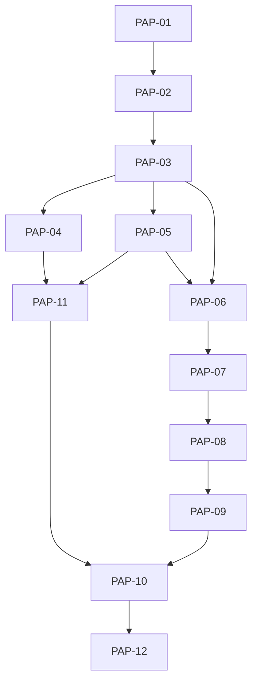

# Execution Backlog: Esteira PRD → ADR → SDD no harness

## 1. Traceability Context

- **Source SPEC**: `./.spec/backend/prd-adr-pipeline/SPEC.md`
- **Source PLAN**: `./.spec/backend/prd-adr-pipeline/PLAN.md`
- **Goal**: traduzir cada task do PLAN em ticket TDD-ready, com caminho físico exato, cenários BDD e DoD verificável.

## 2. Sprint Summary

| Phase | Task ID | Type | Priority | Risk | Complexity | Status |
|-------|---------|------|----------|------|------------|--------|
| Phase 1 | `PAP-01` | Infra | P0 | High | 3 | Todo |
| Phase 1 | `PAP-02` | Test | P0 | Medium | 5 | Todo |
| Phase 1 | `PAP-03` | Domain | P0 | High | 5 | Todo |
| Phase 1 | `PAP-04` | Infra | P0 | Medium | 2 | Todo |
| Phase 1 | `PAP-05` | Domain | P0 | Low | 3 | Todo |
| Phase 2 | `PAP-06` | API | P0 | Medium | 3 | Todo |
| Phase 2 | `PAP-07` | API | P0 | High | 3 | Todo |
| Phase 3 | `PAP-08` | API | P0 | High | 5 | Todo |
| Phase 3 | `PAP-09` | API | P0 | Low | 2 | Todo |
| Phase 4 | `PAP-11` | Domain | P0 | Medium | 3 | Todo |
| Phase 4 | `PAP-10` | Test | P0 | Medium | 3 | Todo |
| Phase 4 | `PAP-12` | Infra | P1 | Low | 2 | Todo |

## 3. Dependency Graph

---

## 4. Task Backlog

### Task `PAP-01`: Guard do resolver — `"prd"` em `SPEC_NON_CYCLE` + teste de regressão

- **Constraint Ref**: `ADR-P01`, `RF-01`, `INV-4`
- **Depends on (PLAN)**: Nenhum
- **Dependency Type**: Hard
- **Layer**: Infrastructure
- **Task Type**: Infra
- **Priority**: P0
- **Risk Level**: High
- **Parallelizable**: No
- **Artifact**: `scripts/sdd-checks.mjs`, `.opencode/plugins/__tests__/sdd-checks.spec.mjs`
- **Framework Detail**: `node:test`; edição de set estático na linha 146

#### 📝 Context & Domain Impact
- **Description**: adicionar `"prd"` a `SPEC_NON_CYCLE` e provar por teste que a árvore `.spec/prd/**` sai da detecção de ciclo SDD.
- **Domain Impact**: sem este guard, criar `.spec/prd/{prd-id}/` onde `prd-id == current_feature` faz o `SDD-02` acusar drift (vermelho) ou, pior, cair no próximo candidato completo e validar o `TASKS.md` de **outro** ciclo — verde-falso.

#### 🛡️ Technical Enforcement (DO NOT IGNORE)
- **Rule**: `isNonCycleRel(".spec/prd/x") === true` e `.spec/prd/<feat>/` incompleto não altera o alvo do `SDD-02`.
- **Failure Mode**: verde-falso — a suíte passa validando o ciclo errado; a esteira inteira perde a confiança.

#### ✅ Acceptance Criteria (BDD)

- **Scenario 1 (Success)**: fixture de `.spec/prd/<feat>/` com apenas `PRD.md` presente
  - **Given** um repo de fixture com `workflow-state.json` cujo `current_feature` é o nome do dir de PRD
  - **When** `resolveSddCycle(root)` roda
  - **Then** o ciclo resolvido **não** é `.spec/prd/**` e `SDD-02` reporta PASS
- **Scenario 2 (Failure Mode — drift reintroduzido)**: `"prd"` removido de `SPEC_NON_CYCLE`
  - **Given** a mesma fixture
  - **When** o teste roda com o set sem `"prd"`
  - **Then** o teste **falha**, provando que cobre o defeito (não passa por acidente)
- **Scenario 3 (Edge Case — `prd-id` diferente de `current_feature`)**
  - **Given** `.spec/prd/outro-id/` incompleto e `current_feature` não correspondente
  - **When** `resolveSddCycle(root)` roda
  - **Then** nenhum drift é reportado e o ciclo SDD de outro bucket segue sendo o alvo

#### 🛠️ Implementation Steps (TDD - Test First)
- [ ] `.opencode/plugins/__tests__/sdd-checks.spec.mjs`: `Unit` — escrever os 3 cenários com fixture em dir temporário (TDD FIRST)
- [ ] `scripts/sdd-checks.mjs`: adicionar `"prd"` ao const `SPEC_NON_CYCLE`, mantendo o comentário FU-40 coerente

#### 🏁 Definition of Done (DoD)
- [ ] Teste escrito antes da mudança no set.
- [ ] Os 3 cenários passam; o cenário 2 falha se o set for revertido.
- [ ] `node --test ".opencode/plugins/__tests__/*.spec.mjs"` verde.
- [ ] Sem TODO pendente.
- [ ] **Path protegido** (`.opencode/plugins/__tests__/**`): commit exige trailer `Harness-Gate-Change: <aprovador>`.

---

### Task `PAP-02`: Testes dos 3 checks (fixtures PASS/FAIL) — TDD FIRST

- **Constraint Ref**: `RF-03`, `NFR-1`, `SPEC §5`
- **Depends on (PLAN)**: `PAP-01`
- **Dependency Type**: Hard
- **Layer**: Integration
- **Task Type**: Test
- **Priority**: P0
- **Risk Level**: Medium
- **Parallelizable**: No
- **Artifact**: `.opencode/plugins/__tests__/prd-checks.spec.mjs`
- **Framework Detail**: `node:test` + fixtures geradas em diretório temporário

#### 📝 Context & Domain Impact
- **Description**: escrever, antes do código, ≥1 fixture PASS e ≥1 FAIL por check (3 checks ⇒ ≥6 fixtures), cobrindo cada asserção do `SPEC §5`.
- **Domain Impact**: é o que transforma "checks ativas" (atividade) em asserção verificável — corrige o defeito D1 apontado pelo parecer de produto.

#### 🛡️ Technical Enforcement (DO NOT IGNORE)
- **Rule**: nenhuma fixture pode passar por **ausência** do alvo sem cobrir o caso negativo correspondente.
- **Failure Mode**: check vacuous-safe mal testado passa sempre e não protege nada (vacuous-safe ≠ vacuously tested).

#### ✅ Acceptance Criteria (BDD)

- **Scenario 1 (Success)**:
  - **Given** um PRD bem-formado com as 7 seções obrigatórias, cada uma com a linha `> ❓ Validação:`, e aprovação preenchida
  - **When** `runPrdChecks(root)` roda
  - **Then** `PRD-01` retorna `PASS`
- **Scenario 2 (Failure Mode — §7 vazia)**:
  - **Given** um PRD cuja seção "NÃO entra" está vazia
  - **When** `runPrdChecks(root)` roda
  - **Then** `PRD-01` retorna `FAIL` nomeando a seção
- **Scenario 3 (Edge Case — 2 ADRs `in-progress`)**:
  - **Given** um `ADR-INDEX.md` com duas linhas `in-progress`
  - **When** `runPrdChecks(root)` roda
  - **Then** `ADR-02` retorna `FAIL`
- **Scenario 4 (Edge Case — `.spec/prd` ausente)**:
  - **Given** um repo sem `.spec/prd/`
  - **When** `runPrdChecks(root)` roda
  - **Then** os 3 checks retornam `PASS` (vacuous-safe) e o relatório declara `N/A`
- **Scenario 5 (Failure Mode — pergunta fechada ausente / §15 vazio)**:
  - **Given** um PRD cuja §6 está sem a linha `> ❓ Validação:` **ou** cuja §15 tem `<task>` vazio
  - **When** `runPrdChecks(root)` roda
  - **Then** `PRD-01` retorna `FAIL` apontando a seção
- **Scenario 6 (Failure Mode — ADR sem PRD aprovado / RESEARCH sem fonte)** — dois casos distintos:
  - **Given** `ADRs/ADR-001-*/` existindo com o bloco §16 do PRD ainda **sem veredito**
  - **When** `runPrdChecks(root)` roda
  - **Then** `PRD-01` retorna `FAIL`
  - **Given** `ADRs/**` existindo **sem** `RESEARCH.md`, ou com menos de 2 fontes (`http`)
  - **When** `runPrdChecks(root)` roda
  - **Then** `ADR-01` retorna `FAIL`
- **Scenario 7 (Edge Case — branch fora do padrão)**:
  - **Given** `ADR-INDEX.md` com `branch: feat/x` em vez de `adr/<prd-id>/<nn>-<slug>`
  - **When** `runPrdChecks(root)` roda
  - **Then** `ADR-02` retorna `FAIL`
- **Scenario 8 (INV-7 — bug fora do funil)**:
  - **Given** um state com `type: "bug"` e nenhum `.spec/prd/`
  - **When** `runPrdChecks(root)` roda
  - **Then** os 3 checks retornam `PASS` com `N/A` e nenhum critério de PRD é exigido

#### 🛠️ Implementation Steps (TDD - Test First)
- [ ] `.opencode/plugins/__tests__/prd-checks.spec.mjs`: `Unit` — os 8 cenários acima (PAP-02 e PAP-03 formam o par TDD)
- [ ] Nenhum arquivo de produção nesta task

#### 🏁 Definition of Done (DoD)
- [ ] Teste escrito antes da implementação (TDD evidenciado).
- [ ] **Par TDD atômico**: `PAP-02` + `PAP-03` fecham **juntas**. Os testes de `PAP-02` ficam legitimamente vermelhos até `PAP-03` implementar o núcleo; nenhuma das duas é declarada `Done` isoladamente (correção do defeito C-1 do parecer de negócio).
- [ ] ≥1 PASS e ≥1 FAIL por check, incluindo o caso vacuous-safe e o cenário de bug (`type=bug` ⇒ `N/A`, sem exigir PRD).
- [ ] `node --test ".opencode/plugins/__tests__/*.spec.mjs"` verde.
- [ ] Sem TODO pendente.
- [ ] **Path protegido**: commit exige trailer `Harness-Gate-Change`.

---

### Task `PAP-03`: Núcleo puro `runPrdChecks(root)`

- **Constraint Ref**: `ADR-P02`, `RF-02`, `SPEC §5`
- **Depends on (PLAN)**: `PAP-02`
- **Dependency Type**: Hard
- **Layer**: Domain
- **Task Type**: Domain
- **Priority**: P0
- **Risk Level**: High
- **Parallelizable**: No
- **Artifact**: `.agents/skills/prd-adr-pipeline/checks.mjs`
- **Framework Detail**: ESM puro; `node:fs`/`node:path` somente leitura

#### 📝 Context & Domain Impact
- **Description**: implementar os 3 checks conforme `SPEC §5`, retornando `{ ok, results: [{ id, status, detail }] }`.
- **Domain Impact**: vive em `.agents/skills/**` porque **é o único canal que propaga** pelo installer — check em `scripts/` viraria gate órfão no repo-destino.

#### 🛡️ Technical Enforcement (DO NOT IGNORE)
- **Rule**: puro — sem rede, sem MCP, sem `exec`/`spawn`, sem escrita; sem termo da DENYLIST do installer (`taskflow`, `vuetify`, `primevue`, `lombok`, `mapstruct`, `restassured`).
- **Failure Mode**: (a) impureza torna o check não determinístico e o CI intermitente; (b) termo proibido faz o vendor-check/installer acusar o repo.

#### ✅ Acceptance Criteria (BDD)

- **Scenario 1 (Success)**:
  - **Given** PRD + `ADR-INDEX.md` + dirs de ADR consistentes
  - **When** `runPrdChecks(root)` roda
  - **Then** `{ ok: true }` e os 3 ids presentes com `PASS`
- **Scenario 2 (Failure Mode — órfão em `ADRs/`)**:
  - **Given** `ADRs/ADR-007-x/` existindo sem linha no índice
  - **When** o check roda
  - **Then** `ADR-01` retorna `FAIL` com o dir órfão no `detail`
- **Scenario 3 (Edge Case — pulo de sequência)**:
  - **Given** `order=2` em `in-progress` com `order=1` em `todo`
  - **When** o check roda
  - **Then** `ADR-02` retorna `FAIL` por pulo de sequência

#### 🛠️ Implementation Steps (TDD - Test First)
- [ ] `.opencode/plugins/__tests__/prd-checks.spec.mjs`: `Unit` — já escrito em `PAP-02`; rodar e ver falhar (red)
- [ ] `.agents/skills/prd-adr-pipeline/checks.mjs`: implementar as asserções de `SPEC §5` até verde

#### 🏁 Definition of Done (DoD)
- [ ] Teste existia antes da implementação (TDD evidenciado).
- [ ] `runPrdChecks` puro — critério **comportamental/estrutural**, não por vocabulário: o conjunto de **especificadores de import** do módulo é exatamente `{node:fs, node:path}`, e não há `import(`/`require(` dinâmico. (Corrigido em `SPEC §5`/revisão: o critério anterior — "grep por `exec|spawn|fetch|http` vazio" — era inaplicável, contradizia a condição de `ADR-01` que **precisa** procurar `http` em `RESEARCH.md`, e reprovaria o próprio arquivo de teste. Um grep por vocabulário não prova ausência de capacidade: `execSync` não casa `\bexec\b`, e `node:net`/`node:child_process` passam por qualquer regex de token. A allowlist de imports é determinística e version-independente — não depende de `--permission`, cuja disponibilidade varia entre o Node do CI (22) e o local.)
- [ ] `node --test` verde nos 3 checks + vacuous-safe.
- [ ] Sem TODO pendente.
- [ ] Path **não** protegido (`.agents/skills/**`) — sem trailer.

---

### Task `PAP-04`: Wiring do adaptador no `static-checks`

- **Constraint Ref**: `ADR-P02`, `RF-04`, `NFR-1`
- **Depends on (PLAN)**: `PAP-03`
- **Dependency Type**: Hard
- **Layer**: Integration
- **Task Type**: Infra
- **Priority**: P0
- **Risk Level**: Medium
- **Parallelizable**: No
- **Artifact**: `scripts/static-checks.mjs`
- **Framework Detail**: `import` ESM + registro no mesmo formato do relatório existente

#### 📝 Context & Domain Impact
- **Description**: importar `runPrdChecks` e registrar o resultado no relatório do `static-checks`, que o `commands.suiteFull` já executa.
- **Domain Impact**: os checks passam a barrar de verdade no `suiteFull` **sem mudar o comando selado**.

#### 🛡️ Technical Enforcement (DO NOT IGNORE)
- **Rule**: `harness.config.json` **não** pode ser alterado; `commands.suiteFull` permanece idêntico.
- **Failure Mode**: mudar o comando muda o selo `sha256` e o contraprova do gate passa a **negar** todo `Completed` legítimo.

#### ✅ Acceptance Criteria (BDD)

- **Scenario 1 (Success)**:
  - **Given** o repo com `.spec/prd/**` malformado
  - **When** `node scripts/static-checks.mjs` roda
  - **Then** sai com código ≠ 0 e o `detail` nomeia o check e a seção
- **Scenario 2 (Failure Mode — selo alterado)**:
  - **Given** `harness.config.json` com `commands.suiteFull` modificado
  - **When** `sealCommands(config.commands)` é comparado ao selo publicado
  - **Then** a verificação acusa divergência (prova de que o comando não pode mudar)
- **Scenario 3 (Edge Case — repo-destino sem `.spec/prd/`)**:
  - **Given** repo sem `.spec/prd/`
  - **When** o `static-checks` roda
  - **Then** exit 0, com os 3 checks declarados `N/A` (vacuous-safe, sem vermelho falso)

#### 🛠️ Implementation Steps (TDD - Test First)
- [ ] `.opencode/plugins/__tests__/prd-checks.spec.mjs`: `Unit` — cenário 3 (integração vacuous-safe no relatório)
- [ ] `scripts/static-checks.mjs`: importar + registrar; sem tocar `harness.config.json`

#### 🏁 Definition of Done (DoD)
- [ ] Cenário 3 coberto por teste.
- [ ] `node scripts/static-checks.mjs` verde com e sem `.spec/prd/**`.
- [ ] `git diff main -- harness.config.json` **vazio**.
- [ ] Sem TODO pendente.
- [ ] **Path protegido** (o teste vive em `.opencode/plugins/__tests__/**`): commit exige trailer `Harness-Gate-Change: <aprovador>` + `HARNESS_GATE_APPROVER` no pre-commit.

---

### Task `PAP-05`: Templates + conserto da ref órfã `ADR_TEMPLATE.md`

- **Constraint Ref**: `RF-05`, `NFR-5`, `SPEC §4.4`
- **Depends on (PLAN)**: `PAP-03`
- **Dependency Type**: Soft
- **Layer**: Domain
- **Task Type**: Domain
- **Priority**: P0
- **Risk Level**: Low
- **Parallelizable**: Yes
- **Artifact**: `.agents/skills/prd-adr-pipeline/templates/{PRD,RESEARCH,ADR-INDEX,ADR}.md`, `.agents/skills/sdd-architecture-board/templates/ADR_TEMPLATE.md`
- **Framework Detail**: markdown puro

#### 📝 Context & Domain Impact
- **Description**: criar os 4 templates da esteira e o `ADR_TEMPLATE.md` referenciado mas **ausente** em `sdd-architecture-board/SKILL.md:36`.
- **Domain Impact**: sem template, cada PRD sai num formato e o check `PRD-01` vira obstáculo em vez de guardrail.

#### 🛡️ Technical Enforcement (DO NOT IGNORE)
- **Rule**: `PRD.md` deve marcar quais seções são **obrigatórias** (as 7 de `SPEC §4.4`) e manter o PRD ≤120 linhas; `ADR.md` deve conter `depende-de` e interface congelada.
- **Failure Mode**: exigir as 16 seções no check força PRD longo ⇒ cerimônia vira a dor que a feature existe para resolver.

#### ✅ Acceptance Criteria (BDD)

- **Scenario 1 (Success)**:
  - **Given** o template `PRD.md`
  - **When** preenchido por um produto real
  - **Then** cabe em ≤120 linhas e as 7 seções obrigatórias estão identificadas no próprio template
- **Scenario 2 (Failure Mode — ref órfã)**:
  - **Given** `.agents/skills/sdd-architecture-board/SKILL.md` linha 36
  - **When** o caminho do template é resolvido
  - **Then** o arquivo existe (hoje: ausente)
- **Scenario 3 (Edge Case — ADR sem dependência)**:
  - **Given** um ADR que não depende de nenhum outro
  - **When** o template é usado
  - **Then** existe campo explícito para registrar `—` (não se omite: declara)

#### 🛠️ Implementation Steps (TDD - Test First)
- [ ] `.opencode/plugins/__tests__/prd-checks.spec.mjs`: `Unit` — teste de existência dos 5 arquivos de template e do campo `depende-de`
- [ ] `.agents/skills/prd-adr-pipeline/templates/PRD.md`, `RESEARCH.md`, `ADR-INDEX.md`, `ADR.md`
- [ ] `.agents/skills/sdd-architecture-board/templates/ADR_TEMPLATE.md`
- [ ] `.agents/skills/sdd-architecture-board/SKILL.md`: repontar a referência de saída do ADR para o novo layout

#### 🏁 Definition of Done (DoD)
- [ ] Teste de existência escrito antes dos arquivos.
- [ ] 5 templates existem; `PRD.md` marca as **7** seções obrigatórias (§1, §2, §5, §6, §7, §9, §16).
- [ ] `grep -c "templates/ADR_TEMPLATE.md" .agents/skills/sdd-architecture-board/SKILL.md` ≥1 e o arquivo resolve.
- [ ] Sem TODO pendente.
- [ ] **Path protegido** (o teste vive em `.opencode/plugins/__tests__/**`): commit exige trailer `Harness-Gate-Change`.

---

### Task `PAP-06`: Regra descritiva `.agents/rules/prd-adr-pipeline.md`

- **Constraint Ref**: `RF-06`, `SPEC §4.4`, constraint 6 de `§12`, `NFR-2`
- **Depends on (PLAN)**: `PAP-03`, `PAP-05`
- **Dependency Type**: Hard
- **Layer**: Application
- **Task Type**: API
- **Priority**: P0
- **Risk Level**: Medium
- **Parallelizable**: No
- **Artifact**: `.agents/rules/prd-adr-pipeline.md`
- **Framework Detail**: markdown em path **protegido**

#### 📝 Context & Domain Impact
- **Description**: documentar a esteira: layout, contrato do `ADR-INDEX.md`, limiar de isenção, teto de 5 ADRs, destino do PRD arquivado, operação de branch/PR sem `gh` e o nível de garantia de cada afirmação.
- **Domain Impact**: é o artefato que torna a esteira executável por outro agente sem reler a SPEC.

#### 🛡️ Technical Enforcement (DO NOT IGNORE)
- **Rule**: nenhuma afirmação de gate sem mecanismo citado (`gate-contract.md`); nível 🟢/🟠/🟡/⚠️ explícito; ≤80 linhas (budget V4).
- **Failure Mode**: afirmação de garantia sem mecanismo = **gate órfão** — o defeito que o `gate-contract.md` existe para impedir.

#### ✅ Acceptance Criteria (BDD)

- **Scenario 1 (Success)**:
  - **Given** a regra escrita
  - **When** `node scripts/sdd-checks.mjs` roda
  - **Then** `V4` continua PASS (`.agents/rules` ≤1705 linhas)
- **Scenario 2 (Failure Mode — gate órfão)**:
  - **Given** uma frase do tipo "bloqueia a criação de ADR sem PRD"
  - **When** revisada
  - **Then** cita o mecanismo exato (`checks.mjs` / `sdd-checks.mjs`) ou é reescrita
- **Scenario 3 (Edge Case — mudança isenta)**:
  - **Given** um typo de documentação
  - **When** a regra é aplicada
  - **Then** nenhum PRD nem ADR é exigido (limiar de isenção explícito)

#### 🛠️ Implementation Steps (TDD - Test First)
- [ ] `.opencode/plugins/__tests__/prd-checks.spec.mjs`: `Unit` — teste de que o arquivo da regra existe e cita `checks.mjs` (é **teste**, não um 4º check: o contrato de `SPEC §5` permanece com exatamente 3 checks)
- [ ] `.agents/rules/prd-adr-pipeline.md`: escrever a regra
- [ ] Declarar no texto da regra que `prompt-optimizer` valida **demanda** (E1..E6), nunca o PRD (fecha o parcial D13)

#### 🏁 Definition of Done (DoD)
- [ ] Teste de existência/citação escrito antes.
- [ ] `V4` PASS; regra ≤80 linhas.
- [ ] Toda afirmação de gate cita mecanismo + nível.
- [ ] Sem TODO pendente.
- [ ] **Path protegido**: commit exige trailer `Harness-Gate-Change`.

---

### Task `PAP-07`: Emendas — vocabulário V17 + layout/estado

- **Constraint Ref**: `ADR-P05`, `RF-06`, `V17`, `NFR-2`
- **Depends on (PLAN)**: `PAP-06`
- **Dependency Type**: Hard
- **Layer**: Application
- **Task Type**: API
- **Priority**: P0
- **Risk Level**: High
- **Parallelizable**: No
- **Artifact**: `.agents/rules/workflow-rules.md`, `.agents/rules/sdd-workflow-standard.md`
- **Framework Detail**: markdown em path **protegido**

#### 📝 Context & Domain Impact
- **Description**: acrescentar a subseção da esteira e as linhas novas na tabela V17; emendar §1 (layout) e §2 (campo `prd_adr`) do standard.
- **Domain Impact**: sem a emenda, o layout `.spec/prd/**` fica contradizendo a regra vigente — duas verdades, que é a dor declarada.

#### 🛡️ Technical Enforcement (DO NOT IGNORE)
- **Rule**: preservar os marcadores de `hasVocabTable` (`` `current_phase` canônico `` + linha iniciando com `| P0`/`| Explore`/`| SPEC`) e não introduzir valor novo de `current_phase`.
- **Failure Mode**: `V17` FAIL e/ou `gate.js` I2 recusando uma fase fora do canônico.

#### ✅ Acceptance Criteria (BDD)

- **Scenario 1 (Success)**:
  - **Given** as emendas aplicadas
  - **When** `node scripts/sdd-checks.mjs` roda
  - **Then** `V17` PASS e `SDD-02` PASS
- **Scenario 2 (Failure Mode — marcador removido)**:
  - **Given** a tabela V17 reescrita sem a linha do canônico
  - **When** o check roda
  - **Then** `V17` FAIL (prova de cobertura)
- **Scenario 3 (Edge Case — fase PRD no state)**:
  - **Given** `current_phase: "Discovery"` durante a fase de PRD
  - **When** o gate avalia
  - **Then** nenhum deny — a fase da esteira é rótulo, não valor novo

#### 🛠️ Implementation Steps (TDD - Test First)
- [ ] `.opencode/plugins/__tests__/sdd-checks.spec.mjs`: `Unit` — fixture de tabela V17 sem o marcador ⇒ `hasVocabTable` = false
- [ ] `.agents/rules/workflow-rules.md`: subseção + 2 linhas na tabela V17
- [ ] `.agents/rules/sdd-workflow-standard.md`: §1 layout `.spec/prd/**` + §2 campo `prd_adr`

#### 🏁 Definition of Done (DoD)
- [ ] Fixture negativa escrita antes da emenda.
- [ ] `V17`, `V4`, `SDD-02` PASS.
- [ ] Nenhum valor novo de `current_phase` introduzido (grep).
- [ ] Bloco `prd_adr` do `SPEC §4.3` emendado no standard **com dono declarado**: escrito/atualizado pelo orquestrador no merge de cada ADR (fecha o parcial O-7 — sem isto o bloco entra sem dono e sem critério).
- [ ] Sem TODO pendente.
- [ ] **Path protegido**: commit exige trailer `Harness-Gate-Change`.

---

### Task `PAP-08`: Wiring nos 2 orquestradores

- **Constraint Ref**: `RF-07`, `RF-09`, `SDD-01`, `SDD-03`, `SPEC §3`
- **Depends on (PLAN)**: `PAP-06`, `PAP-07`
- **Dependency Type**: Hard
- **Layer**: Interface
- **Task Type**: API
- **Priority**: P0
- **Risk Level**: High
- **Parallelizable**: No
- **Artifact**: `.agents/agents/orchestrator/AGENT.md`, `.agents/agents/sdd-orquestrador/AGENT.md`
- **Framework Detail**: markdown em path **protegido**

#### 📝 Context & Domain Impact
- **Description**: inserir as fases PRD/RESEARCH/ADR/loop-por-ADR e o procedimento de branch/PR (sem `gh`) nos dois orquestradores.
- **Domain Impact**: é onde o owner ganha os pontos de parada que hoje não existem (PRD antes do design; 1 ADR = 1 PR).

#### 🛡️ Technical Enforcement (DO NOT IGNORE)
- **Rule**: preservar a **cláusula de não-bypass** e a citação de `gate-contract.md` (SDD-01) e os literais `gates.P1_P2` / `gates.P2_P3` (SDD-03).
- **Failure Mode**: `SDD-01` ou `SDD-03` FAIL — a governança perde a costura entre prosa e artefato.

#### ✅ Acceptance Criteria (BDD)

- **Scenario 1 (Success)**:
  - **Given** os dois AGENT.md atualizados
  - **When** `node scripts/sdd-checks.mjs` roda
  - **Then** `SDD-01` PASS e `SDD-03` PASS
- **Scenario 2 (Failure Mode — não-bypass perdida)**:
  - **Given** a cláusula de não-bypass removida
  - **When** o check roda
  - **Then** `SDD-01` FAIL
- **Scenario 3 (Edge Case — ADR sem `gh`)**:
  - **Given** ambiente sem `gh`
  - **When** o procedimento é seguido
  - **Then** o push acontece e a URL de compare é impressa; o merge é humano

#### 🛠️ Implementation Steps (TDD - Test First)
- [ ] `.opencode/plugins/__tests__/sdd-checks.spec.mjs`: `Unit` — fixture sem a cláusula não-bypass ⇒ `hasNoBypassClause` = false
- [ ] `.agents/agents/sdd-orquestrador/AGENT.md`: fases + branch/PR, preservando a estrutura existente
- [ ] `.agents/agents/orchestrator/AGENT.md`: idem

#### 🏁 Definition of Done (DoD)
- [ ] Fixtures negativas escritas antes da edição.
- [ ] `SDD-01` e `SDD-03` PASS.
- [ ] Procedimento de branch/PR documentado e validado por **dry-run local** (URL de compare montada e conferida, `git push --dry-run`) — **sem push real** (decisão do owner; evita efeito externo).
- [ ] Sem TODO pendente.
- [ ] **Path protegido**: commit exige trailer `Harness-Gate-Change`.

---

### Task `PAP-09`: Conserto do drift de SSoT

- **Constraint Ref**: `RF-08`, `BR-12`, `SPEC §0.3`
- **Depends on (PLAN)**: `PAP-08`
- **Dependency Type**: Soft
- **Layer**: Interface
- **Task Type**: API
- **Priority**: P0
- **Risk Level**: Low
- **Parallelizable**: Yes
- **Artifact**: `.agents/agents/product-manager/AGENT.md`, `.agents/agents/architect/AGENT.md`, `.agents/agents/code-reviewer/PROMPT.md`
- **Framework Detail**: markdown em path **protegido**

#### 📝 Context & Domain Impact
- **Description**: repontar `GEMINI.md`, `docs/specs/` e `docs/adr/` (inexistentes) para `.spec/prd/**`.
- **Domain Impact**: ponteiro morto é o default silencioso que o `prompt-optimizer` existe para matar — três SSoT concorrentes produzem exatamente o retrabalho relatado.

#### 🛡️ Technical Enforcement (DO NOT IGNORE)
- **Rule**: zero referência **viva** a `GEMINI.md`, `docs/specs/`, `docs/adr/` nos AGENT.md/PROMPT.md do `.agents/`.
- **Failure Mode**: agente escreve no lugar errado (path inexistente) e o artefato se perde.

#### ✅ Acceptance Criteria (BDD)

- **Scenario 1 (Success)**:
  - **Given** os 3 arquivos atualizados
  - **When** `grep -rn "GEMINI.md\|docs/specs\|docs/adr" .agents/` roda
  - **Then** zero ocorrência
- **Scenario 2 (Failure Mode — referência sobrevivente)**:
  - **Given** um dos arquivos mantendo `docs/adr/`
  - **When** o grep roda
  - **Then** acusa 1 ocorrência e a task não fecha
- **Scenario 3 (Edge Case — `AGENTS.md` ausente)**:
  - **Given** que `AGENTS.md` não existe na raiz
  - **When** um AGENT.md o referencia
  - **Then** a referência é removida ou marcada como condicional (não se cria arquivo novo)

#### 🛠️ Implementation Steps (TDD - Test First)
- [ ] `.opencode/plugins/__tests__/prd-checks.spec.mjs`: `Unit` — teste de ausência dos 3 ponteiros mortos em `.agents/` (é **teste**, não um 5º check)
- [ ] `.agents/agents/product-manager/AGENT.md`: SSoT → `.spec/prd/**`
- [ ] `.agents/agents/architect/AGENT.md`: idem + modo ADR
- [ ] `.agents/agents/code-reviewer/PROMPT.md`: ponteiro → `.spec/prd/**`

#### 🏁 Definition of Done (DoD)
- [ ] Teste de ausência escrito antes da edição.
- [ ] `grep` dos 3 ponteiros = 0 em `.agents/`.
- [ ] Sem TODO pendente.
- [ ] **Path protegido**: commit exige trailer `Harness-Gate-Change`.
- [ ] **Escopo esperado por agente declarado** na regra de `PAP-06` (`product-manager`/`architect` escrevem apenas `.spec/prd/**`) — mitiga o parcial D11 sem tocar `gate.js`.

---

### Task `PAP-11`: Dogfood — rodar a esteira sobre si mesma

- **Constraint Ref**: `INV-3`, `PROPOSAL §7` critério funcional #1, `SPEC §14.1`, achado O-1
- **Depends on (PLAN)**: `PAP-04`, `PAP-05`
- **Dependency Type**: Hard
- **Layer**: Integration
- **Task Type**: Domain
- **Priority**: P0
- **Risk Level**: Medium
- **Parallelizable**: No
- **Artifact**: `.spec/prd/prd-adr-pipeline/{PRD.md,RESEARCH.md,ADR-INDEX.md}`, `.spec/prd/prd-adr-pipeline/ADRs/ADR-00N-{slug}/ADR.md` (5 dirs: `ADR-001-*`..`ADR-005-*`)
- **Framework Detail**: markdown; templates de `PAP-05`; roda sobre os checks de `PAP-03`/`PAP-04`

#### 📝 Context & Domain Impact
- **Description**: materializar o PRD **real** desta própria feature no layout que estamos construindo — 7 seções obrigatórias com pergunta fechada, bloco de aprovação preenchido, `RESEARCH.md` com as fontes efetivamente usadas, `ADR-INDEX.md` e os 5 ADRs (P01..P05) como unidades de decisão.
- **Domain Impact**: sem isto o critério central do produto passa **"verde por ausência"** de `.spec/prd/` — o aceite validaria nada. Com isto, o guard é exercitado no **pior caso** (`prd-id == current_feature`), que é exatamente onde o verde-falso do `SDD-02` apareceria.

#### 🛡️ Technical Enforcement (DO NOT IGNORE)
- **Rule**: os 3 checks devem retornar PASS sobre o artefato **real**; o `SDD-02` deve continuar resolvendo `.spec/backend/prd-adr-pipeline` (não `.spec/prd/**`).
- **Failure Mode**: se `PAP-01` não estiver no lugar, criar `.spec/prd/prd-adr-pipeline/` faz o `SDD-02` acusar drift ou validar outro ciclo.

#### ✅ Acceptance Criteria (BDD)

- **Scenario 1 (Success)**:
  - **Given** o guard de `PAP-01` no lugar
  - **When** `.spec/prd/prd-adr-pipeline/` é materializado com PRD aprovado + 5 ADRs
  - **Then** `PRD-01`, `ADR-01` e `ADR-02` retornam `PASS` sobre o artefato real, e `SDD-02` continua apontando `.spec/backend/prd-adr-pipeline`
- **Scenario 2 (Failure Mode — ADR sem PRD aprovado)**:
  - **Given** o mesmo layout com o bloco §16 do PRD vazio
  - **When** os checks rodam
  - **Then** `PRD-01` retorna `FAIL` (prova de INV-3)
- **Scenario 3 (Edge Case — `prd-id` igual a `current_feature`)**:
  - **Given** `prd-id == prd-adr-pipeline == current_feature`
  - **When** `resolveSddCycle` roda
  - **Then** nenhum drift é reportado (o pior caso do guard, provado em condições reais)

#### 🛠️ Implementation Steps (TDD - Test First)
- [ ] `.opencode/plugins/__tests__/prd-checks.spec.mjs`: `Unit` — cenário 3 já coberto em `PAP-02`; aqui a prova é a **execução real** sobre o disco
- [ ] `.spec/prd/prd-adr-pipeline/PRD.md` — **todas** as condições de `PRD-01` (`SPEC §5`), não só as óbvias:
      §1, §2, **§5**, §6, §7, §9, §16 presentes · cada seção obrigatória com `> ❓ Validação:` · **§7 não-vazia** ·
      **≥1 métrica da §5 com a coluna "como medir" preenchida** · **§10, se presente, com `Dado`/`Quando`/`Então` em cada story** ·
      §15 com `<task>` e `<context>` não-vazios · §16 com veredito + data
- [ ] `.spec/prd/prd-adr-pipeline/RESEARCH.md` — **≥2 fontes (`http`)** + alternativas + recomendação (condição de `ADR-01`)
- [ ] `.spec/prd/prd-adr-pipeline/ADR-INDEX.md` — 5 linhas (`ADR-001`..`ADR-005`) 1:1 com os dirs; `dir` no padrão **`ADRs/ADR-00N-{slug}/`** (não `ADR-00N/`); `branch` casando `^adr/[a-z0-9-]+/\d{2}-[a-z0-9-]+$`; `depends_on` declarado
- [ ] `.spec/prd/prd-adr-pipeline/ADRs/ADR-00N-{slug}/ADR.md` — 5 arquivos, cada um: decisão, motivo, alternativas descartadas + fonte, `depende-de`, interface congelada, status. **Somente `ADR.md`** — a composição de 5 arquivos por ADR é a exceção declarada em `SPEC §4.4` (ADR cujo SDD é o próprio ciclo em curso)

#### 🏁 Definition of Done (DoD)
- [ ] `node scripts/sdd-checks.mjs` 8/8 PASS **com** `.spec/prd/**` em disco.
- [ ] `PRD-01`/`ADR-01`/`ADR-02` PASS sobre o artefato real (não só sobre fixtures) — cobrindo **todas** as condições de `SPEC §5`, não um subconjunto.
- [ ] Cenário 2 (PRD não aprovado) falha quando o §16 é esvaziado.
- [ ] `SDD-02` continua resolvendo `.spec/backend/prd-adr-pipeline`.
- [ ] **Aprovação humana registrada, não auto-assinada**: o §16 cita o **evento de aprovação do owner** (data + portão) e a evidência está no `VERIFY.md` de `PAP-10`. O agente não preenche o veredito por conta própria (`SPEC §14.13`).
- [ ] Sem TODO pendente.

---

### Task `PAP-10`: README + verificação final do ciclo

- **Constraint Ref**: `SPEC §14`, `§11`, `H6`
- **Depends on (PLAN)**: `PAP-09`, `PAP-11`
- **Dependency Type**: Hard
- **Layer**: Integration
- **Task Type**: Test
- **Priority**: P0
- **Risk Level**: Medium
- **Parallelizable**: No
- **Artifact**: `README.md`, `.spec/backend/prd-adr-pipeline/VERIFY.md`
- **Framework Detail**: markdown + comandos resolvidos de `harness.config.json`

#### 📝 Context & Domain Impact
- **Description**: linha nova na tabela de funcionalidades do README e verificação final: suíte verde **com** `.spec/prd/**` materializado, provas de que `gate.js`/`harness.config.json` estão intocados, e `VERIFY.md` com as 3 dimensões.
- **Domain Impact**: fecha o ciclo com evidência, não com prosa — é o que o portão de conclusão (H6) exige.

#### 🛡️ Technical Enforcement (DO NOT IGNORE)
- **Rule**: a suíte precisa estar verde **na presença** de `.spec/prd/**`; prova por `git diff main` vazio para `gate.js` e `harness.config.json`; `R-NODENY` PASS.
- **Failure Mode**: declarar conclusão com a suíte verde apenas por ausência de `.spec/prd/` = verde-falso (o defeito que este ciclo existe para matar).

#### ✅ Acceptance Criteria (BDD)

- **Scenario 1 (Success)**:
  - **Given** tudo implementado e `.spec/prd/**` materializado por `PAP-11`
  - **When** `commands.suiteFull` roda
  - **Then** 0 falhas, 0 skips não-autorizados
- **Scenario 2 (Failure Mode — alvo de gate alterado)**:
  - **Given** `gate.js` ou `harness.config.json` modificado
  - **When** `git diff main -- <path>` roda
  - **Then** diff **não vazio** ⇒ a task falha
- **Scenario 3 (Edge Case — clone sem `.spec/prd/`)**:
  - **Given** um clone sem `.spec/prd/`
  - **When** os checks rodam
  - **Then** continuam verdes (vacuous-safe) — **mas este cenário NÃO substitui o cenário 1**: o aceite é o cenário 1

#### 🛠️ Implementation Steps (TDD - Test First)
- [ ] `.opencode/plugins/__tests__/prd-checks.spec.mjs`: `Unit` — cenário 3 reafirmado no nível da suíte
- [ ] `README.md`: linha na tabela de funcionalidades
- [ ] `.spec/backend/prd-adr-pipeline/VERIFY.md`: 3 dimensões + evidências literais coladas

#### 🏁 Definition of Done (DoD)
- [ ] `suiteFull` verde e `sdd-checks` 8/8 **com** `.spec/prd/**` presente.
- [ ] `git diff main -- .opencode/plugins/gate.js harness.config.json` vazio.
- [ ] `R-NODENY` PASS e `SDD-02` PASS.
- [ ] `VERIFY.md` com as 3 dimensões preenchidas.
- [ ] **`code-reviewer` invocado após a última mudança, com zero 🔴** (`SPEC §14.9` — antes era critério sem task).
- [ ] **Regressão preservada**: `V4`, `V17`, `SDD-01/02/03`, `R-NODENY`, `RENAME-01` continuam PASS (`SPEC §14.12` — antes era critério sem task).
- [ ] Sem TODO pendente.
- [ ] **Path protegido** (o teste vive em `.opencode/plugins/__tests__/**`): commit exige trailer `Harness-Gate-Change`.

---

### Task `PAP-12`: Instrumentação do baseline SM-1..SM-7

- **Constraint Ref**: `Q7`/`Q10` do parecer de negócio, `PROPOSAL §6` (linha "Causa errada"), `NFR-6`
- **Depends on (PLAN)**: `PAP-10`
- **Dependency Type**: Hard
- **Layer**: Infrastructure
- **Task Type**: Infra
- **Priority**: P1
- **Risk Level**: Low
- **Parallelizable**: Yes
- **Artifact**: `workflow-state.json` (aditivo), `.spec/backend/prd-adr-pipeline/VERIFY.md`
- **Framework Detail**: JSON aditivo + markdown

#### 📝 Context & Domain Impact
- **Description**: congelar o baseline de retrabalho como artefato datado e acrescentar os campos que tornam SM-3 medível por ADR; declarar explicitamente as métricas que **não** são falseáveis hoje.
- **Domain Impact**: sem isto o gatilho de pivot ("se o retrabalho não cair em 3 ADRs, pivotar") é **indetectável** — e o ciclo venderia sucesso sem conseguir medir. O parecer mostrou que `scope_additions=2` tem semântica errada (são itens de planejamento, não pedidos pós-aprovação).

#### 🛡️ Technical Enforcement (DO NOT IGNORE)
- **Rule**: alteração **aditiva** apenas — `NFR-6` e a constraint 8 proíbem renomear/remover campo de `workflow-state.json` (o `gate.js:705-743` lê `current_phase`/`current_feature`/`harness_status`/`code_review_status`).
- **Failure Mode**: mexer em campo existente quebra o gate e/ou o `SDD-03`.

#### ✅ Acceptance Criteria (BDD)

- **Scenario 1 (Success)**:
  - **Given** o state atual (`follow_ups=43`, `escalations=3`, `baseline{suite:104/104}`)
  - **When** a instrumentação roda
  - **Then** `baseline{suite, follow_ups, escalations, frozen_at}` está no `VERIFY.md` e `prd_adr.snapshots[]` existe no state
- **Scenario 2 (Failure Mode — campo existente tocado)**:
  - **Given** `current_phase` renomeado por engano
  - **When** `sdd-checks` e o gate rodam
  - **Then** `SDD-03`/`git diff` acusa a quebra ⇒ task falha
- **Scenario 3 (Edge Case — métrica não falseável)**:
  - **Given** SM-1/SM-5/SM-7 sem instrumentação possível agora
  - **When** o `VERIFY.md` é escrito
  - **Then** as 3 aparecem explicitamente como **não falseáveis hoje** (não são declaradas como sucesso)

#### 🛠️ Implementation Steps (TDD - Test First)
- [ ] `.opencode/plugins/__tests__/prd-checks.spec.mjs`: `Unit` — teste de que `workflow-state.json` preserva os campos lidos pelo gate após a instrumentação
- [ ] `workflow-state.json`: acrescentar `follow_ups[].created_at` e `prd_adr.snapshots[]` (aditivo)
- [ ] `.spec/backend/prd-adr-pipeline/VERIFY.md`: baseline congelado + lista de métricas não falseáveis

#### 🏁 Definition of Done (DoD)
- [ ] Baseline congelado e datado no `VERIFY.md`.
- [ ] Campos aditivos presentes; `SDD-03` PASS; `git diff` mostra só acréscimo.
- [ ] As 7 métricas de `SPEC §14.1` declaradas; SM-1/SM-5/SM-7 marcadas **não falseáveis hoje**.
- [ ] `prd_adr.snapshots[]` criado (é o que torna SM-3 medível por ADR).
- [ ] Sem TODO pendente.
- [ ] **Path protegido** (o teste vive em `.opencode/plugins/__tests__/**`): commit exige trailer `Harness-Gate-Change`.

---

## 5. Coverage Validation

- [x] Todas as tasks do PLAN convertidas: `PAP-01`..`PAP-12` ↔ §8 do PLAN, 1:1.
- [x] Todas as restrições mapeadas para cenários BDD explícitos (§3 do PLAN).
- [x] Todas as tasks incluem validação de modo de falha (Scenario 2 em cada).
- [x] Sem dependência circular no grafo (`PAP-01→02→03→04/05→06→07→08→09→10→12`, com `04/05→11→10`).
- [x] Sem task órfã (todas conectadas no grafo).
- [x] Nenhum critério de `SPEC §14` sem task — verificado após o parecer de negócio (achados O-1..O-7 endereçados ou declarados).

## 6. Plan Feedback

- **Identified Issues**:
  - O `PLAN` declara `Event Implementation Mapping` como **N/A justificado** (§9): a SPEC não define eventos, então o requisito de 4 tasks por evento do `plan-gate §3` é inaplicável. Nenhuma task de evento foi inventada para "cumprir" a regra.
  - O `PLAN` mantém o dogfood externo fora de escopo (decisão do owner), então nenhuma task valida a esteira em repo-destino. Consequência declarada: a propagação de `scripts/`+`.github/` fica como 🟡 processo no destino até F3.
  - **Dependência de ambiente**: a execução do harness do ciclo depende de o seal ser republicado para que `current_phase: "Completed"` possa ser escrito. Sem ele, o fechamento exige **override registrado do owner** (`workflow-state.json.overrides`). Já aceito como aberto declarado.
