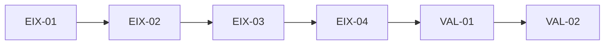

# TASKS — prd-eixos-separados-cli-adr-001

> 6 microtasks. Teste ANTES do código. Base `2fed40a`. Selo/baseline antigos só mudam com ratificação §16.

### EIX-01 — Inventário de eixos e cardinalidade 48
- **RF**: 01, 13 · **P0** · **Risco Médio**
- **Arquivos**: `installer/eixos.mjs` (novo), `installer/__tests__/eixos.spec.mjs`
- **Teste primeiro**: 8 backends × 6 frontends = 48; conjuntos fechados; exceção mobile (dart/flutter nos dois eixos) declarada; **nenhum preset casado, nenhuma op de CLI visual (vai no ADR-002)**.
- **BDD**: sucesso = 48 pares derivados; falha = par fora do inventário; borda = flutter+flutter única exceção.
- **DoD**: `node --test installer/__tests__/eixos.spec.mjs` 48/48.

### EIX-02 — Composição por eixo (commands/moduleMap backend, mcp/stacks frontend)
- **RF**: 02, 03 · **P0** · **Risco Alto**
- **Arquivos**: `installer/compose.mjs` (novo), `installer/__tests__/compose.spec.mjs`
- **Teste primeiro**: `commands`/`moduleMap` vêm do eixo backend; `mcp`/`stacks`/skills do eixo frontend; skills/rules por eixo do registry (`SKILLS_BY_AXIS`/`RULES_BY_AXIS`); nenhum valor do eixo errado no campo.
- **BDD**: sucesso = rust+vue com commands rust/mcp vue; falha = commands vue; borda = other/none sem frontend.
- **DoD**: asserção por eixo nos 48 pares, 0 falha.

### EIX-03 — Gerador de config com textos derivados
- **RF**: 04, 05 · **P0** · **Risco Alto**
- **Arquivos**: `installer/generate-eixos.mjs` (novo), `installer/contract-pure.mjs` (ajuste), `installer/__tests__/generate-eixos.spec.mjs`
- **Teste primeiro**: `generateConfig({project,axes:{backend:'rust',frontend:'vue'}})` ⇒ `rust backend` / `vue frontend`, commands do backend, mcp do frontend; `grep 'declared via Q&A'` vazio no gerador; nenhum perfil casado consultado.
- **BDD**: sucesso = rust+vue válido; falha = literal de preset solto; borda = todos os 48 pares geram config válida.
- **DoD**: `rust+vue` provado; 48 configs geradas.

### EIX-04 — Migração dos 13 consumidores
- **RF**: 06, 07 · **P0** · **Risco Alto**
- **Arquivos**: 13 arquivos do inventário, `installer/__tests__/consumidores.spec.mjs`
- **Teste primeiro**: inventário `grep -rlnE 'STACK_(VALUES|PROFILES)' installer/ .agents/ installer-rs/src/`; cada arquivo com veredito registrado; nenhuma seleção de config por nome de preset casado fora da camada congelada.
- **BDD**: sucesso = 13/13 com veredito; falha = import órfão; borda = oráculo c63e333 permanece fora do caminho.
- **DoD**: inventário reduzido ao registry/oráculo; vereditos no VERIFY.

### VAL-01 — Baseline 48 ratificado + V20
- **RF**: 08, 09 · **P0** · **Risco Alto** · VAL
- **Arquivos**: `installer/__tests__/golden.spec.mjs`, `harness/prd-eixos-separados-cli-adr-001.json`
- **Teste primeiro**: 1 literal por combinação das 48; 36 novas ratificadas em §16; `INSTA_UPDATE=always`/`insta accept` vazio (C3); V20 re-medido e registrado.
- **BDD**: sucesso = 48 literais ratificados; falha = combinação nova verde sem baseline; borda = nenhuma divergência silenciosa de cobertura.
- **DoD**: tabela 48 comando → literal → ratificação; V20 population registrada.

### VAL-02 — Selo re-derivado, harness íntegro, VERIFY
- **RF**: 10, 11, 12 · **P0** · **Risco Alto** · VAL
- **Arquivos**: `harness/prd-eixos-separados-cli-adr-001.json`, `.spec/backend/prd-eixos-separados-cli-adr-001/VERIFY.md`
- **Teste primeiro**: `sealCommands` novo hash ratificado, sem compatibilidade c904f1c5; `grep install.mjs gate.js`=0; gate/config/protectedPaths byte-idênticos; 4 etapas 0 falhas; PRD/ADR-01/ADR-02 PASS; VERIFY 3 dimensões + segurança 14.
- **BDD**: sucesso = novo hash ratificado; falha = promessa de compatibilidade; borda = gate.js tocado reprova.
- **DoD**: VERIFY 3/3; hash novo em §16; push não executado sem aprovação.

## Grafo

**Layer**: backend 4 · VAL 2 · FE N/A (CLI visual é ADR-002).
