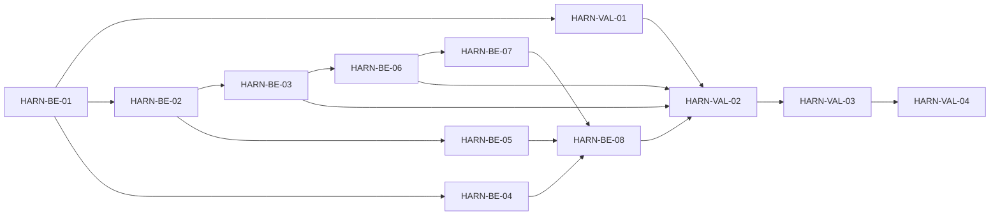

# TASKS — prd-installer-rust-adr-003

> 12 microtasks, camadas **BE** (motor Rust) e **VAL** (validação/oráculo). **FE: N/A** — TUI é ADR-004. Cada task: teste ANTES da implementação, <2h, DoD próprio. Base `fbdca4c`.

### HARN-BE-01 — Bootstrap do motor e fronteira `contract-v1`

- **RF**: 01, 17 · **Prioridade**: P0 · **Risco**: Alto · **Tipo**: Backend/infra
- **Arquivos**: `installer-rs/Cargo.toml`, `installer-rs/src/main.rs`, `installer-rs/src/contract.rs`, `installer-rs/src/dispatcher.rs`, `installer-rs/src/error.rs`
- **Depende de**: —
- **Teste primeiro**: `installer-rs/src/contract.rs` — envelope `{v:1, op, result|error}`; exit `0` ok / `1` erro / `2` só protocolo; 23 nomes `D-ENGINE` no dispatcher; nenhum `planUpgrade`/`applyUpgrade`; segredo em `stdin` sem eco.
- **BDD**: sucesso = `op` conhecida devolve envelope `v:1` com `op` igual; falha = `op` desconhecida ⇒ `2` protocolo; borda = 23º nome presente, 24º rejeitado.
- **Critério de crate (RF-17)**: escolher por ADR §2.4 com linha de `RESEARCH.md` S1/S2/S3 em comentário de `Cargo.toml`; recomendação A1 (`clap`+`anyhow`+`thiserror`), texto divergente ⇒ oráculo vence.
- **DoD**: `cargo test` verde; `grep -c 'case "'` = 23; `grep -cE 'planUpgrade|applyUpgrade'` = 0; `git diff --exit-code -- harness.config.json .opencode/plugins/lib/seal.mjs` vazio.

### HARN-VAL-01 — Oráculo e harness `prova(op)`

- **RF**: 02, 12, 14 · **Prioridade**: P0 · **Risco**: Alto · **Tipo**: Validação
- **Arquivos**: `installer-rs/tests/oracle.rs` (ou harness Node em `installer/__tests__/`), fixture `REQ_op` × 23, lista de 8 arquivos de vereditos congelados
- **Depende de**: BE-01
- **Teste primeiro**: materializar worktree `detach` `c63e333` com SHA cheio + `status --porcelain` vazio antes de cada comparação; registrar `sha256` dos 8 arquivos no RELATÓRIO antes da 1ª comparação; `diff -u` das saídas; mutação de 1 byte reprova.
- **BDD**: sucesso = oráculo íntegro e `prova` executável; falha = SHA divergente/sujo ⇒ fail-closed; borda = `.snap.new` pendente nunca entra como baseline.
- **DoD**: 23 fixtures `REQ_op`; 8 shas registrados; `cargo insta accept` ausente como comando executável; worktree liberado no finally.

### HARN-BE-02 — Ops de leitura 1/2/4/5

- **RF**: 01, 02 · **Prioridade**: P0 · **Risco**: Médio · **Tipo**: Backend
- **Arquivos**: `installer-rs/src/ops/preflight.rs`, `inventory.rs`, `backup_dir.rs`, `answers.rs`
- **Depende de**: BE-01
- **Teste primeiro**: `preflight` (`BAD_TARGET`/`NODE_MIN`/`UID_ROOT`/`REINSTALL`), `inventory` (camadas), `resolveBackupDir` (igual/nested/symlink ⇒ `BACKUP_FAIL`), `loadAnswersFile` (`BAD_ANSWER`).
- **BDD**: sucesso = envelope ok; falha = cada código com `exit 1`, 0 writes; borda = symlink de backup recusado.
- **DoD**: `prova` dessas 4 `op`s com `diff` vazio; nenhuma escrita em disco.

### HARN-BE-03 — Ops de coleta 6/7/8

- **RF**: 01, 02 · **Prioridade**: P0 · **Risco**: Médio · **Tipo**: Backend
- **Arquivos**: `installer-rs/src/ops/collect.rs`, `config.rs`, `incoming.rs`
- **Depende de**: BE-02
- **Teste primeiro**: `collectAnswers` (`BAD_ANSWER`/`NO_STDIN`/`USER_ABORT`), `generateConfig` byte-equal ao literal (`golden.spec.mjs`), `collectIncoming` (paths+bodies da registry).
- **BDD**: sucesso = config 9 byte-equal + 2 parciais; falha = divergência SI-6 ⇒ `exit 1`; borda = `NO_STDIN` sem eco.
- **DoD**: `prova` dessas 3 `op`s com `diff` vazio; `EXPECTED_STACKS` continua literal escrito à mão no oráculo, nunca derivado do sujeito.

### HARN-BE-04 — Texto congelado: erro 4-linhas, códigos e help

- **RF**: 07, 08 · **Prioridade**: P0 · **Risco**: Alto · **Tipo**: Backend
- **Arquivos**: `installer-rs/src/text/error.rs`, `usage.rs`, `codes.rs`
- **Depende de**: BE-01
- **Teste primeiro**: cada código do `Set` de `install.mjs:1529-1535` (**22 medidos + UNKNOWN** — S3; nunca o número 23 do ADR) ⇒ 4 linhas byte-equal; `printUsage` 9 linhas; `--help` ⇒ 0; sem `--target` ⇒ 1; `NOT_INSTALLED`/`MANIFEST_INVALID` ⇒ `UNKNOWN`.
- **BDD**: sucesso = `diff` vazio para cada código; falha = crate gera texto divergente ⇒ oráculo vence; borda = ANSI control chars removidos como no oráculo.
- **DoD**: tabela dos 22 códigos com prova; nenhum código novo; sem stack trace/path interno.

### HARN-BE-05 — Ops 18: `runDoctor` somente leitura

- **RF**: 06, 03(I3) · **Prioridade**: P0 · **Risco**: Alto · **Tipo**: Backend
- **Arquivos**: `installer-rs/src/ops/doctor.rs`, `installer-rs/tests/doctor_markers.rs`
- **Depende de**: BE-02
- **Teste primeiro**: 7 marcadores D0..D6, vereditos `SAUDÁVEL`/`ATENÇÃO`/`QUEBRADO`, `exit 0/1`, 0 writes; `report.verdict` alimenta `doctorPre`, **nunca** gate do upgrade.
- **BDD**: sucesso = veredito e exit idênticos ao oráculo; falha = `QUEBRADO` abortando upgrade ⇒ proibido (EX-BE-05); borda = nenhum arquivo tocado.
- **DoD**: `prova(runDoctor)` com `diff` vazio; hash de árvore antes=depois.

### HARN-BE-06 — Ops 9/10/11/12/15/16: merge, manifesto e escrita

- **RF**: 09, 10 · **Prioridade**: P0 · **Risco**: Alto · **Tipo**: Backend
- **Arquivos**: `installer-rs/src/ops/merge.rs`, `manifest.rs`, `write.rs`, `opencode.rs`, `agent_file.rs`
- **Depende de**: BE-03
- **Teste primeiro**: `planMerge`/`applyMerge`/`buildManifest`/`writeManifest`/`mergeOpencodeJson`/`mergeAgentFile`; v2-only T1..T8; remoção de chave v1 **por forma**; npm do usuário preservado; only-add em `mcp`/`instructions`.
- **BDD**: sucesso = 2ª execução `noop` em conteúdo/mtime/inode (BF-02b); falha = `MISSING_INCOMING` ⇒ `exit 1`; borda = `flag` vira `collisions` (upgrade) mas `flagged-open` aborta (init).
- **DoD**: `prova` das 6 `op`s com `diff` vazio; schema v1 intacto.

### HARN-BE-07 — Ops 3/13/14: backup verificado e checks

- **RF**: 04 · **Prioridade**: P0 · **Risco**: Alto · **Tipo**: Backend
- **Arquivos**: `installer-rs/src/ops/backup.rs`, `checks.rs`
- **Depende de**: BE-06
- **Teste primeiro**: `backup` com `injectFailure` ⇒ `BACKUP_FAIL`, 0 writes; `requireVerifiedBackup` sem `verified` ⇒ `BACKUP_UNVERIFIED`; `runChecks` ⇒ `passed:true/false` com `json-invalid`/`flagged-open`/`literal-denied`/`manifest-missing`.
- **BDD**: sucesso = hash do destino idêntico após falha; falha = nenhuma escrita de conteúdo sem backup verificado; borda = rollback é o diretório de backup, nunca limpeza.
- **DoD**: `prova` das 3 `op`s com `diff` vazio; `apply` é o único ponto de escrita de conteúdo.

### HARN-BE-08 — Ops 17/19/20/21/23: entrypoints e ordens congeladas

- **RF**: 03, 05, 09, 10, 11 · **Prioridade**: P0 · **Risco**: Alto · **Tipo**: Backend
- **Arquivos**: `installer-rs/src/entry/main.rs` (`main`), `init.rs`, `upgrade.rs`, `cli.rs`, `wizard.rs`
- **Depende de**: BE-04, BE-05, BE-07
- **Teste primeiro**: `runUpgrade` na ordem exata (preflight → manifesto → parse → schema → runDoctor → collectAnswers → collectIncoming/generateConfig → planUpgrade/printPlan → [dry-run retorno] → confirmByLayer → backup+requireVerifiedBackup → applyUpgrade → buildManifest/writeManifest → runChecks → regrava manifesto → exitCode); `main` na ordem distinta (backup antes de planejar); `dryRun` ⇒ `applied:false`, `backupDir:null`, `checks:{passed:null,ran:false,skipped:true}`, 0 writes; exitCode nos 4 call sites.
- **BDD**: sucesso = ordem e exit idênticos ao oráculo nos 4 entrypoints; falha = `USER_ABORT`/`NOT_INSTALLED`/`FOREIGN_MANIFEST`/`flagged-open` ⇒ 1, 0 writes; borda = 2ª execução `noop`.
- **DoD**: diff de sequência relativa contra `c63e333` vazio; `report.verdict` não é gate; nenhuma ordem unificada.

### HARN-VAL-02 — Differential das 23 `op`s

- **RF**: 02, 14 · **Prioridade**: P0 · **Risco**: Alto · **Tipo**: Validação
- **Arquivos**: `installer-rs/tests/parity_ops.rs`, `installer/__tests__/parity-oracle.spec.mjs` (extensão parametrizada)
- **Depende de**: BE-02, BE-03, BE-04, BE-05, BE-06, BE-07, BE-08, VAL-01
- **Teste primeiro**: laço sobre as 23 `op`s com `prova(op)`; SHA + porcelania antes de cada; mutação de 1 byte do oráculo reprova; `op` nova sem linha no ADR reprova (SI-6).
- **BDD**: sucesso = 23/23 `diff` vazio; falha = qualquer divergência de envelope/mensagem/exit; borda = `2` só em protocolo.
- **DoD**: tabela 23 `op` → oráculo → comando → mutação que derruba, colada no RELATÓRIO.

### HARN-VAL-03 — SI-2/SI-3 de `not_measured` a differential real

- **RF**: 12, 14 · **Prioridade**: P0 · **Risco**: Alto · **Tipo**: Validação
- **Arquivos**: `installer/parity-oracle.mjs` (wiring do binário Rust), `harness/prd-installer-rust-adr-003.json`
- **Depende de**: VAL-02
- **Teste primeiro**: `runParity` com `$INSTALLER_BIN` apontando para o binário Rust; SI-2 (paths+bodies) e SI-3 (dry-run 0 writes com hash de **conteúdo**) passam a `medido`; vereditos lidos dos 8 arquivos externos com sha registrado; assinatura do rito permanecendo válida (`literalProven:true`).
- **BDD**: sucesso = 6/6 SI medidos; falha = binário ausente ⇒ `not_measured` honesto (nunca PASS); borda = literal mutado ⇒ `literalProven:false`.
- **DoD**: nenhum `PASS` por omissão; `Veredito: validated literal 9fa4530b… <ISO> c63e333` herdado intacto ou rubrica nova se sha divergir.

### HARN-VAL-04 — Relatório, 5 suítes e selo

- **RF**: 13, 15, 16 · **Prioridade**: P0 · **Risco**: Médio · **Tipo**: Validação
- **Arquivos**: `harness/prd-installer-rust-adr-003.json`, `.spec/backend/prd-installer-rust-adr-003/VERIFY.md`
- **Depende de**: VAL-03
- **Teste primeiro**: 5 suítes (plugins, installer, static, sdd, vendor) + `cargo test` paralelo; `sealCommands` = `c904f1c5…`; `9+2` medido e `12/12` nunca como fato; `PASS PRD-01/ADR-01/ADR-02`; trailer `Harness-Gate-Change`.
- **BDD**: sucesso = 0 falhas em todas; falha = comando Rust dentro do selo ⇒ bloqueio; borda = população V20 re-medida após última edição.
- **DoD**: VERIFY 3/3; BRIDGE `D1-two-motors` pronta para expirar no merge; push não executado sem aprovação.

## Grafo de dependências

## Sumário

| Layer | Tasks | Total |
|---|---|---|
| BE (Rust) | BE-01..BE-08 | 8 |
| VAL (validação) | VAL-01..VAL-04 | 4 |
| FE | N/A (ADR-004) | 0 |
