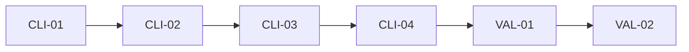

# TASKS — prd-eixos-separados-cli-adr-002

> 6 microtasks. Teste ANTES do código. Base `75caa4a`. Protótipo aprovado é a autoridade — N/M não reabertos sem §16.

### CLI-01 — Infra: @inquirer + i18n PT-BR + AbortSignal
- **RF**: 04, 08, 12 · **P0** · **Risco Médio**
- **Arquivos**: `installer/cli/package.json`, `installer/cli/locale.js`, `installer/cli/abort.js`
- **Teste primeiro**: @inquirer/prompts disponível; locale PT-BR com todas as chaves dos prompts; AbortSignal + ExitPromptError tratados; **grep word-boundary** `/\b(inquire|ratatui|dialoguer)\b/` (excluindo @inquirer/) = 0; versão/pin registrada como escolha SDD (não decisão do ADR).
- **BDD**: sucesso = locale completo e B1; falha = lib full-screen; borda = Ctrl+C vira USER_ABORT.
- **DoD**: nenhuma string de prompt fora do locale.

### CLI-02 — Telas backend/frontend/nome + resumo (N=4)
- **RF**: 01, 02, 03, 04 · **P0** · **Risco Alto**
- **Arquivos**: `installer/cli/wizard.js`, `installer/__tests__/wizard.spec.mjs`
- **Teste primeiro**: ordem backend→frontend→nome→token + resumo; **N=4**; **M** = 2 setas+Enter / 1 seta+Enter / Enter / token+Enter; **zero comando digitado** (nenhuma etapa lê nome de stack como texto livre); todo texto do locale.
- **BDD**: sucesso = 4 transições por setas+Enter; falha = 5ª tela ou texto livre; borda = backend e frontend das 48 combinações da ADR-001.
- **DoD**: wizard.spec cobre 4 transições, 0 falha; N/M idênticos ao state.prototype.

### CLI-03 — Seleção independente backend/frontend (consome ADR-001)
- **RF**: 06, 10 · **P0** · **Risco Alto**
- **Arquivos**: `installer/cli/eixos.js`, `installer/__tests__/wizard-eixos.spec.mjs`
- **Teste primeiro**: `select` de backend (8) e frontend (6) separados; `rust+vue` gera config válida via generateConfig da ADR-001; nenhum preset casado na seleção.
- **BDD**: sucesso = rust+vue; falha = preset casado; borda = other/none sem frontend.
- **DoD**: eixos-stack.spec + wizard-eixos.spec 0 falha.

### CLI-04 — Segredo, aborto 0 writes, restore de eco
- **RF**: 05, 07 · **P0** · **Risco Alto**
- **Arquivos**: `installer/cli/secret.js`, `installer/__tests__/qa.spec.mjs`
- **Teste primeiro**: `password` mask + `[REDACTED]`; `SEGREDO_PROVA` vazio em `/proc/$PID/cmdline`, stdout, stderr, transcript; `q`/EOF/ExitPromptError ⇒ USER_ABORT; hash de árvore antes=depois; SIGTERM com prompt aberto restaura eco.
- **BDD**: sucesso = segredo invisível e 0 writes; falha = vazamento ou write; borda = token vazio OK.
- **DoD**: qa.spec 0 falha; prova PTY com sinal e eco restaurado.

### VAL-01 — Transcript novo ratificado + rust+vue
- **RF**: 06, 09, 10 · **P0** · **Risco Alto** · VAL
- **Arquivos**: `harness/prd-eixos-separados-cli-adr-002.json`, novo transcript
- **Teste primeiro**: transcript com 4 telas + resumo e marcadores PT-BR; sha registrado antes de virar baseline; **nenhuma afirmação de paridade com 16.336 B**; rust+vue separados gerando config válida; rito ADR-002 (`9fa4530b…`) reutilizado, owner aprova / orquestrador registra.
- **BDD**: sucesso = sha ratificado; falha = claim de paridade antiga; borda = 37 novas da ADR-001 não reabertas.
- **DoD**: tabela de ratificação no RELATÓRIO; semanticamente novo.

### VAL-02 — Suíte, canais, N/M medidos, VERIFY
- **RF**: 02, 08, 11 · **P0** · **Médio** · VAL
- **Arquivos**: `harness/prd-eixos-separados-cli-adr-002.json`, `.spec/frontend/prd-eixos-separados-cli-adr-002/VERIFY.md`
- **Teste primeiro**: 4 etapas 0 falhas; canais separados (r.json envelope / r.err progresso); N/M re-medidos = congelados; B2 grep word-boundary 0; VERIFY 3 dimensões + segurança 14.
- **BDD**: sucesso = N/M batem e 0 falhas; falha = protótipo reaberto; borda = stdoutHash com duration_ms (dívida declarada).
- **DoD**: VERIFY 3/3; push não executado sem aprovação.

## Grafo

**Layer**: FE/CLI 4 · VAL 2 · backend N/A (eixos já entregues na ADR-001).
