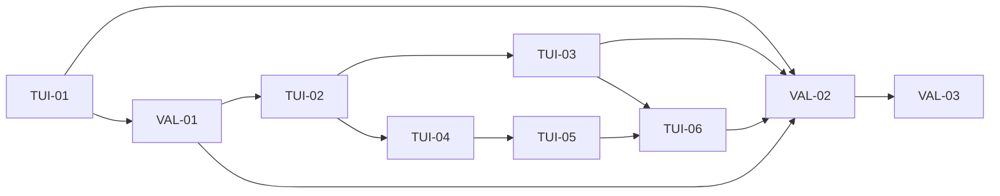

# TASKS — prd-installer-rust-adr-004

> 9 microtasks (8 TUI + 1 VAL). Teste ANTES da implementação. DoD próprio. Base `9a74ba9`. Parecer `ux-designer` (`UX.md`) e guarda RF-05 são vinculantes.

### TUI-01 — Modelo 10×5 + guarda de escrita com dente
- **RF**: 01, 05, 10, 17, 18 · **P0** · **Risco Alto** · camada TUI
- **Arquivos**: `installer-rs/src/tui/model.rs` (novo), `installer-rs/src/entry/wizard.rs`, `installer-rs/src/tui/mod.rs`
- **Depende de**: —
- **Teste primeiro**: 10 ids × 5 campos I/C/P/E/A preenchidos (50); **asserção RF-05(b)** com 3 caminhos (limpo passa, `fs::write` injetado em cópia reprova, arquivo ausente reprova); canais separados.
- **BDD**: sucesso = 50 campos e guarda com dente; falha = qualquer campo vazio, escrita na tela ou arquivo ausente; borda = crate/versão com fonte S4/S5/S6/S10/S11 (sem op nova).
- **DoD**: `grep -c` da guarda = 0 em `wizard.rs`; 3 caminhos medidos; nenhuma chave de envelope nova sem §16.

### VAL-01 — Transcript e oráculo travados
- **RF**: 02, 05, 13 · **P0** · **Risco Alto** · VAL
- **Arquivos**: `installer-rs/tests/tui-transcript.spec.mjs` (novo), `harness/prd-installer-rust-adr-004.json`
- **Depende de**: TUI-01
- **Teste primeiro**: `wc -c "$TRANSCRIPT"` = 16.336; 5 marcadores; `git diff --exit-code -- "$TRANSCRIPT"` vazio; worktree `detach c63e333` com SHA + porcelania antes de cada prova; mutação de 1 byte do transcript reprova.
- **BDD**: sucesso = oráculo externo íntegro; falha = drift ou sujeira ⇒ fail-closed.
- **DoD**: 8 shas de vereditos congelados registrados antes da comparação.

### TUI-02 — Navegação W0→W4 na ordem de `runWizard`
- **RF**: 03, 12, 18 · **P0** · **Risco Alto** · TUI
- **Arquivos**: `installer-rs/src/tui/navigation.rs` (novo), `entry/wizard.rs`
- **Depende de**: VAL-01
- **Teste primeiro**: ordem exata W0→W1→W2→(W2m-1→W2m-2 | W3)→W4; 4 ramos medidos; retry da **mesma** pergunta (M4); `report.verdict` nunca gate; `runWizard` orquestra no motor.
- **BDD**: sucesso = ordem idêntica ao oráculo; falha = 5º ramo, `voltar`/`pular` ou mensagem nova; borda = W2 com/sem pubspec e W2m com/sem `next`.
- **DoD**: `diff` de transições oráculo↔binário vazio; nenhum rótulo novo.

### TUI-03 — W5 confirmação, aborto e dry-run 0 writes
- **RF**: 03, 06, 18 · **P0** · **Risco Alto** · TUI
- **Arquivos**: `installer-rs/src/tui/confirm.rs` (novo), `entry/wizard.rs`
- **Depende de**: TUI-02
- **Teste primeiro**: `q`/EOF/`USER_ABORT` ⇒ exit 1, 0 writes, hash de árvore antes=depois; `flagged-open` aborta; `flag` no upgrade vira `collisions` e continua; dry-run ⇒ `checks.passed:null`, 0 writes, exit 0; **`--yes` pula**.
- **BDD**: sucesso = 0 writes em aborto/dry-run; falha = 1 arquivo tocado; borda = `MISSING_INCOMING` encerra sem W6/W7.
- **DoD**: 0 writes medidos por hash de conteúdo.

### TUI-04 — Segredo: TTY sem eco e pipe `serializeSkips`
- **RF**: 07, 08, 18 · **P0** · **Risco Alto** · TUI
- **Arquivos**: `installer-rs/src/tui/secret.rs` (novo), `entry/wizard.rs`
- **Depende de**: TUI-02
- **Teste primeiro**: `canNoEchoTTY` ⇒ `r.close()`→leitura sem eco→novo reader; `q` no segredo ⇒ `USER_ABORT`; `[OK] deployToken = [REDACTED]`; pipe ⇒ `serializeSkips` (chave ausente do envelope), `sanitizeLog=token=[REDACTED]`; `grep -F SEGREDO_PROVA` vazio em `/proc/$PID/cmdline`, `stdout`, `stderr`.
- **BDD**: sucesso = segredo nunca em claro; falha = 1 occurrence em qualquer canal; borda = token vazio é permitido.
- **DoD**: prompts com espaço final preservado (`:19`,`:24`,`:38`), `\r` não normalizado.

### TUI-05 — Cleanup de terminal após SIGTERM (R5)
- **RF**: 09, 06, 18 · **P0** · **Risco Alto** · TUI
- **Arquivos**: `installer-rs/src/tui/cleanup.rs` (novo), `entry/wizard.rs`
- **Depende de**: TUI-04
- **Teste primeiro**: handler **idempotente registrado antes** da leitura sem eco; PTY com prompt aberto → `kill -TERM` → `stty -a` com eco restaurado + nova leitura visível + `ExitStatus` com sinal, **nunca exit 0**; cobre SIGINT/EOF/erro.
- **BDD**: sucesso = eco restaurado em todos os sinais; falha = terminal sem eco; borda = handler chamado 2× não corrompe estado.
- **DoD**: prova PTY com sinal e eco restaurado colada no RELATÓRIO.

### TUI-06 — 8 `op`s de TUI no dispatcher + quitação parcial da ponte
- **RF**: 04, 11, 12 · **P0** · **Risco Alto** · TUI/motor
- **Arquivos**: `installer-rs/src/dispatcher.rs`, `installer/installer-contract.mjs`, `installer/contract-inventory.mjs`
- **Depende de**: TUI-03, TUI-04, TUI-05
- **Teste primeiro**: `diff -u <(nomes D-TUI) <(ops TUI do dispatcher)` vazio; 8 nomes exatos; nenhuma op de escrita na classe; remover os 8 nomes da ponte em `installer-contract.mjs:58`, deixando só os 10 D-ENGINE; ajustar override `D1-two-motors-restante` para 10 nomes.
- **BDD**: sucesso = 8 ops 1:1 e ponte reduzida; falha = 9ª op ou nome divergente; borda = `printPlan`/`detect` não viram engine.
- **DoD**: 8 provas `prova(op)` com `diff` vazio; ponte = 10 nomes; 540+704 testes verdes.

### VAL-02 — Prova integral: transcript, canais, segredo, 8 ops
- **RF**: 02, 04, 07, 10, 13 · **P0** · **Risco Alto** · VAL
- **Arquivos**: `installer-rs/tests/tui-parity.mjs` (novo), `harness/prd-installer-rust-adr-004.json`
- **Depende de**: TUI-01..06, VAL-01
- **Teste primeiro**: `diff` transcript 16.336 B; 5 marcadores; canais separados; segredo ausente; 8 `prova(op)` com mutação que derruba; guarda RF-05 nos 3 caminhos.
- **BDD**: sucesso = tudo vazio/0; falha = qualquer divergência de byte.
- **DoD**: tabela 8 op → oráculo → comando → mutação; literal assinado com rito ADR-002.

### VAL-03 — Relatório, 5 suítes, selo, VERIFY
- **RF**: 14, 15, 16, 18 · **P0** · **Médio** · VAL
- **Arquivos**: `harness/prd-installer-rust-adr-004.json`, `.spec/frontend/prd-installer-rust-adr-004/VERIFY.md`
- **Depende de**: VAL-02
- **Teste primeiro**: rito `Veredito: validated literal <sha> <ISO> c63e333`; 5 suítes + cargo; selo `c904f1c5`; `PASS ADR-01/02`; 3 dimensões; segurança 14 itens.
- **BDD**: sucesso = 0 falhas, selo intacto; falha = comando TUI no selo; borda = população V20 re-medida.
- **DoD**: VERIFY 3/3; ponte D1 com 10 nomes; push não executado sem aprovação.

## Grafo

**Layer**: TUI 8 · VAL 3 · Backend/engine N/A (8 ops de apresentação; 10 D-ENGINE em dívida separada).
