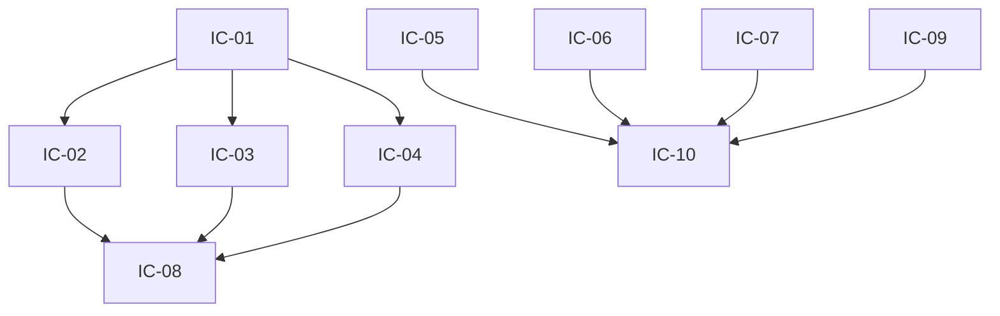

<!-- scope: adr/ADR-001 -->
# Execution Backlog: ADR-001 — Inventário e contrato de paridade opencode↔Codex

## 1. Traceability Context
- **Source ADR/SPEC**: `.spec/prd/prd-codex-port/ADRs/ADR-001-inventario-contrato/ADR.md` + `SPEC.md`
- **Goal**: Explodir o contrato de ADR-001 em tickets TDD-ready (inventário, reason codes, deny, kill-switch, dual-run, bypass, smoke schema, fixtures, teto, rastreabilidade).
- **Unit**: `adr` (ADR-INDEX.md, linha ADR-001).

## 2. Sprint Summary

| Phase | Task ID | Type | Priority | Risk | Complexity | Status |
|---|---|---|---|---|---|---|
| Phase 1 | `IC-01` | Doc/Contract | P0 | Low | 2 | Done |
| Phase 1 | `IC-02` | Contract/Test | P0 | Medium | 3 | Done |
| Phase 1 | `IC-03` | Contract | P0 | Low | 2 | Done |
| Phase 1 | `IC-04` | Contract/Test | P0 | Medium | 3 | Done |
| Phase 2 | `IC-05` | Contract/Test | P0 | Medium | 2 | Done |
| Phase 2 | `IC-06` | Doc/Contract | P1 | Low | 1 | Done |
| Phase 2 | `IC-07` | Schema/Test | P1 | Low | 2 | Done |
| Phase 3 | `IC-08` | Test | P1 | Medium | 3 | Done |
| Phase 3 | `IC-09` | Contract/Test | P2 | Low | 1 | Done |
| Phase 3 | `IC-10` | Doc/Audit | P2 | Low | 1 | Done |

## 3. Dependency Graph

---

## 4. Task Backlog

### Task IC-01 — Consolidar e validar inventário de superfícies (7)
- **Constraint Ref**: ADR-001 I1, RF-01, RF-08, RF-09, INV-INV-1..4
- **Depends on (SPEC)**: —
- **Dependency Type**: Hard (nenhuma; fundação do contrato)
- **Layer**: Documentation/Contract
- **Task Type**: Doc
- **Priority**: P0
- **Risk Level**: Low
- **Parallelizable**: No
- **Artifact**: tabela de inventário em `ADR.md` + `SPEC.md` §3
- **Framework Detail**: Markdown (sem código)

#### 📝 Context & Domain Impact
- **Description**: Garantir que o inventário de 7 superfícies (ADR.md tabela) esteja completo, com contagens de referência (11 agentes, 8 regras, 32 skills) e invariantes INV-INV-1..4 documentados.
- **Domain Impact**: Base do contrato; ADR-002/ADR-003 dependem deste inventário para saber o que portar.

#### 🛡️ Technical Enforcement (DO NOT IGNORE)
- **Rule**: apenas as 7 superfícies listadas são portadas; skills reusam-se sem port; nenhum deny novo.
- **Failure Mode**: inventário incompleto ou contagens erradas propagam drift para ADR-002/ADR-003.

#### ✅ Acceptance Criteria (BDD)
- **Scenario 1 (Success)**: inventário presente e completo
  - **Given** o ADR-001
  - **When** grep `Superfície opencode` em `ADR.md`
  - **Then** a tabela lista 7 linhas e as contagens (11 agentes, 8 regras, 32 skills) conferem com o disco
- **Scenario 2 (Failure Mode — inventário parcial)**: linha ausente
  - **Given** ADR.md sem uma das 7 superfícies
  - **When** revisão de contrato
  - **Then** reprovado (I1 violado)
- **Scenario 3 (Edge Case — contagem de skills)**: skill adicionada/removida
  - **Given** `.agents/skills/` com ≠32
  - **When** validação
  - **Then** inventário atualizado ou reprovado (INV-INV-2)

#### 🛠️ Implementation Steps (TDD - Test First)
- [ ] `scripts/__tests__/codex-inventory.spec.mjs`: teste de contagem (agentes=11 em opencode.json, regras=8 em .agents/rules, skills=32 em .agents/skills) — TDD FIRST.
- [ ] `scripts/check-codex-inventory.mjs`: asserção de presença da tabela e contagens.
- [ ] Revisar `ADR.md` + `SPEC.md` §3 para conformidade.

#### 🏁 Definition of Done (DoD)
- [ ] Teste criado antes da implementação.
- [ ] Contagens verificadas em disco.
- [ ] Invariantes INV-INV-1..4 documentados.

---

### Task IC-02 — Congelar e publicar conjunto de reason codes (CORE_GATES)
- **Constraint Ref**: ADR-001 I2, RF-02, NFR-01, NFR-08
- **Depends on (SPEC)**: IC-01
- **Dependency Type**: Hard
- **Layer**: Contract/Test
- **Task Type**: Contract
- **Priority**: P0
- **Risk Level**: Medium
- **Parallelizable**: No
- **Artifact**: lista de reason codes em `SPEC.md` (referência a `CORE_GATES`)
- **Framework Detail**: extração de `.opencode/plugins/gate.js`

#### 📝 Context & Domain Impact
- **Description**: Extrair de `gate.js` o conjunto de reason codes (`CORE_GATES`) e publicá-lo como fonte única de verdade para paridade Codex.
- **Domain Impact**: Base da métrica A2 (0 divergências).

#### 🛡️ Technical Enforcement (DO NOT IGNORE)
- **Rule**: reason codes Codex = reason codes opencode (mesma fonte); sem reescrita/divergência.
- **Failure Mode**: drift de reason codes → A2 falha.

#### ✅ Acceptance Criteria (BDD)
- **Scenario 1 (Success)**: extração e comparação
  - **Given** `gate.js` com `CORE_GATES`
  - **When** extração automatizada
  - **Then** lista não vazia e estável (hash registrado)
- **Scenario 2 (Failure Mode — drift)**: adapter reescreve reason code
  - **Given** reason code divergente em Codex
  - **When** fixture de paridade
  - **Then** A2 falha (divergência reportada)
- **Scenario 3 (Edge Case — gate não coberto)**: tool sem hook
  - **Given** `spawn_agent` (issue #49736)
  - **When** paridade
  - **Then** documentado como best-effort, fora do conjunto medido

#### 🛠️ Implementation Steps (TDD - Test First)
- [ ] `scripts/__tests__/codex-reason-codes.spec.mjs`: extrai `CORE_GATES` de gate.js e assera não-vazio + estabilidade — TDD FIRST.
- [ ] `scripts/extract-reason-codes.mjs`: helper de extração (read-only).
- [ ] Documentar lista em `SPEC.md` §4/§5 (RF-02).

#### 🏁 Definition of Done (DoD)
- [ ] Extração automatizada passa.
- [ ] Lista publicada e referenciada por ADR-002.

---

### Task IC-03 — Definir contrato de deny semantics (permissionDecision/exit 2)
- **Constraint Ref**: ADR-001 I3, RF-03, NFR-06, PRD §13
- **Depends on (SPEC)**: IC-01
- **Dependency Type**: Hard
- **Layer**: Contract
- **Task Type**: Contract
- **Priority**: P0
- **Risk Level**: Low
- **Parallelizable**: Yes
- **Artifact**: seção I3 em `ADR.md` + `SPEC.md` §4
- **Framework Detail**: JSON stdout / exit code

#### 📝 Context & Domain Impact
- **Description**: Congelar a única semântica de deny aceita (`permissionDecision:"deny"` em JSON stdout OU exit 2, com `permissionDecisionReason` carregando o reason code) e proibir prompts interativos como gate.
- **Domain Impact**: Garante auditabilidade (NFR-06) e paridade (I3).

#### 🛡️ Technical Enforcement (DO NOT IGNORE)
- **Rule**: nenhum deny fora de `permissionDecision:"deny"`/exit 2; nenhum prompt interativo como gate.
- **Failure Mode**: uso de prompt interativo como gate → bypass da governança.

#### ✅ Acceptance Criteria (BDD)
- **Scenario 1 (Success)**: deny via permissionDecision
  - **Given** hook Codex ativo
  - **When** gate nega
  - **Then** stdout JSON com `permissionDecision:"deny"` e reason code em `permissionDecisionReason`
- **Scenario 2 (Failure Mode — prompt interativo)**: tentativa de usar prompt como gate
  - **Given** implementação propõe prompt interativo
  - **When** revisão
  - **Then** reprovado (I3 violado)
- **Scenario 3 (Edge Case — exit 2)**: deny via exit code
  - **Given** hook retorna exit 2
  - **When** Codex processa
  - **Then** ação negada e reason code disponível

#### 🛠️ Implementation Steps (TDD - Test First)
- [ ] `scripts/__tests__/codex-deny-semantics.spec.mjs`: asserção de que doc/adapter declara apenas as duas formas — TDD FIRST.
- [ ] Revisar `ADR.md` I3 e `SPEC.md` §4.

#### 🏁 Definition of Done (DoD)
- [ ] Contrato documentado e referenciado por ADR-002.

---

### Task IC-04 — Definir kill-switch HARNESS_GATES=off e bypass log
- **Constraint Ref**: ADR-001 I4, RF-04, NFR-07, PRD §13
- **Depends on (SPEC)**: IC-01
- **Dependency Type**: Hard
- **Layer**: Contract/Test
- **Task Type**: Contract
- **Priority**: P0
- **Risk Level**: Medium
- **Parallelizable**: Yes
- **Artifact**: seção I4 em `ADR.md` + `SPEC.md` §4/§11
- **Framework Detail**: env var + log

#### 📝 Context & Domain Impact
- **Description**: Congelar comportamento do kill-switch: com `HARNESS_GATES=off`, hooks Codex não negam e registram bypass (sem segredo, sem eco de path); 0 denies (A3).
- **Domain Impact**: Saída declarada e auditável da governança.

#### 🛡️ Technical Enforcement (DO NOT IGNORE)
- **Rule**: zero denies com env setada; log sem segredo/eco de path.
- **Failure Mode**: env setada mas deny ocorre → kill-switch ineficaz.

#### ✅ Acceptance Criteria (BDD)
- **Scenario 1 (Success)**: kill-switch ativo
  - **Given** `HARNESS_GATES=off`
  - **When** tool chamada no Codex
  - **Then** hook não nega e registra bypass (A3)
- **Scenario 2 (Failure Mode — bypass log com path)**: eco de path
  - **Given** log contém path/segredo
  - **When** revisão
  - **Then** reprovado (I4 violado)
- **Scenario 3 (Edge Case — env ausente)**: comportamento padrão
  - **Given** `HARNESS_GATES` não setada
  - **When** tool chamada
  - **Then** hooks ativos (deny normal)

#### 🛠️ Implementation Steps (TDD - Test First)
- [ ] `scripts/__tests__/codex-killswitch.spec.mjs`: asserção documental + placeholder de teste de hook — TDD FIRST.
- [ ] Revisar `ADR.md` I4 e `SPEC.md` §4.

#### 🏁 Definition of Done (DoD)
- [ ] Contrato documentado; teste de hook (A3) referenciado.

---

### Task IC-05 — Definir dual-run invariante e assertion de diff
- **Constraint Ref**: ADR-001 I5, RF-05, NFR-05, PRD §7
- **Depends on (SPEC)**: IC-01
- **Dependency Type**: Hard
- **Layer**: Contract/Test
- **Task Type**: Contract
- **Priority**: P0
- **Risk Level**: Medium
- **Parallelizable**: Yes
- **Artifact**: seção I5 em `ADR.md` + `SPEC.md` §4/§7
- **Framework Detail**: git diff

#### 📝 Context & Domain Impact
- **Description**: Congelar o invariante dual-run: o diff do ciclo não toca `.opencode/**`, `opencode.json` (exceto merge aditivo do harness-sync) nem `.agents/**` existentes.
- **Domain Impact**: Protege o caminho opencode (A1).

#### 🛡️ Technical Enforcement (DO NOT IGNORE)
- **Rule**: nenhum arquivo do caminho opencode é reescrito.
- **Failure Mode**: edição em opencode → regressão A1.

#### ✅ Acceptance Criteria (BDD)
- **Scenario 1 (Success)**: diff limpo
  - **Given** o ciclo implementado
  - **When** `git diff --name-only`
  - **Then** nenhum arquivo em `.opencode/**`, `opencode.json` (exceto merge aditivo) ou `.agents/**` existentes
- **Scenario 2 (Failure Mode — edição em opencode)**: toque em gate.js
  - **Given** commit altera `.opencode/plugins/gate.js`
  - **When** revisão
  - **Then** reprovado (I5 violado), exceto refatoração mínima D1-A aprovada em ADR-002
- **Scenario 3 (Edge Case — merge aditivo opencode.json)**: harness-sync merge
  - **Given** harness-sync merge aditivo em opencode.json
  - **When** diff
  - **Then** aceito (exceção declarada)

#### 🛠️ Implementation Steps (TDD - Test First)
- [ ] `scripts/__tests__/codex-dualrun.spec.mjs`: asserção de padrão de paths proibidos — TDD FIRST.
- [ ] Documentar exceção de merge aditivo em `SPEC.md` §5 (RF-05).

#### 🏁 Definition of Done (DoD)
- [ ] Invariante documentado e verificável.

---

### Task IC-06 — Declarar superfície de bypass e mitigação
- **Constraint Ref**: ADR-001 I6, RF-06, PRD §13
- **Depends on (SPEC)**: IC-01
- **Dependency Type**: Soft
- **Layer**: Documentation
- **Task Type**: Doc
- **Priority**: P1
- **Risk Level**: Low
- **Parallelizable**: Yes
- **Artifact**: seção I6 em `ADR.md` + `SPEC.md` §4/§11
- **Framework Detail**: Markdown

#### 📝 Context & Domain Impact
- **Description**: Declarar que `.codex/hooks.json` adulterado pode desarmar gates e mitigar via paridade de fixtures (A2) + revisão humana no merge.
- **Domain Impact**: Transparência da superfície de bypass.

#### 🛡️ Technical Enforcement (DO NOT IGNORE)
- **Rule**: bypass declarado e mitigado; nenhuma ocultação.
- **Failure Mode**: bypass não documentado → risco silencioso.

#### ✅ Acceptance Criteria (BDD)
- **Scenario 1 (Success)**: declaração presente
  - **Given** ADR.md
  - **When** grep `Superfície de bypass`
  - **Then** presente com mitigação
- **Scenario 2 (Failure Mode — bypass oculto)**: ausência de declaração
  - **Given** ADR.md sem I6
  - **When** revisão
  - **Then** reprovado
- **Scenario 3 (Edge Case — revisão humana)**: merge com revisão
  - **Given** PR de port
  - **When** merge
  - **Then** revisão humana obrigatória (PRD §13)

#### 🛠️ Implementation Steps (TDD - Test First)
- [ ] `scripts/__tests__/codex-bypass.spec.mjs`: grep de declaração — TDD FIRST.
- [ ] Revisar `ADR.md` I6 e `SPEC.md` §11.

#### 🏁 Definition of Done (DoD)
- [ ] Declaração presente e revisada.

---

### Task IC-07 — Template e validação de smoke report schema
- **Constraint Ref**: ADR-001 I7, RF-07, PRD §5 (A6)
- **Depends on (SPEC)**: IC-01
- **Dependency Type**: Soft
- **Layer**: Schema/Test
- **Task Type**: Schema
- **Priority**: P1
- **Risk Level**: Low
- **Parallelizable**: Yes
- **Artifact**: `harness/codex-port-smoke.json` (template) + schema
- **Framework Detail**: JSON Schema

#### 📝 Context & Domain Impact
- **Description**: Criar template de smoke report `harness/codex-port-smoke.json` válido no schema, preenchido pelo usuário (A6). O schema pode reusar `.agents/schemas/harness-report.schema.json` como referência.
- **Domain Impact**: Verificação empírica do port.

#### 🛡️ Technical Enforcement (DO NOT IGNORE)
- **Rule**: report válido no schema; sem segredos.
- **Failure Mode**: report inválido → A6 não atendido.

#### ✅ Acceptance Criteria (BDD)
- **Scenario 1 (Success)**: template válido
  - **Given** template criado
  - **When** validação JSON + schema
  - **Then** válido (A6)
- **Scenario 2 (Failure Mode — schema inválido)**: campo obrigatório ausente
  - **Given** report sem campo obrigatório
  - **When** validação
  - **Then** falha
- **Scenario 3 (Edge Case — sem segredos)**: report com token
  - **Given** report com segredo
  - **When** revisão
  - **Then** reprovado (PRD §13)

#### 🛠️ Implementation Steps (TDD - Test First)
- [ ] `scripts/__tests__/codex-smoke-schema.spec.mjs`: valida template contra schema — TDD FIRST.
- [ ] Criar `harness/codex-port-smoke.json` (template, não preenchido).
- [ ] Documentar checklist de trust no template.

#### 🏁 Definition of Done (DoD)
- [ ] Template válido e documentado.

---

### Task IC-08 — Fixtures de paridade de reason codes (template A2)
- **Constraint Ref**: ADR-001 I2, NFR-01, NFR-08, PRD §5 (A2)
- **Depends on (SPEC)**: IC-02, IC-03, IC-04
- **Dependency Type**: Hard
- **Layer**: Test
- **Task Type**: Test
- **Priority**: P1
- **Risk Level**: Medium
- **Parallelizable**: No
- **Artifact**: diretório de fixtures `tests/codex-parity/` (ou `harness/fixtures/codex-parity/`)
- **Framework Detail**: JSON fixtures comparando opencode × Codex

#### 📝 Context & Domain Impact
- **Description**: Criar template/estrutura de fixtures de paridade para cada gate de `CORE_GATES`, comparando reason code opencode × Codex, com 0 divergências (A2). Execução real depende de ADR-002.
- **Domain Impact**: Contraprova da paridade.

#### 🛡️ Technical Enforcement (DO NOT IGNORE)
- **Rule**: 0 divergências para tools cobertas; `spawn_agent` documentado como best-effort.
- **Failure Mode**: fixture ausente ou divergente → A2 não verificável.

#### ✅ Acceptance Criteria (BDD)
- **Scenario 1 (Success)**: fixtures presentes
  - **Given** estrutura de fixtures criada
  - **When** listagem
  - **Then** um fixture por gate de `CORE_GATES`
- **Scenario 2 (Failure Mode — divergência)**: reason code difere
  - **Given** fixture com divergência
  - **When** runner
  - **Then** reporta divergência (A2 falha)
- **Scenario 3 (Edge Case — tool não coberta)**: `spawn_agent`
  - **Given** fixture para `spawn_agent`
  - **When** execução
  - **Then** marcado como best-effort, fora da meta 0

#### 🛠️ Implementation Steps (TDD - Test First)
- [ ] `scripts/__tests__/codex-parity-fixtures.spec.mjs`: valida estrutura e contagem — TDD FIRST.
- [ ] Criar diretório `harness/fixtures/codex-parity/` com README e template de fixture.
- [ ] Documentar execução em `SPEC.md` §12 (T1).

#### 🏁 Definition of Done (DoD)
- [ ] Estrutura de fixtures criada e documentada.

---

### Task IC-09 — Gate de teto de injeção 32 KiB (métrica)
- **Constraint Ref**: ADR-001 NFR-02, PRD §5 (métrica), D3
- **Depends on (SPEC)**: IC-01
- **Dependency Type**: Soft
- **Layer**: Contract/Test
- **Task Type**: Contract
- **Priority**: P2
- **Risk Level**: Low
- **Parallelizable**: Yes
- **Artifact**: asserção de tamanho em `SPEC.md` + futuro check
- **Framework Detail**: byte count

#### 📝 Context & Domain Impact
- **Description**: Congelar a métrica de teto de injeção: tamanho efetivo de `AGENTS.md` encadeado ≤ 32768 bytes (NFR-02), aplicado em ADR-003.
- **Domain Impact**: Evita truncamento silencioso de regras.

#### 🛡️ Technical Enforcement (DO NOT IGNORE)
- **Rule**: ≤ 32768 bytes efetivos; elevar exige revisão da métrica.
- **Failure Mode**: exceder teto → truncamento silencioso.

#### ✅ Acceptance Criteria (BDD)
- **Scenario 1 (Success)**: dentro do teto
  - **Given** AGENTS.md encadeado ≤ 32768 bytes
  - **When** medição
  - **Then** passa
- **Scenario 2 (Failure Mode — excede teto)**: 32769 bytes
  - **Given** tamanho 32769
  - **When** medição
  - **Then** falha
- **Scenario 3 (Edge Case — exatamente 32768)**: limite
  - **Given** tamanho 32768
  - **When** medição
  - **Then** passa (≤)

#### 🛠️ Implementation Steps (TDD - Test First)
- [ ] `scripts/__tests__/codex-agents-md-budget.spec.mjs`: asserção de constante 32768 e comparação — TDD FIRST.
- [ ] Documentar em `SPEC.md` §6 (NFR-02).

#### 🏁 Definition of Done (DoD)
- [ ] Métrica congelada e documentada.

---

### Task IC-10 — Rastreabilidade ADR→RF/NFR e cobertura de invariantes
- **Constraint Ref**: ADR-001 §16 (rastreabilidade), NFR-09, SPEC.md §16
- **Depends on (SPEC)**: IC-05, IC-06, IC-07, IC-09
- **Dependency Type**: Soft
- **Layer**: Documentation/Audit
- **Task Type**: Doc
- **Priority**: P2
- **Risk Level**: Low
- **Parallelizable**: No
- **Artifact**: tabela de rastreabilidade em `SPEC.md` §16
- **Framework Detail**: Markdown

#### 📝 Context & Domain Impact
- **Description**: Auditar que cada RF/NFR cita o item do ADR que o origina e que invariantes INV-1..INV-6 estão cobertos por critérios de aceite.
- **Domain Impact**: Fechamento do contrato de ADR-001.

#### 🛡️ Technical Enforcement (DO NOT IGNORE)
- **Rule**: rastreabilidade 1:1 ADR item → RF/NFR; sem RF órfão.
- **Failure Mode**: RF sem origem → contrato não auditável.

#### ✅ Acceptance Criteria (BDD)
- **Scenario 1 (Success)**: rastreabilidade completa
  - **Given** `SPEC.md` §16
  - **When** revisão
  - **Then** cada RF/NFR mapeado a I1–I7 ou PRD/RESEARCH
- **Scenario 2 (Failure Mode — RF órfão)**: RF sem origem
  - **Given** RF sem item ADR
  - **When** revisão
  - **Then** reprovado
- **Scenario 3 (Edge Case — invariante sem teste)**: INV sem critério
  - **Given** invariante sem asserção
  - **When** revisão
  - **Then** tarefa de teste criada

#### 🛠️ Implementation Steps (TDD - Test First)
- [ ] `scripts/__tests__/codex-traceability.spec.mjs`: valida presença da tabela e contagem de RF/NFR — TDD FIRST.
- [ ] Revisar `SPEC.md` §16 e §7.

#### 🏁 Definition of Done (DoD)
- [ ] Rastreabilidade auditada e aprovada.

---

## 5. Coverage Validation

- [x] Todos os RF/NFR (RF-01..RF-10, NFR-01..NFR-09) mapeados a tasks (IC-01..IC-10).
- [x] Todos os invariantes (INV-1..INV-6, INV-INV-1..4) cobertos.
- [x] TDD: teste antes de implementação em cada task.
- [x] Grafo sem ciclos e sem tarefas órfãs.
- [x] Nenhuma macro-tarefa inventada além do contrato de ADR-001.

## 6. Plan Feedback (Optional)
- **Identified Issues**:
  - Execução real das fixtures (IC-08) depende de ADR-002 (adapter Codex); até lá, fixtures são template/estrutura.
  - Teto de injeção (IC-09) aplicado efetivamente em ADR-003.
  - `spawn_agent` não dispara hook (issue #49736) — documentado como best-effort, fora da meta A2.