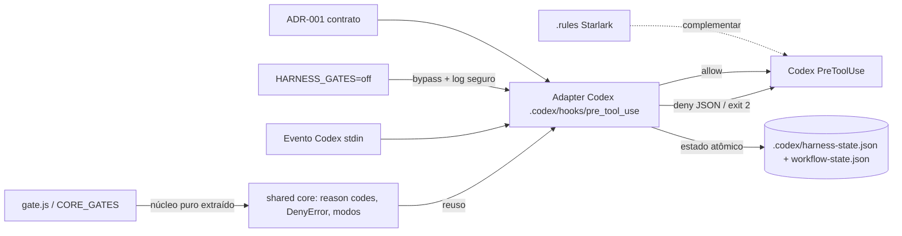

# SPEC — ADR-002: Hooks e gates no Codex (PreToolUse, reason codes, kill-switch)

> **prd-id**: `prd-codex-port`
> **adr**: `ADR-002-hooks-gates-codex` (`.spec/prd/prd-codex-port/ADRs/ADR-002-hooks-gates-codex/ADR.md`)
> **status do ADR**: `todo`
> **fontes**: `PRD.md` (§2, §3, §5, §6, §7, §8, §9, §13, §14), `RESEARCH.md` (D1, D2, D4, D7, D8), `ADR.md` (Decisão, Motivo, Interface congelada I1–I9, Consequências, Requisitos de segurança), `ADR-001` (I2 reason codes, I3 deny semantics, I4 kill-switch)
> **escopo**: especificação da decisão ADR-002 — portar a lógica de `gate.js` para hooks Codex via adapter fino reusando o núcleo puro, com reason codes idênticos, deny semântica única, kill-switch e persistência de estado em arquivo. Agentes/regras/config/instalador ficam em ADR-003.

## 1. Propósito

Congelar, de forma verificável, como os gates do harness rodam no Codex: quais tools disparam `PreToolUse`, qual é o contrato de I/O do adapter, qual é a única semântica de deny aceita, como o kill-switch desliga tudo, como o estado mutável (HITL/subagent) persiste entre processos, onde hooks terminam e `.rules` começa, e quais salvaguardas de segurança (identidade confiável, integridade de manifest, fail-open, higiene, trust, precedência, cobertura, bypass log, injeção de comando) são obrigatórias. ADR-003 herda este contrato e não o reabre; mudança exige nova decisão (ADR.md §"Consequências").

## 2. Decisão de referência (ADR-002)

Portar a lógica de `gate.js` para hooks Codex via **adapter fino reusando o núcleo puro** de `gate.js` (D1-A): extrair funções puras (reason codes, `DenyError`, modos) para módulo compartilhado; criar adapter `.codex/hooks/pre_tool_use.*` (Node) que lê o evento Codex de stdin, monta o `ctx` equivalente, executa os gates e emite o deny JSON ou exit 2. Adotar o **híbrido** hooks (gates/reason codes) + `.rules` (Starlark, sandbox de comandos) (D2-C), com `.rules` complementar e experimental. Persistência de estado via **arquivo** (D4-A); transporte por `command` (D7-A); matcher amplo para tools locais (D8-A); limitação de `spawn_agent` documentada como best-effort (issue #49736). Kill-switch: `HARNESS_GATES=off` ⇒ saída antecipada no adapter com log de bypass, sem negar (A3).

## 3. Interface congelada (I1–I9)

Contrato consumível por ADR-003 e pelo implementador. Nenhum item pode ser emendado por prosa de implementação — mudança exige nova decisão.

- **I1 — Mapeamento tool → gate (conjunto fechado).** `PreToolUse` dispara nos local function tools do Codex: `Bash`, `apply_patch`, tools MCP e demais local function tools. Matcher amplo (`Bash|apply_patch|Agent|.*`) para cobertura máxima; hosted tools (ex.: `WebSearch`) não disparam (limitação do Codex). 🟢 contrato · 🟡 execução.
- **I2 — Adapter (contrato de I/O).** Entrada: evento Codex em stdin (JSON com `session_id`, `cwd`, `tool_name`, `tool_input`, …). Saída de deny: stdout JSON `{ "hookSpecificOutput": { "hookEventName": "PreToolUse", "permissionDecision": "deny", "permissionDecisionReason": "<reason code>" } }` **ou** exit code 2 com a reason code em stderr. Nenhum outro formato de deny é aceito (ADR-001 I3). 🟢 contrato.
- **I3 — Deny JSON (forma congelada).** `permissionDecision:"deny"` é a única semântica aceita; `permissionDecisionReason` carrega o reason code literal (sem transformação, sem prefixo). 🟢 contrato.
- **I4 — Kill-switch (A3).** Com `HARNESS_GATES=off`, o adapter sai antes de executar gates, não nega, e registra bypass (arquivo de estado, sem segredo/eco de path). Zero denies. 🟢 contrato.
- **I5 — Persistência HITL/agente (D4-A).** Estado mutável em arquivo: reusa `workflow-state.json` quando fizer sentido + arquivo dedicado `.codex/harness-state.json` para estado específico do runtime Codex. Escrita atômica + lock; escopo por sessão para concorrência em subagents. Env apenas para kill-switch/config; tmp apenas para output grande (nativo do Codex). 🟢 contrato · 🟡 execução.
- **I6 — Spike `spawn_agent` (best-effort).** `PreToolUse` pode não disparar em `spawn_agent` (issue openai/codex#49736, v0.159.2). Se confirmado no smoke, gates de subagent ficam documentados como best-effort e a paridade de reason codes (A2) é medida apenas nas tools onde o hook dispara. Thread principal é tratada como orchestrator por premissa (sem claim de identidade); regras dependentes de identidade não são portadas como gates de hook. 🟢 contrato · 🟡 empírico (A6).
- **I7 — Fronteira hooks vs `.rules` (D2-C).** Hooks = gates/reason codes (RF-02). `.rules` (Starlark) = sandbox de comandos (allow/prompt/forbidden por prefixo), validado por `codex execpolicy check`. `.rules` é complementar e experimental (PRD §14.3); não duplicar política (risco de divergência silenciosa, mitigado por A2). 🟢 contrato.
- **I8 — Refatoração de `gate.js` (condicionada).** Extração do núcleo puro exige refatoração mínima de `gate.js` sem alterar o caminho opencode; arquivo protegido — exige revisão humana no merge. 🟡 processo.
- **I9 — `SessionStart` (complemento).** Hook `SessionStart` pode injetar `additionalContext` (limite conservador, default 2500 tokens) para contexto de sessão; não é canal primário de regras (D3-C). 🟢 contrato.

## 4. Interface de segurança (requisitos anexados)

Requisitos de segurança (security review ADR-001, 2026-11-19), incorporados como contrato adicional. Mudança exige nova decisão.

- **C-01 (identidade confiável)**: adapter deriva `agent` exclusivamente do contexto de sessão do Codex, nunca de `tool_input`; valida contra enum fechado; sessão não identificada ⇒ `unknown` (fail-closed para escrita protegida).
- **C-02 (integridade)**: harness-sync publica manifest com hashes de `.codex/**`; `doctor` verifica hash de `hooks.json` e do adapter; CI bloqueia alteração sem atualização do manifest.
- **H-04 (fail-open)**: adapter valida/parseia input defensivamente e nega (exit 2) em input inválido; fail-open apenas para erro inesperado de runtime.
- **M-02 (higiene I10)**: details com basename apenas e agentes reduzidos ao enum; reason code literal sem transformação.
- **H-01 (trust)**: `doctor` reporta estado de trust ativo/inativo; smoke inclui deny real.
- **H-02 (precedência)**: hooks autoritativos > `.rules`; `.rules` é subset validado por `codex execpolicy check`.
- **H-03 (matriz de cobertura)**: documentar tool→hook (sim/não), incluindo `spawn_agent` e hosted tools.
- **M-03 (bypass log)**: sink stderr/arquivo 0600, rotação, campos permitidos (timestamp, gate, session id, reason "kill-switch"), proibição de eco de env/path/args.
- **M-06 (command injection)**: caminho absoluto validado/publicado; sem interpolação de `tool_input`.

## 5. Requisitos funcionais (RF)

Cada RF é rastreável ao item do ADR que o origina (decisão/interface/consequências/security). Formato: `RF-NN — <enunciado>. Verificável: <comando/asserção>`.

- **RF-01 (I1, H-03)** — `PreToolUse` dispara nos local function tools do Codex (`Bash`, `apply_patch`, tools MCP e demais local function tools) via matcher amplo (`Bash|apply_patch|Agent|.*`); hosted tools (ex.: `WebSearch`) não disparam e são documentados como não cobertos. *Verificável*: matriz de cobertura em SPEC §10 + smoke A6.
- **RF-02 (I2, I3, ADR-001 I2/I3)** — O adapter Codex nega com os mesmos reason codes do opencode para as tools cobertas, emitindo exclusivamente `permissionDecision:"deny"` (JSON em stdout) ou exit code 2, com `permissionDecisionReason` carregando o reason code literal (sem transformação, sem prefixo). *Verificável*: fixtures de paridade (A2) — 0 divergências.
- **RF-03 (I2, M-02)** — O deny JSON tem forma congelada: `{"hookSpecificOutput":{"hookEventName":"PreToolUse","permissionDecision":"deny","permissionDecisionReason":"<reason code>"}}`; nenhum outro formato de deny é aceito. *Verificável*: inspeção do adapter + teste de hook (A2).
- **RF-04 (I4, M-03)** — `HARNESS_GATES=off` faz o adapter sair antes de executar gates, não negar, e registrar bypass em sink seguro (stderr/arquivo 0600, rotação) com campos permitidos (timestamp, gate, session id, reason "kill-switch"), sem segredo e sem eco de env/path/args. *Verificável*: teste de hook com env setada (A3) — 0 denies.
- **RF-05 (I5)** — Estado mutável (HITL batch, turno, identidade de sessão) persiste em arquivo: reuso de `workflow-state.json` quando fizer sentido + arquivo dedicado `.codex/harness-state.json`; escrita atômica + lock; escopo por sessão para concorrência em subagents. Env apenas para kill-switch/config; tmp apenas para output grande (nativo do Codex). *Verificável*: testes de concorrência (T5) + inspeção de escrita atômica.
- **RF-06 (I6)** — `spawn_agent` é tratado como best-effort: se `PreToolUse` não disparar, gates de subagent ficam documentados como best-effort e a paridade de reason codes (A2) é medida apenas nas tools onde o hook dispara; thread principal é tratada como orchestrator por premissa (sem claim de identidade); regras dependentes de identidade não são portadas como gates de hook. *Verificável*: smoke A6 (matriz H-03) + documentação.
- **RF-07 (I7, H-02)** — Fronteira clara: hooks = gates/reason codes; `.rules` (Starlark) = sandbox de comandos (allow/prompt/forbidden por prefixo), validado por `codex execpolicy check`; hooks autoritativos > `.rules`; `.rules` complementar e experimental; não duplicar política. *Verificável*: `codex execpolicy check` no smoke A6 + revisão.
- **RF-08 (I8)** — Refatoração mínima de `gate.js` extrai o núcleo puro (reason codes, `DenyError`, modos) para módulo compartilhado, sem alterar o caminho opencode; arquivo protegido, exige revisão humana no merge. *Verificável*: `commands.suiteFull` verde (A1) + diff restrito ao núcleo puro.
- **RF-09 (I9)** — Hook `SessionStart` pode injetar `additionalContext` (limite conservador, default 2500 tokens) para contexto de sessão; não é canal primário de regras. *Verificável*: inspeção de `.codex/hooks.json` + smoke A6.
- **RF-10 (C-01, NF-10)** — O adapter deriva `agent` exclusivamente do contexto de sessão do Codex (nunca de `tool_input`); valida contra enum fechado sincronizado com `KNOWN_AGENTS` de `gate.js` (`orchestrator`, `frontend-engineer`, `backend-engineer`, `engineer`, `product-manager`, `qa-engineer`, `architect`, `security-engineer`, `code-reviewer`, `ux-designer`, `design-system-specialist`, `general`, `unknown`); sessão não identificada ⇒ `unknown` (fail-closed para escrita protegida). *Verificável*: teste unitário de derivação + deny `protected-path-write`/`write-denied-for-role` quando `unknown`.
- **RF-11 (C-02)** — harness-sync publica manifest com hashes de `.codex/**`; `doctor` verifica hash de `hooks.json` e do adapter; CI bloqueia alteração de `.codex/**` sem atualização do manifest. *Verificável*: `doctor` em tmp (A4) + teste de CI (A5).
- **RF-12 (H-04)** — O adapter valida/parseia input defensivamente e nega (exit 2) em input inválido; fail-open apenas para erro inesperado de runtime (plugin-error-fail-open), nunca para input malformado. *Verificável*: testes de input inválido (T3).
- **RF-13 (M-02)** — Details de deny contêm basename apenas e agentes reduzidos ao enum; reason code literal sem transformação (sem prefixo, sem normalização). *Verificável*: inspeção de `DenyError.details` + fixtures A2.
- **RF-14 (H-01)** — `doctor` reporta estado de trust ativo/inativo (presença de `.codex/hooks.json` + aviso de `/hooks`); smoke inclui deny real. *Verificável*: saída de `doctor` + smoke A6.
- **RF-15 (H-02)** — Precedência: hooks autoritativos > `.rules`; `.rules` é subset validado por `codex execpolicy check`. *Verificável*: smoke A6 + revisão.
- **RF-16 (H-03)** — Matriz de cobertura tool→hook (sim/não) documentada, incluindo `spawn_agent` e hosted tools (ex.: `WebSearch`), com justificativa. *Verificável*: SPEC §10 + smoke A6.
- **RF-17 (M-03)** — Bypass log: sink stderr/arquivo com permissão 0600, rotação, campos permitidos (timestamp, gate, session id, reason "kill-switch"); proibição de eco de env/path/args/segredo. *Verificável*: teste de kill-switch (A3) inspecionando o log.
- **RF-18 (M-06)** — Caminho absoluto do adapter validado/publicado por harness-sync; sem interpolação de `tool_input` no comando do hook (sem shell injection). *Verificável*: inspeção de `.codex/hooks.json` + teste de injeção (T6).
- **RF-19 (NF-01)** — Canonicalização de path: o adapter aplica a mesma normalização de `gate.js` (`normalizePath`) a todo path extraído de `tool_input` (incluindo `write`, `edit`, `apply_patch`/`patch` e `tool_input.command`), rejeitando traversal (`..`), separadores mistos, aspas e paths absolutos; path canônico vazio/inválido ⇒ deny (fail-closed). *Verificável*: testes de canonicalização (T12) — 0 bypass por traversal.
- **RF-20 (NF-02)** — Allowlist de `tool_name`: o adapter valida `tool_name` do evento Codex contra a lista fechada de local function tools cobertas (`Bash`, `apply_patch`, `patch`, `write`, `edit` e tools MCP); `tool_name` ausente/desconhecido ⇒ deny (`unknown-tool`/fail-closed), nunca execução de gate sobre tool não coberta. *Verificável*: testes de allowlist (T13).
- **RF-21 (NF-03)** — Extração de paths de patch em `tool_input.command`: além de `patchText`/`diff`/`content`, o adapter extrai alvos de escrita de `tool_input.command` quando contiver `apply_patch`/`patch` (mesmas 4 regexes de `parsePatchPaths`), garantindo que escrita protegida embutida em comando seja detectada. *Verificável*: testes de extração (T14).
- **RF-22 (NF-04)** — Bootstrap de identidade (dependência ADR-003): a derivação de `agent` consome o contexto de sessão publicado por ADR-003 (`.codex/agents/*.toml` + config); enquanto o bootstrap não estiver disponível/validado, a sessão é tratada como `unknown` (fail-closed para escrita protegida); nenhuma identidade é inferida do payload. *Verificável*: teste de bootstrap ausente ⇒ `unknown` + deny (T15).
- **RF-23 (NF-05)** — Reset de HITL via `UserPromptSubmit`: o contador de `task` consecutivos (HITL) é resetado na fronteira de turno humano (`UserPromptSubmit`), não apenas por eventos de tool; estado persistido em `.codex/harness-state.json` com escopo por sessão. *Verificável*: teste de reset (T16).
- **RF-24 (NF-06, NF-07)** — Permissões e higiene de I/O: o adapter nunca emite prompt interativo como gate; todo deny é exclusivamente `permissionDecision:"deny"`/exit 2; stdout carrega apenas o deny JSON (sem logs), e logs/diagnósticos vão para stderr; `permissionDecisionReason` carrega o reason code literal. *Verificável*: inspeção + teste de I/O (T1, T3).
- **RF-25 (NF-08)** — Bypass log endurecido: sink stderr/arquivo com permissão 0600, rotação, campos permitidos (timestamp, gate, session id, reason "kill-switch"); proibição de eco de env/path/args/segredo; log de bypass é append-only e não altera estado de governança. *Verificável*: teste de kill-switch (A3) + inspeção (S4).
- **RF-26 (NF-10)** — Enum de agentes sincronizado com `KNOWN_AGENTS`: o enum usado na sanitização/identidade do adapter é exatamente o de `gate.js` (`KNOWN_AGENTS`), incluindo `general` e `architect`; divergência ⇒ falha de paridade (A2). *Verificável*: teste de igualdade de conjuntos (T4).
- **RF-27 (NF-16)** — Manifest de integridade estendido: o manifest publicado por harness-sync inclui hash do adapter, de `hooks.json` e dos arquivos de `.codex/` relevantes; `doctor` verifica todos; CI bloqueia alteração sem atualização. *Verificável*: `doctor` em tmp (A4) + teste de CI (A5).

## 6. Requisitos não-funcionais (NFR)

- **NFR-01 (Paridade)** — 0 divergências de reason codes entre opencode e Codex para as tools cobertas (A2).
- **NFR-02 (Zero rede/portas)** — todos os scripts de aceite rodam sem rede e sem portas; tmp com cleanup (PRD §7, A4, A5).
- **NFR-03 (Determinismo)** — publicação `.codex/` via harness-sync é determinística: write set = diff de hash; idempotente (G1, C-02).
- **NFR-04 (Compatibilidade)** — suíte opencode (`commands.suiteFull`) permanece verde (0 falhas) após a refatoração do núcleo puro (A1, I8).
- **NFR-05 (Auditabilidade)** — todo deny carrega o reason code em `permissionDecisionReason` (I3, M-02).
- **NFR-06 (Testabilidade)** — adapter Codex é fino e reusa o núcleo puro de `gate.js` (D1-A), permitindo testes de paridade (A2) sem reescrita (NFR-08 do ADR-001).
- **NFR-07 (Segurança)** — bypass log não contém segredo nem eco de path (I4, M-03, PRD §13).
- **NFR-08 (Concorrência)** — escrita de estado é atômica + lock + escopo por sessão; sem corrupção em subagents concorrentes (I5, R4).
- **NFR-09 (Fail-closed)** — input inválido ⇒ deny (exit 2); fail-open apenas para erro inesperado de runtime (H-04).
- **NFR-10 (Rastreabilidade)** — cada RF/NFR cita o item do ADR/security que o origina; verificável por revisão (ADR-001 NFR-09).

## 7. Invariantes (resumo executável)

| ID | Invariante | Verificação |
|---|---|---|
| INV-1 (reason codes) | conjunto congelado = `CORE_GATES` de `gate.js` (mesma fonte de verdade) | fixtures A2 |
| INV-2 (deny) | única semântica aceita = `permissionDecision:"deny"`/exit 2 | inspeção + teste |
| INV-3 (kill-switch) | 0 denies com `HARNESS_GATES=off`; bypass registrado | teste A3 |
| INV-4 (identidade) | `agent` derivado exclusivamente do contexto de sessão; nunca de `tool_input`; sessão não identificada ⇒ `unknown`; enum sincronizado com `KNOWN_AGENTS` (incl. `general`/`architect`) | teste unitário + deny |
| INV-5 (fail-closed) | input inválido ⇒ deny (exit 2); fail-open só para erro inesperado de runtime | testes T3 |
| INV-12 (canonicalização) | todo path de `tool_input` normalizado via `normalizePath`; traversal/absoluto/aspas ⇒ deny | testes T12 |
| INV-13 (tool_name) | `tool_name` validado contra allowlist fechada; desconhecido ⇒ deny | testes T13 |
| INV-14 (patch command) | paths em `tool_input.command` (apply_patch/patch) extraídos e verificados | testes T14 |
| INV-15 (I/O) | stdout só deny JSON; logs em stderr; sem prompt interativo | inspeção + T1/T3 |
| INV-16 (HITL reset) | contador HITL resetado em `UserPromptSubmit`; estado por sessão | testes T16 |
| INV-6 (precedência) | hooks autoritativos > `.rules`; `.rules` validado por `codex execpolicy check` | smoke A6 |
| INV-7 (estado) | escrita atômica + lock + escopo por sessão; sem corrupção | testes T5 |
| INV-8 (dual-run) | nenhum arquivo de `.opencode/**`, `opencode.json` (exceto merge aditivo), `.agents/**` existentes é reescrito | `git diff --name-only` + A1 |
| INV-9 (inventário fechado) | apenas as 7 superfícies de ADR-001 são portadas; nenhum deny novo | revisão ADR/PRD §7 |
| INV-10 (higiene) | details com basename apenas; reason code literal sem transformação | inspeção + fixtures A2 |
| INV-11 (cobertura) | matriz tool→hook documentada (sim/não), incluindo `spawn_agent` e hosted tools | SPEC §10 + smoke A6 |

## 8. Modelo de dados

Estado de runtime do Codex (novo, dedicado):

- **`.codex/harness-state.json`** (arquivo dedicado, D4-A): estado específico do runtime Codex — identidade de sessão→agente, contadores HITL, turnos, bypass log cursor. Escrita atômica (temp + rename) + lock por arquivo; escopo por `session_id` para concorrência em subagents.
- **`workflow-state.json`** (reuso): quando fizer sentido (estado de governança compartilhado), lido/escrito com a mesma disciplina de lock.

Campos mínimos de `.codex/harness-state.json`:

| Campo | Tipo | Descrição |
|---|---|---|
| `session_id` | string | Identificador da sessão Codex (chave de escopo) |
| `agent` | enum | Identidade derivada do contexto de sessão (C-01) |
| `hitl` | object | Contadores de `task` consecutivos (I6 HITL) |
| `turn` | object | Estado de fronteira de turno (reset do HITL) |
| `bypass_log` | object | Cursor/rotação do log de kill-switch (M-03) |

N/A para entidade de domínio nova: este ADR não cria tabelas/coleções de negócio; o estado é de governança de runtime. Motivo: `N/A — estado de runtime, não entidade de domínio`.

## 9. Event model / integrações

N/A — sem eventos de domínio novos. `PreToolUse`/`SessionStart` são eventos de runtime do Codex consumidos pelo adapter, não eventos de domínio produzidos pelo harness. A paridade é verificada por fixtures de gate (A2), não por eventos. Motivo: `N/A — sem produtor/consumidor de evento de domínio novo`.

## 10. Matriz de cobertura (tool → hook) — H-03

| Tool / superfície | `PreToolUse` dispara? | Cobertura de gates | Observação |
|---|---|---|---|
| `Bash` | sim | sim | sandbox nativo via `.rules` complementa |
| `apply_patch` | sim | sim | escrita protegida (protected-path-write) |
| tools MCP (local function) | sim | sim | matcher amplo |
| demais local function tools | sim | sim | matcher amplo `.*` |
| `spawn_agent` | não confirmado (best-effort) | best-effort | issue openai/codex#49736, v0.159.2; medido no smoke A6 |
| hosted tools (ex.: `WebSearch`) | não | não | limitação do Codex; gates não rodam |
| `SessionStart` | n/a (outro hook) | contexto | injeção de `additionalContext` (I9) |

## 11. IAM, segurança e trust

- **Trust**: hooks dependem de trust do projeto (`/hooks` + projeto trusted). `doctor` reporta estado ativo/inativo e nunca força trust (H-01, PRD §8/§13).
- **Identidade confiável (C-01)**: `agent` derivado exclusivamente do contexto de sessão; enum fechado; sessão não identificada ⇒ `unknown` (fail-closed para escrita protegida).
- **Integridade (C-02)**: manifest com hashes de `.codex/**`; `doctor` verifica hash de `hooks.json` e do adapter; CI bloqueia alteração sem atualização do manifest.
- **Fail-open (H-04)**: input inválido ⇒ deny (exit 2); fail-open apenas para erro inesperado de runtime.
- **Higiene (M-02)**: details com basename apenas; agentes reduzidos ao enum; reason code literal sem transformação.
- **Precedência (H-02)**: hooks autoritativos > `.rules`; `.rules` subset validado por `codex execpolicy check`.
- **Bypass log (M-03)**: sink stderr/arquivo 0600, rotação, campos permitidos (timestamp, gate, session id, reason "kill-switch"); proibição de eco de env/path/args/segredo.
- **Command injection (M-06)**: caminho absoluto validado/publicado; sem interpolação de `tool_input`.
- **Canonicalização (NF-01)**: paths normalizados; traversal/absoluto/aspas ⇒ deny.
- **Allowlist tool_name (NF-02)**: `tool_name` validado; desconhecido ⇒ deny.
- **Patch em command (NF-03)**: extração de paths de `tool_input.command`.
- **Bootstrap identidade (NF-04)**: dependência de ADR-003; ausente ⇒ `unknown`.
- **Reset HITL (NF-05)**: reset via `UserPromptSubmit`.
- **Enum sincronizado (NF-10)**: `KNOWN_AGENTS` inclui `general`/`architect`.
- **Manifest estendido (NF-16)**: hash do adapter/hooks incluído.
- Nenhum prompt interativo como gate (I3, PRD §13).
- Bypass log sem segredo e sem eco de path (I4).
- Superfície de bypass declarada (ADR-001 I6): `.codex/hooks.json` adulterado pode desarmar gates; mitigação via paridade de fixtures (A2) + revisão humana no merge.

## 12. Estratégia de testes

- **T1 (Paridade de reason codes)** — fixtures comparando opencode × Codex para cada gate de `CORE_GATES`; meta 0 divergências (A2). Cobertura: RF-02, RF-03, RF-13.
- **T2 (Kill-switch)** — hook Codex com `HARNESS_GATES=off` não nega e registra bypass (A3). Cobertura: RF-04, RF-17.
- **T3 (Fail-closed input)** — adapter com input inválido/malformado ⇒ deny (exit 2); erro inesperado de runtime ⇒ fail-open. Cobertura: RF-12, NFR-09.
- **T4 (Identidade)** — derivação de `agent` do contexto de sessão; sessão não identificada ⇒ `unknown`; tentativa de injeção via `tool_input` ignorada. Cobertura: RF-10, INV-4.
- **T5 (Concorrência de estado)** — escrita atômica + lock + escopo por sessão sob subagents concorrentes; sem corrupção. Cobertura: RF-05, NFR-08.
- **T6 (Command injection)** — `.codex/hooks.json` publicado usa caminho absoluto validado; `tool_input` não é interpolado. Cobertura: RF-18, M-06.
- **T7 (Dual-run)** — suíte opencode verde + `git diff` sem tocar opencode após refatoração do núcleo puro (A1, A5). Cobertura: RF-08, NFR-04.
- **T8 (harness-sync em tmp)** — `init/update/doctor` em tmp sem rede, exit 0; manifest com hashes (A4). Cobertura: RF-11, NFR-03.
- **T9 (Checks estáticos)** — `static-checks`, `sdd-checks`, `vendor-skills --check`, `acceptance-clean-room` verdes (A5).
- **T10 (Smoke real)** — `harness/codex-port-smoke.json` válido no schema, preenchido pelo usuário, incluindo deny real e matriz de cobertura (A6). Cobertura: RF-01, RF-06, RF-07, RF-09, RF-14, RF-15, RF-16.
- **T11 (Teto de injeção)** — tamanho efetivo de `AGENTS.md` ≤ 32768 bytes (métrica PRD; aplicado em ADR-003).
- **T12 (Canonicalização NF-01)** — paths com traversal/absoluto/aspas ⇒ deny; paths válidos ⇒ allow. Cobertura: RF-19, INV-12.
- **T13 (Allowlist tool_name NF-02)** — `tool_name` desconhecido ⇒ deny; conhecido ⇒ processamento. Cobertura: RF-20, INV-13.
- **T14 (Patch command NF-03)** — extração de paths de `tool_input.command` (apply_patch/patch). Cobertura: RF-21, INV-14.
- **T15 (Bootstrap identidade NF-04)** — bootstrap ausente ⇒ `unknown` + deny protegido. Cobertura: RF-22.
- **T16 (Reset HITL NF-05)** — reset do contador em `UserPromptSubmit`. Cobertura: RF-23, INV-16.

## 13. Critérios de aceite executáveis (ADR-002)

| ID | Critério | Comando / asserção | Meta |
|---|---|---|---|
| A1 | suíte opencode verde antes de dev novo | `commands.suiteFull` exit 0 | 0 falhas |
| A2 | paridade de reason codes | fixtures opencode × Codex | 0 divergências |
| A3 | kill-switch Codex | teste de hook com env setada | 0 denies |
| A4 | harness-sync em tmp | `init/update/doctor` em tmp, sem rede | 0 falhas |
| A5 | checks estáticos | `static-checks`, `sdd-checks`, `vendor-skills --check`, `acceptance-clean-room` | 0 falhas |
| A6 | smoke real | `harness/codex-port-smoke.json` válido no schema | 1 relatório |
| S1 | identidade confiável | teste de derivação de `agent` + deny quando `unknown` | 0 bypass |
| S2 | fail-closed input | adapter com input inválido ⇒ deny (exit 2) | 0 fail-open indevido |
| S3 | manifest/integridade | `doctor` verifica hash de `hooks.json` e adapter; CI bloqueia alteração sem manifest | 0 drift |
| S4 | bypass log seguro | inspeção do log: campos permitidos, sem segredo/eco de path | 0 leak |
| S5 | command injection | `.codex/hooks.json` sem interpolação de `tool_input` | 0 injeção |
| S6 | canonicalização (NF-01) | teste de traversal/absoluto ⇒ deny | 0 bypass |
| S7 | allowlist tool_name (NF-02) | `tool_name` desconhecido ⇒ deny | 0 processamento indevido |
| S8 | patch command (NF-03) | extração de paths em `command` | 0 omissão |
| S9 | bootstrap identidade (NF-04) | bootstrap ausente ⇒ `unknown` | 0 escalada |
| S10 | reset HITL (NF-05) | reset em `UserPromptSubmit` | 0 stale counter |
| S11 | enum KNOWN_AGENTS (NF-10) | igualdade de conjuntos | 0 divergência |
| M | teto de injeção | tamanho efetivo `AGENTS.md` ≤ 32768 bytes | ≤ 32768 |

Comandos de verificação do contrato (executáveis neste repositório):
- `node scripts/static-checks.mjs` (ADR-01/ADR-02 devem passar após SPEC/TASKS)
- `node scripts/sdd-checks.mjs` (F4: marcador de escopo em TASKS.md)
- `node scripts/acceptance-clean-room.mjs` (A1–A7)
- `grep -n "permissionDecision" .spec/prd/prd-codex-port/ADRs/ADR-002-hooks-gates-codex/ADR.md`

## 14. Diagrama (porta de hooks)

## 15. Delta Specs

Alterações documentadas (aplicadas em implementação futura; este ADR não implementa código):

- **Cria** `.codex/hooks.json` (matcher amplo + comando do adapter com caminho absoluto validado).
- **Cria** `.codex/hooks/pre_tool_use.*` (adapter Node fino, reusando núcleo puro de `gate.js`).
- **Cria** `.codex/harness-state.json` (runtime, gerado; não versionado como fonte — estado mutável).
- **Cria** `.codex/*.rules` (Starlark, complementar e experimental) + validação `codex execpolicy check`.
- **Modifica** `.opencode/plugins/gate.js` (refatoração mínima: extração do núcleo puro; arquivo protegido — revisão humana no merge; caminho opencode inalterado).
- **Modifica** `scripts/harness-sync.mjs` (publicação de `.codex/**` + manifest com hashes — C-02; merge/preservação).
- **Modifica** `harness.config.json` apenas se necessário para declarar novas chaves de config do adapter (sem duplicação; fonte única).
- **Não toca** `.opencode/**` (exceto refatoração do núcleo puro em `gate.js`), `opencode.json` (exceto merge aditivo do harness-sync) nem `.agents/**` existentes (dual-run, ADR-001 I5).
- **Não introduz** novos denies além dos gates existentes (PRD §7).

## 16. Rastreabilidade ADR → RF/NFR

| ADR item | RF/NFR |
|---|---|
| I1 (mapeamento tool→gate) | RF-01, RF-16, NFR-05 |
| I2 (adapter I/O) | RF-02, RF-03, NFR-01, NFR-06 |
| I3 (deny JSON) | RF-03, NFR-05 |
| I4 (kill-switch) | RF-04, RF-17, NFR-07 |
| I5 (persistência) | RF-05, NFR-08 |
| I6 (spawn_agent best-effort) | RF-06, NFR-01 |
| I7 (fronteira hooks/.rules) | RF-07, RF-15, NFR-05 |
| I8 (refatoração gate.js) | RF-08, NFR-04 |
| I9 (SessionStart) | RF-09, NFR-02 |
| C-01 (identidade) | RF-10, INV-4, NFR-09 |
| C-02 (integridade) | RF-11, NFR-03 |
| H-04 (fail-open) | RF-12, NFR-09 |
| M-02 (higiene) | RF-13, NFR-05 |
| H-01 (trust) | RF-14, NFR-07 |
| H-02 (precedência) | RF-15, NFR-05 |
| H-03 (matriz cobertura) | RF-01, RF-16, NFR-01 |
| M-03 (bypass log) | RF-04, RF-17, NFR-07 |
| M-06 (command injection) | RF-18, NFR-02 |
| NF-01 (canonicalização) | RF-19, INV-12, NFR-09 |
| NF-02 (allowlist tool_name) | RF-20, INV-13 |
| NF-03 (patch command) | RF-21, INV-14 |
| NF-04 (bootstrap identidade) | RF-22, INV-4 |
| NF-05 (reset HITL) | RF-23, INV-16 |
| NF-06/NF-07 (permissões/I/O) | RF-24, INV-15, NFR-05 |
| NF-08 (bypass log) | RF-25, NFR-07 |
| NF-10 (enum KNOWN_AGENTS) | RF-10, RF-26, INV-4 |
| NF-16 (manifest) | RF-27, RF-11, NFR-03 |
| PRD §5/§7/§13 | NFR-02, NFR-03, NFR-04, NFR-10 |
| RESEARCH D1/D2/D4/D7/D8 | RF-02, RF-05, RF-07, RF-08, NFR-06 |
| ADR-001 I2/I3/I4/I5/I6 | RF-02, RF-03, RF-04, INV-8, INV-9 |

## 17. Portão spec-gate (auto-avaliação)

| # | Item | Status |
|---|---|---|
| 1.1 | ADRs (decisão documentada) | ✅ ADR.md presente com decisão + interface congelada I1–I9 + segurança |
| 1.2 | DDD Modular (api/impl/public) | N/A — sem código/módulos neste ciclo (governança docs + contrato) |
| 1.3 | Segurança/IAM (auth + @HasPermission) | N/A — sem IAM de aplicação; trust de hooks + identidade de sessão documentados (§11) |
| 2.1 | ERD | N/A — sem entidade de domínio nova; estado de runtime documentado (§8) |
| 2.2 | Event Registry | N/A — sem eventos de domínio novos (§9) |
| 2.3 | Migrations | N/A — sem banco/ORM afetado |
| 3.1 | Invariantes de entidade | N/A — sem entidade nova; invariantes de contrato em §7 (INV-1..INV-11) |
| 3.2 | Invariantes de workflow | ✅ §7 (INV-1..INV-11) |
| 3.3 | Test strategy | ✅ §12 (T1–T11) |
| 4.1 | Single file | ✅ SPEC.md único |
| 4.2 | Domínio claro | ✅ portabilidade de harness (opencode↔Codex), hooks/gates |
