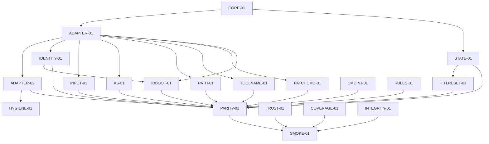

<!-- scope: adr/ADR-002 -->
# Execution Backlog: ADR-002 — Hooks e gates no Codex (PreToolUse, reason codes, kill-switch)

## 1. Traceability Context

- **Source ADR/SPEC**: `.spec/prd/prd-codex-port/ADRs/ADR-002-hooks-gates-codex/ADR.md` + `SPEC.md`
- **Goal**: Translate ADR-002 into TDD-driven, physically mapped execution tickets with full execution metadata.
- **Constraint**: zero rede/portas; tmp com cleanup; sem alterar caminho opencode (dual-run).

## 2. Sprint Summary

| Phase | Task ID | Type | Priority | Risk | Complexity | Status |
|---|---|---|---|---|---|---|
| Phase 1 | `CORE-01` | Infra | P0 | High | 3 | Todo |
| Phase 1 | `ADAPTER-01` | Infra | P0 | High | 3 | Todo |
| Phase 1 | `ADAPTER-02` | Infra | P0 | High | 2 | Todo |
| Phase 2 | `IDENTITY-01` | Domain | P0 | High | 2 | Todo |
| Phase 2 | `INPUT-01` | Domain | P0 | High | 2 | Todo |
| Phase 2 | `KS-01` | Infra | P0 | High | 2 | Todo |
| Phase 2 | `STATE-01` | Infra | P1 | Medium | 3 | Todo |
| Phase 2 | `PATH-01` | Domain | P0 | High | 2 | Todo |
| Phase 2 | `TOOLNAME-01` | Domain | P0 | High | 2 | Todo |
| Phase 2 | `PATCHCMD-01` | Domain | P1 | Medium | 2 | Todo |
| Phase 2 | `IDBOOT-01` | Domain | P1 | High | 2 | Todo |
| Phase 2 | `HITLRESET-01` | Infra | P1 | Medium | 2 | Todo |
| Phase 3 | `HYGIENE-01` | Domain | P1 | Medium | 1 | Todo |
| Phase 3 | `RULES-01` | Infra | P1 | Medium | 2 | Todo |
| Phase 3 | `CMDINJ-01` | Infra | P1 | Medium | 1 | Todo |
| Phase 3 | `TRUST-01` | Infra | P1 | Medium | 1 | Todo |
| Phase 3 | `COVERAGE-01` | Docs | P1 | Low | 1 | Todo |
| Phase 3 | `SESSIONSTART-01` | Infra | P2 | Low | 1 | Todo |
| Phase 4 | `INTEGRITY-01` | Infra | P1 | Medium | 3 | Todo |
| Phase 4 | `PARITY-01` | Test | P0 | High | 3 | Todo |
| Phase 4 | `SMOKE-01` | Docs | P1 | Medium | 2 | Todo |

## 3. Dependency Graph

---

## 4. Task Backlog

### Task CORE-01 — Extrair núcleo puro de gate.js (reason codes, DenyError, modos)

- **Constraint Ref**: ADR-002 I8, SPEC RF-08, NFR-04
- **Depends on (SPEC)**: SPEC §3 I8, §5 RF-08
- **Dependency Type**: Hard
- **Layer**: `.opencode/plugins/lib/` (módulo compartilhado) + `.opencode/plugins/gate.js`
- **Task Type**: Infra
- **Priority**: P0
- **Risk Level**: High
- **Parallelizable**: No
- **Artifact**: módulo compartilhado de núcleo puro (reason codes, `DenyError`, modos)
- **Framework Detail**: Node ESM; extrair sem alterar caminho opencode

#### 📝 Context & Domain Impact
- **Description**: Extrair funções puras (reason codes, `DenyError`, `resolveGateMode`/`modeForGate`/`isKillSwitchOff`) de `gate.js` para módulo compartilhado, mantendo `gate.js` como consumidor; arquivo protegido exige revisão humana no merge.
- **Domain Impact**: Habilita adapter Codex a reusar a mesma fonte de verdade de reason codes (A2, INV-1).

#### 🛡️ Technical Enforcement (DO NOT IGNORE)
- **Rule**: nenhum reason code novo; conjunto congelado = `CORE_GATES`/constantes existentes.
- **Failure Mode**: drift de reason codes (R1) — A2 falha.

#### ✅ Acceptance Criteria (BDD)
- **Scenario 1 (Success)**: módulo compartilhado exporta as mesmas constantes de reason code e `DenyError`; `gate.js` importa delas.
  - **Given** o módulo compartilhado criado
  - **When** `commands.suiteFull` roda
  - **Then** 0 falhas e reason codes idênticos
- **Scenario 2 (Failure Mode - Drift)**: tentativa de duplicar constante em `gate.js` é detectada.
  - **Given** constante duplicada
  - **When** teste de paridade roda
  - **Then** falha com divergência
- **Scenario 3 (Edge Case - Caminho opencode)**: nenhuma mudança de comportamento no opencode.
  - **Given** refatoração aplicada
  - **When** suíte opencode roda
  - **Then** 0 regressões

#### 🛠️ Implementation Steps (TDD - Test First)
- [ ] `tests/core-pure.spec.mjs`: escrever testes de exportação e igualdade de reason codes (TDD FIRST).
- [ ] `.opencode/plugins/lib/gate-core.mjs`: implementar módulo compartilhado.
- [ ] `.opencode/plugins/gate.js`: consumir módulo compartilhado (sem mudança de comportamento).

#### 🏁 Definition of Done (DoD)
- [ ] Test file created BEFORE implementation file.
- [ ] `commands.suiteFull` verde.
- [ ] Revisão humana do diff de `gate.js` (arquivo protegido).
- [ ] Sem TODOs pending.

---

### Task ADAPTER-01 — Criar adapter Codex PreToolUse (stdin parse + ctx build)

- **Constraint Ref**: ADR-002 I2, I5, SPEC RF-02, RF-05, RF-10
- **Depends on (SPEC)**: CORE-01
- **Dependency Type**: Hard
- **Layer**: `.codex/hooks/`
- **Task Type**: Infra
- **Priority**: P0
- **Risk Level**: High
- **Parallelizable**: No
- **Artifact**: `.codex/hooks/pre_tool_use.mjs`
- **Framework Detail**: Node, leitura de stdin JSON, montagem de ctx equivalente

#### 📝 Context & Domain Impact
- **Description**: Adapter fino que lê evento Codex de stdin (`session_id`, `cwd`, `tool_name`, `tool_input`, …), monta `ctx` equivalente ao opencode e executa gates do núcleo compartilhado.
- **Domain Impact**: Ponto de entrada único dos gates no Codex (I2).

#### 🛡️ Technical Enforcement (DO NOT IGNORE)
- **Rule**: I/O conforme I2; deny apenas via deny JSON/exit 2.
- **Failure Mode**: formato de deny não aceito (I3) ⇒ hook inefetivo.

#### ✅ Acceptance Criteria (BDD)
- **Scenario 1 (Success)**: evento válido ⇒ gates executam e allow é retornado quando não há deny.
  - **Given** evento Codex válido em stdin
  - **When** adapter roda
  - **Then** exit 0 / sem deny
- **Scenario 2 (Failure Mode - Input inválido)**: input malformado ⇒ deny (exit 2).
  - **Given** stdin inválido
  - **When** adapter roda
  - **Then** exit 2 com reason code
- **Scenario 3 (Edge Case - Kill-switch)**: com `HARNESS_GATES=off` ⇒ saída antecipada.
  - **Given** env setada
  - **When** adapter roda
  - **Then** 0 denies e bypass logado

#### 🛠️ Implementation Steps (TDD - Test First)
- [ ] `tests/adapter-stdin.spec.mjs`: testes de parse e montagem de ctx (TDD FIRST).
- [ ] `.codex/hooks/pre_tool_use.mjs`: implementar leitura stdin + ctx.

#### 🏁 Definition of Done (DoD)
- [ ] Test file created BEFORE implementation file.
- [ ] Parse defensivo implementado.
- [ ] Sem TODOs pending.

---

### Task ADAPTER-02 — Emitir deny JSON / exit 2 (forma congelada)

- **Constraint Ref**: ADR-002 I2, I3, SPEC RF-02, RF-03, M-02
- **Depends on (SPEC)**: ADAPTER-01
- **Dependency Type**: Hard
- **Layer**: `.codex/hooks/`
- **Task Type**: Infra
- **Priority**: P0
- **Risk Level**: High
- **Parallelizable**: No
- **Artifact**: função de emissão de deny no adapter
- **Framework Detail**: stdout JSON `{hookSpecificOutput:{...}}` ou exit 2 + stderr

#### 📝 Context & Domain Impact
- **Description**: Converter `DenyError` em deny JSON (stdout) ou exit code 2 (stderr) com reason code literal; sem transformação/prefixo.
- **Domain Impact**: Garante semântica única de deny (I3, INV-2).

#### 🛡️ Technical Enforcement (DO NOT IGNORE)
- **Rule**: reason code literal em `permissionDecisionReason`.
- **Failure Mode**: transformação do reason code ⇒ A2 falha.

#### ✅ Acceptance Criteria (BDD)
- **Scenario 1 (Success)**: `DenyError("picco-tag-absent")` ⇒ deny JSON com reason literal.
  - **Given** gate lança `DenyError`
  - **When** adapter processa
  - **Then** stdout JSON com `permissionDecision:"deny"` e reason literal
- **Scenario 2 (Failure Mode - Formato alternativo)**: tentativa de deny via prompt interativo é proibida.
  - **Given** implementação incorreta
  - **When** revisão roda
  - **Then** reprovação
- **Scenario 3 (Edge Case - Exit code 2)**: modo alternativo ⇒ exit 2 + stderr com reason code.
  - **Given** configuração de saída exit 2
  - **When** adapter nega
  - **Then** exit code 2 e stderr contém reason code

#### 🛠️ Implementation Steps (TDD - Test First)
- [ ] `tests/adapter-deny.spec.mjs`: testes de emissão deny (TDD FIRST).
- [ ] `.codex/hooks/pre_tool_use.mjs`: implementar emissão.

#### 🏁 Definition of Done (DoD)
- [ ] Test file created BEFORE implementation file.
- [ ] Forma congelada validada.
- [ ] Sem TODOs pending.

---

### Task IDENTITY-01 — Derivação de agent do contexto de sessão (C-01)

- **Constraint Ref**: ADR-002 C-01, SPEC RF-10, INV-4
- **Depends on (SPEC)**: ADAPTER-01
- **Dependency Type**: Hard
- **Layer**: `.codex/hooks/` + `.codex/harness-state.json`
- **Task Type**: Domain
- **Priority**: P0
- **Risk Level**: High
- **Parallelizable**: Yes
- **Artifact**: função de derivação de identidade
- **Framework Detail**: enum fechado; `unknown` se não identificado

#### 📝 Context & Domain Impact
- **Description**: Adapter deriva `agent` exclusivamente do contexto de sessão do Codex (nunca de `tool_input`); valida contra enum fechado; sessão não identificada ⇒ `unknown` (fail-closed para escrita protegida).
- **Domain Impact**: Previne injeção de identidade via `tool_input` (C-01).

#### 🛡️ Technical Enforcement (DO NOT IGNORE)
- **Rule**: nunca ler `tool_input.agent` para identidade.
- **Failure Mode**: escalada de privilégio (escrita protegida por agente forjado).

#### ✅ Acceptance Criteria (BDD)
- **Scenario 1 (Success)**: sessão identificada ⇒ agent do enum.
  - **Given** contexto de sessão com agent válido
  - **When** adapter deriva
  - **Then** agent = valor do enum
- **Scenario 2 (Failure Mode - Injeção)**: `tool_input.agent` forjado é ignorado.
  - **Given** `tool_input.agent = "backend-engineer"` mas sessão é `unknown`
  - **When** adapter deriva
  - **Then** agent = `unknown` e escrita protegida negada
- **Scenario 3 (Edge Case - Sessão não identificada)**: sessão ausente ⇒ `unknown`.
  - **Given** sem contexto de sessão
  - **When** adapter deriva
  - **Then** agent = `unknown`

#### 🛠️ Implementation Steps (TDD - Test First)
- [ ] `tests/identity.spec.mjs`: testes de derivação e injeção (TDD FIRST).
- [ ] `.codex/hooks/pre_tool_use.mjs`: implementar derivação.

#### 🏁 Definition of Done (DoD)
- [ ] Test file created BEFORE implementation file.
- [ ] Enum fechado documentado.
- [ ] Sem TODOs pending.

---

### Task INPUT-01 — Validação defensiva de input (fail-closed) — H-04

- **Constraint Ref**: ADR-002 H-04, SPEC RF-12, NFR-09
- **Depends on (SPEC)**: ADAPTER-01
- **Dependency Type**: Hard
- **Layer**: `.codex/hooks/`
- **Task Type**: Domain
- **Priority**: P0
- **Risk Level**: High
- **Parallelizable**: Yes
- **Artifact**: validador de input do adapter
- **Framework Detail**: parse defensivo; deny (exit 2) em input inválido; fail-open só para erro inesperado de runtime

#### 📝 Context & Domain Impact
- **Description**: Adapter valida/parseia input defensivamente e nega (exit 2) em input inválido; fail-open apenas para erro inesperado de runtime.
- **Domain Impact**: Garante fail-closed para input malformado (H-04, NFR-09).

#### 🛡️ Technical Enforcement (DO NOT IGNORE)
- **Rule**: input inválido nunca é fail-open.
- **Failure Mode**: fail-open indevido ⇒ gates desarmados.

#### ✅ Acceptance Criteria (BDD)
- **Scenario 1 (Success)**: input válido ⇒ processamento normal.
  - **Given** JSON válido em stdin
  - **When** adapter roda
  - **Then** gates executam
- **Scenario 2 (Failure Mode - Input inválido)**: JSON malformado ⇒ deny (exit 2).
  - **Given** stdin inválido
  - **When** adapter roda
  - **Then** exit 2 com reason code
- **Scenario 3 (Edge Case - Erro inesperado)**: erro de runtime inesperado ⇒ fail-open com log.
  - **Given** erro não relacionado a input
  - **When** adapter roda
  - **Then** allow + log (plugin-error-fail-open)

#### 🛠️ Implementation Steps (TDD - Test First)
- [ ] `tests/input-validation.spec.mjs`: testes de input (TDD FIRST).
- [ ] `.codex/hooks/pre_tool_use.mjs`: implementar validação.

#### 🏁 Definition of Done (DoD)
- [ ] Test file created BEFORE implementation file.
- [ ] Fail-closed verificado.
- [ ] Sem TODOs pending.

---

### Task KS-01 — Kill-switch no adapter + bypass log seguro (M-03)

- **Constraint Ref**: ADR-002 I4, M-03, SPEC RF-04, RF-17
- **Depends on (SPEC)**: ADAPTER-01
- **Dependency Type**: Hard
- **Layer**: `.codex/hooks/`
- **Task Type**: Infra
- **Priority**: P0
- **Risk Level**: High
- **Parallelizable**: Yes
- **Artifact**: kill-switch + bypass log
- **Framework Detail**: `HARNESS_GATES=off` ⇒ saída antecipada; sink stderr/arquivo 0600, rotação

#### 📝 Context & Domain Impact
- **Description**: Com `HARNESS_GATES=off`, adapter sai antes de executar gates, não nega, e registra bypass com campos permitidos (timestamp, gate, session id, reason "kill-switch"), sem segredo/eco de path/args/env.
- **Domain Impact**: Saída declarada e auditável (I4, M-03, NFR-07).

#### 🛡️ Technical Enforcement (DO NOT IGNORE)
- **Rule**: 0 denies com env setada; log sem segredo/eco de path.
- **Failure Mode**: leak de segredo/path no log ⇒ violação de segurança.

#### ✅ Acceptance Criteria (BDD)
- **Scenario 1 (Success)**: env setada ⇒ 0 denies e bypass logado.
  - **Given** `HARNESS_GATES=off`
  - **When** tool é chamada
  - **Then** allow + log com campos permitidos
- **Scenario 2 (Failure Mode - Log inseguro)**: log contendo env/path/args é reprovado.
  - **Given** implementação incorreta
  - **When** teste de higiene roda
  - **Then** falha
- **Scenario 3 (Edge Case - Rotação)**: log rotaciona ao atingir limite.
  - **Given** log cheio
  - **When** novo bypass ocorre
  - **Then** rotação aplicada

#### 🛠️ Implementation Steps (TDD - Test First)
- [ ] `tests/kill-switch.spec.mjs`: testes de kill-switch e higiene de log (TDD FIRST).
- [ ] `.codex/hooks/pre_tool_use.mjs`: implementar kill-switch + log.

#### 🏁 Definition of Done (DoD)
- [ ] Test file created BEFORE implementation file.
- [ ] 0 denies com env setada.
- [ ] Sem TODOs pending.

---

### Task STATE-01 — Persistência atômica de harness-state.json (lock + escopo sessão)

- **Constraint Ref**: ADR-002 I5, SPEC RF-05, NFR-08
- **Depends on (SPEC)**: CORE-01
- **Dependency Type**: Hard
- **Layer**: `.codex/` (runtime) + `.codex/hooks/`
- **Task Type**: Infra
- **Priority**: P1
- **Risk Level**: Medium
- **Parallelizable**: Yes
- **Artifact**: escritor atômico de estado
- **Framework Detail**: temp + rename; lock por arquivo; escopo por `session_id`

#### 📝 Context & Domain Impact
- **Description**: Implementar escrita atômica + lock + escopo por sessão para `.codex/harness-state.json` e reuso de `workflow-state.json` quando fizer sentido.
- **Domain Impact**: Evita corrupção em subagents concorrentes (I5, R4).

#### 🛡️ Technical Enforcement (DO NOT IGNORE)
- **Rule**: escrita atômica (temp + rename) + lock.
- **Failure Mode**: corrupção de estado ⇒ HITL/subagent quebrado.

#### ✅ Acceptance Criteria (BDD)
- **Scenario 1 (Success)**: escrita concorrente ⇒ estado consistente.
  - **Given** dois subagents escrevendo
  - **When** operações ocorrem
  - **Then** sem corrupção
- **Scenario 2 (Failure Mode - Escrita não atômica)**: escrita parcial é detectada.
  - **Given** falha no meio da escrita
  - **When** leitura ocorre
  - **Then** estado anterior preservado
- **Scenario 3 (Edge Case - Escopo de sessão)**: estado de uma sessão não vaza para outra.
  - **Given** duas sessões
  - **When** leitura ocorre
  - **Then** isolamento mantido

#### 🛠️ Implementation Steps (TDD - Test First)
- [ ] `tests/state-atomic.spec.mjs`: testes de concorrência (TDD FIRST).
- [ ] `.codex/hooks/state.mjs`: implementar escrita atômica + lock.

#### 🏁 Definition of Done (DoD)
- [ ] Test file created BEFORE implementation file.
- [ ] Concorrência verificada.
- [ ] Sem TODOs pending.

---

### Task PATH-01 — Canonicalização de path (NF-01)

- **Constraint Ref**: ADR-002 NF-01, SPEC RF-19, INV-12
- **Depends on (SPEC)**: ADAPTER-01
- **Dependency Type**: Hard
- **Layer**: `.codex/hooks/`
- **Task Type**: Domain
- **Priority**: P0
- **Risk Level**: High
- **Parallelizable**: Yes
- **Artifact**: canonicalizador de paths no adapter
- **Framework Detail**: reuso de `normalizePath`; traversal/absoluto/aspas ⇒ deny

#### 📝 Context & Domain Impact
- **Description**: Aplicar `normalizePath` a todo path extraído de `tool_input` (write/edit/apply_patch/patch e `tool_input.command`); path canônico vazio/inválido ou com traversal ⇒ deny (fail-closed).
- **Domain Impact**: Previne path traversal e bypass de escrita protegida (NF-01).

#### 🛡️ Technical Enforcement (DO NOT IGNORE)
- **Rule**: nenhuma normalização alternativa; reuso da função de `gate.js`.
- **Failure Mode**: bypass de protected-path via `..`/absoluto.

#### ✅ Acceptance Criteria (BDD)
- **Scenario 1 (Success)**: path válido ⇒ processamento normal.
  - **Given** `tool_input.filePath = "harness/x.json"`
  - **When** adapter canonicaliza
  - **Then** path normalizado e gates executam
- **Scenario 2 (Failure Mode - Traversal)**: `../.spec/x` ⇒ deny.
  - **Given** path com `..`
  - **When** adapter canonicaliza
  - **Then** deny (exit 2)
- **Scenario 3 (Edge Case - Absoluto/aspas)**: path absoluto ou com aspas ⇒ deny/normalização.
  - **Given** path absoluto
  - **When** adapter canonicaliza
  - **Then** deny ou path normalizado sem bypass

#### 🛠️ Implementation Steps (TDD - Test First)
- [ ] `tests/path-canonicalization.spec.mjs`: testes de canonicalização (TDD FIRST).
- [ ] `.codex/hooks/pre_tool_use.mjs`: aplicar canonicalização.

#### 🏁 Definition of Done (DoD)
- [ ] Test file created BEFORE implementation file.
- [ ] 0 bypass por traversal.
- [ ] Sem TODOs pending.

---

### Task TOOLNAME-01 — Allowlist de tool_name (NF-02)

- **Constraint Ref**: ADR-002 NF-02, SPEC RF-20, INV-13
- **Depends on (SPEC)**: ADAPTER-01
- **Dependency Type**: Hard
- **Layer**: `.codex/hooks/`
- **Task Type**: Domain
- **Priority**: P0
- **Risk Level**: High
- **Parallelizable**: Yes
- **Artifact**: validador de `tool_name`
- **Framework Detail**: allowlist fechada; desconhecido ⇒ deny

#### 📝 Context & Domain Impact
- **Description**: Validar `tool_name` do evento Codex contra allowlist fechada de local function tools cobertas; ausente/desconhecido ⇒ deny (fail-closed).
- **Domain Impact**: Previne spoofing de tool_name e execução de gate sobre tool não coberta.

#### 🛡️ Technical Enforcement (DO NOT IGNORE)
- **Rule**: nunca executar gates para tool_name fora da allowlist.
- **Failure Mode**: bypass via tool_name forjado.

#### ✅ Acceptance Criteria (BDD)
- **Scenario 1 (Success)**: `tool_name = "apply_patch"` ⇒ processamento.
  - **Given** evento com tool conhecido
  - **When** adapter valida
  - **Then** gates executam
- **Scenario 2 (Failure Mode - Desconhecido)**: `tool_name = "Foo"` ⇒ deny.
  - **Given** tool não coberta
  - **When** adapter valida
  - **Then** deny (exit 2)
- **Scenario 3 (Edge Case - Ausente)**: sem `tool_name` ⇒ deny.
  - **Given** evento sem tool_name
  - **When** adapter valida
  - **Then** deny (exit 2)

#### 🛠️ Implementation Steps (TDD - Test First)
- [ ] `tests/tool-name-allowlist.spec.mjs`: testes de allowlist (TDD FIRST).
- [ ] `.codex/hooks/pre_tool_use.mjs`: implementar validação.

#### 🏁 Definition of Done (DoD)
- [ ] Test file created BEFORE implementation file.
- [ ] 0 processamento indevido.
- [ ] Sem TODOs pending.

---

### Task PATCHCMD-01 — Extração de paths em tool_input.command (NF-03)

- **Constraint Ref**: ADR-002 NF-03, SPEC RF-21, INV-14
- **Depends on (SPEC)**: ADAPTER-01, PATH-01
- **Dependency Type**: Hard
- **Layer**: `.codex/hooks/`
- **Task Type**: Domain
- **Priority**: P1
- **Risk Level**: Medium
- **Parallelizable**: Yes
- **Artifact**: extrator de paths de comando
- **Framework Detail**: reuso de `parsePatchPaths` sobre `tool_input.command`

#### 📝 Context & Domain Impact
- **Description**: Extrair alvos de escrita de `tool_input.command` quando contiver apply_patch/patch, usando as mesmas regexes de `parsePatchPaths`, e submeter ao checkWriteAccess.
- **Domain Impact**: Detecta escrita protegida embutida em comando (NF-03).

#### 🛡️ Technical Enforcement (DO NOT IGNORE)
- **Rule**: reuso das 4 regexes existentes; sem parser alternativo.
- **Failure Mode**: omissão de escrita protegida em comando.

#### ✅ Acceptance Criteria (BDD)
- **Scenario 1 (Success)**: comando com `*** Update File: x` ⇒ path extraído.
  - **Given** `tool_input.command` com patch
  - **When** adapter extrai
  - **Then** path listado
- **Scenario 2 (Failure Mode - Omissão)**: comando sem padrão ⇒ nenhum path falso.
  - **Given** comando comum
  - **When** adapter extrai
  - **Then** lista vazia
- **Scenario 3 (Edge Case - Misto)**: comando com múltiplos paths ⇒ todos extraídos.
  - **Given** múltiplos padrões
  - **When** adapter extrai
  - **Then** todos listados

#### 🛠️ Implementation Steps (TDD - Test First)
- [ ] `tests/patch-command-extraction.spec.mjs`: testes de extração (TDD FIRST).
- [ ] `.codex/hooks/pre_tool_use.mjs`: aplicar extração.

#### 🏁 Definition of Done (DoD)
- [ ] Test file created BEFORE implementation file.
- [ ] 0 omissão.
- [ ] Sem TODOs pending.

---

### Task IDBOOT-01 — Bootstrap de identidade (NF-04)

- **Constraint Ref**: ADR-002 NF-04, RF-22, ADR-003
- **Depends on (SPEC)**: IDENTITY-01, ADAPTER-01
- **Dependency Type**: Hard
- **Layer**: `.codex/hooks/` + ADR-003
- **Task Type**: Domain
- **Priority**: P1
- **Risk Level**: High
- **Parallelizable**: No
- **Artifact**: bootstrap de identidade
- **Framework Detail**: dependência de ADR-003; ausente ⇒ `unknown`

#### 📝 Context & Domain Impact
- **Description**: A derivação de `agent` consome o contexto de sessão publicado por ADR-003; enquanto o bootstrap não estiver disponível/validado, a sessão é `unknown` (fail-closed).
- **Domain Impact**: Evita escalada de privilégio por identidade forjada/ausente.

#### 🛡️ Technical Enforcement (DO NOT IGNORE)
- **Rule**: nenhuma identidade inferida do payload; bootstrap ausente ⇒ `unknown`.
- **Failure Mode**: escalada via payload.

#### ✅ Acceptance Criteria (BDD)
- **Scenario 1 (Success)**: bootstrap presente ⇒ agent derivado.
  - **Given** contexto de sessão publicado por ADR-003
  - **When** adapter deriva
  - **Then** agent do enum
- **Scenario 2 (Failure Mode - Bootstrap ausente)**: ausente ⇒ `unknown`.
  - **Given** sem bootstrap
  - **When** adapter deriva
  - **Then** agent = `unknown`
- **Scenario 3 (Edge Case - Payload forjado)**: `tool_input.agent` forjado é ignorado.
  - **Given** payload forjado
  - **When** adapter deriva
  - **Then** agent = `unknown` (se sem bootstrap)

#### 🛠️ Implementation Steps (TDD - Test First)
- [ ] `tests/identity-bootstrap.spec.mjs`: testes de bootstrap (TDD FIRST).
- [ ] `.codex/hooks/pre_tool_use.mjs`: integrar bootstrap.

#### 🏁 Definition of Done (DoD)
- [ ] Test file created BEFORE implementation file.
- [ ] 0 escalada.
- [ ] Sem TODOs pending.

---

### Task HITLRESET-01 — Reset de HITL via UserPromptSubmit (NF-05)

- **Constraint Ref**: ADR-002 NF-05, SPEC RF-23, INV-16
- **Depends on (SPEC)**: STATE-01
- **Dependency Type**: Hard
- **Layer**: `.codex/hooks/` + runtime
- **Task Type**: Infra
- **Priority**: P1
- **Risk Level**: Medium
- **Parallelizable**: Yes
- **Artifact**: reset de contador HITL
- **Framework Detail**: reset na fronteira de turno humano; estado por sessão

#### 📝 Context & Domain Impact
- **Description**: Resetar o contador de `task` consecutivos (HITL) em `UserPromptSubmit`, persistindo estado em `.codex/harness-state.json` com escopo por sessão.
- **Domain Impact**: Evita acumulação stale de HITL entre turnos.

#### 🛡️ Technical Enforcement (DO NOT IGNORE)
- **Rule**: reset apenas na fronteira humana; sem reset por tool.
- **Failure Mode**: HITL stale ⇒ bloqueio indevido.

#### ✅ Acceptance Criteria (BDD)
- **Scenario 1 (Success)**: `UserPromptSubmit` ⇒ contador zerado.
  - **Given** contador > 0
  - **When** evento humano ocorre
  - **Then** contador = 0
- **Scenario 2 (Failure Mode - Sem reset)**: ausência de reset ⇒ stale.
  - **Given** implementação incorreta
  - **When** teste roda
  - **Then** falha
- **Scenario 3 (Edge Case - Escopo sessão)**: reset de uma sessão não afeta outra.
  - **Given** duas sessões
  - **When** reset ocorre
  - **Then** isolamento mantido

#### 🛠️ Implementation Steps (TDD - Test First)
- [ ] `tests/hitl-reset.spec.mjs`: testes de reset (TDD FIRST).
- [ ] `.codex/hooks/pre_tool_use.mjs` + estado: implementar reset.

#### 🏁 Definition of Done (DoD)
- [ ] Test file created BEFORE implementation file.
- [ ] 0 stale counter.
- [ ] Sem TODOs pending.

---

### Task HYGIENE-01 — Higiene M-02 (basename, enum, reason literal)

- **Constraint Ref**: ADR-002 M-02, SPEC RF-13, INV-10
- **Depends on (SPEC)**: ADAPTER-02
- **Dependency Type**: Hard
- **Layer**: `.codex/hooks/`
- **Task Type**: Domain
- **Priority**: P1
- **Risk Level**: Medium
- **Parallelizable**: Yes
- **Artifact**: higiene de details
- **Framework Detail**: basename apenas; agentes reduzidos ao enum; reason code literal

#### 📝 Context & Domain Impact
- **Description**: Garantir que details de deny contenham basename apenas e agentes reduzidos ao enum; reason code literal sem transformação.
- **Domain Impact**: Evita leak de paths e normalização de reason codes (M-02).

#### 🛡️ Technical Enforcement (DO NOT IGNORE)
- **Rule**: reason code literal sem prefixo/normalização.
- **Failure Mode**: transformação ⇒ A2 falha.

#### ✅ Acceptance Criteria (BDD)
- **Scenario 1 (Success)**: details usam basename.
  - **Given** deny com path
  - **When** adapter emite
  - **Then** details contém basename apenas
- **Scenario 2 (Failure Mode - Path completo)**: path completo é reprovado.
  - **Given** implementação incorreta
  - **When** teste roda
  - **Then** falha
- **Scenario 3 (Edge Case - Reason literal)**: reason code não é normalizado.
  - **Given** reason code com maiúsculas
  - **When** adapter emite
  - **Then** reason preservado literal

#### 🛠️ Implementation Steps (TDD - Test First)
- [ ] `tests/hygiene.spec.mjs`: testes de higiene (TDD FIRST).
- [ ] `.codex/hooks/pre_tool_use.mjs`: aplicar higiene.

#### 🏁 Definition of Done (DoD)
- [ ] Test file created BEFORE implementation file.
- [ ] Higiene verificada.
- [ ] Sem TODOs pending.

---

### Task RULES-01 — Fronteira hooks vs .rules + execpolicy check (H-02)

- **Constraint Ref**: ADR-002 I7, H-02, SPEC RF-07, RF-15
- **Depends on (SPEC)**: ADAPTER-01
- **Dependency Type**: Hard
- **Layer**: `.codex/` (`.rules`) + scripts
- **Task Type**: Infra
- **Priority**: P1
- **Risk Level**: Medium
- **Parallelizable**: Yes
- **Artifact**: `.codex/*.rules` + validação `codex execpolicy check`
- **Framework Detail**: Starlark complementar/experimental; hooks autoritativos

#### 📝 Context & Domain Impact
- **Description**: Criar `.rules` (Starlark) como sandbox de comandos (allow/prompt/forbidden por prefixo), validado por `codex execpolicy check`; hooks autoritativos > `.rules`; sem duplicar política.
- **Domain Impact**: Complementa gates com sandbox nativo (I7, H-02).

#### 🛡️ Technical Enforcement (DO NOT IGNORE)
- **Rule**: `.rules` não duplica política de gates.
- **Failure Mode**: divergência silenciosa (R3).

#### ✅ Acceptance Criteria (BDD)
- **Scenario 1 (Success)**: `.rules` passa em `codex execpolicy check`.
  - **Given** `.rules` criado
  - **When** validação roda
  - **Then** exit 0
- **Scenario 2 (Failure Mode - Duplicação)**: política duplicada é reprovada.
  - **Given** `.rules` duplica gate
  - **When** revisão roda
  - **Then** reprovação
- **Scenario 3 (Edge Case - Hooks autoritativos)**: conflito ⇒ hooks vencem.
  - **Given** conflito hooks/.rules
  - **When** execução ocorre
  - **Then** hooks autoritativos

#### 🛠️ Implementation Steps (TDD - Test First)
- [ ] `tests/rules-execpolicy.spec.mjs`: testes de validação (TDD FIRST).
- [ ] `.codex/default.rules`: criar regras Starlark.
- [ ] script de validação no smoke.

#### 🏁 Definition of Done (DoD)
- [ ] Test file created BEFORE implementation file.
- [ ] `codex execpolicy check` verde (ou documentado como empírico).
- [ ] Sem TODOs pending.

---

### Task CMDINJ-01 — Caminho absoluto validado, sem interpolação (M-06)

- **Constraint Ref**: ADR-002 M-06, SPEC RF-18
- **Depends on (SPEC)**: ADAPTER-01
- **Dependency Type**: Hard
- **Layer**: `.codex/hooks.json` + harness-sync
- **Task Type**: Infra
- **Priority**: P1
- **Risk Level**: Medium
- **Parallelizable**: Yes
- **Artifact**: `.codex/hooks.json` publicado
- **Framework Detail**: caminho absoluto validado; sem interpolação de `tool_input`

#### 📝 Context & Domain Impact
- **Description**: Garantir que `.codex/hooks.json` use caminho absoluto validado/publicado pelo harness-sync e não interpole `tool_input` no comando (prevenção de command injection).
- **Domain Impact**: Previne injeção de comando (M-06).

#### 🛡️ Technical Enforcement (DO NOT IGNORE)
- **Rule**: sem shell interpolation de `tool_input`.
- **Failure Mode**: command injection via tool_input.

#### ✅ Acceptance Criteria (BDD)
- **Scenario 1 (Success)**: hooks.json usa caminho absoluto validado.
  - **Given** publicação via harness-sync
  - **When** inspeção ocorre
  - **Then** caminho absoluto e validado
- **Scenario 2 (Failure Mode - Interpolação)**: interpolação de `tool_input` é reprovada.
  - **Given** hooks.json incorreto
  - **When** teste roda
  - **Then** falha
- **Scenario 3 (Edge Case - Path inválido)**: path inexistente ⇒ doctor falha.
  - **Given** path inválido
  - **When** doctor roda
  - **Then** erro

#### 🛠️ Implementation Steps (TDD - Test First)
- [ ] `tests/hooks-json.spec.mjs`: testes de injeção (TDD FIRST).
- [ ] harness-sync: publicar hooks.json com caminho absoluto.

#### 🏁 Definition of Done (DoD)
- [ ] Test file created BEFORE implementation file.
- [ ] Sem interpolação.
- [ ] Sem TODOs pending.

---

### Task TRUST-01 — doctor reporta trust (H-01)

- **Constraint Ref**: ADR-002 H-01, SPEC RF-14
- **Depends on (SPEC)**: ADAPTER-01
- **Dependency Type**: Soft
- **Layer**: scripts/harness-sync.mjs (doctor)
- **Task Type**: Infra
- **Priority**: P1
- **Risk Level**: Medium
- **Parallelizable**: Yes
- **Artifact**: doctor com estado de trust
- **Framework Detail**: reporta ativo/inativo; nunca força trust

#### 📝 Context & Domain Impact
- **Description**: `doctor` reporta estado de trust ativo/inativo (presença de `.codex/hooks.json` + aviso de `/hooks`); smoke inclui deny real.
- **Domain Impact**: Transparência de trust (H-01).

#### 🛡️ Technical Enforcement (DO NOT IGNORE)
- **Rule**: nunca forçar trust.
- **Failure Mode**: auto-forçar trust ⇒ risco de segurança.

#### ✅ Acceptance Criteria (BDD)
- **Scenario 1 (Success)**: doctor reporta trust ativo quando hooks.json presente.
  - **Given** `.codex/hooks.json` presente
  - **When** doctor roda
  - **Then** reporta ativo
- **Scenario 2 (Failure Mode - Ausente)**: ausência ⇒ inativo + aviso.
  - **Given** sem hooks.json
  - **When** doctor roda
  - **Then** reporta inativo
- **Scenario 3 (Edge Case - Forçar trust)**: tentativa de forçar trust é reprovada.
  - **Given** implementação incorreta
  - **When** revisão roda
  - **Then** reprovação

#### 🛠️ Implementation Steps (TDD - Test First)
- [ ] `tests/doctor-trust.spec.mjs`: testes de trust (TDD FIRST).
- [ ] harness-sync doctor: adicionar report de trust.

#### 🏁 Definition of Done (DoD)
- [ ] Test file created BEFORE implementation file.
- [ ] Trust reportado.
- [ ] Sem TODOs pending.

---

### Task COVERAGE-01 — Matriz de cobertura documentada (H-03)

- **Constraint Ref**: ADR-002 H-03, SPEC RF-01, RF-16, §10
- **Depends on (SPEC)**: SPEC §10
- **Dependency Type**: Soft
- **Layer**: docs (SPEC §10 + smoke)
- **Task Type**: Docs
- **Priority**: P1
- **Risk Level**: Low
- **Parallelizable**: Yes
- **Artifact**: matriz tool→hook
- **Framework Detail**: inclui `spawn_agent` e hosted tools

#### 📝 Context & Domain Impact
- **Description**: Documentar matriz de cobertura tool→hook (sim/não), incluindo `spawn_agent` e hosted tools, com justificativa.
- **Domain Impact**: Transparência de cobertura (H-03, INV-11).

#### 🛡️ Technical Enforcement (DO NOT IGNORE)
- **Rule**: matriz atualizada no smoke.
- **Failure Mode**: cobertura não documentada ⇒ paridade não medida.

#### ✅ Acceptance Criteria (BDD)
- **Scenario 1 (Success)**: matriz presente e completa.
  - **Given** SPEC §10
  - **When** revisão roda
  - **Then** matriz completa
- **Scenario 2 (Failure Mode - Omissão)**: matriz ausente é reprovada.
  - **Given** SPEC sem matriz
  - **When** revisão roda
  - **Then** reprovação
- **Scenario 3 (Edge Case - spawn_agent)**: `spawn_agent` marcado best-effort.
  - **Given** matriz
  - **When** inspeção roda
  - **Then** best-effort documentado

#### 🛠️ Implementation Steps (TDD - Test First)
- [ ] `tests/coverage-matrix.spec.mjs`: teste de presença (TDD FIRST).
- [ ] Atualizar SPEC §10 e smoke template.

#### 🏁 Definition of Done (DoD)
- [ ] Test file created BEFORE implementation file.
- [ ] Matriz completa.
- [ ] Sem TODOs pending.

---

### Task SESSIONSTART-01 — Hook SessionStart additionalContext (I9)

- **Constraint Ref**: ADR-002 I9, SPEC RF-09
- **Depends on (SPEC)**: ADAPTER-01
- **Dependency Type**: Soft
- **Layer**: `.codex/hooks.json`
- **Task Type**: Infra
- **Priority**: P2
- **Risk Level**: Low
- **Parallelizable**: Yes
- **Artifact**: hook SessionStart
- **Framework Detail**: limite conservador 2500 tokens; não é canal primário de regras

#### 📝 Context & Domain Impact
- **Description**: Configurar hook `SessionStart` para injetar `additionalContext` (limite conservador, default 2500 tokens) para contexto de sessão; não é canal primário de regras.
- **Domain Impact**: Contexto de sessão opcional (I9, D3-C).

#### 🛡️ Technical Enforcement (DO NOT IGNORE)
- **Rule**: limite ≤ 2500 tokens.
- **Failure Mode**: injeção excessiva de contexto.

#### ✅ Acceptance Criteria (BDD)
- **Scenario 1 (Success)**: SessionStart injeta additionalContext dentro do limite.
  - **Given** hook configurado
  - **When** sessão inicia
  - **Then** contexto injetado ≤ 2500 tokens
- **Scenario 2 (Failure Mode - Excesso)**: excesso é reprovado.
  - **Given** configuração incorreta
  - **When** teste roda
  - **Then** falha
- **Scenario 3 (Edge Case - Primário)**: não usado como canal primário de regras.
  - **Given** revisão
  - **When** inspeção roda
  - **Then** regras não dependem do canal

#### 🛠️ Implementation Steps (TDD - Test First)
- [ ] `tests/sessionstart.spec.mjs`: testes de limite (TDD FIRST).
- [ ] `.codex/hooks.json`: adicionar SessionStart.

#### 🏁 Definition of Done (DoD)
- [ ] Test file created BEFORE implementation file.
- [ ] Limite respeitado.
- [ ] Sem TODOs pending.

---

### Task INTEGRITY-01 — Manifest de hashes + doctor verification (C-02)

- **Constraint Ref**: ADR-002 C-02, SPEC RF-11, NFR-03
- **Depends on (SPEC)**: CMDINJ-01, TRUST-01
- **Dependency Type**: Hard
- **Layer**: scripts/harness-sync.mjs + CI
- **Task Type**: Infra
- **Priority**: P1
- **Risk Level**: Medium
- **Parallelizable**: No
- **Artifact**: manifest de hashes de `.codex/**`
- **Framework Detail**: doctor verifica hash de hooks.json e adapter; CI bloqueia alteração sem manifest

#### 📝 Context & Domain Impact
- **Description**: harness-sync publica manifest com hashes de `.codex/**`; `doctor` verifica hash de `hooks.json` e do adapter; CI bloqueia alteração sem atualização do manifest.
- **Domain Impact**: Integridade da camada Codex (C-02).

#### 🛡️ Technical Enforcement (DO NOT IGNORE)
- **Rule**: alteração de `.codex/**` exige manifest atualizado.
- **Failure Mode**: tampering não detectado.

#### ✅ Acceptance Criteria (BDD)
- **Scenario 1 (Success)**: doctor verifica hashes e passa.
  - **Given** manifest atualizado
  - **When** doctor roda
  - **Then** OK
- **Scenario 2 (Failure Mode - Alteração sem manifest)**: CI bloqueia.
  - **Given** alteração sem manifest
  - **When** CI roda
  - **Then** falha
- **Scenario 3 (Edge Case - Hash divergente)**: doctor falha em hash divergente.
  - **Given** hash divergente
  - **When** doctor roda
  - **Then** erro

#### 🛠️ Implementation Steps (TDD - Test First)
- [ ] `tests/manifest-integrity.spec.mjs`: testes de manifest (TDD FIRST).
- [ ] harness-sync: publicar/verificar manifest.

#### 🏁 Definition of Done (DoD)
- [ ] Test file created BEFORE implementation file.
- [ ] Manifest verificado.
- [ ] Sem TODOs pending.

---

### Task PARITY-01 — Fixtures de paridade reason codes (A2)

- **Constraint Ref**: ADR-002 I2, ADR-001 I2/I3, SPEC RF-02, NFR-01
- **Depends on (SPEC)**: ADAPTER-02, IDENTITY-01, INPUT-01, KS-01, STATE-01, PATH-01, TOOLNAME-01, PATCHCMD-01, IDBOOT-01, HITLRESET-01, HYGIENE-01, RULES-01, CMDINJ-01
- **Dependency Type**: Hard
- **Layer**: tests/fixtures
- **Task Type**: Test
- **Priority**: P0
- **Risk Level**: High
- **Parallelizable**: No
- **Artifact**: fixtures opencode × Codex
- **Framework Detail**: 0 divergências para tools cobertas

#### 📝 Context & Domain Impact
- **Description**: Criar fixtures comparando opencode × Codex para cada gate de `CORE_GATES`; meta 0 divergências.
- **Domain Impact**: Prova de paridade (A2, NFR-01).

#### 🛡️ Technical Enforcement (DO NOT IGNORE)
- **Rule**: conjunto congelado = `CORE_GATES`.
- **Failure Mode**: drift de reason codes.

#### ✅ Acceptance Criteria (BDD)
- **Scenario 1 (Success)**: fixtures passam com 0 divergências.
  - **Given** fixtures criadas
  - **When** comparadas
  - **Then** 0 divergências
- **Scenario 2 (Failure Mode - Divergência)**: divergência é detectada.
  - **Given** reason code diferente
  - **When** fixture roda
  - **Then** falha
- **Scenario 3 (Edge Case - Tools não cobertas)**: `spawn_agent`/hosted tools documentados como não medidos.
  - **Given** matriz de cobertura
  - **When** inspeção roda
  - **Then** exclusões documentadas

#### 🛠️ Implementation Steps (TDD - Test First)
- [ ] `tests/parity-fixtures.spec.mjs`: harness de comparação (TDD FIRST).
- [ ] fixtures/ : criar casos por gate.

#### 🏁 Definition of Done (DoD)
- [ ] Test file created BEFORE implementation file.
- [ ] 0 divergências.
- [ ] Sem TODOs pending.

---

### Task SMOKE-01 — Template de smoke report + deny real (A6)

- **Constraint Ref**: ADR-002 I6, H-01, H-03, SPEC RF-01, RF-06, RF-07, RF-09, RF-14, RF-15, RF-16
- **Depends on (SPEC)**: PARITY-01, TRUST-01, COVERAGE-01, INTEGRITY-01
- **Dependency Type**: Hard
- **Layer**: harness/
- **Task Type**: Docs
- **Priority**: P1
- **Risk Level**: Medium
- **Parallelizable**: No
- **Artifact**: `harness/codex-port-smoke.json` (template)
- **Framework Detail**: válido no schema; inclui deny real e matriz

#### 📝 Context & Domain Impact
- **Description**: Criar template de smoke report `harness/codex-port-smoke.json` válido no schema, preenchido pelo usuário, incluindo deny real, trust, matriz de cobertura.
- **Domain Impact**: Verificação empírica pelo usuário (A6).

#### 🛡️ Technical Enforcement (DO NOT IGNORE)
- **Rule**: smoke report válido no schema; sem segredos.
- **Failure Mode**: smoke não reproduzível.

#### ✅ Acceptance Criteria (BDD)
- **Scenario 1 (Success)**: template válido no schema.
  - **Given** template criado
  - **When** validação roda
  - **Then** OK
- **Scenario 2 (Failure Mode - Inválido)**: template inválido é reprovado.
  - **Given** template malformado
  - **When** validação roda
  - **Then** falha
- **Scenario 3 (Edge Case - Segredos)**: smoke não contém segredos.
  - **Given** template
  - **When** inspeção roda
  - **Then** sem segredos

#### 🛠️ Implementation Steps (TDD - Test First)
- [ ] `tests/smoke-template.spec.mjs`: validação de schema (TDD FIRST).
- [ ] `harness/codex-port-smoke.json`: criar template.

#### 🏁 Definition of Done (DoD)
- [ ] Test file created BEFORE implementation file.
- [ ] Schema válido.
- [ ] Sem TODOs pending.

---

## 5. Coverage Validation

- [ ] All constraints mapped to explicit BDD scenarios.
- [ ] All tasks include failure mode validation.
- [ ] No circular dependencies in the graph.
- [ ] No orphan tasks (all tasks connected in the dependency graph).
- [ ] TDD order (test before implementation) in every task.
- [ ] Metadata (priority, risk, type, dependencies) filled for every task.

## 6. Plan Feedback (Optional)

- **Identified Issues**:
  - ADR-002 não possui PLAN.md (layout por ADR); a rastreabilidade se dá via SPEC.md (tasks-gate §1 lê SPEC como PLAN).
  - Refatoração de `gate.js` (CORE-01) é arquivo protegido — exige revisão humana no merge (I8).
  - `spawn_agent` e hosted tools não são cobertos por hooks (best-effort/documentado) — paridade medida apenas onde hook dispara (I6, H-03).
