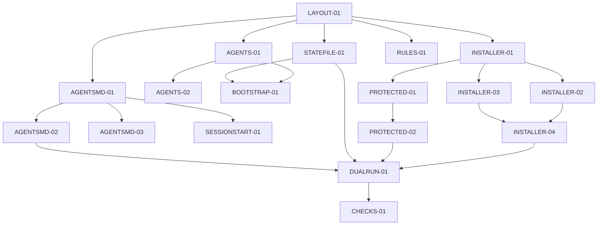

<!-- scope: adr/ADR-003 -->
# Execution Backlog: ADR-003 — Agentes, regras, config e instalador repo-local (.codex/)

## 1. Traceability Context

- **Source ADR/SPEC**: `.spec/prd/prd-codex-port/ADRs/ADR-003-agentes-regras-installer/ADR.md` + `SPEC.md`
- **Goal**: Explodir ADR-003 em tickets TDD-ready (layout, agentes, AGENTS.md/teto, instalador/payload, config preservado, protectedPaths, state file, bootstrap, .rules, smoke schema, dual-run, checks).
- **Unit**: `adr` (ADR-INDEX.md, linha ADR-003).
- **Constraint**: zero rede/portas; tmp com cleanup; sem alterar caminho opencode (dual-run); sem `PLAN.md`.

## 2. Sprint Summary

| Phase | Task ID | Type | Priority | Risk | Complexity | Status |
|---|---|---|---|---|---|---|
| Phase 1 | `LAYOUT-01` | Infra | P0 | Medium | 2 | Done |
| Phase 1 | `AGENTS-01` | Infra | P0 | High | 3 | Done |
| Phase 1 | `AGENTS-02` | Test | P0 | Medium | 2 | Done |
| Phase 1 | `AGENTSMD-01` | Doc/Infra | P0 | Medium | 3 | Done |
| Phase 2 | `AGENTSMD-02` | Test | P0 | Medium | 2 | Done |
| Phase 2 | `AGENTSMD-03` | Config | P1 | Low | 1 | Done |
| Phase 2 | `SESSIONSTART-01` | Config | P1 | Low | 1 | Done |
| Phase 2 | `INSTALLER-01` | Infra | P0 | High | 3 | Done |
| Phase 2 | `INSTALLER-02` | Infra | P0 | High | 2 | Done |
| Phase 2 | `INSTALLER-03` | Infra | P1 | Medium | 1 | Done |
| Phase 2 | `INSTALLER-04` | Test | P1 | Medium | 2 | Done |
| Phase 3 | `PROTECTED-01` | Infra | P0 | High | 2 | Done |
| Phase 3 | `PROTECTED-02` | Config | P0 | High | 1 | Done |
| Phase 3 | `STATEFILE-01` | Infra | P0 | High | 3 | Done |
| Phase 3 | `BOOTSTRAP-01` | Domain | P1 | High | 2 | Done |
| Phase 3 | `RULES-01` | Infra | P1 | Medium | 2 | Done |
| Phase 3 | `SMOKE-01` | Schema | P1 | Low | 2 | Done |
| Phase 4 | `DUALRUN-01` | Test | P0 | High | 2 | Done |
| Phase 4 | `CHECKS-01` | Test | P1 | Low | 1 | Done |

## 3. Dependency Graph

---

## 4. Task Backlog

### Task LAYOUT-01 — Criar/publicar layout `.codex/` conjunto fechado
- **Constraint Ref**: ADR-003 I1, RF-01, INV-1, F-02, F-05
- **Depends on (SPEC)**: —
- **Dependency Type**: Hard (fundação)
- **Layer**: Infra
- **Task Type**: Infra
- **Priority**: P0
- **Risk Level**: Medium
- **Parallelizable**: No
- **Artifact**: diretórios `.codex/{agents,hooks,rules}/`, arquivos `.codex/{hooks.json,config.toml,harness-state.json}` (runtime)
- **Framework Detail**: Node/fs + harness-sync

#### 📝 Context & Domain Impact
- **Description**: Garantir a existência do layout fechado `.codex/` (6 entradas) sem tocar o caminho opencode; `harness-state.json` é runtime (não payload).
- **Domain Impact**: Base da camada Codex; ADR-002 consome hooks/adapter.

#### 🛡️ Technical Enforcement (DO NOT IGNORE)
- **Rule**: apenas as 6 entradas do I1; nenhuma superfície adicional; dual-run preservado.
- **Failure Mode**: layout incompleto → instalador/publicação falha.

#### ✅ Acceptance Criteria (BDD)
- **Scenario 1 (Success)**: layout completo
  - **Given** repositório com harness
  - **When** `harness-sync init` em tmp
  - **Then** `.codex/{agents,hooks,rules,hooks.json,config.toml,harness-state.json}` existem
- **Scenario 2 (Failure Mode — entrada ausente)**: diretório faltando
  - **Given** `.codex/agents/` ausente
  - **When** `doctor`
  - **Then** falha com mensagem de entrada ausente
- **Scenario 3 (Edge Case — dual-run)**: toque em opencode
  - **Given** publicação do layout
  - **When** `git diff --name-only`
  - **Then** nenhum arquivo em `.opencode/**` (exceto protectedPaths config aditiva)

#### 🛠️ Implementation Steps (TDD - Test First)
- [ ] `scripts/__tests__/codex-layout.spec.mjs`: asserção de presença das 6 entradas — TDD FIRST.
- [ ] Criar estrutura base de `.codex/` (ou template no payload).
- [ ] Atualizar `harness-sync` para publicar o layout (INSTALLER-01).

#### 🏁 Definition of Done (DoD)
- [ ] Teste criado antes da implementação.
- [ ] Layout verificável em tmp.
- [ ] Dual-run preservado.

---

### Task AGENTS-01 — Gerar 11 `.codex/agents/*.toml` com schema e reuso
- **Constraint Ref**: ADR-003 I2, I8, M-07, RF-02, RF-19, F-11
- **Depends on (SPEC)**: LAYOUT-01
- **Dependency Type**: Hard
- **Layer**: Infra
- **Task Type**: Infra
- **Priority**: P0
- **Risk Level**: High
- **Parallelizable**: No
- **Artifact**: `.codex/agents/{architect,backend-engineer,code-reviewer,design-system-specialist,engineer,frontend-engineer,orchestrator,product-manager,qa-engineer,security-engineer,ux-designer}.toml`
- **Framework Detail**: TOML (Node)

#### 📝 Context & Domain Impact
- **Description**: Criar um `.toml` por papel (11), com `name`, `description`, `developer_instructions`, reusando o conteúdo de `.agents/agents/**`.
- **Domain Impact**: Paridade de papéis (RF-06/RF-18); bootstrap de identidade para ADR-002 (RF-22).

#### 🛡️ Technical Enforcement (DO NOT IGNORE)
- **Rule**: 11 agentes; schema TOML com os 3 campos; `developer_instructions` não vazio; custom sobrepõe built-in.
- **Failure Mode**: contagem/nomes divergentes → paridade (A2/A5) falha; bootstrap de identidade quebrado.

#### ✅ Acceptance Criteria (BDD)
- **Scenario 1 (Success)**: 11 agentes válidos
  - **Given** `.agents/agents/**` (11 papéis)
  - **When** geração
  - **Then** 11 `.toml` com `name`/`description`/`developer_instructions` não vazio e nomes idênticos
- **Scenario 2 (Failure Mode — schema incompleto)**: campo ausente
  - **Given** `.toml` sem `developer_instructions`
  - **When** validação
  - **Then** falha
- **Scenario 3 (Edge Case — contagem)**: 10 agentes
  - **Given** apenas 10 `.toml`
  - **When** validação
  - **Then** falha (M-07 exige 11)

#### 🛠️ Implementation Steps (TDD - Test First)
- [ ] `scripts/__tests__/codex-agents.spec.mjs`: valida contagem=11, nomes e campos — TDD FIRST.
- [ ] Criar os 11 `.toml` reusando `.agents/agents/**`.
- [ ] Publicar via payload (INSTALLER-01).

#### 🏁 Definition of Done (DoD)
- [ ] Teste criado antes da implementação.
- [ ] 11 agentes válidos e paridade de nomes.
- [ ] Sem segredos em `developer_instructions`.

---

### Task AGENTS-02 — Validar paridade de papéis (contagem/nomes)
- **Constraint Ref**: ADR-003 I8, M-07, RF-18, NFR-01
- **Depends on (SPEC)**: AGENTS-01
- **Dependency Type**: Hard
- **Layer**: Test
- **Task Type**: Test
- **Priority**: P0
- **Risk Level**: Medium
- **Parallelizable**: Yes
- **Artifact**: teste de paridade `scripts/__tests__/codex-agent-parity.spec.mjs`
- **Framework Detail**: Node test

#### 📝 Context & Domain Impact
- **Description**: Assegurar contagem = 11 e nomes idênticos entre `.codex/agents/*.toml` e `.agents/agents/**`.
- **Domain Impact**: Métrica A5 (contagem/nomes).

#### 🛡️ Technical Enforcement (DO NOT IGNORE)
- **Rule**: 0 divergências de contagem/nomes.
- **Failure Mode**: drift de papéis → RF-06/RF-18 violado.

#### ✅ Acceptance Criteria (BDD)
- **Scenario 1 (Success)**: paridade
  - **Given** 11 agentes em ambos os lados
  - **When** comparação de nomes
  - **Then** 0 divergências
- **Scenario 2 (Failure Mode — nome divergente)**: papel renomeado
  - **Given** nome diferente
  - **When** comparação
  - **Then** falha listando o nome divergente
- **Scenario 3 (Edge Case — agente extra)**: 12 `.toml`
  - **Given** `.codex/agents/` com 12
  - **When** validação
  - **Then** falha (contagem ≠ 11)

#### 🛠️ Implementation Steps (TDD - Test First)
- [ ] `scripts/__tests__/codex-agent-parity.spec.mjs`: compara nomes/contagem — TDD FIRST.
- [ ] Integrar ao `acceptance-clean-room` (A5).

#### 🏁 Definition of Done (DoD)
- [ ] Teste criado antes da implementação.
- [ ] Paridade verificada.

---

### Task AGENTSMD-01 — Encadear `AGENTS.md` raiz enxuta + chunking por papel
- **Constraint Ref**: ADR-003 I3, RF-04, D3-A+B
- **Depends on (SPEC)**: LAYOUT-01
- **Dependency Type**: Hard
- **Layer**: Doc/Infra
- **Task Type**: Doc
- **Priority**: P0
- **Risk Level**: Medium
- **Parallelizable**: No
- **Artifact**: `AGENTS.md` (raiz) + `AGENTS.md`/`AGENTS.override.md` aninhados por diretório
- **Framework Detail**: Markdown

#### 📝 Context & Domain Impact
- **Description**: Criar raiz enxuta (índice + convenções cross-cutting, crítico de segurança priorizado) e chunking por papel em diretórios relevantes.
- **Domain Impact**: Respeita teto 32 KiB (M-04); evita truncamento silencioso.

#### 🛡️ Technical Enforcement (DO NOT IGNORE)
- **Rule**: raiz enxuta; chunking por escopo; conteúdo crítico de segurança na raiz.
- **Failure Mode**: tudo na raiz → excede teto → truncamento silencioso.

#### ✅ Acceptance Criteria (BDD)
- **Scenario 1 (Success)**: encadeamento válido
  - **Given** raiz enxuta + aninhados
  - **When** medição efetiva
  - **Then** ≤ 32768 bytes e conteúdo de segurança na raiz
- **Scenario 2 (Failure Mode — raiz inchada)**: raiz com regras completas
  - **Given** raiz > limite
  - **When** medição
  - **Then** falha (AGENTSMD-02)
- **Scenario 3 (Edge Case — override)**: `AGENTS.override.md` em subdiretório
  - **Given** override presente
  - **When** descoberta root→cwd
  - **Then** override aplicado no escopo

#### 🛠️ Implementation Steps (TDD - Test First)
- [ ] `scripts/__tests__/codex-agents-md.spec.mjs`: valida presença de raiz e aninhados — TDD FIRST.
- [ ] Criar `AGENTS.md` raiz enxuto.
- [ ] Criar `AGENTS.md`/`AGENTS.override.md` aninhados por diretório.

#### 🏁 Definition of Done (DoD)
- [ ] Teste criado antes da implementação.
- [ ] Encadeamento documentado e medido.

---

### Task AGENTSMD-02 — Medir teto 32 KiB e falhar se exceder (M-04)
- **Constraint Ref**: ADR-003 I3, I9, M-04, RF-05, NFR-02, F-10
- **Depends on (SPEC)**: AGENTSMD-01
- **Dependency Type**: Hard
- **Layer**: Test
- **Task Type**: Test
- **Priority**: P0
- **Risk Level**: Medium
- **Parallelizable**: Yes
- **Artifact**: teste de medição `scripts/__tests__/codex-agents-md-budget.spec.mjs`
- **Framework Detail**: byte count

#### 📝 Context & Domain Impact
- **Description**: Medir tamanho efetivo do encadeamento e falhar (não truncar silenciosamente) se exceder 32768 bytes; priorizar conteúdo crítico de segurança na raiz.
- **Domain Impact**: Métrica PRD §5 (A5).

#### 🛡️ Technical Enforcement (DO NOT IGNORE)
- **Rule**: ≤ 32768 bytes efetivos; 32769 ⇒ falha; exatamente 32768 ⇒ passa.
- **Failure Mode**: exceder teto → truncamento silencioso de regras.

#### ✅ Acceptance Criteria (BDD)
- **Scenario 1 (Success)**: dentro do teto
  - **Given** encadeamento ≤ 32768 bytes
  - **When** medição
  - **Then** passa
- **Scenario 2 (Failure Mode — excede teto)**: 32769 bytes
  - **Given** tamanho 32769
  - **When** medição
  - **Then** falha
- **Scenario 3 (Edge Case — limite exato)**: 32768 bytes
  - **Given** tamanho 32768
  - **When** medição
  - **Then** passa (≤)

#### 🛠️ Implementation Steps (TDD - Test First)
- [ ] `scripts/__tests__/codex-agents-md-budget.spec.mjs`: constante 32768 + comparação — TDD FIRST.
- [ ] Implementar medição efetiva (raiz + aninhados no escopo).
- [ ] Integrar ao `acceptance-clean-room` (A5).

#### 🏁 Definition of Done (DoD)
- [ ] Teste criado antes da implementação.
- [ ] Medição falha se exceder.

---

### Task AGENTSMD-03 — Configurar `project_doc_fallback_filenames` para `.agents/rules/*`
- **Constraint Ref**: ADR-003 I3, RF-06
- **Depends on (SPEC)**: AGENTSMD-01
- **Dependency Type**: Soft
- **Layer**: Config
- **Task Type**: Config
- **Priority**: P1
- **Risk Level**: Low
- **Parallelizable**: Yes
- **Artifact**: config Codex com `project_doc_fallback_filenames` incluindo `.agents/rules/*`
- **Framework Detail**: TOML config

#### 📝 Context & Domain Impact
- **Description**: Permitir carregamento de `.agents/rules/*` via fallback filenames, com validação empírica do tamanho efetivo (A5).
- **Domain Impact**: Reuso das 8 regras sem duplicar fonte.

#### 🛡️ Technical Enforcement (DO NOT IGNORE)
- **Rule**: fallback apenas para `.agents/rules/*`; validar tamanho efetivo (AGENTSMD-02).
- **Failure Mode**: fallback sem medição → exceder teto silenciosamente.

#### ✅ Acceptance Criteria (BDD)
- **Scenario 1 (Success)**: fallback configurado
  - **Given** config com fallback filenames
  - **When** medição efetiva
  - **Then** ≤ 32768 bytes
- **Scenario 2 (Failure Mode — fallback sem medição)**: tamanho excedido
  - **Given** fallback carrega tudo
  - **When** medição
  - **Then** falha
- **Scenario 3 (Edge Case — ausência de rules)**: `.agents/rules/` vazio
  - **Given** sem regras
  - **When** fallback
  - **Then** passa (sem erro)

#### 🛠️ Implementation Steps (TDD - Test First)
- [ ] `scripts/__tests__/codex-fallback.spec.mjs`: valida config + medição — TDD FIRST.
- [ ] Configurar fallback filenames.
- [ ] Documentar validação empírica (A5).

#### 🏁 Definition of Done (DoD)
- [ ] Teste criado antes da implementação.
- [ ] Fallback validado.

---

### Task SESSIONSTART-01 — `SessionStart` como complemento dinâmico
- **Constraint Ref**: ADR-003 I3, RF-07
- **Depends on (SPEC)**: AGENTSMD-01
- **Dependency Type**: Soft
- **Layer**: Config
- **Task Type**: Config
- **Priority**: P1
- **Risk Level**: Low
- **Parallelizable**: Yes
- **Artifact**: hook `SessionStart` com `additionalContext` (limite conservador)
- **Framework Detail**: `.codex/hooks.json`

#### 📝 Context & Domain Impact
- **Description**: Configurar `SessionStart` para injetar `additionalContext` (limite conservador, default 2500 tokens) para contexto de sessão; não é canal primário de regras.
- **Domain Impact**: Complemento dinâmico sem substituir AGENTS.md.

#### 🛡️ Technical Enforcement (DO NOT IGNORE)
- **Rule**: `additionalContext` apenas complemento; limite conservador; não canal primário.
- **Failure Mode**: usar SessionStart como canal primário → perde determinismo/auditabilidade (D3-C).

#### ✅ Acceptance Criteria (BDD)
- **Scenario 1 (Success)**: complemento configurado
  - **Given** hooks.json com SessionStart
  - **When** inspeção
  - **Then** `additionalContext` com limite conservador
- **Scenario 2 (Failure Mode — canal primário)**: regras canônicas via SessionStart
  - **Given** implementação usa SessionStart como primário
  - **When** revisão
  - **Then** reprovado
- **Scenario 3 (Edge Case — ausência)**: sem SessionStart
  - **Given** hooks sem SessionStart
  - **When** revisão
  - **Then** aceito (complemento opcional)

#### 🛠️ Implementation Steps (TDD - Test First)
- [ ] `scripts/__tests__/codex-sessionstart.spec.mjs`: valida forma — TDD FIRST.
- [ ] Configurar hook `SessionStart` (se aplicável).

#### 🏁 Definition of Done (DoD)
- [ ] Teste criado antes da implementação.
- [ ] Complemento documentado.

---

### Task INSTALLER-01 — Adicionar `.codex/` estáticos ao payload do harness-sync
- **Constraint Ref**: ADR-003 I4, RF-08, RF-21, RF-22, G1/G3/G4/G5, F-02, F-05, F-06, F-07, F-11
- **Depends on (SPEC)**: LAYOUT-01
- **Dependency Type**: Hard
- **Layer**: Infra
- **Task Type**: Infra
- **Priority**: P0
- **Risk Level**: High
- **Parallelizable**: No
- **Artifact**: `scripts/harness-sync.mjs` (PAYLOAD_DIRS/PAYLOAD_FILES estendidos)
- **Framework Detail**: Node

#### 📝 Context & Domain Impact
- **Description**: Adicionar `.codex/agents`, `.codex/hooks`, `.codex/rules`, `.codex/hooks.json` ao payload copiado, mantendo contrato G1 (write set = diff de hash), G3 (backup), G4 (merge), G5 (zero rede).
- **Domain Impact**: Publicação determinística da camada Codex (A4).

#### 🛡️ Technical Enforcement (DO NOT IGNORE)
- **Rule**: payload copiado apenas para estáticos; contrato G1/G3/G4/G5 inalterado; zero rede.
- **Failure Mode**: payload não determinístico → A4 falha; drift de hash.

#### ✅ Acceptance Criteria (BDD)
- **Scenario 1 (Success)**: publicação em tmp
  - **Given** tmp limpo
  - **When** `harness-sync init`
  - **Then** `.codex/agents,hooks,rules,hooks.json` publicados; exit 0; 0 rede
- **Scenario 2 (Failure Mode — drift de hash)**: write set divergente
  - **Given** segunda passada
  - **When** `harness-sync update`
  - **Then** 0 writes (idempotente)
- **Scenario 3 (Edge Case — backup)**: arquivo preexistente
  - **Given** `.codex/agents/foo.toml` preexistente divergente
  - **When** update
  - **Then** backup G3 criado antes de sobrescrever

#### 🛠️ Implementation Steps (TDD - Test First)
- [ ] `scripts/__tests__/codex-sync-payload.spec.mjs`: valida publicação/idempotência em tmp — TDD FIRST.
- [ ] Estender `PAYLOAD_DIRS`/`PAYLOAD_FILES` em `harness-sync.mjs`.
- [ ] Integrar ao `acceptance-clean-room` (A4).

#### 🏁 Definition of Done (DoD)
- [ ] Teste criado antes da implementação.
- [ ] Publicação determinística verificada.

---

### Task INSTALLER-02 — Preservar/criar `.codex/config.toml` (sem parser TOML)
- **Constraint Ref**: ADR-003 I4, I5, RF-09, INV-6
- **Depends on (SPEC)**: INSTALLER-01
- **Dependency Type**: Hard
- **Layer**: Infra
- **Task Type**: Infra
- **Priority**: P0
- **Risk Level**: High
- **Parallelizable**: No
- **Artifact**: lógica `buildConfig`-like para `.codex/config.toml`
- **Framework Detail**: Node

#### 📝 Context & Domain Impact
- **Description**: Tratar `.codex/config.toml` como preservado se existente e criado quando ausente (como `buildConfig`), evitando dependência de parser TOML externo (zero rede).
- **Domain Impact**: Evita drift de config entre camadas (R3).

#### 🛡️ Technical Enforcement (DO NOT IGNORE)
- **Rule**: config preexistente nunca sobrescrito; criado quando ausente; sem parser TOML externo.
- **Failure Mode**: sobrescrever config do consumidor → perda de customização.

#### ✅ Acceptance Criteria (BDD)
- **Scenario 1 (Success)**: criado quando ausente
  - **Given** tmp sem `.codex/config.toml`
  - **When** `harness-sync init`
  - **Then** `.codex/config.toml` criado
- **Scenario 2 (Failure Mode — sobrescrita)**: config preexistente
  - **Given** `.codex/config.toml` preexistente divergente
  - **When** `harness-sync update`
  - **Then** arquivo inalterado (preservado)
- **Scenario 3 (Edge Case — merge aditivo)**: harness-sync merge em opencode.json
  - **Given** merge aditivo
  - **When** diff
  - **Then** aceito (exceção declarada)

#### 🛠️ Implementation Steps (TDD - Test First)
- [ ] `scripts/__tests__/codex-config-preserve.spec.mjs`: valida preservação/criação — TDD FIRST.
- [ ] Implementar preservação/criação de `config.toml`.

#### 🏁 Definition of Done (DoD)
- [ ] Teste criado antes da implementação.
- [ ] Preservação verificada.

---

### Task INSTALLER-03 — `.codex/harness-state.json` runtime (não payload)
- **Constraint Ref**: ADR-003 I4, RF-10, INV-7
- **Depends on (SPEC)**: INSTALLER-01
- **Dependency Type**: Hard
- **Layer**: Infra
- **Task Type**: Infra
- **Priority**: P1
- **Risk Level**: Medium
- **Parallelizable**: Yes
- **Artifact**: exclusão de `harness-state.json` do payload
- **Framework Detail**: Node

#### 📝 Context & Domain Impact
- **Description**: Garantir que `.codex/harness-state.json` nunca seja tocado pelo payload (runtime, não gerenciado).
- **Domain Impact**: Protege estado mutável de governança.

#### 🛡️ Technical Enforcement (DO NOT IGNORE)
- **Rule**: `harness-state.json` fora do payload; preservado sempre.
- **Failure Mode**: payload sobrescreve estado → perda de HITL/identidade.

#### ✅ Acceptance Criteria (BDD)
- **Scenario 1 (Success)**: não tocado
  - **Given** `harness-state.json` preexistente com conteúdo
  - **When** `harness-sync update`
  - **Then** conteúdo inalterado
- **Scenario 2 (Failure Mode — payload inclui state)**: state no payload
  - **Given** configuração errada
  - **When** revisão
  - **Then** reprovado
- **Scenario 3 (Edge Case — ausente)**: state ausente
  - **Given** sem state file
  - **When** update
  - **Then** não é criado pelo payload (criado em runtime)

#### 🛠️ Implementation Steps (TDD - Test First)
- [ ] `scripts/__tests__/codex-state-notpayload.spec.mjs`: valida não-toque — TDD FIRST.
- [ ] Excluir `harness-state.json` do payload.

#### 🏁 Definition of Done (DoD)
- [ ] Teste criado antes da implementação.
- [ ] State file protegido.

---

### Task INSTALLER-04 — Determinismo e idempotência da publicação
- **Constraint Ref**: ADR-003 I4, RF-20, NFR-04
- **Depends on (SPEC)**: INSTALLER-02, INSTALLER-03
- **Dependency Type**: Hard
- **Layer**: Test
- **Task Type**: Test
- **Priority**: P1
- **Risk Level**: Medium
- **Parallelizable**: No
- **Artifact**: teste de idempotência `scripts/__tests__/codex-sync-idempotent.spec.mjs`
- **Framework Detail**: Node

#### 📝 Context & Domain Impact
- **Description**: Verificar write set = diff de hash e idempotência (0 writes na segunda passada) em tmp.
- **Domain Impact**: G1 (determinismo).

#### 🛡️ Technical Enforcement (DO NOT IGNORE)
- **Rule**: re-execução produz 0 writes; hash estável.
- **Failure Mode**: não idempotente → drift contínuo.

#### ✅ Acceptance Criteria (BDD)
- **Scenario 1 (Success)**: idempotente
  - **Given** primeira passada concluída
  - **When** segunda passada
  - **Then** 0 writes
- **Scenario 2 (Failure Mode — hash divergente)**: write indevido
  - **Given** segundo passada reescreve
  - **When** teste
  - **Then** falha
- **Scenario 3 (Edge Case — arquivo modificado manualmente)**: drift
  - **Given** arquivo alterado
  - **When** update
  - **Then** backup + sobrescrita (G3)

#### 🛠️ Implementation Steps (TDD - Test First)
- [ ] `scripts/__tests__/codex-sync-idempotent.spec.mjs`: duas passadas — TDD FIRST.
- [ ] Integrar ao `acceptance-clean-room` (A4).

#### 🏁 Definition of Done (DoD)
- [ ] Teste criado antes da implementação.
- [ ] Idempotência verificada.

---

### Task PROTECTED-01 — Estender `protectedPaths` à camada Codex (I5)
- **Constraint Ref**: ADR-003 I5, RF-11, RF-21, INV-5, F-05, F-08
- **Depends on (SPEC)**: INSTALLER-01
- **Dependency Type**: Hard
- **Layer**: Infra
- **Task Type**: Infra
- **Priority**: P0
- **Risk Level**: High
- **Parallelizable**: No
- **Artifact**: `protectedPaths` estendido (config/harness-sync)
- **Framework Detail**: Node

#### 📝 Context & Domain Impact
- **Description**: Estender `protectedPaths` (conjunto fechado) para `.codex/config.toml`, `.codex/harness-state.json`, qualquer arquivo sob `.codex/` não listado no payload, `.agents/rules/project-*.md`, `AGENTS.md`/`DESIGN.md` do consumidor; `writeGuarded`/`assertSafeWrite` via única.
- **Domain Impact**: Protege arquivos do consumidor e config.

#### 🛡️ Technical Enforcement (DO NOT IGNORE)
- **Rule**: nenhum arquivo protegido sobrescrito; nenhuma escrita fora do payload.
- **Failure Mode**: sobrescrever config do consumidor → perda de customização.

#### ✅ Acceptance Criteria (BDD)
- **Scenario 1 (Success)**: proteção ativa
  - **Given** arquivo protegido preexistente
  - **When** update
  - **Then** não sobrescrito (preservado)
- **Scenario 2 (Failure Mode — escrita fora do payload)**: tentativa de write
  - **Given** path não listado
  - **When** `writeGuarded`
  - **Then** negado
- **Scenario 3 (Edge Case — payload listado)**: arquivo no payload
  - **Given** `.codex/agents/foo.toml` no payload
  - **When** update
  - **Then** sobrescrito (com backup G3)

#### 🛠️ Implementation Steps (TDD - Test First)
- [ ] `scripts/__tests__/codex-protected-paths.spec.mjs`: valida proteção — TDD FIRST.
- [ ] Estender `protectedPaths` em harness-sync/config.

#### 🏁 Definition of Done (DoD)
- [ ] Teste criado antes da implementação.
- [ ] Proteção verificada.

---

### Task PROTECTED-02 — `protectedPaths` do opencode inclui `.codex/` e state file (L-02)
- **Constraint Ref**: ADR-003 L-02, RF-16, NFR-07, INV-12, F-01
- **Depends on (SPEC)**: PROTECTED-01
- **Dependency Type**: Hard
- **Layer**: Config
- **Task Type**: Config
- **Priority**: P0
- **Risk Level**: High
- **Parallelizable**: No
- **Artifact**: config de protectedPaths do opencode atualizada
- **Framework Detail**: config

#### 📝 Context & Domain Impact
- **Description**: Incluir `.codex/` e `.codex/harness-state.json` em `protectedPaths` do opencode para proteção no dual-run.
- **Domain Impact**: Proteção cross-runtime (L-02).

#### 🛡️ Technical Enforcement (DO NOT IGNORE)
- **Rule**: `.codex/` e state file protegidos no opencode; sem remoção.
- **Failure Mode**: opencode sobrescreve camada Codex → drift/break.

#### ✅ Acceptance Criteria (BDD)
- **Scenario 1 (Success)**: presente
  - **Given** config de protectedPaths
  - **When** inspeção
  - **Then** `.codex/` e `.codex/harness-state.json` presentes
- **Scenario 2 (Failure Mode — ausente)**: não incluído
  - **Given** config sem `.codex/`
  - **When** revisão
  - **Then** reprovado
- **Scenario 3 (Edge Case — dual-run)**: opencode tenta escrever `.codex/`
  - **Given** protectedPaths ativo
  - **When** write
  - **Then** negado

#### 🛠️ Implementation Steps (TDD - Test First)
- [ ] `scripts/__tests__/codex-protected-opencode.spec.mjs`: valida presença — TDD FIRST.
- [ ] Atualizar config de protectedPaths.

#### 🏁 Definition of Done (DoD)
- [ ] Teste criado antes da implementação.
- [ ] Proteção cross-runtime verificada.

---

### Task STATEFILE-01 — State file seguro (M-01)
- **Constraint Ref**: ADR-003 M-01, RF-14, NFR-06, INV-10, F-03, F-04, F-09
- **Depends on (SPEC)**: LAYOUT-01
- **Dependency Type**: Hard
- **Layer**: Infra
- **Task Type**: Infra
- **Priority**: P0
- **Risk Level**: High
- **Parallelizable**: No
- **Artifact**: `.codex/harness-state.json` (gitignored, atomic rename, lock, hash/nonce)
- **Framework Detail**: Node

#### 📝 Context & Domain Impact
- **Description**: Implementar state file com gitignore, escrita atômica via rename, lock com timeout, path normalizado, hash/nonce anti-tampering, sem segredos.
- **Domain Impact**: Governança de runtime segura (M-01).

#### 🛡️ Technical Enforcement (DO NOT IGNORE)
- **Rule**: gitignored; atomic rename; lock timeout; path normalizado; hash/nonce; sem segredos.
- **Failure Mode**: state file versionado/com segredo → leak; concorrência → corrupção.

#### ✅ Acceptance Criteria (BDD)
- **Scenario 1 (Success)**: state file seguro
  - **Given** escrita de estado
  - **When** verificação
  - **Then** gitignored, atomic rename, lock, hash/nonce, sem segredos
- **Scenario 2 (Failure Mode — segredo presente)**: token no state
  - **Given** state com segredo
  - **When** validador
  - **Then** falha
- **Scenario 3 (Edge Case — tampering)**: hash divergente
  - **Given** state alterado externamente
  - **When** leitura
  - **Then** detectado via hash/nonce (fail-closed)

#### 🛠️ Implementation Steps (TDD - Test First)
- [ ] `scripts/__tests__/codex-statefile.spec.mjs`: valida segurança — TDD FIRST.
- [ ] Implementar escrita atômica + lock + hash/nonce.
- [ ] Adicionar `.codex/harness-state.json` ao `.gitignore`.

#### 🏁 Definition of Done (DoD)
- [ ] Teste criado antes da implementação.
- [ ] State file seguro verificado.

---

### Task BOOTSTRAP-01 — Bootstrap de identidade (consumido por ADR-002)
- **Constraint Ref**: ADR-003 M-01/NF-04, RF-15, RF-21, ADR-002 RF-22, F-02
- **Depends on (SPEC)**: AGENTS-01, STATEFILE-01
- **Dependency Type**: Hard
- **Layer**: Domain
- **Task Type**: Domain
- **Priority**: P1
- **Risk Level**: High
- **Parallelizable**: No
- **Artifact**: contexto de sessão publicado por `.codex/agents/*.toml` + config
- **Framework Detail**: Node

#### 📝 Context & Domain Impact
- **Description**: Garantir que a derivação de `agent` (ADR-002 C-01/RF-10) consuma o contexto de sessão publicado pelos agentes/config; ausente ⇒ `unknown` (fail-closed); nenhuma identidade inferida do payload.
- **Domain Impact**: Identidade confiável (S1 ADR-002).

#### 🛡️ Technical Enforcement (DO NOT IGNORE)
- **Rule**: bootstrap ausente ⇒ `unknown`; sem inferência do payload.
- **Failure Mode**: identidade inferida → escalada de privilégio.

#### ✅ Acceptance Criteria (BDD)
- **Scenario 1 (Success)**: bootstrap presente
  - **Given** agentes/config publicados
  - **When** derivação
  - **Then** identidade correta
- **Scenario 2 (Failure Mode — bootstrap ausente)**: sem agentes
  - **Given** `.codex/agents/` ausente
  - **When** derivação
  - **Then** `unknown` + deny protegido (ADR-002 T15)
- **Scenario 3 (Edge Case — payload com agent)**: tentativa de injeção
  - **Given** `tool_input` contém campo `agent`
  - **When** derivação
  - **Then** ignorado (identidade só do contexto de sessão)

#### 🛠️ Implementation Steps (TDD - Test First)
- [ ] `scripts/__tests__/codex-bootstrap.spec.mjs`: valida bootstrap — TDD FIRST.
- [ ] Documentar contrato de bootstrap para ADR-002.

#### 🏁 Definition of Done (DoD)
- [ ] Teste criado antes da implementação.
- [ ] Bootstrap verificado.

---

### Task RULES-01 — `.rules` (Starlark) complementar + `codex execpolicy check`
- **Constraint Ref**: ADR-003 I7, RF-12
- **Depends on (SPEC)**: LAYOUT-01
- **Dependency Type**: Hard
- **Layer**: Infra
- **Task Type**: Infra
- **Priority**: P1
- **Risk Level**: Medium
- **Parallelizable**: Yes
- **Artifact**: `.codex/rules/*.rules` (Starlark) validados
- **Framework Detail**: Starlark

#### 📝 Context & Domain Impact
- **Description**: Criar `.rules` complementares com `prefix_rule` (allow/prompt/forbidden) para comandos shell, validados por `codex execpolicy check`; experimental; não duplicar política dos hooks.
- **Domain Impact**: Sandbox nativo de comandos (D2-C).

#### 🛡️ Technical Enforcement (DO NOT IGNORE)
- **Rule**: `.rules` complementar; não duplicar política dos hooks; validado por execpolicy check.
- **Failure Mode**: duplicação de política → divergência silenciosa (mitigado por A2).

#### ✅ Acceptance Criteria (BDD)
- **Scenario 1 (Success)**: execpolicy check passa
  - **Given** `.rules` válidos
  - **When** `codex execpolicy check`
  - **Then** passa
- **Scenario 2 (Failure Mode — duplicação)**: regra duplica hook
  - **Given** `.rules` repete política do hook
  - **When** revisão
  - **Then** reprovado
- **Scenario 3 (Edge Case — experimental)**: Codex não suporta execpolicy
  - **Given** ambiente sem Codex CLI
  - **When** smoke
  - **Then** documentado como best-effort (A6)

#### 🛠️ Implementation Steps (TDD - Test First)
- [ ] `scripts/__tests__/codex-rules.spec.mjs`: valida presença/estrutura — TDD FIRST.
- [ ] Criar `.codex/rules/*.rules`.
- [ ] Documentar validação no smoke (A6).

#### 🏁 Definition of Done (DoD)
- [ ] Teste criado antes da implementação.
- [ ] `.rules` validados.

---

### Task SMOKE-01 — Smoke report schema sem segredos (M-05)
- **Constraint Ref**: ADR-003 M-05, RF-17, NFR-08, F-12
- **Depends on (SPEC)**: LAYOUT-01
- **Dependency Type**: Soft
- **Layer**: Schema
- **Task Type**: Schema
- **Priority**: P1
- **Risk Level**: Low
- **Parallelizable**: Yes
- **Artifact**: `harness/codex-port-smoke.json` + schema/validador
- **Framework Detail**: JSON Schema

#### 📝 Context & Domain Impact
- **Description**: Garantir que o smoke report tenha schema que proíbe campos de segredo e validador que escaneia padrões (token/key) e falha.
- **Domain Impact**: Verificação empírica sem leak (A6).

#### 🛡️ Technical Enforcement (DO NOT IGNORE)
- **Rule**: schema proíbe campos de segredo; validador escaneia padrões (token/key) e falha.
- **Failure Mode**: report com segredo → leak.

#### ✅ Acceptance Criteria (BDD)
- **Scenario 1 (Success)**: template válido
  - **Given** template criado
  - **When** validação JSON + schema
  - **Then** válido (A6)
- **Scenario 2 (Failure Mode — campo de segredo)**: campo `token`
  - **Given** report com campo `token`
  - **When** validação
  - **Then** falha
- **Scenario 3 (Edge Case — padrão em valor)**: valor contém "api_key"
  - **Given** valor com padrão de segredo
  - **When** validador escaneia
  - **Then** falha

#### 🛠️ Implementation Steps (TDD - Test First)
- [ ] `scripts/__tests__/codex-smoke-schema.spec.mjs`: valida template/schema/scan — TDD FIRST.
- [ ] Criar/atualizar `harness/codex-port-smoke.json` (template).
- [ ] Implementar validador de padrões (token/key).

#### 🏁 Definition of Done (DoD)
- [ ] Teste criado antes da implementação.
- [ ] Schema sem segredos verificado.

---

### Task DUALRUN-01 — Verificação dual-run (opencode intacto)
- **Constraint Ref**: ADR-003 I5, RF-13, RF-22, NFR-05, INV-8, F-08, F-09, F-10, F-11
- **Depends on (SPEC)**: INSTALLER-04, PROTECTED-02, STATEFILE-01, AGENTSMD-02
- **Dependency Type**: Hard
- **Layer**: Test
- **Task Type**: Test
- **Priority**: P0
- **Risk Level**: High
- **Parallelizable**: No
- **Artifact**: teste de dual-run `scripts/__tests__/codex-dualrun.spec.mjs`
- **Framework Detail**: git diff + suite

#### 📝 Context & Domain Impact
- **Description**: Verificar que o ciclo não toca `.opencode/**`, `opencode.json` (exceto merge aditivo) nem `.agents/**` existentes e que a suíte opencode permanece verde.
- **Domain Impact**: Protege caminho opencode (A1).

#### 🛡️ Technical Enforcement (DO NOT IGNORE)
- **Rule**: nenhum arquivo do caminho opencode reescrito; suíte verde.
- **Failure Mode**: edição em opencode → regressão A1.

#### ✅ Acceptance Criteria (BDD)
- **Scenario 1 (Success)**: diff limpo
  - **Given** ciclo implementado
  - **When** `git diff --name-only`
  - **Then** nenhum arquivo em `.opencode/**`, `opencode.json` (exceto merge aditivo) ou `.agents/**` existentes, ressalvadas as exceções herdadas de ADR-002: `.opencode/plugins/gate.js` e `.opencode/plugins/lib/gate-core.mjs`
- **Scenario 2 (Failure Mode — toque em opencode)**: edição em arquivo protegido fora da exceção
  - **Given** commit altera `.opencode/plugins/harness-validator.js` (ou outro arquivo não excepcionado)
  - **When** revisão
  - **Then** reprovado (I5 violado)
- **Scenario 3 (Edge Case — merge aditivo)**: harness-sync merge em opencode.json
  - **Given** merge aditivo
  - **When** diff
  - **Then** aceito (exceção declarada)

#### 🛠️ Implementation Steps (TDD - Test First)
- [ ] `scripts/__tests__/codex-dualrun.spec.mjs`: asserção de padrões proibidos — TDD FIRST.
- [ ] Rodar `commands.suiteFull` (A1).

#### 🏁 Definition of Done (DoD)
- [ ] Teste criado antes da implementação.
- [ ] Dual-run verificado.

---

### Task CHECKS-01 — Checks estáticos verdes (A5)
- **Constraint Ref**: ADR-003 A5, RF-08/RF-13
- **Depends on (SPEC)**: DUALRUN-01
- **Dependency Type**: Hard
- **Layer**: Test
- **Task Type**: Test
- **Priority**: P1
- **Risk Level**: Low
- **Parallelizable**: No
- **Artifact**: execução de `static-checks`, `sdd-checks`, `vendor-skills --check`, `acceptance-clean-room`
- **Framework Detail**: Node

#### 📝 Context & Domain Impact
- **Description**: Rodar todos os checks estáticos e garantir 0 falhas (A5).
- **Domain Impact**: Portão de regressão.

#### 🛡️ Technical Enforcement (DO NOT IGNORE)
- **Rule**: 0 falhas em todos os checks.
- **Failure Mode**: check falhando → A5 não atendido.

#### ✅ Acceptance Criteria (BDD)
- **Scenario 1 (Success)**: todos verdes
  - **Given** implementação completa
  - **When** checks
  - **Then** 0 falhas
- **Scenario 2 (Failure Mode — falha estática)**: check vermelho
  - **Given** erro de lint/teste
  - **When** check
  - **Then** falha reportada
- **Scenario 3 (Edge Case — vacuous-safe)**: sem PRDs
  - **Given** ambiente vazio
  - **When** checks
  - **Then** PASS vacuous-safe

#### 🛠️ Implementation Steps (TDD - Test First)
- [ ] `node scripts/static-checks.mjs`
- [ ] `node scripts/sdd-checks.mjs`
- [ ] `node scripts/vendor-skills.mjs --check`
- [ ] `node scripts/acceptance-clean-room.mjs`

#### 🏁 Definition of Done (DoD)
- [ ] Todos os checks verdes.
- [ ] Resultado registrado.

---

## 5. Coverage Validation

- [x] Todos os RF (RF-01..RF-22) mapeados a tasks (LAYOUT-01, AGENTS-01/02, AGENTSMD-01/02/03, SESSIONSTART-01, INSTALLER-01..04, PROTECTED-01/02, STATEFILE-01, BOOTSTRAP-01, RULES-01, SMOKE-01, DUALRUN-01, CHECKS-01).
- [x] Todos os NFR (NFR-01..NFR-11) cobertos.
- [x] Invariantes (INV-1..INV-13) cobertos.
- [x] TDD: teste antes de implementação em cada task.
- [x] Grafo sem ciclos e sem tarefas órfãs.
- [x] Nenhuma macro-tarefa inventada além do contrato de ADR-003.
- [x] Requisitos de segurança (M-01, M-04, M-05, M-07, L-02) mapeados: STATEFILE-01 (M-01), AGENTSMD-02 (M-04), SMOKE-01 (M-05), AGENTS-01/AGENTS-02 (M-07), PROTECTED-02 (L-02).
- [x] Achados F-01..F-12 (security review 2026-11-20) mapeados: PROTECTED-02 (F-01), INSTALLER-01/BOOTSTRAP-01 (F-02), STATEFILE-01 (F-03/F-04/F-09), INSTALLER-01/PROTECTED-01 (F-05/F-08), INSTALLER-01 (F-06/F-07/F-11), AGENTSMD-02 (F-10), AGENTS-01 (F-11), SMOKE-01 (F-12), DUALRUN-01 (F-08/F-09/F-10/F-11).

## 6. Plan Feedback (Optional)

- **Identified Issues**:
  - Execução real das fixtures de paridade (A2) depende de ADR-002 (adapter Codex); até lá, estrutura/template.
  - Teto de injeção (AGENTSMD-02) aplicado efetivamente na implementação (A5).
  - `.rules` (RULES-01) é experimental (PRD §14.3) e depende de Codex CLI para `codex execpolicy check` (smoke A6).
  - Contagem de agentes (M-07) corrigida para 11 (vs 10 registrados em opencode.json) — paridade por nomes/papéis, não por contagem do opencode.