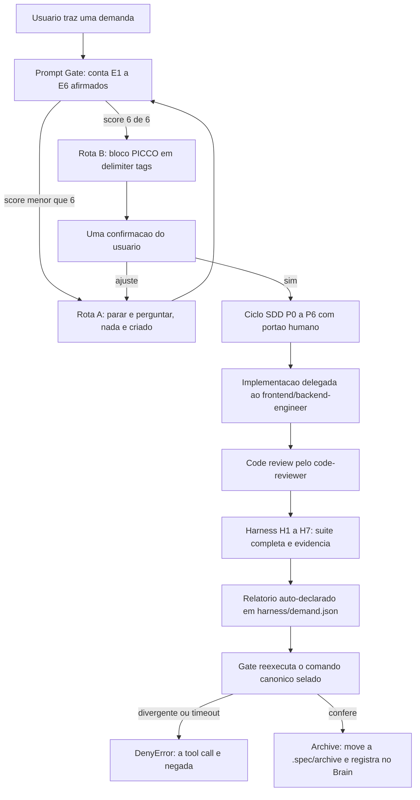
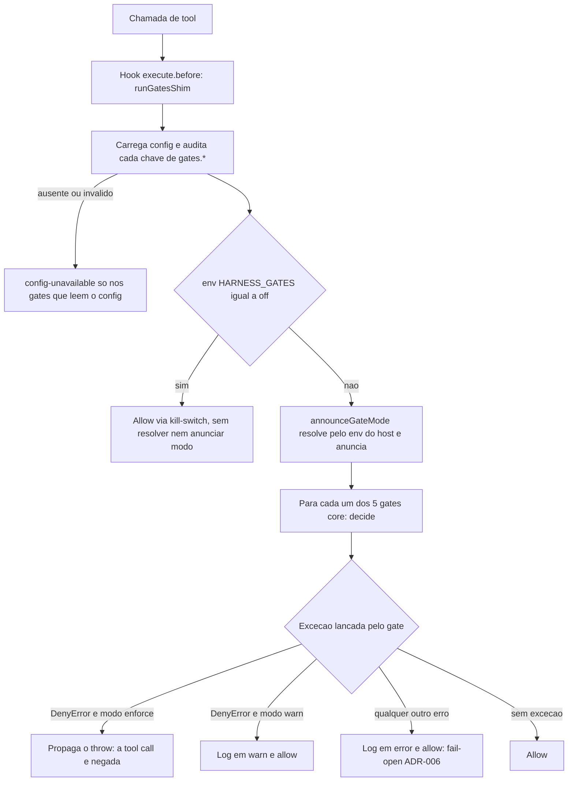
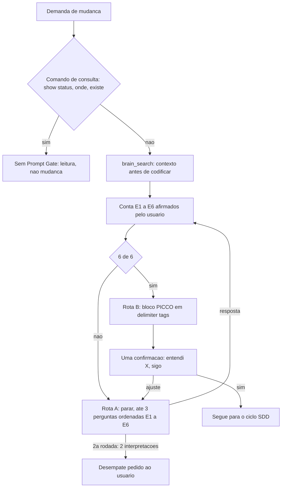
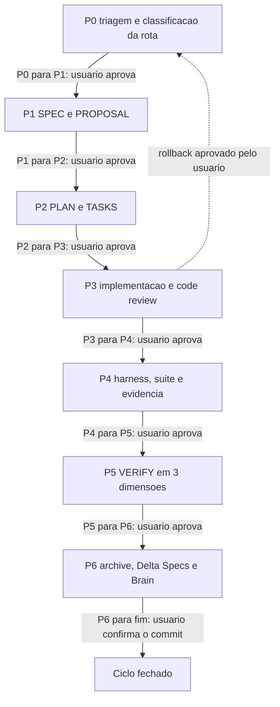
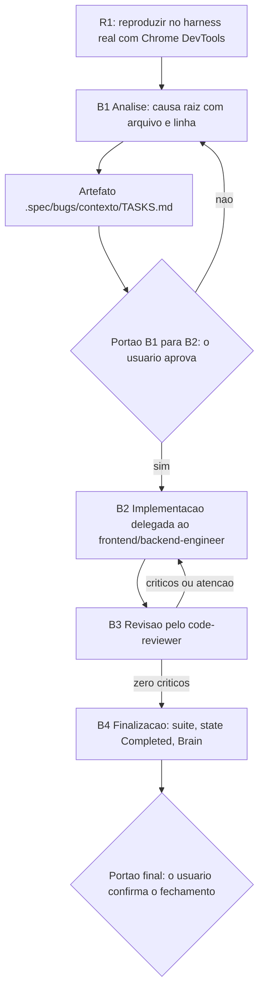
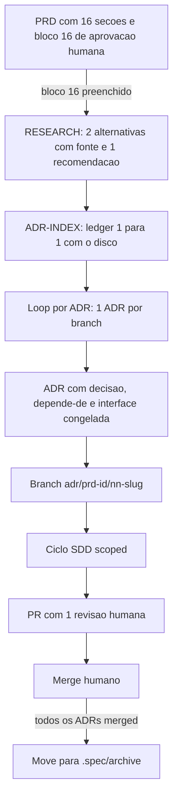
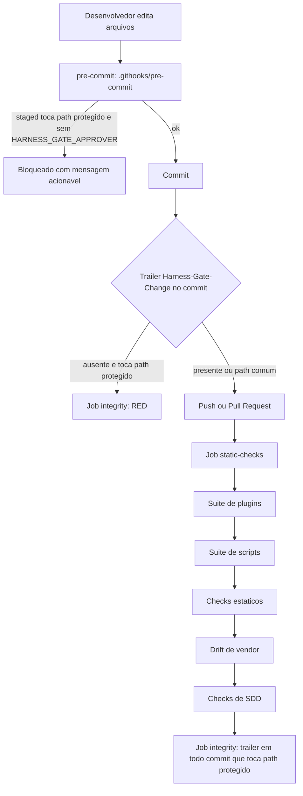

# FUNCIONAMENTO — Harness v7 (este repo)

> Prosa descreve; quem nega é `gate.js` + CI.

Este repositório é a **governança de agentes opencode** transformada em portões executáveis.
Ele tem duas camadas, e a distinção entre elas é o eixo de leitura de todo o documento:

- **Runtime** — o que o plugin `gate.js` de fato nega, e o que o CI de fato falha.
- **Processo** — o que é descrito em `.agents/rules/**` e orquestrado pelos agentes, mas que
  **não** tem negação própria no runtime.

Toda afirmação de comportamento neste documento cita o **símbolo** que a sustenta
(`evaluateSdd02`, `runContraprova`, `resolveGateMode`) ou a **seção** da rule
(`§5 H6`, `gate-contract.md` I2) — nunca `arquivo:linha`, que apodrece no primeiro diff
do arquivo citado. A classe é barrada por `findLineCitations`
(`scripts/__tests__/docs-citations.spec.mjs`), que varre `docs/**`. Onde a garantia é
parcial, dependente de CI ou apenas de processo, o nível é marcado
(🟢 runtime · 🟠 parcial/CI-dependente · 🟡 processo · 🔴 declarado-aberto), conforme
`.agents/rules/gate-contract.md` §3.

**Sumário**

1. [Visão geral](#1-visão-geral)
2. [Mapa do repo](#2-mapa-do-repo)
3. [Funcionalidades](#3-funcionalidades)
4. [Runtime](#4-runtime)
   - [4.1 Ciclo de vida do plugin](#41-ciclo-de-vida-do-plugin)
   - [4.2 Dispatcher](#42-dispatcher)
   - [4.3 GATE-02 — PICCO](#43-gate-02--picco)
   - [4.4 GATE-03 — evidência e contraprova](#44-gate-03--evidência-e-contraprova)
   - [4.5 GATE-04 — pausa HITL](#45-gate-04--pausa-hitl)
   - [4.6 GATE-05 — higiene, path protegido e escopo do qa-engineer](#46-gate-05--higiene-path-protegido-e-escopo-do-qa-engineer)
   - [4.7 Config fail-closed, kill-switch e selo](#47-config-fail-closed-kill-switch-e-selo)
5. [Processo](#5-processo)
   - [5.1 Prompt Gate](#51-prompt-gate)
   - [5.2 SDD P0..P6](#52-sdd-p0p6)
   - [5.3 Bugfix B1..B4](#53-bugfix-b1b4)
   - [5.4 Archive e Brain](#54-archive-e-brain)
   - [5.5 PRD → ADR → SDD](#55-prd--adr--sdd)
6. [Evidência e relatório](#6-evidência-e-relatório)
7. [Checks e CI](#7-checks-e-ci)
8. [Sincronizador](#8-sincronizador)
9. [Agentes e permissões](#9-agentes-e-permissões)
10. [Onde a lógica pode melhorar](#10-onde-a-lógica-pode-melhorar)
11. [Índice de fontes](#11-índice-de-fontes)

---

## 1. Visão geral

O harness existe para converter regras que um modelo *pode* ignorar em portões que o
runtime *aplica*. O README declara o lema que estrutura o repo inteiro
(`README.md`, abertura): **prosa descreve; quem nega é `gate.js` + CI**.

| Camada | O que é | Onde vive | Quem aplica | Nível típico |
|---|---|---|---|---|
| **Runtime** | Negações disparadas por tool call: PICCO ausente, conclusão sem contraprova, ciclo anterior aberto, 3º `task` sem turno humano, escrita em path protegido, `pkill -f` | `.opencode/plugins/gate.js` (1483 linhas) | hook `ctx.tool.hook("execute.before", …)` (`V2_TOOL_HOOK`, registrado em `setup`) | 🟢 / 🟠 |
| **Processo** | Prompt Gate, ciclo SDD, portões humanos P0..P6, bugfix B1..B4, H1..H7, code review | `.agents/rules/workflow.md` (fluxo), `.agents/rules/workflow-rules.md` (§0 prompt gate, §5 harness), `.agents/agents/*/AGENT.md` | agentes obedecendo prosa + o usuário aprovando portões | 🟡 |

O **Runtime** nega em exatamente **5 gates core** (`registerCoreGate`, chamado cinco vezes);
4 têm `gateName` (`gatePiccoTask`, `gateCompletionAnchorA`, `gatePhaseAnchorB`,
`gateHitlBatch`) — o de higiene (`gateShellHygiene`) não tem e cai no `DEFAULT_MODE`.
Cada gate é uma função pura `async (ctx) => void` que nega lançando `DenyError`.

O **Processo** não nega nada por si só: `.agents/rules/gate-contract.md` §2 é explícito
("Prosa não é negada"), e o check `R-NODENY` (`runSddChecks` em `scripts/sdd-checks.mjs`)
falha se `gate.js` passar a conter um deny de artefato de SDD.

### Fluxo geral — o relatório de evidência é `harness/<demand>.json` (o diagrama abrevvia como `harness/demand.json` porque o Mermaid não renderiza `<`/`>` em label)

Note o sentido do diagrama: o **relatório é auto-declarado** e a **contraprova é a prova**
(`harness-report`, §1). O gate não confia na palavra "concluído" — ele re-executa.

---

## 2. Mapa do repo

| Caminho | Função | Símbolos-âncora |
|---|---|---|
| `harness.config.json` | Fonte única de dados do projeto: comandos, `moduleMap`, `infra`, `mcp.required`, `protectedPaths`, `gates`, `riskPaths`, `escalateOnRisk`, `contraproveTimeoutMs`, `evidence` | chaves `commands`, `protectedPaths`, `gates`, `riskPaths`, `escalateOnRisk`, `contraproveTimeoutMs`, `evidence` |
| `opencode.json` | Config v2-only do opencode: `permission.task = "ask"`, 10 agentes com `permission.edit`/`permission.bash` | `permission.task`, `agent.*` |
| `.opencode/plugins/gate.js` | Núcleo de enforcement: `DenyError`, dispatcher, 5 gates, contrato v2 do plugin | `DenyError`, `decide`, `registerCoreGate`, `V2_TOOL_HOOK`, `V2_HOOK_TABLE`, `runGatesShim`, `setup` |
| `.opencode/plugins/lib/config.mjs` | Loader fail-closed do config + `resolveCommand` + `configGatesDisableEnforcement` | `loadHarnessConfig`, `resolveCommand`, `configGatesDisableEnforcement` |
| `.opencode/plugins/lib/seal.mjs` | `sha256` / `sealCommands` / `verifySeal` do comando canônico | `sha256`, `sealCommands`, `verifySeal` |
| `.opencode/plugins/harness-validator.js` | **No-op** desde FIX-01 (mantido como placeholder) | módulo sem hook registrado |
| `.opencode/plugins/hitl-guardrail.js` | **No-op** desde FIX-01 (a pausa HITL vive em GATE-04) | módulo sem hook registrado |
| `.opencode/plugins/__tests__/` | 19 specs do runtime (gate, seal, adapter v2, schema do report, dogfood, refs, PRD, ADR por `unit`) | diretório |
| `.agents/rules/workflow.md` | **Fonte única do fluxo**: esteira PRD→ADR, SDD por ADR, layout `.spec/**`, bugfix, code review, estado | §0 (vocabulário), §2 (esteira e traceability), §3 (layout), §4 (bugfix), §5 (code review), §6 (estado) |
| `.agents/rules/workflow-rules.md` | Prompt Gate (§0), papéis (§0.1), Harness Contínuo H0..H7 (§5) + anexos | §0, §0.1, §5, Anexos A/B |
| `.agents/rules/gate-contract.md` | Tabela I1..I12: onde mora cada negação + nível de garantia | §1 (I1..I12), §2 (não-promessas), §3 (níveis) |
| `.agents/rules/harness-config.md` | Política descritiva do config (dados vêm do config, nunca de prosa) | "Key map", "Fail-closed", "Kill-switch" |
| `.agents/rules/prd-adr-pipeline.md` | Contrato da esteira PRD → RESEARCH → ADR-INDEX → ADR | §1..§6 |
| `.agents/rules/brain-context.md` | Ponte para o repo `brain` (dono da regra) | fluxo busca→registra |
| `.agents/agents/*/AGENT.md` | 10 diretórios de agente — 9 com `AGENT.md` + `code-reviewer/PROMPT.md` — e o `opencode.json` registra os mesmos 10: registro↔disco em paridade nos dois sentidos, medido por `V21` (`rosterParity`) | `rosterParity` (`scripts/static-checks.mjs`); `orchestrator/AGENT.md` ("Portões Obrigatórios no Ciclo SDD", "Workflow de Bugfix") |
| `.agents/skills/` | Playbooks: `prompt-optimizer`, `sdd-compiler`, `harness-report`, `security-review`, `brain` | — |
| `.opencode/plugins/lib/prd-adr-pipeline/` | Módulo da esteira PRD→ADR: `checks.mjs` + 4 templates (norma fica na rule) | `runPrdChecks`, `evalPrd01`, `evalAdr01`, `evalAdr02` |
| `.agents/schemas/harness-report.schema.json` | Schema canônico do relatório de evidência | `required`, `counts`, `e2e`, `brainStore` |
| `scripts/static-checks.mjs` | Checks estáticos V2/V3/V6/V6b/V7/V12/V14/V18/V21 + PRD/ADR-01/02 (341 linhas) | `checkV6`, `checkV2V3V7`, `checkV12`, `checkV14`, `checkRefs`, `checkPrd`, `checkRosterParity`, `runStaticChecks` |
| `scripts/sdd-checks.mjs` | Checks executáveis V4/V17/SDD-01..03/R-V12/R-NODENY/RENAME-01 | `runSddChecks`, `evaluateSdd02`, `resolveSddCycle` |
| `scripts/vendor-skills.mjs` | Vendorização de skills + `--check` de drift (sem rede no check) | `checkVendor`, `buildVendor` |
| `scripts/__tests__/sync.spec.mjs` | Testes do sincronizador e do selo (v2/F1) | diretório |
| `scripts/__tests__/docs-citations.spec.mjs` | Guarda da classe "citação por linha em doc" | `findLineCitations` |
| `scripts/harness-sync.mjs` | Sincronizador repo→repo (v2/F1): `init`/`update`/`doctor`, manifesto sha256 (ledger que preserva órfão e se recria), backup fora do target, merge de `opencode.json`, recusa de symlink (payload, config gerado, manifesto e diretório de backup). Toda escrita passa por `writeGuarded` (guard + atômico na mesma função; `writeAtomic` é privado) | `assertNoLinkInPath`, `assertSafeWrite`, `assertSafeBackupDir`, `assertNotSource`, `writeGuarded`, `planConfig`, `buildPlan`, `applyPlan`, `runDoctor` |
| `.github/workflows/harness-integrity.yml` | CI: job `static-checks` + job `integrity` (trailer obrigatório) | jobs `static-checks` e `integrity` |
| `.githooks/pre-commit` | Espelho local do CI (exige `HARNESS_GATE_APPROVER`) | `HARNESS_GATE_APPROVER` |
| `workflow-state.json` | Estado do ciclo (96 chaves de topo; subconjunto canônico em `workflow.md` §6) | raiz |
| `harness/` | Relatórios auto-declarados (`harness/<demand>.json`) | chave `evidence` do config |

---

## 3. Funcionalidades

As 10 funcionalidades declaradas no README (`README.md`, "Funcionalidades") mais as 5
capacidades de enforcement que o gate implementa.

| # | O quê | Como | Onde está | Nível |
|---|---|---|---|---|
| 1 | **Gates bloqueantes** — delegação sem PICCO nega; conclusão sem contraprova nega; 3º `task` sem turno humano nega; higiene de shell nega; escrita em path protegido nega | `DenyError` lançado no hook `execute.before` | `registerCoreGate` (registro), constantes `DENY_*` (motivos) | 🟢 runtime |
| 2 | **Evidência machine-checkable** — conclusão exige relatório válido + re-execução do comando canônico (verificador ≠ executor) | schema + selo `sha256` + cache | `runContraprova`, `.agents/schemas/harness-report.schema.json`, `sealCommands`/`verifySeal` | 🟠 parcial — o executor padrão só observa exit code (`defaultContraproveExec`) |
| 3 | **Zero path hardcoded** — comandos, paths e módulos vêm do config do projeto | check estático V3 + loader do config | `SCAN_FILES`/`SCAN_DIRS` e `checkV2V3V7` (`scripts/static-checks.mjs`), `loadHarnessConfig`/`resolveCommand` (`config.mjs`) | 🟠 parcial — V3 varre 3 arquivos + 2 diretórios, não o `gate.js` |
| 4 | **Portão de prompt** — 6 elementos PICCO; sem eles o orquestrador pergunta em vez de adivinhar | skill `prompt-optimizer` + GATE-02 | `checkPicco`/`gatePiccoTask`, `.agents/rules/workflow-rules.md` §0 | 🟢 para a tag obrigatória · 🟡 para E3..E6 (só aviso, `checkPicco`) |
| 5 | **SDD governado** — ADR → SPEC → TASKS → execução → VERIFY → archive, com portões humanos | skills `sdd-compiler` + `scripts/sdd-checks.mjs` | `.agents/rules/workflow.md` §2, `evaluateSdd02` | 🟡 processo |
| 6 | **Cobertura de risco** — mudança em `riskPaths` sobe o E2E a `enforce` | `escalateOnRisk` no config | `harness.config.json` (`riskPaths`/`escalateOnRisk`) | 🔴 declarado-aberto no runtime — nenhum gate consome `riskPaths` (ver §10a) |
| 7 | **Kill-switch e modo fora do worktree** — `HARNESS_GATES=off` no host desliga a suíte; o modo por gate vem de `HARNESS_GATE_<GATE>` (com `_REASON` não vazio para rebaixar); o config não decide modo, só é auditado | env do host + `resolveGateMode`/`auditConfigGates` | `KILL_SWITCH_ENV`/`isKillSwitchOff`, `resolveGateMode`, `auditConfigGates`, `announceGateMode`, `runGatesShim` (corte), `configGatesDisableEnforcement` | 🟢 por construção |
| 8 | **Memória persistente** — decisões, erros e lições no Brain (busca antes, registra depois) | skill `brain` (MCP) | `.agents/rules/brain-context.md`, `.agents/rules/workflow-rules.md` §5 H5, `workflow.md` §4 (R4) | 🟡 processo |
| 9 | **Sincronizador** — leva o harness a outro repo sem copiar domínio alheio; determinístico (só o que mudou), com backup obrigatório e zero rede | `scripts/harness-sync.mjs` + `.harness-manifest.json` | `scripts/harness-sync.mjs` (`buildPlan`/`applyPlan`), `scripts/__tests__/sync.spec.mjs` | 🟢 neste repo (suite própria) · 🟡 no destino |
| 10 | **Esteira PRD→ADR→SDD** — 1 ADR = 1 branch = 1 ciclo SDD, sem deny novo no runtime | `PRD-01`/`ADR-01`/`ADR-02` dentro do `suiteFull` | `evalAdr01`/`evalAdr02` (`prd-adr-pipeline/checks.mjs`), `checkPrd` (`static-checks.mjs`) | 🟢 neste repo (CI) · 🟡 no destino |
| 11 | **Contraprova com selo** — o comando canônico é selado por `sha256`; divergência nega | `seal.mjs` + `verifySealOrDeny` | `verifySealOrDeny`, `runContraprova`, `loadPublishedSeal` | 🟢 runtime (fail-closed: selo ausente ⇒ `empty-seal`) |
| 12 | **Escopo de escrita por papel** — orquestrador só em `.spec/**` + state; qa-engineer só em `harness/`; reviewer e ux-designer não escrevem | `checkWriteAccess` | `isOrchAllowlisted`/`isHarnessScoped`, `checkWriteAccess` | 🟠 parcial — depende da identidade de agente no payload (ver §10b) |
| 13 | **Pausa HITL entre batches** — 3º `task` consecutivo sem turno humano nega | contador por sessão + fronteira de turno do event stream | `createHitlTracker`/`gateHitlBatch`, `noteTurnBoundary` | 🟠 parcial (fronteira depende do stream emitir) |
| 14 | **Higiene de shell** — `pkill -f` nega; redirect/`tee` em path protegido nega | parse de comando | `isPkillF`, `bashProtectedWrites`, `gateShellHygiene` | 🟠 parcial — parse evadível (`gate-contract.md` I7) |
| 15 | **Config fail-closed** — config ausente/inválido nega com `config-unavailable` **nos gates que leem o config** (âncora A e higiene); `task` não toca o config e segue permitido; chave de comando desconhecida lança | loader + `loadConfigOrDeny` | `loadHarnessConfig`/`resolveCommand`, `loadConfigOrDeny`, `gateCompletionAnchorA`, `gateShellHygiene` | 🟠 parcial — o deny depende de o gate pedir o config (ver §10a8) |

---

## 4. Runtime

### 4.1 Ciclo de vida do plugin

O módulo default exporta **um objeto** `{ id, setup }` — o loader v2 rejeita função default
(`export default`, e a medição está documentada em `V2_HOOK_TABLE`).

`setup(ctx)` faz exatamente três coisas:

1. **Registra um único hook de tool**: `ctx.tool.hook("execute.before", runGatesShim)`
   (`V2_TOOL_HOOK`). Se `ctx.tool.hook` não for função → `throw new Error("HOOK-NO-EQUIV:ctx.tool.hook")`;
   se o registro for rejeitado → `throw new Error("GATE-ABSENT:execute.before")` (`setup`).
   Ambos são **visíveis**, nunca silêncio.
2. **Assina o event stream** para a fronteira de turno (`setup`), de forma
   *detached* — a assinatura vive no escopo do plugin e não bloqueia a ativação. Um stream
   descartado só perde o reset do contador HITL.
3. **Retorna `undefined`** (`setup`). Isso é obrigatório: o runtime entrega o valor
   de retorno ao `acquireRelease` e um objeto truthy seria *chamado como função* — o
   `TypeError` que desligou o enforcement 58× desde 2026-10-15 (`setup`, nota do contrato v2).

O hook cobre os tools listados em `V2_TOOL_KEYS`:
`task, write, edit, apply_patch, patch, bash, shell`. O filtro por tool mora nos **cores
puros**, não no hook (`runGatesShim`).

Hooks proibidos estão declarados em `V2_FORBIDDEN_HOOKS = ["ask"]` — o
`permission.ask` não existe no runtime (`gate-contract.md` §2, item 2).

Os módulos `harness-validator.js` e `hitl-guardrail.js` são **no-op**: registram zero hooks
e não registram nada. Desde FIX-01 eles não re-injetam prosa nem escutam eventos de bus
inexistentes.

A identidade do agente chega pelo **payload do próprio hook** (`runGatesShim` chama
`recordSessionAgent`: `if (agent) recordSessionAgent(sessionID, agent)`), alimentando o mapa
`sessionID → agente` com teto de 1000 entradas (`MAX_SESSION_AGENTS`). Sem entrada no mapa,
nenhuma regra por agente se aplica — fail-open explícito (`resolveSessionAgent`).

### 4.2 Dispatcher

`decide()` é puro e testável sem runtime:

Regras do dispatcher, com lastro:

- **DenyError ⇒ deny**; qualquer outro erro ⇒ **allow + log `error`** (`decide`,
  ADR-006). Um plugin que quebra não paralisa o loop de desenvolvimento (`decide`).
- O log carrega **só a mensagem**; `DenyError.details` (paths, contagens) fica no objeto
  lançado, nunca na linha de log (`logError`).
- Modo por gate: `resolveGateMode` é **puro** e lê só o env do host —
  `HARNESS_GATE_<GATE>` = `"enforce"`/`"warn"`, com `_REASON` não vazio obrigatório para
  `"warn"`; ausente/inválido ⇒ `"enforce"` (fail-closed). `modeForGate`
  é o resolvedor de referência; o loop usa `announceGateMode`.
- O `gates.*` do config **não decide modo**: é auditado 1× por (chave, valor) por processo
  (`auditConfigGates`); chave que não nomeia gate é inerte (`isRegisteredGateName`).
- Ordem: carga + auditoria do config → corte `HARNESS_GATES=off` (`runGatesShim`) → resolução
  de modo → loop (`runGatesShim`); sob o corte nenhum modo é resolvido nem anunciado — a auditoria do config roda antes do corte e ainda pode emitir WARN.

### 4.3 GATE-02 — PICCO

`gatePiccoTask` só age sobre `tool === "task"`.

Contrato exato (`checkPicco`):

| Situação | Veredito | Motivo |
|---|---|---|
| Nenhuma tag PICCO **e** o texto começa com prefixo de consulta (`show status`, `o que`, `onde`, `qual`, `existe`, `list`, `read`, `get`, `status`) | allow | `via: "query"` (`QUERY_PREFIX_RE`, `checkPicco`) |
| `<open_questions>` **ausente** | **deny** | `picco-tag-absent` (`checkPicco`, constante `DENY_PICCO_ABSENT`) |
| `<open_questions>` com conteúdo não-vazio (após remover comentários HTML) | **deny** | `picco-tag-nonempty` (`checkPicco`/`stripHtmlComments`, constante `DENY_PICCO_NONEMPTY`) |
| `<open_questions>` vazio, mas `<role>/<task>/<context>/<constraints>/<acceptance>` incompletos | allow + **aviso** | `picco-warning: <tag> absent` (`checkPicco`, `PICCO_CONTENT_TAGS`) |

Ou seja: **E1/E2 são deny; E3..E6 são advisory** (`gate-contract.md` §1, linha I1). O texto
efetivo é extraído de `prompt`, `description`, `task`, `message`, `text`, `content` — ou de
qualquer string nos args (`extractPromptText`).

O gate `permission.task = "ask"` do runtime (`opencode.json`, `permission.task`) actua
**antes** do gate custom: o opencode já pergunta ao usuário antes de cada `task`.

### 4.4 GATE-03 — evidência e contraprova

Duas âncoras independentes.

**Âncora A — via estruturada (`gateCompletionAnchorA`).**

1. Só tools de escrita entram (`WRITE_TOOLS = write, edit, apply_patch, patch`,
   filtragem em `gateCompletionAnchorA`).
2. Os alvos são extraídos do args em **dois shapes**: `{filePath,…}`/`{path,…}` para
   `write`/`edit` e texto de patch (`patchText`/`patch`/`diff`/`content`) para
   `apply_patch`/`patch` (`extractWriteTargets`). Paths de patch são extraídos por 4 regexes
   heurísticos (`parsePatchPaths`).
3. `checkWriteAccess` roda **antes** de qualquer outra coisa (`gateCompletionAnchorA`) — ver §4.6.
4. A escrita só é "de conclusão" se toca `workflow-state.json` **e** o conteúdo tem
   `current_phase === "Completed"` (`isCompletionWrite`).
5. Aí a contraprova roda (`gateCompletionAnchorA`).

**Contraprova (`runContraprova`).**

| Passo | Comportamento | Lastro |
|---|---|---|
| Selo primeiro | `verifySealOrDeny(commands, seal)` — comando adulterado nega **antes** de executar | `runContraprova`, `verifySealOrDeny` |
| Evidência ausente | `demand` ou `report` ausente ⇒ deny `completed-no-evidence` | `runContraprova` |
| Cache | só vale com `treeHash` real; `"unknown"` (default) desabilita o cache | `isCacheableTreeHash`, `runContraprova` |
| Execução | `execFileSync(commands.suiteFull, { shell: "/bin/sh", timeout })` | `defaultContraproveExec`, `runContraprova` |
| Timeout | `ETIMEDOUT` ⇒ deny `contraprove-timeout` | `runContraprova`, `DENY_CONTRAPROVE_TIMEOUT` |
| Exit code divergente | esperado ≠ observado ⇒ deny `contraprove-divergent` | `runContraprova`, `DENY_CONTRAPROVE_DIVERGENT` |
| Contagens | se **ambos** os lados declaram e divergem ⇒ deny; se o executor não observa contagens ⇒ allow `via: "counts-unverifiable"` | `runContraprova` |

O executor padrão observa **apenas exit code** (`counts: null`, `defaultContraproveExec`) —
por isso, no caminho real, a comparação de contagens é não-comparável e o allow sai
declarando o motivo (`runContraprova`). A branch de divergência de contagens existe e é
testada, mas exige um `execFn` que as observe (`runContraprova`).

**Âncora B — ciclo anterior fechado (`gatePhaseAnchorB`).**

Um novo `task` só passa se `workflow-state.json` tiver `current_phase === "Completed"` **e**
`harness_status === "passed"` **e** `code_review_status === "passed"` (`checkAnchorB`).
Caso contrário ⇒ deny `prev-cycle-not-completed` (`DENY_PREV_CYCLE`).

A decisão "isso é um novo ciclo?" é **heurística declarada**: se o prompt contém o nome de
`current_feature`, é continuação; senão, é novo ciclo (`inferNewCycle`).

Estado ausente (`ENOENT`) é bootstrap ⇒ allow (`loadWorkflowState`); estado ilegível ou
corrompido ⇒ deny `state-corrupt` (`loadWorkflowState`, `DENY_STATE_CORRUPT`).

### 4.5 GATE-04 — pausa HITL

`gateHitlBatch` conta `task` por sessão (`createHitlTracker`). No **3º** `task` consecutivo
sem turno humano intermediário ⇒ deny `hitl-pause-required` (`gateHitlBatch`, constante
`DENY_HITL`).

A exceção do loop obrigatório `frontend-engineer|backend-engineer → code-reviewer` (2 chamadas) é
**estrutural**, não um caso especial: 2 < 3 (`gateHitlBatch`).

O reset do contador é feito pela fronteira de turno, que no v2 vem do **event stream**:
`session.idle`, `message.updated` com `role` de usuário, ou `session.step.ended` com
`finish === "stop"` (`V2_TURN_BOUNDARY_TYPES`; `isTurnBoundaryEvent`; `noteTurnBoundary`).

### 4.6 GATE-05 — higiene, path protegido e escopo do qa-engineer

`gateShellHygiene` age sobre `bash`/`shell` (`SHELL_TOOLS`):

- `pkill -f` ⇒ deny `pkill-f` (`isPkillF`; constante `DENY_PKILL`).
- Redirect (`>`/`>>`) ou `tee` para path protegido ⇒ deny `protected-path-write`
  (`bashProtectedWrites`; constante `DENY_PROTECTED`).

`checkWriteAccess` rege a escrita por tool:

| Agente | Regra | Lastro |
|---|---|---|
| qualquer um (a exceção legada `developer-engineer` está inalcançável após F4 — papel removido) | path protegido ⇒ deny `protected-path-write` | `checkWriteAccess` (ramo legado do ex-`developer-engineer`, não removido por restrição de escopo) |
| `orchestrator` | fora de `.spec/**` e `workflow-state.json` ⇒ deny `orch-write-outside-allowlist` | `isOrchAllowlisted` (allowlist), `checkWriteAccess` (`DENY_ALLOWLIST`) |
| `qa-engineer` | fora de `harness/` ⇒ deny `qa-scope-violation` | `isHarnessScoped` (escopo), `checkWriteAccess` (`DENY_QA_SCOPE`) |
| `code-reviewer`, `ux-designer` | qualquer escrita ⇒ deny `write-denied-for-role` | `checkWriteAccess` (`DENY_ROLE_WRITE`) |

O path protegido é testado com um **glob próprio** (`matchGlob`), não com
a biblioteca de glob do runtime; os padrões vêm de `harness.config.json` (`protectedPaths`).

Nos detalhes do deny, paths são reduzidos a **basename** e o agente a um enum conhecido
(`sanitizePathForDetails`, `sanitizeAgent`, `KNOWN_AGENTS`) — nada de path absoluto vaza para o log.

### 4.7 Config fail-closed, kill-switch e selo

- **Config fail-closed**: `loadHarnessConfig` lança se o arquivo falta ou o JSON é inválido;
  `loadConfigOrDeny` converte em `DenyError("config-unavailable")` (constante
  `DENY_CONFIG_UNAVAILABLE`) — sem isso o fail-open tornaria o RF-01 em allow.
  `resolveCommand` lança para chave ou valor inválidos.
- **Modo por gate (ADR-001)**: só o env do host decide — `HARNESS_GATE_<GATE>` = `"enforce"`/
  `"warn"` com `_REASON` não vazio para rebaixar; ausente/inválido ⇒ `enforce` (`resolveGateMode`).
  O `gates.*` do config não decide modo: é auditado 1× por (chave, valor)
  (`auditConfigGates`), e chave sem gate registrado é inerte (`isRegisteredGateName`).
- **Anúncio (INV-3) e kill-switch**: rebaixamento/recusa saem em `warn` 1× por (gate, motivo)/
  (gate, tipo) por processo (`announceGateMode`); em `warn` o `DenyError` vira
  log + allow (`decide`). Só `HARNESS_GATES=off` no host (`KILL_SWITCH_ENV`/`isKillSwitchOff`) corta
  no `runGatesShim`, antes de resolver modo e antes do loop — sob o corte nenhum modo é resolvido (a auditoria do config ainda pode emitir WARN).
- **Selo**: de `HARNESS_SEAL_JSON` fora do worktree (`loadPublishedSeal`);
  ausente ⇒ `empty-seal`, divergência ⇒ lista de chaves (`verifySealOrDeny`).

---

## 5. Processo

Tudo nesta seção é **descritivo**. O runtime não nega prosa
(`gate-contract.md` §2); a garantia é 🟡 processo, com a exceção pontuada onde o
gate ou o CI tocam o artefato.

### 5.1 Prompt Gate

`.agents/rules/workflow-rules.md` §0 e a skill `prompt-optimizer`. O portão conta os
**6 elementos afirmados pelo usuário** (E1 Objetivo, E2 Escopo, E3 Contexto, E4 Restrições,
E5 Critério de aceite, E6 Intenção de rota) — `workflow-rules.md` §0 (tabela E1..E6).
"Presente = o usuário AFIRMOU"; dedução da IA conta como ausente (`workflow-rules.md` §0).

- **Rota A** (score < 6/6): parar, máximo 3 perguntas ordenadas por impacto no retrabalho,
  máximo 2 rodadas, nada criado antes (`workflow-rules.md` §0, "Rota A";
  `.agents/skills/prompt-optimizer/SKILL.md`).
- **Rota B** (6/6): re-encoding em bloco PICCO com `<role>/<task>/<context>/<constraints>/<acceptance>/<open_questions>`,
  **1 confirmação**, e então seguir (`workflow-rules.md` §0, "Rota B").
- **Rota de conflito**: pedido que viola regra do projeto **prevalece** sobre a contagem de
  elementos — pergunta-se sobre a exceção, não sobre o elemento faltante
  (`workflow-rules.md` §0, "Precedência").
- **Exceção**: consultas factuais ao repo pulam o gate (`workflow-rules.md` §0, "Exceção — comandos de consulta").
- O runtime enforce só a **forma** do bloco na delegação: `<open_questions>` presente e
  vazia (§4.3). A **qualidade** do bloco (E3..E6) é aviso.

### 5.2 SDD P0..P6

`.agents/agents/orchestrator/AGENT.md` ("Portões Obrigatórios no Ciclo SDD") define os
portões; `workflow.md` §2 define a esteira (etapa → artefato → portão); o vocabulário
**canônico** de `current_phase` está em `workflow.md` §0 e é o único validado pelo gate
(`gate-contract.md` I2, V17).

| Portão | Momento | Artefato/produção | Registro | Nível |
|---|---|---|---|---|
| P0→P1 | fim da triagem | classificação Feature/Bugfix/Refactor | `workflow-state.json` | 🟡 humano (`orchestrator/AGENT.md`, portão P0→P1) |
| P1→P2 | fim da Fase 1 | `PROPOSAL.md` + `SPEC.md` (com Delta Specs) | `artifacts.spec` | 🟡 humano (`orchestrator/AGENT.md`, portão P1→P2) |
| P2→P3 | fim da Fase 2 | `PLAN.md` + `TASKS.md` (TDD-ready) | `gates.P1_P2`, `gates.P2_P3` | 🟡 humano, com check mecânico (`runSddChecks`, SDD-03) |
| P3→P4 | fim da Fase 3 | código + code review + security review | `code_review_status` | 🟡 humano (`orchestrator/AGENT.md`, portão P3→P4) |
| P4→P5 | fim da Fase 4 | `harness/<demand>.json` + H4 | `harness_status` | 🟠 parcial — o gate reexecuta o comando selado (`runContraprova`) |
| P5→P6 | fim da Fase 5 | `VERIFY.md` (3 dimensões) | `verify` | 🟡 humano (`orchestrator/AGENT.md`, portão P5→P6) |
| P6→fim | fim da Fase 6 | move para `.spec/archive/` + lições no Brain | `archive`, `lessons` | 🟡 humano (`orchestrator/AGENT.md`, portão P6→fim) |

Etapas do ciclo por ADR: P1 spec (`SPEC.md`), P2 tasks (`TASKS.md`), P3 implementação,
P4 review/harness, P5 verify (`VERIFY.md`), P6 archive (`workflow.md` §2); a exploração
opcional é insumo do `engineer` (md-only; a skill `dev-planner` entrega parecer), não uma fase da esteira.

Feedback obrigatório após cada comando SDD: 10-point summary (`workflow.md` §2.3,
`.agents/skills/sdd-feedback/SKILL.md`).
Dashboard de features a partir de `workflow-state.json.features`
(`.agents/skills/feature-status-dashboard/SKILL.md`).
Traceability antes do archive (`workflow.md` §2.4).

### 5.3 Bugfix B1..B4

`.agents/agents/orchestrator/AGENT.md` ("Workflow de Bugfix (Fast-Track)") define as 4
fases do fast-track de bug; `workflow.md` §4 define as regras mandatórias R1..R4.

| Fase | O que produz | Regra | Nível |
|---|---|---|---|
| **B1** Análise | reprodução com evidência, causa raiz com `arquivo:linha` (no artefato de bug), `.spec/bugs/{contexto}/TASKS.md` | R1 (ver o erro real na tela antes de codificar) + portão B1→B2 | 🟡 processo (`workflow.md` §4, R1) |
| **B2** Implementação | correção + testes, via `frontend-engineer`/`backend-engineer` | compilar/testar a cada task | 🟡 processo (`orchestrator/AGENT.md`, fase B2) |
| **B3** Revisão | parecer do `code-reviewer`; se 🔴/🟡, volta a B2 (máx 3 ciclos) | Chrome DevTools obrigatório em bug de UI | 🟡 processo (`orchestrator/AGENT.md`, fase B3) |
| **B4** Finalização | suite completa, `current_phase = Completed`, lições no Brain, débito técnico | portão final humano | 🟡 processo (`orchestrator/AGENT.md`, fase B4) |

### 5.4 Archive e Brain

- **Archive** move `.spec/<feature>/` → `.spec/archive/[YYYYMMDD]-[feature]/`, mescla os
  Delta Specs nos documentos `.doc/` correspondentes e registra as lições
  (`workflow.md` §3). O destino de archive é um bucket **non-cycle**: o check
  `SDD-02` nunca o trata como ciclo corrente (`SPEC_NON_CYCLE`/`isNonCycleRel`,
  `sddCycleCandidates`).
- **Brain** é a memória persistente: busca antes de codificar, registro depois
  (`brain-context.md`, fluxo). Tipos: `sessoes/`, `estudos/`, `regras/`, `arquitetura/`;
  `scope` obrigatório em arquitetura/regras/estudos (`workflow-rules.md` §5 H5,
  `workflow.md` §4, R4).
- O `brainStore` é campo **obrigatório** do relatório de evidência
  (`.agents/schemas/harness-report.schema.json`, `required` e `properties.brainStore`).

### 5.5 PRD → ADR → SDD

`.agents/rules/prd-adr-pipeline.md` (contrato) e `.agents/agents/orchestrator/AGENT.md`
("Esteira PRD → ADR → SDD"). Esta esteira **entra antes** do ciclo SDD para features; os
portões P0..P6 continuam valendo depois dela, não no lugar dela
(`orchestrator/AGENT.md`, "Esteira PRD → ADR → SDD", item 1).

Regras: nenhuma ADR nasce antes do bloco §16 do PRD preenchido
(`prd-adr-pipeline.md` §1); teto de 5 ADRs por PRD (`prd-adr-pipeline.md` §3); 1 ADR =
1 branch = 1 ciclo SDD (`prd-adr-pipeline.md` §1 e §2); branch/PR sem `gh`
(`prd-adr-pipeline.md` §4).

Validação mecânica: `PRD-01` (7 seções obrigatórias), `ADR-01` (1:1 índice↔disco),
`ADR-02` (ordem, `status`, `branch`, `merge`) — implementados em
`.opencode/plugins/lib/prd-adr-pipeline/checks.mjs` (`evalPrd01`, `evalAdr01`, `evalAdr02`)
e executados **dentro** do `suiteFull` (`runStaticChecks`, `checkPrd`). Nível: 🟢 neste repo
(rodam no CI) · 🟡 no repo-destino (não há CI prometido lá).

---

## 6. Evidência e relatório

**O relatório é auto-declarado; a contraprova é a prova** (`harness-report`, §1).

| Item | Valor |
|---|---|
| Caminho | `harness/<demand>.json` (`harness.config.json`, chave `evidence`) |
| Schema | `.agents/schemas/harness-report.schema.json` |
| Campos obrigatórios | `version, demand, agent, phase, gitSha, commands[≥1], counts{unit,it,frontend}, evaluation, brainStore[], cleanup, selfReported` (schema, `required`) |
| Campo condicional | `e2e` — obrigatório quando `escalateOnRisk` dispara (schema, `e2e`) |
| Quem escreve | o executor (frontend-engineer / backend-engineer / qa-engineer). O `qa-engineer` é justamente o papel com `edit: allow` porque precisa gravar o REPORT (`gate-contract.md` I5) |

O gate encontra o relatório por `state.current_feature` — o **nome do arquivo** é o da
feature corrente (`readEvidenceReport`). Relatório ausente ⇒ deny
`completed-no-evidence` (`gateCompletionAnchorA`, constante `DENY_COMPLETED_NO_EVIDENCE`).

O validador de schema embutido no gate cobre **apenas** o subconjunto
`$ref/type/required/properties/items/minItems/minimum` (`SCHEMA_SUBSET_KEYWORDS`,
`validateAgainstSchema`) e tolera uma chave `required` ausente **somente** se o relatório a
declara como omissão intencional (`isDeclaredDeviation`).

**H1..H7** (`workflow-rules.md` §5):

| # | Regra | Resumo |
|---|---|---|
| H1 | Suite completa em todo desenvolvimento | sempre `commands.suiteFull`; falhou ⇒ parar, causa raiz, corrigir, re-rodar (`workflow-rules.md` §5 H1) |
| H2 | Zero tolerância a falhas pré-existentes | dívida pré-existente = bug P1, saneada antes da feature (`workflow-rules.md` §5 H2) |
| H3 | Harness E2E greenfield | wipe + recadastro, 12 passos, DevTools: Network + Console limpos (`workflow-rules.md` §5 H3) |
| H4 | Avaliação contínua | telas / regras / negócio / lógica / performance (`workflow-rules.md` §5 H4) |
| H5 | Encerramento limpo + Brain | encerrar por `lsof -ti :PORT` + `kill` por PID; **nunca `pkill -f`** (`workflow-rules.md` §5 H5) |
| H6 | Portão de conclusão expandido | build+testes, H3 quando aplicável, H4, review, Brain+state, portas livres (`workflow-rules.md` §5 H6) |
| H7 | Cadência | suite por task, E2E por sub-fase, Brain por achado, auditoria mensal (`workflow-rules.md` §5 H7) |

---

## 7. Checks e CI

### Checks

| ID | Script | O que acusa | Nível |
|---|---|---|---|
| V2 | `checkV2V3V7` (`scripts/static-checks.mjs`) | ocorrência de `permission.ask` nos arquivos escopados | 🟢 (CI) |
| V3 | `checkV2V3V7` (`scripts/static-checks.mjs`) | literal de projeto hardcoded (`docker-compose-postgresql`, `-pl application`) | 🟠 — escopo restrito a `SCAN_FILES`/`SCAN_DIRS` |
| V6 / V6b | `checkV6` (`scripts/static-checks.mjs`) | config e schema são JSON válido | 🟢 |
| V7 | `checkV2V3V7` (`scripts/static-checks.mjs`) | `output.system = <scalar>` (hook morto) | 🟢 |
| V12 | `checkV12` (`scripts/static-checks.mjs`) | referência órfã a `harness-continuous.md` | 🟡 INFO — não falha o build (`checkV12`); a enforcing real é R-V12 |
| V14 | `checkV14` (`scripts/static-checks.mjs`) | git + remote + CI presentes (ADR-007 operante) | 🟢 neste repo (remote `git@github.com:freitasjh/harness.git` existe) |
| V18 | `checkRefs` (`scripts/static-checks.mjs`) → `.opencode/plugins/lib/refs/checks.mjs` | referência viva a `rules/*.md` ausente e não declarada na BASELINE | 🟢 |
| V21 | `checkRosterParity`/`rosterParity` (`scripts/static-checks.mjs`) | paridade `opencode.json` ↔ `.agents/agents/**` nos dois sentidos + arquivo de papel (`AGENT.md`/`PROMPT.md`) | 🟢 — repõe a metade barata do V19; citação por token e classe por `.vendor-lock.json` continuam **não medidas** |
| ~~V15~~ | removido em v2/F1 | media referência de rede na árvore do instalador v1, apagada | sucessor: `NET-01` em `scripts/__tests__/sync.spec.mjs` — cobre módulo de rede, cliente HTTP de pacote e comando (`curl`/`wget`, `git clone|push|pull|fetch`, `npm install`, `npx`) na fonte de `harness-sync.mjs`/`seal.mjs`; as arestas E1..E9 do V15 **não** voltam — perda declarada em `gate-contract.md` §1 (linha do V15) |
| ~~V19/V20~~ | removidos em v2/F1 | V20 media prosa viva `.md` repo-wide (223 arquivos / 30.373 linhas no momento da remoção; régua de 4 vereditos + `prohibition-cited=27` como contador; a baseline de dívidas **chegou a 96 entradas no pico** (`47c906b`) e foi zerada por ADR-002/003/005 antes da remoção — 80 em `9bf383c`, 38 em `c061514`, **0** em `381b5e0` (tag v1.0) e **0** no commit de remoção); V19 media o inventário (roster, citação por token, vendor lock, inventário por eixo) | nenhum check mede a régua de prosa nem a citação por token hoje; débito registrado em `.spec/tech-debts/harness-v2-cdl/TASKS.md`. Só a metade roster↔disco voltou, como `V21` |
| PRD-01 / ADR-01 / ADR-02 | `checkPrd` (`scripts/static-checks.mjs`) → `runPrdChecks` (`prd-adr-pipeline/checks.mjs`) | 7 seções do PRD; 1:1 do índice de ADRs; ordem/branch/merge | 🟢 neste repo · 🟡 no destino |
| V4 | `runSddChecks`/`countLines` (`scripts/sdd-checks.mjs`, `LINE_BUDGET`) | orçamento de linhas das rules (medido no run, não fixado no doc) | 🟢 |
| R-V12 | `runSddChecks`/`findLiveRefs` (`scripts/sdd-checks.mjs`) | referência órfã ao arquivo fundido (FAIL real) | 🟢 |
| V17 | `runSddChecks`/`hasVocabTable` (`scripts/sdd-checks.mjs`) | tabela de vocabulário canônico de `current_phase` | 🟢 |
| SDD-01 | `runSddChecks`/`hasNoBypassClause` (`scripts/sdd-checks.mjs`) | `orchestrator` alinhado, cláusula de não-bypass, sem promessa órfã | 🟢 |
| SDD-02 | `evaluateSdd02` (`scripts/sdd-checks.mjs`) | artefatos do ciclo resolvido + coerência task↔seção (dogfood) | 🟢 |
| SDD-03 | `runSddChecks`/`hasGatesConvention` (`scripts/sdd-checks.mjs`) | `gates.P1_P2`/`P2_P3` no state + convenção no AGENT.md | 🟢 |
| R-NODENY | `runSddChecks` (`scripts/sdd-checks.mjs`) | `gate.js` **não** tem deny de artefato de SDD | 🟢 |
| RENAME-01 | `runSddChecks`/`findLiveRefs` (`scripts/sdd-checks.mjs`) | nome antigo do reviewer zerado em código vivo | 🟢 |
| vendor drift | `scripts/vendor-skills.mjs --check` | hash das skills vendorizadas vs `.agents/skills/.vendor-lock.json` | 🟢 (roda sem rede) |

### Pipeline

O comando canônico do repo é `commands.suiteFull` (`harness.config.json`, chave `commands`),
que encadeia suite de plugins + suite de `scripts/__tests__/` + checks estáticos + drift de
vendor. O CI invoca os mesmos scripts individualmente (`.github/workflows/harness-integrity.yml`,
job `static-checks`).

O job `integrity` varre os commits do range do evento (`...` em PR, `..` em push) e falha
se qualquer commit tocar path protegido sem o trailer
(`.github/workflows/harness-integrity.yml`, job `integrity`). O `pre-commit` é o espelho
local, com `HARNESS_GATE_APPROVER` no lugar do trailer (`.githooks/pre-commit`);
`workflow-state.json` é explicitamente **fora** da proteção (`.githooks/pre-commit` e o CI).

Os paths protegidos são os 9 de `harness.config.json` (`protectedPaths`).

---

## 8. Sincronizador

O instalador v1 (wizard W0..W7, perfis por eixo, TUI, `installer-rs`) foi **apagado**
em v2/F1. O papel dele é de `scripts/harness-sync.mjs` — três verbos determinísticos,
sem pergunta, sem perfil de stack e sem rede:

| Verbo | Faz | Não faz |
|---|---|---|
| `init --target <dir>` | copia o payload (`.agents/{agents,rules,schemas,skills}`, `.opencode/{plugins,commands}`, `scripts/harness-sync.mjs`, `scripts/seal.mjs`, `opencode.json`), gera `harness.config.json` mínimo e o manifesto | não roda em alvo que já carrega estado do harness (`.agents/`, `.agents/skills/`, `.opencode/plugins/`, `.opencode/commands/` ou o manifesto — manda usar `update`); **não instala config com `commands.suiteFull` nulo** (exit 1 pedindo `--suite <cmd>`; guarda compartilhada com o `update`) |
| `update --target <dir>` | backup em `<parent do target>/.harness-backup/<nome>-<timestamp>/` (ou `--backup-dir <dir>`) e grava **só** `{p : sha256(destino) ≠ sha256(fonte)}` | não sobrescreve `harness.config.json`, `workflow-state.json`, `.agents/rules/project-*.md` nem `.spec/**` (config só é **criado** se ausente, com o mesmo guard de `commands.suiteFull` do `init`); **não apaga nada**: path do manifesto ausente do payload sai como `orphan <path> (não removido)` e **sobrevive à regravação do manifesto**; 2ª execução = 0 writes; manifesto ausente/divergente é recriado (`manifest rewritten`) com payload idêntico |
| `doctor --target <dir>` | valida camadas, JSON de `opencode.json`/`harness.config.json`/manifesto, `commands.suiteFull`, **recomputa o sha256 de cada arquivo do manifesto** (entrada que é symlink ⇒ FAIL, o hash nunca é lido através do link) e avisa (WARN) sobre o pin do `brain` irmão; exit 1 com o path de cada falha | não escreve nada; WARN de `brain` nunca vira exit 1 |

Toda escrita passa por duas checagens de segurança que **abortam o run inteiro**
antes do backup: `assertSafeWrite` (nenhum symlink em componente do path de
destino, `lstat` por componente — vale para payload, `harness.config.json` gerado
e manifesto) e `assertNotSource` (`target` não pode ser a própria fonte — compara
`realpath`, então `--target` que é symlink para este checkout é recusado sem criar
manifesto na fonte). O diretório de **backup** é validado pela mesma regra
(`assertSafeBackupDir`): o ancestral existente mais fundo é canonicalizado por
`realpath` e a contenção é decidida contra `realpath(target)`, então uma cadeia
symlinkada que resolve para dentro do alvo é recusada (`backup dentro do
target`, mesmo com caminho lexical "fora"; link no ancestral existente mais
fundo do backup (ou na folha que `--backup-dir` nomeia) continua recusando
(`symlink no diretório de backup`), e ancestrais acima dele não são superfície da
run; o fallback lexical vale só para path inexistente. A gravação é atômica
(`<arquivo>.tmp-<pid>` + `rename`, também nas cópias de backup): o temporário é
aberto com `wx` (`O_CREAT|O_EXCL`), então um link plantado no nome previsível é
**recusado** em vez de seguido, e o temporário é removido em qualquer erro; o
manifesto é o **último** write. O `doctor` também checa a **entrada** de cada
arquivo do manifesto com `lstat`: arquivo substituído por symlink é FAIL mesmo
que os bytes do outro lado sejam idênticos.

O mesmo contrato está disponível como **comando do operador** no destino:
`.opencode/commands/` é camada do payload, então `init` copia
`harness-init.md`, `harness-update.md` e `harness-doctor.md` (`/harness-init [dir]`,
`/harness-update [dir]`, `/harness-doctor [dir]`). Cada um só orquestra o CLI —
mostra `--dry-run`, pede confirmação antes de aplicar, fecha com `doctor` — e
nenhum pergunta stack/perfil. O `doctor` valida a camada (ausente, vazia ou
symlink ⇒ FAIL; arquivo apagado ⇒ `arquivo do manifesto ausente`).

Órfão apagado ou editado à mão ⇒ `doctor` FAIL (`arquivo do manifesto ausente` /
`sha256 divergente do manifesto`); reparo: podar a entrada do manifesto, ou
apagar `.harness-manifest.json` e rodar `update` (`manifest rewritten`).

`targets` e `commands` são **detectados** por arquivo (`pom.xml` ⇒ java/`mvn test`,
`Cargo.toml` ⇒ rust/`cargo test`, `package.json` com `react`/`vue`, `@nestjs/core`,
`express`/`fastify`, `scripts.test` ⇒ `npm test`), nunca escolhidos em menu; `--suite`/
`--unit` sobrepõem. O manifesto é `.harness-manifest.json` (`{version, files:{path: sha256}}`).
O selo do comando canônico continua saindo de `sha256`/`sealCommands`
(`.opencode/plugins/lib/seal.mjs`) via `node scripts/seal.mjs --env`.

Cobertura: `scripts/__tests__/sync.spec.mjs` (init/update/doctor, preservação,
backup fora do target, idempotência, dry-run, detecção, recusa de symlink,
identidade de path sob link — D1/D2, órfãos, hash do doctor, pin do brain, selo,
`NET-01` rede-zero na fonte) + `scripts/__tests__/commands.spec.mjs` (contrato dos
três comandos: frontmatter, `$ARGUMENTS`, plano antes de aplicar, ≤ 40 linhas).

## 9. Agentes e permissões

Permissões nativas vêm de `opencode.json` (`agent.*`). O gate acrescenta regras por papel em
`checkWriteAccess`, que são **mais estreitas** que a permissão nativa.

| Agente | Papel | `edit` | `bash` | O que pode escrever (regra efetiva) |
|---|---|---|---|---|
| `orchestrator` | Triagem, governance, SPEC/PLAN/TASKS; não implementa | deny (`agent.orchestrator`) | allow | só `.spec/**` e `workflow-state.json` — fora disso, deny `orch-write-outside-allowlist` (`isOrchAllowlisted`, `checkWriteAccess`) |
| `frontend-engineer` | Implementa código e testes frontend sob delegação | allow (`agent.frontend-engineer`) | allow | qualquer path, **inclusive protegido** (`checkWriteAccess`, exceção legada ao path protegido — F4) — o trailer é exigido fora do runtime, pelo CI |
| `backend-engineer` | Implementa código e testes backend sob delegação | allow (`agent.backend-engineer`) | allow | qualquer path, **inclusive protegido** (`checkWriteAccess`, exceção legada ao path protegido — F4) — o trailer é exigido fora do runtime, pelo CI |
| `engineer` | Insumo em Markdown (RESEARCH/design-decisions); não decide ADR | deny `*` / allow `.spec/**` (`agent.engineer`) | allow | prosa em `.spec/**` — o gate só barra `protectedPaths` (F4/AGENTS-03) |
| `product-manager` | Validação de negócio; escreve o PRD | allow (`agent.product-manager`) | allow | `.spec/prd/**` (`gate-contract.md` I5) |
| `qa-engineer` | Execução do harness; grava o relatório | allow (`agent.qa-engineer`) | allow | **só** `harness/` — fora disso, deny `qa-scope-violation` (`isHarnessScoped`, `checkWriteAccess`) |
| `architect` | ADRs e integridade estrutural; modo de análise sob demanda | deny `*` / allow `.spec/**` (`agent.architect`) | allow | `.spec/**` (`gate-contract.md` I5, F4/AGENTS-04) |
| `security-engineer` | Auditoria OWASP/ASVS | deny (`agent.security-engineer`) | allow | nada |
| `code-reviewer` | Parecer de review | deny (`agent.code-reviewer`) | allow | nada — e o gate nega escrita explícita (`checkWriteAccess`, `DENY_ROLE_WRITE`) |
| `ux-designer` | Parecer de UX | deny (`agent.ux-designer`) | allow | nada — idem (`checkWriteAccess`, `DENY_ROLE_WRITE`) |
| `design-system-specialist` | Templates de componentes do design system | deny (`agent.design-system-specialist`) | allow | nada — idem (`checkWriteAccess`, `DENY_ROLE_WRITE`) |

Notas:

- `permission.bash = "allow"` em **todos** os 11 agentes. O gate cobre `bash` só por parse
  (`gateShellHygiene`/`bashProtectedWrites`/`isPkillF`); o backstop real é CI + pre-commit (§10b).
- `permission.task = "ask"` (`opencode.json`, `permission.task`) — o opencode pergunta ao
  usuário antes de cada delegação, independentemente do PICCO.
- **Brain**: `brain_search` antes de codificar, `brain_store` depois
  (`brain-context.md`, fluxo). O `brainStore` é campo obrigatório do relatório.

---

## 10. Onde a lógica pode melhorar

Somente fatos verificáveis no repo. Cada item traz o lastro por **símbolo** (nunca por
número de linha) e o nível de garantia. Nada aqui propõe implementação.

### (a) Cobertura declarada × aplicada

| # | Fato | Lastro | Nível |
|---|---|---|---|
| a1 | `gates.e2eGreenfield: "warn"` **não tem efeito no runtime**: nenhum gate declara `gateName = "e2eGreenfield"` e o gate não cria modo a partir do config; `auditConfigGates` declara a chave **inerte** (1 WARN por chave/valor) | `harness.config.json` (`gates.e2eGreenfield`); `gateName` dos gates; `auditConfigGates`/`isRegisteredGateName` | 🟡 processo — chave auditada como inerte, sem efeito |
| a2 | `riskPaths` e `escalateOnRisk` **não têm consumidor no runtime**: nenhuma chave é lida por `gate.js`; o gerador de config do instalador v1 era a única outra ocorrência e saiu em v2/F1 | `harness.config.json` (`riskPaths`/`escalateOnRisk`); `gate-contract.md` §1 (linha do RF-04) | 🔴 declarado-aberto no runtime |
| a3 | O check V3 ("zero literal hardcoded") escaneia **3 arquivos + 2 diretórios** — `harness.config.json`, `opencode.json`, `.agents/rules/harness-config.md`, `.agents/schemas/**`, `.opencode/plugins/lib/**`. O próprio `gate.js` e as demais rules **não** são escopados | `SCAN_FILES`/`SCAN_DIRS`/`checkV2V3V7` (`scripts/static-checks.mjs`); `gate-contract.md` I3 | 🟠 parcial |
| a4 | V12 é **INFO** (não falha o build); a enforcing real do mesmo item é R-V12, em outro script | `checkV12` (`scripts/static-checks.mjs`); `runSddChecks`/`findLiveRefs` (`scripts/sdd-checks.mjs`) | 🟢 / 🟠 |
| a5 | O schema do report tem campo `e2e` "required when escalateOnRisk fires", mas a regra que dispara o `escalateOnRisk` não é executável por máquina | `.agents/schemas/harness-report.schema.json` (`e2e`); `harness.config.json` (`escalateOnRisk`) | 🟡 processo |
| a6 | A comparação de contagens da contraprova é inalcançável no caminho real: o executor padrão devolve `counts: null` e o schema **exige** `counts` | `defaultContraproveExec`/`runContraprova`; `.agents/schemas/harness-report.schema.json` (`counts`) | 🟠 parcial |
| a7 | **Modo por gate agora vem do env do host (ADR-001, implementado em 2026-10-22)**: `HARNESS_GATE_<GATE>` = `"enforce"`/`"warn"`; `"warn"` exige `_REASON` não vazio; ausente ou fora do domínio ⇒ `"enforce"` (fail-closed). `resolveGateMode` é puro; `modeForGate` é o resolvedor de referência e o dispatcher usa `announceGateMode`. O antigo `resolveMode` **foi removido** (ADR-001 item 4) e o `gates.*` do config **não decide modo** — é auditado 1× por (chave, valor) (`auditConfigGates`) e chave sem gate registrado é inerte (`isRegisteredGateName`); em `warn` o `DenyError` vira log + allow (`decide`). O corte vem depois da carga+auditoria do config e antes de qualquer resolução de modo (`runGatesShim`) | `resolveGateMode`, `modeForGate`, `auditConfigGates`, `announceGateMode`, `decide`, `runGatesShim`; `configGatesDisableEnforcement`; `harness.config.json` (`gates`); `gate-contract.md` §1 (linha RF-01/RF-02 e linha KILL) | 🟢 runtime — o canal é o env do processo host, não o worktree; rebaixamento/recusa são anunciados (ADR-001) |
| a8 | **Config ausente não nega `task`**: `runGatesShim` engole o erro de load do config (`config = null`) e o `DenyError("config-unavailable")` só nasce *lazy*, dentro dos gates que pedem o config — âncora A (`ensureConfig` em `gateCompletionAnchorA`) e higiene (`gateShellHygiene`). Medido: `task` + config ausente ⇒ **allow**; `write`/`bash` + config ausente ⇒ deny `config-unavailable`. `gatePiccoTask`, `gatePhaseAnchorB` e `gateHitlBatch` nunca pedem o config | `runGatesShim`, `ensureConfig`, `loadConfigOrDeny`, `gateCompletionAnchorA`, `gateShellHygiene` | 🟠 parcial — a garantia "config fail-closed" cobre os gates que leem o config, não a tool call inteira |

### (b) Evasão

| # | Fato | Lastro | Nível |
|---|---|---|---|
| b1 | A proteção de path protegido e a higiene de shell são **parse de string**: `bashProtectedWrites` só casa redirect e `tee`; `isPkillF` é regex. Formas indiretas (interpretador, comando codificado, variável) não casam | `bashProtectedWrites`/`isPkillF`; `gate-contract.md` I7 | 🟠 parcial — CI é a rede final |
| b2 | O ban de `pkill -f` é parse-based e, portanto, evadível | `isPkillF`; `gate-contract.md` I7 | 🟠 parcial |
| b3 | `permission.bash = "allow"` para os 10 agentes; o gate só enxerga `bash` por parse. A própria escrita de governança pelo orquestrador é registrada como **evasão declarada** | `opencode.json` (os 10 pares `permission.edit`/`permission.bash`); `workflow-state.json` → `enforcement_status.pendente` | 🟠 — backstop é CI/pre-commit (`gate-contract.md` I9) |
| b4 | A detecção de path em patch é **heurística por 4 regexes**, e o glob de path protegido é implementação própria | `parsePatchPaths`, `matchGlob` | 🟠 parcial |
| b5 | As regras por papel dependem da identidade de agente, que vem do payload do hook. Sem a entrada no mapa `sessionID → agente`, **nenhuma** regra por agente se aplica (fail-open) | `resolveSessionAgent`, `recordSessionAgent`, `runGatesShim` | 🟠 parcial |
| b6 | A varredura de rede do caminho de instalação (`NET-01`) cobre 3 classes na **fonte** dos dois scripts — módulo de rede (`http`/`net`/`tls`…), cliente HTTP de pacote (`axios`/`got`/`undici`…) e comando de rede (`curl`/`wget`, `git clone|push|pull|fetch`, `npm install`, `npx`). **Não** cobre o que o V15 declarava como E1..E9: comando montado em variável, `fetch` alcançado por alias, specifier construído em runtime e padrão dividido entre linhas; e a varredura nunca olha skills vendorizadas | `scripts/__tests__/sync.spec.mjs` (NET-01); `gate-contract.md` §1 (linha do V15) | 🟠 parcial — perda declarada, não silenciosa |

### (c) Custos de operação

| # | Fato | Lastro | Nível |
|---|---|---|---|
| c1 | A contraprova depende do selo publicado na env `HARNESS_SEAL_JSON`, **fora do worktree**. Selo ausente ⇒ deny `sealed-command-mismatch` (`cause: "empty-seal"`) — a contraprova nunca roda | `loadPublishedSeal`, `verifySealOrDeny` | 🟢 runtime (fail-closed), mas pré-requisito operacional pouco visível |
| c2 | A fronteira de turno do HITL vem do event stream. Se o stream não emitir `session.idle` / `message.updated` / `session.step.ended`, o contador de 3 `task` **não reseta** e o 3º `task` é negado indefinidamente | `V2_TURN_BOUNDARY_TYPES`/`isTurnBoundaryEvent`/`noteTurnBoundary`, `setup`, `gateHitlBatch` | 🟠 parcial |
| c3 | O cache da contraprova só vale com `treeHash` real; o default do runtime é `"unknown"`, que **desabilita** o cache (re-execução a cada vez) | `isCacheableTreeHash`, `runContraprova`, `contraproveCacheKey` | 🟢 comportamento declarado |
| c4 | A re-execução usa o comando canônico do config com timeout de 900000 ms; o executor padrão usa `shell: "/bin/sh"` e `stdio: "pipe"` | `harness.config.json` (`contraproveTimeoutMs`); `defaultContraproveExec` | 🟢 |
| c5 | `permission.task = "ask"` pede confirmação ao usuário **antes** de cada delegação, sobrepondo-se ao gate PICCO — duas camadas de interrupção no mesmo ponto | `opencode.json` (`permission.task`); `gatePiccoTask` | 🟡 processo |

### (d) Estado e drift

| # | Fato | Lastro | Nível |
|---|---|---|---|
| d1 | `workflow-state.json` tem **96 chaves de topo**; só um subconjunto é canônico (`current_feature`, `current_phase`, `previous_phase`, `next_phase`, `artifacts`, `type`, `last_update`) | `workflow-state.json` (raiz); `.agents/rules/workflow.md` §6 | 🟡 processo — risco de estado paralelo |
| d2 | `orchestrator` é o único orquestrador registrado; os checks SDD-01 e SDD-03 leem o `AGENT.md` dele | `opencode.json` (`agent.*`); `runSddChecks` (`hasNoBypassClause`, `hasGatesConvention`) | 🟡 processo |
| d3 | `gate-contract.md` (I6) **citava** `hitl-guardrail.js` como bloqueante e a fronteira via `chat.message` — o código diz que esse plugin é **no-op** e que `chat.message` não existe no v2. **Corrigido em 2026-10-22**: a linha I6 foi reescrita com o mecanismo real (GATE-04 `gateHitlBatch` + event stream) | `.agents/rules/gate-contract.md` (linha I6); `hitl-guardrail.js` (módulo no-op); `gateHitlBatch`, `V2_TURN_BOUNDARY_TYPES`, `noteTurnBoundary`, `setup` | 🟢 runtime (mecanismo documentado = o que o código faz) |
| d4 | `gate-contract.md` (I11) **afirmava** que o mapa `sessionID → agente` é alimentado por `chat.message`/`chat.params` e que `tool.execute.before` não traz o agente — no v2 o agente vem do payload do hook, e a tabela v1→v2 documenta a substituição. **Corrigido em 2026-10-22**: a linha I11 foi reescrita com o mecanismo real (agente pelo payload do hook `execute.before`) | `.agents/rules/gate-contract.md` (linha I11); `V2_HOOK_TABLE`, `recordSessionAgent`, `resolveSessionAgent` | 🟢 runtime (mecanismo documentado = o que o código faz) |
| d5 | `orchestrator/AGENT.md` **afirmava** que `harness-validator.js` injeta a regra H1..H7 em todos os agentes via system prompt; o plugin não registra hook nenhum desde FIX-01. **Corrigido em 2026-10-22**: a linha agora cita o mecanismo real (`opencode.json` → `instructions` global + prompt por agente; enforcement = `gate.js`) | `.agents/agents/orchestrator/AGENT.md` ("Harness de Testes & Validação"); `harness-validator.js` (módulo no-op); `opencode.json` (`instructions` e `agent.*`) | 🟢 runtime (mecanismo documentado = o que o código faz) |
| d6 | `harness-validator.js` e `hitl-guardrail.js` permanecem como módulos no-op no diretório de plugins — arquivos vivos que não exercem nada | `harness-validator.js`, `hitl-guardrail.js` | 🟡 processo |
| d7 | O `current_feature` é a chave de **nome** do arquivo de evidência procurado pelo gate; se o nome do arquivo e a feature divergirem, o gate não encontra o relatório e nega `completed-no-evidence` | `readEvidenceReport`; `harness.config.json` (`evidence`) | 🟢 comportamento, 🟡 ergonomia |
| d8 | A decisão "novo ciclo?" (âncora B) é heurística por substring do nome da feature no prompt — o gate não tem conceito estruturado de ciclo | `inferNewCycle`; `gate-contract.md` I2 (🟠 parcial) | 🟠 parcial |
| d9 | **Hook v1 citado como vivo em 3 lugares**: `tool.execute.before` aparecia como o hook de negação em `README.md`, `gate-contract.md` §1 e `.agents/agents/sdd-orquestrador/AGENT.md` (agente removido) — no v2 o hook é `ctx.tool.hook("execute.before", …)` (`V2_TOOL_HOOK`, `setup`) e a entry v1 foi removida. **Corrigido em 2026-10-22** | `V2_TOOL_HOOK`, `setup`, `V2_HOOK_TABLE`; `README.md`; `gate-contract.md` §1 | 🟢 runtime — mecanismo documentado = o que o código faz |
| d10 | **Pré-requisito de opencode na era v1**: o README exigia `opencode ≥ 1.18.31` num repo que é v2-only e cujo contrato foi medido contra o binário v2.0.32. **Corrigido em 2026-10-22** (README agora exige opencode v2) | `README.md` ("Como instalar em projetos"); `opencode.json` (config v2); `V2_HOOK_TABLE` | 🟢 runtime — contrato medido |

---

## 11. Índice de fontes

| Fonte (símbolo) | Sustenta |
|---|---|
| `gate.js` (`DEFAULT_MODE`) | `DEFAULT_MODE = "enforce"` |
| `gate.js` (`KILL_SWITCH_ENV`, `KILL_SWITCH_OFF`, `isKillSwitchOff`, `decide`) | kill-switch por env `HARNESS_GATES=off` |
| `gate.js` (`DenyError`) | classe `DenyError` (reason + details) |
| `gate.js` (`resolveGateMode`, `modeForGate`, `auditConfigGates`, `announceGateMode`) | modos por gate: env do host + resolvedor puro + auditoria do config + anúncio |
| `gate.js` (`decide`) | modo `warn` converte `DenyError` em log + allow |
| `gate.js` (`isCacheableTreeHash`, `contraproveCacheKey`) | cache da contraprova só com `treeHash` real |
| `gate.js` (`verifySealOrDeny`) | selo: `empty-commands`, `empty-command`, `empty-seal`, divergência |
| `gate.js` (`logWarn`, `logError`) | log só com a mensagem (I10) |
| `gate.js` (`decide`) | dispatcher: DenyError ⇒ deny; outro erro ⇒ allow + log |
| `gate.js` (constantes `DENY_*`) | catálogo dos motivos de deny |
| `gate.js` (`loadConfigOrDeny`, `ensureConfig`) | config fail-closed (`config-unavailable`) |
| `gate.js` (`recordSessionAgent`, `resolveSessionAgent`, `MAX_SESSION_AGENTS`) | mapa `sessionID → agente`, teto de 1000 |
| `gate.js` (`checkPicco`, `PICCO_CONTENT_TAGS`, `extractPromptText`, `QUERY_PREFIX_RE`) | contrato PICCO: tag obrigatória, vazia; E3..E6 advisory |
| `gate.js` (`gatePiccoTask`) | GATE-02 sobre `task` |
| `gate.js` (`matchGlob`) | glob próprio de path protegido |
| `gate.js` (`WRITE_TOOLS`, `extractWriteTargets`, `parsePatchPaths`) | tools de escrita e extração de alvos (dois shapes) |
| `gate.js` (`sanitizeAgent`, `sanitizePathForDetails`, `KNOWN_AGENTS`) | sanitização de path/agente nos detalhes |
| `gate.js` (`isOrchAllowlisted`, `isHarnessScoped`, `checkWriteAccess`) | path protegido, allowlist do orquestrador, escopo `harness/` do qa-engineer, papéis |
| `gate.js` (`isCompletionWrite`) | escrita de conclusão = `workflow-state.json` + `current_phase: Completed` |
| `gate.js` (`runContraprova`, `defaultContraproveExec`) | execução da contraprova, timeout, divergência, contagens |
| `gate.js` (`validateAgainstSchema`, `SCHEMA_SUBSET_KEYWORDS`, `isDeclaredDeviation`, `reportSchemaViolations`) | validador de schema (subconjunto) + desvio declarado |
| `gate.js` (`loadPublishedSeal`) | selo publicado em `HARNESS_SEAL_JSON` |
| `gate.js` (`gateCompletionAnchorA`) | GATE-03 âncora A |
| `gate.js` (`loadWorkflowState`, `checkAnchorB`) | leitura do state (ENOENT allow, erro deny) e âncora B |
| `gate.js` (`inferNewCycle`, `gatePhaseAnchorB`) | heurística de novo ciclo + GATE-03 âncora B |
| `gate.js` (`readEvidenceReport`) | busca do relatório por `current_feature` |
| `gate.js` (`createHitlTracker`, `gateHitlBatch`) | contador HITL e deny no 3º `task` |
| `gate.js` (`SHELL_TOOLS`, `isPkillF`, `bashProtectedWrites`, `gateShellHygiene`) | higiene de shell: `pkill -f`, redirect, `tee` |
| `gate.js` (`registerCoreGate`, `gateName`) | registro dos 5 gates core e seus `gateName` |
| `gate.js` (`V2_TOOL_HOOK`, `V2_TOOL_KEYS`, `V2_FORBIDDEN_HOOKS`, `V2_HOOK_TABLE`) | contrato v2 do plugin: setup, hook único, tools cobertos, `ask` proibido, tabela v1→v2 |
| `gate.js` (`V2_TURN_BOUNDARY_TYPES`, `isTurnBoundaryEvent`, `noteTurnBoundary`) | eventos de fronteira de turno |
| `gate.js` (`runGatesShim`) | normalização do payload e loop dos gates |
| `gate.js` (`setup`) | hook, assinatura do stream, retorno `undefined` |
| `gate.js` (`export default`) | `{ id: "harness-gate", setup }` |
| `.opencode/plugins/lib/config.mjs` (`loadHarnessConfig`) | loader fail-closed |
| `.opencode/plugins/lib/config.mjs` (`resolveCommand`) | resolução de comando por chave |
| `.opencode/plugins/lib/config.mjs` (`configGatesDisableEnforcement`) | `gates.*` não desliga a suíte nem decide modo; sempre `false` |
| `.opencode/plugins/lib/seal.mjs` (`sha256`, `sealCommands`, `verifySeal`) | selo do comando canônico |
| `harness-validator.js` (módulo no-op) | sem hook desde FIX-01 |
| `hitl-guardrail.js` (módulo no-op) | sem hook desde FIX-01 |
| `harness.config.json` (`commands`) | comandos canônicos (`suiteFull`, `unit`) |
| `harness.config.json` (`protectedPaths`) | 9 paths protegidos |
| `harness.config.json` (`gates`) | `gates.*` (inclui `e2eGreenfield` sem consumidor) |
| `harness.config.json` (`riskPaths`, `escalateOnRisk`) | superfícies de risco e escalada declarada |
| `harness.config.json` (`contraproveTimeoutMs`, `evidence`) | timeout da contraprova; caminho e schema da evidência |
| `opencode.json` (`permission.task`) | `permission.task = "ask"` |
| `opencode.json` (`agent.*`) | 10 agentes com `permission.edit` / `permission.bash` |
| `.agents/rules/gate-contract.md` §1 | tabela I1..I12 com mecanismo e nível |
| `.agents/rules/gate-contract.md` §2 | não-promessas explícitas (prosa não é negada, `permission.ask` ausente) |
| `.agents/rules/gate-contract.md` §3 | níveis de garantia |
| `.agents/rules/workflow-rules.md` §0 | Prompt Gate (Rota A / Rota B / PICCO) |
| `.agents/rules/workflow-rules.md` §0.1 | divisão de papéis |
| `.agents/rules/workflow-rules.md` §5 (H0..H7 + anexos) | Harness Contínuo e obrigações de teste por eixo |
| `.agents/rules/workflow.md` §0 | vocabulário canônico de `current_phase` (V17) |
| `.agents/rules/workflow.md` §2 | esteira por ADR: etapas, `unit`, branch/PR, feedback, traceability |
| `.agents/rules/workflow.md` §3 | layout `.spec/**` |
| `.agents/rules/workflow.md` §4 | bugfix B1..B4 e regras R1..R4 |
| `.agents/rules/workflow.md` §5 | code review obrigatório: critérios, loop e tracking |
| `.agents/rules/workflow.md` §6 | campos canônicos do estado |
| `.agents/rules/prd-adr-pipeline.md` §1 | direção obrigatória; nenhum ADR antes do bloco §16 |
| `.agents/rules/prd-adr-pipeline.md` §3 | teto de 5 ADRs por PRD |
| `.agents/rules/prd-adr-pipeline.md` §4 | branch/PR sem `gh`; merge humano |
| `.agents/rules/brain-context.md` | busca antes, registro depois |
| `.agents/agents/orchestrator/AGENT.md` ("Portões Obrigatórios no Ciclo SDD") | portões P0..P6 |
| `.agents/agents/orchestrator/AGENT.md` ("Esteira PRD → ADR → SDD") | esteira PRD → ADR → SDD |
| `.agents/agents/orchestrator/AGENT.md` ("Workflow de Bugfix (Fast-Track)") | fases B1..B4 |
| `.agents/agents/orchestrator/AGENT.md` ("Harness de Testes & Validação") | regra H1..H7: carregada por `opencode.json` (`instructions` global + prompt por agente; alcance por config, não medido no binário); enforcement em `gate.js` |
| `.agents/skills/harness-report/SKILL.md` §1..§2 | relatório auto-declarado × contraprova |
| `.agents/schemas/harness-report.schema.json` (`required`, `counts`, `e2e`, `brainStore`) | campos obrigatórios e condicionais |
| `scripts/static-checks.mjs` (`SCAN_FILES`, `SCAN_DIRS`) | escopo de V2/V3/V7 |
| `scripts/static-checks.mjs` (`checkV6`, `checkV2V3V7`, `checkV12`, `checkV14`) | V6/V6b/V2/V3/V7/V12/V14 |
| `scripts/static-checks.mjs` (`reportLegacyBaseline`) | baseline legado (INFO) |
| `scripts/static-checks.mjs` (`checkPrd`, `checkRosterParity`, `runStaticChecks`) | checks PRD, V21 e veredito do processo |
| `scripts/sdd-checks.mjs` (`hasGatesConvention`, `runSddChecks`) | convenção de gates e os checks de SDD |
| `scripts/sdd-checks.mjs` (`SPEC_NON_CYCLE`, `isNonCycleRel`, `resolveSddCycle`) | buckets non-cycle e resolução do ciclo |
| `scripts/__tests__/docs-citations.spec.mjs` (`findLineCitations`) | guarda: `docs/**` sem citação por linha |
| `scripts/vendor-skills.mjs` (`checkVendor`) | vendor `--check` sem rede |
| `scripts/harness-sync.mjs` (`buildPlan`, `applyPlan`, `runDoctor`) | contrato `init`/`update`/`doctor`, manifesto, backup, merge |
| `scripts/seal.mjs` (`buildSeal`) | publicação do selo a partir de `commands` |
| `.github/workflows/harness-integrity.yml` (job `static-checks`, job `integrity`) | pipeline do CI e trailer obrigatório |
| `.githooks/pre-commit` (`HARNESS_GATE_APPROVER`) | espelho local do CI |
| `workflow-state.json` | 96 chaves de topo; `enforcement_status.pendente` |
| `README.md` (lema e "Funcionalidades") | lema e as 10 funcionalidades declaradas |
