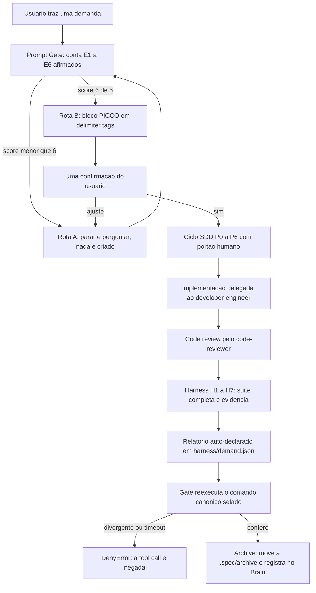
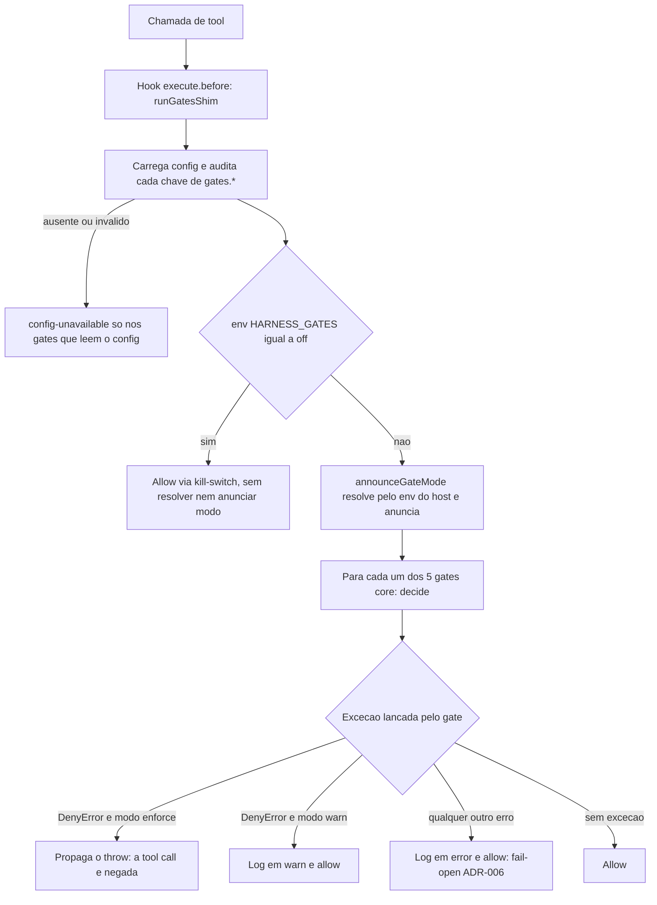
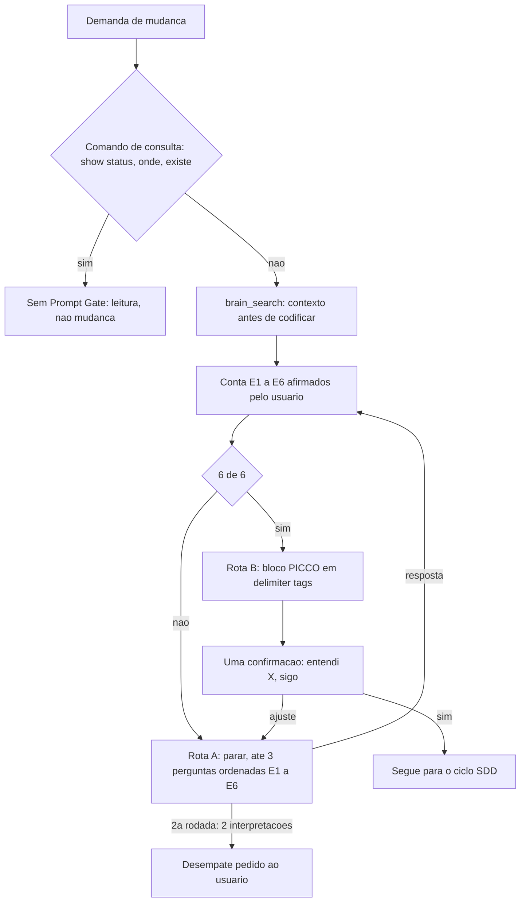
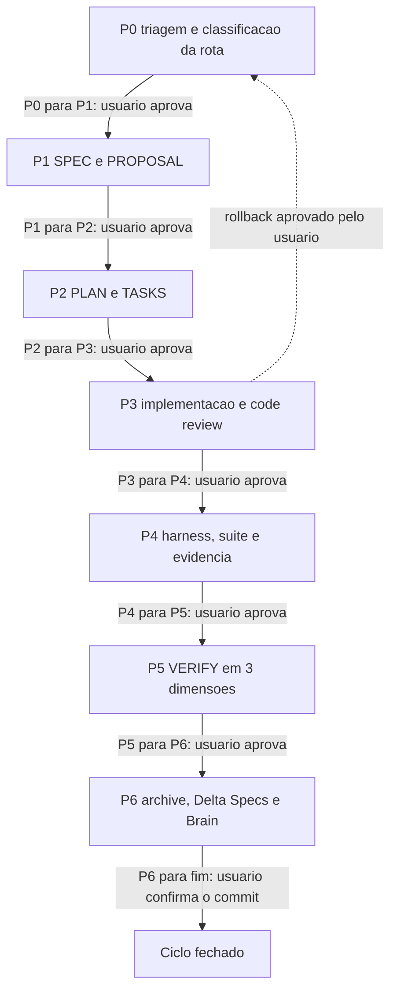
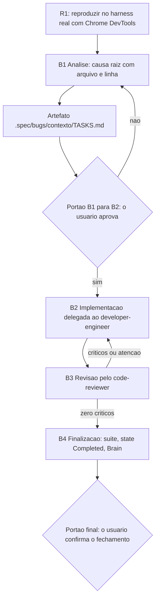
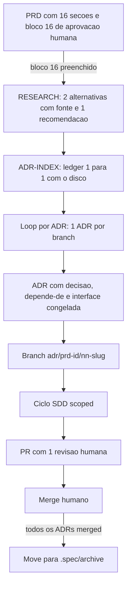
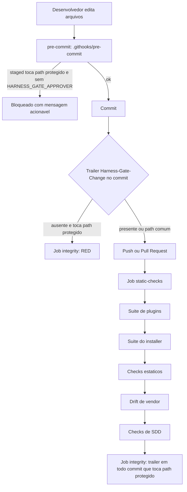

# FUNCIONAMENTO — Harness v7 (este repo)

> Prosa descreve; quem nega é `gate.js` + CI.

Este repositório é a **governança de agentes opencode** transformada em portões executáveis.
Ele tem duas camadas, e a distinção entre elas é o eixo de leitura de todo o documento:

- **Runtime** — o que o plugin `gate.js` de fato nega, e o que o CI de fato falha.
- **Processo** — o que é descrito em `.agents/rules/**` e orquestrado pelos agentes, mas que
  **não** tem negação própria no runtime.

Toda afirmação de comportamento neste documento cita `arquivo:linha`. Onde a garantia é
parcial, dependente de CI ou apenas de processo, o nível é marcado
(🟢 runtime · 🟠 parcial/CI-dependente · 🟡 processo · 🔴 declarado-aberto), conforme
`.agents/rules/gate-contract.md:12-31` e `:53-56`.

**Sumário**

1. [Visão geral](#1-visão-geral)
2. [Mapa do repo](#2-mapa-do-repo)
3. [Funcionalidades](#3-funcionalidades)
4. [Runtime](#4-runtime)
   - [4.1 Ciclo de vida do plugin](#41-ciclo-de-vida-do-plugin)
   - [4.2 Dispatcher](#42-dispatcher)
   - [4.3 GATE-02 — PICCO](#43-gate-02--picco)
   - [4.4 GATE-03 — evidência e contraprova](#44-gate-03--evidência-e-contraprova)
   - [4.5 GATE-04 — pausa HITL](#45-gate-04--pausa-hitl)
   - [4.6 GATE-05 — higiene, path protegido e escopo do qa-engineer](#46-gate-05--higiene-path-protegido-e-escopo-do-qa-engineer)
   - [4.7 Config fail-closed, kill-switch e selo](#47-config-fail-closed-kill-switch-e-selo)
5. [Processo](#5-processo)
   - [5.1 Prompt Gate](#51-prompt-gate)
   - [5.2 SDD P0..P6](#52-sdd-p0p6)
   - [5.3 Bugfix B1..B4](#53-bugfix-b1b4)
   - [5.4 Archive e Brain](#54-archive-e-brain)
   - [5.5 PRD → ADR → SDD](#55-prd--adr--sdd)
6. [Evidência e relatório](#6-evidência-e-relatório)
7. [Checks e CI](#7-checks-e-ci)
8. [Instalador](#8-instalador)
9. [Agentes e permissões](#9-agentes-e-permissões)
10. [Onde a lógica pode melhorar](#10-onde-a-lógica-pode-melhorar)
11. [Índice de fontes](#11-índice-de-fontes)

---

## 1. Visão geral

O harness existe para converter regras que um modelo *pode* ignorar em portões que o
runtime *aplica*. O README declara o lema que estrutura o repo inteiro
(`README.md:3-5`): **prosa descreve; quem nega é `gate.js` + CI**.

| Camada | O que é | Onde vive | Quem aplica | Nível típico |
|---|---|---|---|---|
| **Runtime** | Negações disparadas por tool call: PICCO ausente, conclusão sem contraprova, ciclo anterior aberto, 3º `task` sem turno humano, escrita em path protegido, `pkill -f` | `.opencode/plugins/gate.js` (1482 linhas) | hook `ctx.tool.hook("execute.before", …)` (`gate.js:1231`, `:1447`) | 🟢 / 🟠 |
| **Processo** | Prompt Gate, ciclo SDD, portões humanos P0..P6, bugfix B1..B4, H1..H7, code review | `.agents/rules/workflow-rules.md`, `.agents/agents/*/AGENT.md` | agentes obedecendo prosa + o usuário aprovando portões | 🟡 |

O **Runtime** nega em exatamente **5 gates core** (`gate.js:1175-1179`); 4 têm `gateName`
(`gate.js:1180-1183`) — o de higiene não tem e cai no `DEFAULT_MODE` (`gate.js:59`,
`:126-130`). Cada gate é uma função pura `async (ctx) => void` que nega lançando `DenyError` (`gate.js:68-75`).

O **Processo** não nega nada por si só: `.agents/rules/gate-contract.md:35-38` é explícito
("Prosa não é negada"), e o check `R-NODENY` (`scripts/sdd-checks.mjs:409-413`) falha se
`gate.js` passar a conter um deny de artefato de SDD.

### Fluxo geral — o relatório de evidência é `harness/<demand>.json` (o diagrama abrevvia como `harness/demand.json` porque o Mermaid não renderiza `<`/`>` em label)

Note o sentido do diagrama: o **relatório é auto-declarado** e a **contraprova é a prova**
(`.agents/skills/harness-report/SKILL.md:10-14`). O gate não confia na palavra "concluído" —
ele re-executa.

---

## 2. Mapa do repo

| Caminho | Função | Linhas-chave |
|---|---|---|
| `harness.config.json` | Fonte única de dados do projeto: comandos, `moduleMap`, `infra`, `mcp.required`, `protectedPaths`, `gates`, `riskPaths`, `escalateOnRisk`, `contraproveTimeoutMs`, `evidence` | `13-16`, `27-37`, `38-43`, `55-59` |
| `opencode.json` | Config v2-only do opencode: `permission.task = "ask"`, 9 agentes com `permission.edit`/`permission.bash` | `9-11`, `12-94` |
| `.opencode/plugins/gate.js` | Núcleo de enforcement: `DenyError`, dispatcher, 5 gates, contrato v2 do plugin | `59`, `68-75`, `98-130`, `318-334`, `356-369`, `1175-1183`, `1440`, `1482` |
| `.opencode/plugins/lib/config.mjs` | Loader fail-closed do config + `resolveCommand` + `configGatesDisableEnforcement` | `13-25`, `27-33`, `38-40` |
| `.opencode/plugins/lib/seal.mjs` | `sha256` / `sealCommands` / `verifySeal` do comando canônico | `9-29` |
| `.opencode/plugins/harness-validator.js` | **No-op** desde FIX-01 (mantido como placeholder) | `1`, `22-31` |
| `.opencode/plugins/hitl-guardrail.js` | **No-op** desde FIX-01 (a pausa HITL vive em GATE-04) | `1`, `23-32` |
| `.opencode/plugins/__tests__/` | 17 specs do runtime (gate, seal, adapter v2, schema do report, dogfood) | diretório |
| `.agents/rules/workflow-rules.md` | Prompt Gate (§0), papéis (§0.1), SDD (§3), bugfix (§4), H1..H7 (§5), code review (§6) | `12`, `85`, `144`, `330`, `373`, `455` |
| `.agents/rules/gate-contract.md` | Tabela I1..I12: onde mora cada negação + nível de garantia | `12-31` |
| `.agents/rules/harness-config.md` | Política descritiva do config (dados vêm do config, nunca de prosa) | `1-30` |
| `.agents/rules/prd-adr-pipeline.md` | Contrato da esteira PRD → RESEARCH → ADR-INDEX → ADR | `1-79` |
| `.agents/rules/sdd-workflow-standard.md` | Layout `.spec/**` + campos canônicos de `workflow-state.json` | `1-50` |
| `.agents/rules/brain-context.md` | Ponte para o repo `brain` (dono da regra) | `1-15` |
| `.agents/agents/*/AGENT.md` | 10 papéis (o `opencode.json` registra 9) | `orchestrator/AGENT.md:213-235`, `:426-457` |
| `.agents/skills/` | Playbooks: `prompt-optimizer`, `sdd-compiler`, `harness-report`, `harness-installer`, `prd-adr-pipeline` | — |
| `.agents/schemas/harness-report.schema.json` | Schema canônico do relatório de evidência | `7-19`, `40-48` |
| `scripts/static-checks.mjs` | Checks estáticos V2/V3/V6/V7/V12/V14/V15 + PRD/ADR-01/02 | `42-47`, `254-342`, `371-382` |
| `scripts/sdd-checks.mjs` | Checks executáveis V4/V17/SDD-01..03/R-V12/R-NODENY/RENAME-01 | `367-421` |
| `scripts/vendor-skills.mjs` | Vendorização de skills + `--check` de drift (sem rede no check) | `5-26` |
| `installer/install.mjs` | Instalador repo→repo: perfis por eixo, wizard, merge, manifesto, checks | `218-246`, `247-309`, `643-669` |
| `.github/workflows/harness-integrity.yml` | CI: job `static-checks` + job `integrity` (trailer obrigatório) | `16-32`, `34-86` |
| `.githooks/pre-commit` | Espelho local do CI (exige `HARNESS_GATE_APPROVER`) | `9-38` |
| `workflow-state.json` | Estado do ciclo (81 chaves de topo; subconjunto canônico em `sdd-workflow-standard.md` §2) | raiz |
| `harness/` | Relatórios auto-declarados (`harness/<demand>.json`) | `harness.config.json:56-59` |

---

## 3. Funcionalidades

As 10 funcionalidades declaradas no README (`README.md:9-20`) mais as 5 capacidades de
enforcement que o gate implementa.

| # | O quê | Como | Onde está | Nível |
|---|---|---|---|---|
| 1 | **Gates bloqueantes** — delegação sem PICCO nega; conclusão sem contraprova nega; 3º `task` sem turno humano nega; higiene de shell nega; escrita em path protegido nega | `DenyError` lançado no hook `execute.before` | `gate.js:1175-1179` (registro), `gate.js:356-369` (motivos) | 🟢 runtime |
| 2 | **Evidência machine-checkable** — conclusão exige relatório válido + re-execução do comando canônico (verificador ≠ executor) | schema + selo `sha256` + cache | `gate.js:739-806`, `.agents/schemas/harness-report.schema.json`, `seal.mjs:14-29` | 🟠 parcial — o executor padrão só observa exit code (`gate.js:726-737`) |
| 3 | **Zero path hardcoded** — comandos, paths e módulos vêm do config do projeto | check estático V3 + loader do config | `scripts/static-checks.mjs:42-47`, `:274-275`, `config.mjs:13-33` | 🟠 parcial — V3 varre 3 arquivos + 2 diretórios, não o `gate.js` |
| 4 | **Portão de prompt** — 6 elementos PICCO; sem eles o orquestrador pergunta em vez de adivinhar | skill `prompt-optimizer` + GATE-02 | `gate.js:489-521`, `.agents/rules/workflow-rules.md:12-55` | 🟢 para a tag obrigatória · 🟡 para E3..E6 (só aviso, `gate.js:500-505`) |
| 5 | **SDD governado** — SPEC → PLAN → TASKS → execução → VERIFY → archive, com portões humanos | skills `sdd-compiler`/`spec-review` + `scripts/sdd-checks.mjs` | `.agents/rules/workflow-rules.md:144-328`, `scripts/sdd-checks.mjs:367-421` | 🟡 processo |
| 6 | **Cobertura de risco** — mudança em `riskPaths` sobe o E2E a `enforce` | `escalateOnRisk` no config | `harness.config.json:44-54` | 🔴 declarado-aberto no runtime — nenhum gate consome `riskPaths` (ver §10a) |
| 7 | **Kill-switch e modo fora do worktree** — `HARNESS_GATES=off` no host desliga a suíte; o modo por gate vem de `HARNESS_GATE_<GATE>` (com `_REASON` não vazio para rebaixar); o config não decide modo, só é auditado | env do host + `resolveGateMode`/`auditConfigGates` | `gate.js:61-62`, `:77-79`, `:98-117`, `:252-272`, `:1366`, `config.mjs:35-40` | 🟢 por construção |
| 8 | **Memória persistente** — decisões, erros e lições no Brain (busca antes, registra depois) | skill `brain` (MCP) | `.agents/rules/brain-context.md:1-15`, `workflow-rules.md:402-414` | 🟡 processo |
| 9 | **Instalador** — leva o harness a outro repo sem copiar domínio alheio | `installer/install.mjs` por eixo + manifesto | `installer/install.mjs:218-309`, `:643-669` | 🟢 neste repo (suite própria) · 🟡 no destino |
| 10 | **Esteira PRD→ADR→SDD** — 1 ADR = 1 branch = 1 ciclo SDD, sem deny novo no runtime | `PRD-01`/`ADR-01`/`ADR-02` dentro do `suiteFull` | `.agents/skills/prd-adr-pipeline/checks.mjs:417-495`, `static-checks.mjs:361-363` | 🟢 neste repo (CI) · 🟡 no destino |
| 11 | **Contraprova com selo** — o comando canônico é selado por `sha256`; divergência nega | `seal.mjs` + `verifySealOrDeny` | `gate.js:146-161`, `:748-749`, `:918-929` | 🟢 runtime (fail-closed: selo ausente ⇒ `empty-seal`) |
| 12 | **Escopo de escrita por papel** — orquestrador só em `.spec/**` + state; qa-engineer só em `harness/`; reviewer e ux-designer não escrevem | `checkWriteAccess` | `gate.js:556-568`, `:652-681` | 🟠 parcial — depende da identidade de agente no payload (ver §10b) |
| 13 | **Pausa HITL entre batches** — 3º `task` consecutivo sem turno humano nega | contador por sessão + fronteira de turno do event stream | `gate.js:1059-1102`, `:1270-1297` | 🟠 parcial (fronteira depende do stream emitir) |
| 14 | **Higiene de shell** — `pkill -f` nega; redirect/`tee` em path protegido nega | parse de comando | `gate.js:1127-1169` | 🟠 parcial — parse evadível (`gate-contract.md:20`) |
| 15 | **Config fail-closed** — config ausente/inválido nega com `config-unavailable` **nos gates que leem o config** (âncora A e higiene); `task` não toca o config e segue permitido; chave de comando desconhecida lança | loader + `loadConfigOrDeny` | `config.mjs:13-33`, `gate.js:377-401`, `:936`, `:1158` | 🟠 parcial — o deny depende de o gate pedir o config (ver §10a8) |

---

## 4. Runtime

### 4.1 Ciclo de vida do plugin

O módulo default exporta **um objeto** `{ id, setup }` — o loader v2 rejeita função default
(`gate.js:1478-1482`, e a medição está documentada em `gate.js:1201-1213`).

`setup(ctx)` (`gate.js:1440-1476`) faz exatamente três coisas:

1. **Registra um único hook de tool**: `ctx.tool.hook("execute.before", runGatesShim)`
   (`gate.js:1447`). Se `ctx.tool.hook` não for função → `throw new Error("HOOK-NO-EQUIV:ctx.tool.hook")`
   (`gate.js:1443-1445`); se a registro for rejeitado → `throw new Error("GATE-ABSENT:execute.before")`
   (`gate.js:1448-1450`). Ambos são **visíveis**, nunca silêncio.
2. **Assina o event stream** para a fronteira de turno (`gate.js:1451-1473`), de forma
   *detached* — a assinatura vive no escopo do plugin e não bloqueia a ativação. Um stream
   descartado só perde o reset do contador HITL (`gate.js:1456-1457`).
3. **Retorna `undefined`** (`gate.js:1475`). Isso é obrigatório: o runtime entrega o valor
   de retorno ao `acquireRelease` e um objeto truthy seria *chamado como função* — o
   `TypeError` que desligou o enforcement 58× desde 2026-10-15 (`gate.js:1209-1212`).

O hook cobre os tools listados em `V2_TOOL_KEYS` (`gate.js:1234`):
`task, write, edit, apply_patch, patch, bash, shell`. O filtro por tool mora nos **cores
puros**, não no hook (`gate.js:1228-1230`).

Hooks proibidos estão declarados em `V2_FORBIDDEN_HOOKS = ["ask"]` (`gate.js:1239`) — o
`permission.ask` não existe no runtime (`gate-contract.md:39-41`).

Os módulos `harness-validator.js` e `hitl-guardrail.js` são **no-op**: registram zero hooks
e não registram nada (`harness-validator.js:26-31`, `hitl-guardrail.js:27-32`). Desde FIX-01
eles não re-injetam prosa nem escutam eventos de bus inexistentes
(`harness-validator.js:3-12`, `hitl-guardrail.js:3-13`).

A identidade do agente chega pelo **payload do próprio hook** (`gate.js:1346`:
`if (agent) recordSessionAgent(sessionID, agent)`), alimentando o mapa
`sessionID → agente` com teto de 1000 entradas (`gate.js:410-427`). Sem entrada no mapa,
nenhuma regra por agente se aplica — fail-open explícito (`gate.js:405-408`).

### 4.2 Dispatcher

`decide()` (`gate.js:318-334`) é puro e testável sem runtime:

Regras do dispatcher, com lastro:

- **DenyError ⇒ deny**; qualquer outro erro ⇒ **allow + log `error`** (`gate.js:323-327`,
  ADR-006). Um plugin que quebra não paralisa o loop de desenvolvimento
  (`gate.js:20-22`).
- O log carrega **só a mensagem**; `DenyError.details` (paths, contagens) fica no objeto
  lançado, nunca na linha de log (`gate.js:171-182`).
- Modo por gate: `resolveGateMode` (`gate.js:98-117`) é **puro** e lê só o env do host —
  `HARNESS_GATE_<GATE>` = `"enforce"`/`"warn"`, com `_REASON` não vazio obrigatório para
  `"warn"`; ausente/inválido ⇒ `"enforce"` (fail-closed). `modeForGate` (`gate.js:126-130`)
  é o resolvedor de referência; o loop usa `announceGateMode` (`gate.js:278-313`).
- O `gates.*` do config **não decide modo**: é auditado 1× por (chave, valor) por processo
  (`auditConfigGates`, `gate.js:252-272`); chave que não nomeia gate é inerte (`:260-264`).
- Ordem: carga + auditoria do config → corte `HARNESS_GATES=off` (`gate.js:1366`) → resolução
  de modo → loop (`gate.js:1390-1404`); sob o corte nenhum modo é resolvido nem anunciado — a auditoria do config (`gate.js:1358`) roda antes do corte e ainda pode emitir WARN.

### 4.3 GATE-02 — PICCO

`gatePiccoTask` (`gate.js:509-521`) só age sobre `tool === "task"` (`gate.js:510`).

Contrato exato (`gate.js:489-507`):

| Situação | Veredito | Motivo |
|---|---|---|
| Nenhuma tag PICCO **e** o texto começa com prefixo de consulta (`show status`, `o que`, `onde`, `qual`, `existe`, `list`, `read`, `get`, `status`) | allow | `via: "query"` (`gate.js:468`, `:492-494`) |
| `<open_questions>` **ausente** | **deny** | `picco-tag-absent` (`gate.js:495-496`, motivo em `gate.js:356`) |
| `<open_questions>` com conteúdo não-vazio (após remover comentários HTML) | **deny** | `picco-tag-nonempty` (`gate.js:497-499`, motivo em `gate.js:357`) |
| `<open_questions>` vazio, mas `<role>/<task>/<context>/<constraints>/<acceptance>` incompletos | allow + **aviso** | `picco-warning: <tag> absent` (`gate.js:500-505`) |

Ou seja: **E1/E2 são deny; E3..E6 são advisory** (`gate-contract.md:14`, I1). O texto
efetivo é extraído de `prompt`, `description`, `task`, `message`, `text`, `content` — ou de
qualquer string nos args (`gate.js:470-483`).

O gate `permission.task = "ask"` do runtime (`opencode.json:9-11`) actua **antes** do gate
custom: o opencode já pergunta ao usuário antes de cada `task`.

### 4.4 GATE-03 — evidência e contraprova

Duas âncoras independentes.

**Âncora A — via estruturada (`gateCompletionAnchorA`, `gate.js:931-956`).**

1. Só tools de escrita entram (`WRITE_TOOLS = write, edit, apply_patch, patch`, `gate.js:576`,
   filtragem em `gate.js:933`).
2. Os alvos são extraídos do args em **dois shapes**: `{filePath,…}`/`{path,…}` para
   `write`/`edit` e texto de patch (`patchText`/`patch`/`diff`/`content`) para
   `apply_patch`/`patch` (`gate.js:597-618`). Paths de patch são extraídos por 4 regexes
   heurísticos (`parsePatchPaths`, `gate.js:578-594`).
3. `checkWriteAccess` roda **antes** de qualquer outra coisa (`gate.js:937-942`) — ver §4.6.
4. A escrita só é "de conclusão" se toca `workflow-state.json` **e** o conteúdo tem
   `current_phase === "Completed"` (`isCompletionWrite`, `gate.js:691-705`).
5. Aí a contraprova roda (`gate.js:946-954`).

**Contraprova (`runContraprova`, `gate.js:739-806`).**

| Passo | Comportamento | Lastro |
|---|---|---|
| Selo primeiro | `verifySealOrDeny(commands, seal)` — comando adulterado nega **antes** de executar | `gate.js:748-749`, `:146-161` |
| Evidência ausente | `demand` ou `report` ausente ⇒ deny `completed-no-evidence` | `gate.js:750-755` |
| Cache | só vale com `treeHash` real; `"unknown"` (default) desabilita o cache | `gate.js:139-141`, `:756-758`, `:953` |
| Execução | `execFileSync(commands.suiteFull, { shell: "/bin/sh", timeout })` | `gate.js:726-737`, `:761` |
| Timeout | `ETIMEDOUT` ⇒ deny `contraprove-timeout` | `gate.js:763-775`, `:360` |
| Exit code divergente | esperado ≠ observado ⇒ deny `contraprove-divergent` | `gate.js:776-783`, `:359` |
| Contagens | se **ambos** os lados declaram e divergem ⇒ deny; se o executor não observa contagens ⇒ allow `via: "counts-unverifiable"` | `gate.js:784-804` |

O executor padrão observa **apenas exit code** (`counts: null`, `gate.js:729`, `:735`) —
por isso, no caminho real, a comparação de contagens é não-comparável e o allow sai
declarando o motivo (`gate.js:801-804`). A branch de divergência de contagens existe e é
testada, mas exige um `execFn` que as observe (`gate.js:793-799`).

**Âncora B — ciclo anterior fechado (`gatePhaseAnchorB`, `gate.js:1023-1030`).**

Um novo `task` só passa se `workflow-state.json` tiver `current_phase === "Completed"` **e**
`harness_status === "passed"` **e** `code_review_status === "passed"` (`checkAnchorB`,
`gate.js:983-997`). Caso contrário ⇒ deny `prev-cycle-not-completed` (`gate.js:361`).

A decisão "isso é um novo ciclo?" é **heurística declarada**: se o prompt contém o nome de
`current_feature`, é continuação; senão, é novo ciclo (`inferNewCycle`, `gate.js:1002-1021`).

Estado ausente (`ENOENT`) é bootstrap ⇒ allow (`gate.js:963-965`); estado ilegível ou
corrompido ⇒ deny `state-corrupt` (`gate.js:969-980`).

### 4.5 GATE-04 — pausa HITL

`gateHitlBatch` (`gate.js:1096-1102`) conta `task` por sessão. No **3º** `task` consecutivo
sem turno humano intermediário ⇒ deny `hitl-pause-required` (`gate.js:1074-1079`, motivo em
`gate.js:362`).

A exceção do loop obrigatório `developer-engineer → code-reviewer` (2 chamadas) é
**estrutural**, não um caso especial: 2 < 3 (`gate.js:1051-1056`).

O reset do contador é feito pela fronteira de turno, que no v2 vem do **event stream**:
`session.idle`, `message.updated` com `role` de usuário, ou `session.step.ended` com
`finish === "stop"` (`V2_TURN_BOUNDARY_TYPES`, `gate.js:1270`; `isTurnBoundaryEvent`,
`gate.js:1272-1284`; `noteTurnBoundary`, `gate.js:1288-1297`).

### 4.6 GATE-05 — higiene, path protegido e escopo do qa-engineer

`gateShellHygiene` (`gate.js:1154-1169`) age sobre `bash`/`shell` (`SHELL_TOOLS`,
`gate.js:1114`):

- `pkill -f` ⇒ deny `pkill-f` (`isPkillF`, `gate.js:1127-1129`; motivo `gate.js:363`).
- Redirect (`>`/`>>`) ou `tee` para path protegido ⇒ deny `protected-path-write`
  (`bashProtectedWrites`, `gate.js:1131-1152`; motivo `gate.js:364`).

`checkWriteAccess` (`gate.js:652-681`) rege a escrita por tool:

| Agente | Regra | Lastro |
|---|---|---|
| qualquer um, exceto `developer-engineer` | path protegido ⇒ deny `protected-path-write` | `gate.js:656-665` (exceção em `:659`) |
| `orchestrator` | fora de `.spec/**` e `workflow-state.json` ⇒ deny `orch-write-outside-allowlist` | `gate.js:556-563` (allowlist), `:666-668` (motivo `gate.js:365`) |
| `qa-engineer` | fora de `harness/` ⇒ deny `qa-scope-violation` | `gate.js:565-568` (escopo), `:669-671` (motivo `gate.js:366`) |
| `code-reviewer`, `ux-designer` | qualquer escrita ⇒ deny `write-denied-for-role` | `gate.js:672-678` (motivo `gate.js:367`) |

O path protegido é testado com um **glob próprio** (`matchGlob`, `gate.js:537-551`), não com
a biblioteca de glob do runtime; os padrões vêm de `harness.config.json:27-37`.

Nos detalhes do deny, paths são reduzidos a **basename** e o agente a um enum conhecido
(`sanitizePathForDetails`, `gate.js:648-650`; `sanitizeAgent`, `gate.js:644-646`;
`KNOWN_AGENTS`, `gate.js:635-642`) — nada de path absoluto vaza para o log.

### 4.7 Config fail-closed, kill-switch e selo

- **Config fail-closed**: `loadHarnessConfig` lança se o arquivo falta ou o JSON é inválido
  (`config.mjs:13-25`); `loadConfigOrDeny` converte em `DenyError("config-unavailable")`
  (`gate.js:377-388`, motivo `gate.js:368`) — sem isso o fail-open tornaria o RF-01 em allow
  (`gate.js:371-375`). `resolveCommand` lança para chave ou valor inválidos (`config.mjs:27-33`).
- **Modo por gate (ADR-001)**: só o env do host decide — `HARNESS_GATE_<GATE>` = `"enforce"`/
  `"warn"` com `_REASON` não vazio para rebaixar; ausente/inválido ⇒ `enforce` (`resolveGateMode`,
  `gate.js:98-117`). O `gates.*` do config não decide modo: é auditado 1× por (chave, valor)
  (`auditConfigGates`, `gate.js:252-272`), e chave sem gate registrado é inerte (`:260-264`).
- **Anúncio (INV-3) e kill-switch**: rebaixamento/recusa saem em `warn` 1× por (gate, motivo)/
  (gate, tipo) por processo (`announceGateMode`, `gate.js:278-313`); em `warn` o `DenyError` vira
  log + allow (`gate.js:328-331`). Só `HARNESS_GATES=off` no host (`gate.js:61-62`, `:77-79`) corta
  em `:1366`, antes de resolver modo e antes do loop — sob o corte nenhum modo é resolvido (a auditoria do config ainda pode emitir WARN).
- **Selo**: de `HARNESS_SEAL_JSON` fora do worktree (`loadPublishedSeal`, `gate.js:918-929`);
  ausente ⇒ `empty-seal` (`:155-157`), divergência ⇒ lista de chaves (`:158-159`).

---

## 5. Processo

Tudo nesta seção é **descritivo**. O runtime não nega prosa
(`gate-contract.md:35-38`); a garantia é 🟡 processo, com a exceção pontuada onde o
gate ou o CI tocam o artefato.

### 5.1 Prompt Gate

`.agents/rules/workflow-rules.md:12-83` e a skill `prompt-optimizer`. O portão conta os
**6 elementos afirmados pelo usuário** (E1 Objetivo, E2 Escopo, E3 Contexto, E4 Restrições,
E5 Critério de aceite, E6 Intenção de rota) — `workflow-rules.md:25-30`. "Presente = o
usuário AFIRMOU"; dedução da IA conta como ausente (`workflow-rules.md:32`).

- **Rota A** (score < 6/6): parar, máximo 3 perguntas ordenadas por impacto no retrabalho,
  máximo 2 rodadas, nada criado antes (`workflow-rules.md:35`,
  `.agents/skills/prompt-optimizer/SKILL.md`).
- **Rota B** (6/6): re-encoding em bloco PICCO com `<role>/<task>/<context>/<constraints>/<acceptance>/<open_questions>`,
  **1 confirmação**, e então seguir (`workflow-rules.md:36`).
- **Rota de conflito**: pedido que viola regra do projeto **prevalece** sobre a contagem de
  elementos — pergunta-se sobre a exceção, não sobre o elemento faltante
  (`workflow-rules.md:37-39`).
- **Exceção**: consultas factuais ao repo pulam o gate (`workflow-rules.md:57-60`).
- O runtime enforce só a **forma** do bloco na delegação: `<open_questions>` presente e
  vazia (§4.3). A **qualidade** do bloco (E3..E6) é aviso.

### 5.2 SDD P0..P6

`.agents/agents/orchestrator/AGENT.md:213-235` define os portões; `workflow-rules.md:144-328`
define as fases; o vocabulário **canônico** de `current_phase` está em `workflow-rules.md:150-174`
e é o único validado pelo gate (`gate-contract.md:15`, V17).

| Portão | Momento | Artefato/produção | Registro | Nível |
|---|---|---|---|---|
| P0→P1 | fim da triagem | classificação Feature/Bugfix/Refactor | `workflow-state.json` | 🟡 humano (`orchestrator/AGENT.md:229`) |
| P1→P2 | fim da Fase 1 | `PROPOSAL.md` + `SPEC.md` (com Delta Specs) | `artifacts.spec` | 🟡 humano (`orchestrator/AGENT.md:230`) |
| P2→P3 | fim da Fase 2 | `PLAN.md` + `TASKS.md` (TDD-ready) | `gates.P1_P2`, `gates.P2_P3` | 🟡 humano, com check mecânico (`sdd-checks.mjs:406-407`) |
| P3→P4 | fim da Fase 3 | código + code review + security review | `code_review_status` | 🟡 humano (`orchestrator/AGENT.md:232`) |
| P4→P5 | fim da Fase 4 | `harness/<demand>.json` + H4 | `harness_status` | 🟠 parcial — o gate reexecuta o comando selado (`gate.js:761`) |
| P5→P6 | fim da Fase 5 | `VERIFY.md` (3 dimensões) | `verify` | 🟡 humano (`orchestrator/AGENT.md:234`) |
| P6→fim | fim da Fase 6 | move para `.spec/archive/` + lições no Brain | `archive`, `lessons` | 🟡 humano (`orchestrator/AGENT.md:235`) |

Fases do SDD, resumidas: Fase 0 Exploração/Planejamento (opcional, `dev-planner`), Fase 1
Análise + SPEC, Fase 2 Implementação, Fase 3 Review, Fase 4 Verify, Fase 5 Archive
(`workflow-rules.md:175-249`).

Feedback obrigatório após cada comando SDD: 10-point summary (`workflow-rules.md:251-272`).
Dashboard de features a partir de `workflow-state.json.features` (`workflow-rules.md:274-300`).
Traceability antes do archive (`workflow-rules.md:302-316`).

### 5.3 Bugfix B1..B4

`.agents/agents/orchestrator/AGENT.md:426-457` define as 4 fases do fast-track de bug;
`workflow-rules.md:330-371` define as regras mandatórias R1..R4.

| Fase | O que produz | Regra | Nível |
|---|---|---|---|
| **B1** Análise | reprodução com evidência, causa raiz com `arquivo:linha`, `.spec/bugs/{contexto}/TASKS.md` | R1 (ver o erro real na tela antes de codificar) + portão B1→B2 | 🟡 processo (`workflow-rules.md:334-356`) |
| **B2** Implementação | correção + testes, via `developer-engineer` | compilar/testar a cada task | 🟡 processo (`orchestrator/AGENT.md:435-443`) |
| **B3** Revisão | parecer do `code-reviewer`; se 🔴/🟡, volta a B2 (máx 3 ciclos) | Chrome DevTools obrigatório em bug de UI | 🟡 processo (`orchestrator/AGENT.md:445-449`) |
| **B4** Finalização | suite completa, `current_phase = Completed`, lições no Brain, débito técnico | portão final humano | 🟡 processo (`orchestrator/AGENT.md:451-457`) |

### 5.4 Archive e Brain

- **Archive** move `.spec/<feature>/` → `.spec/archive/[YYYYMMDD]-[feature]/`, mescla os
  Delta Specs nos documentos `.doc/` correspondentes e registra as lições
  (`workflow-rules.md:239-249`). O destino de archive é um bucket **non-cycle**: o check
  `SDD-02` nunca o trata como ciclo corrente (`sdd-checks.mjs:150-161`, `:278-286`).
- **Brain** é a memória persistente: busca antes de codificar, registro depois
  (`brain-context.md:1-15`). Tipos: `sessoes/`, `estudos/`, `regras/`, `arquitetura/`;
  `scope` obrigatório em arquitetura/regras/estudos (`workflow-rules.md:402-414`).
- O `brainStore` é campo **obrigatório** do relatório de evidência
  (`.agents/schemas/harness-report.schema.json:16`, `:57-60`).

### 5.5 PRD → ADR → SDD

`.agents/rules/prd-adr-pipeline.md` (contrato) e `.agents/agents/orchestrator/AGENT.md:239-262`.
Esta esteira **entra antes** do ciclo SDD para features; os portões P0..P6 continuam valendo
depois dela, não no lugar dela (`orchestrator/AGENT.md:243`).

Regras: nenhuma ADR nasce antes do bloco §16 do PRD preenchido
(`prd-adr-pipeline.md:20-21`); teto de 5 ADRs por PRD (`prd-adr-pipeline.md:41-42`); 1 ADR =
1 branch = 1 ciclo SDD (`prd-adr-pipeline.md:20`, `:51-54`); branch/PR sem `gh`
(`prd-adr-pipeline.md:49-54`).

Validação mecânica: `PRD-01` (7 seções obrigatórias), `ADR-01` (1:1 índice↔disco),
`ADR-02` (ordem, `status`, `branch`, `merge`) — implementados em
`.agents/skills/prd-adr-pipeline/checks.mjs` e executados **dentro** do `suiteFull`
(`scripts/static-checks.mjs:371-378`, `:361-363`). Nível: 🟢 neste repo (rodam no CI) ·
🟡 no repo-destino (não há CI prometeido lá).

---

## 6. Evidência e relatório

**O relatório é auto-declarado; a contraprova é a prova** (`.agents/skills/harness-report/SKILL.md:10-14`).

| Item | Valor |
|---|---|
| Caminho | `harness/<demand>.json` (`harness.config.json:56-59`) |
| Schema | `.agents/schemas/harness-report.schema.json` |
| Campos obrigatórios | `version, demand, agent, phase, gitSha, commands[≥1], counts{unit,it,frontend}, evaluation, brainStore[], cleanup, selfReported` (`schema:7-19`) |
| Campo condicional | `e2e` — obrigatório quando `escalateOnRisk` dispara (`schema:49-52`) |
| Quem escreve | o executor (developer-engineer / qa-engineer). O `qa-engineer` é justamente o papel com `edit: allow` porque precisa gravar o REPORT (`gate-contract.md:18`) |

O gate encontra o relatório por `state.current_feature` — o **nome do arquivo** é o da
feature corrente (`readEvidenceReport`, `gate.js:1035-1047`). Relatório ausente ⇒ deny
`completed-no-evidence` (`gate.js:945`).

O validador de schema embutido no gate cobre **apenas** o subconjunto
`$ref/type/required/properties/items/minItems/minimum` (`gate.js:829-837`, `:849-888`) e
tolera uma chave `required` ausente **somente** se o relatório a declara como omissão
intencional (`isDeclaredDeviation`, `gate.js:896-907`).

**H1..H7** (`workflow-rules.md:373-431`):

| # | Regra | Resumo |
|---|---|---|
| H1 | Suite completa em todo desenvolvimento | sempre `commands.suiteFull`; falhou ⇒ parar, causa raiz, corrigir, re-rodar (`workflow-rules.md:382-385`) |
| H2 | Zero tolerância a falhas pré-existentes | dívida pré-existente = bug P1, saneada antes da feature (`workflow-rules.md:386-390`) |
| H3 | Harness E2E greenfield | wipe + recadastro, 12 passos, DevTools: Network + Console limpos (`workflow-rules.md:391-397`) |
| H4 | Avaliação contínua | telas / regras / negócio / lógica / performance (`workflow-rules.md:398-401`) |
| H5 | Encerramento limpo + Brain | encerrar por `lsof -ti :PORT` + `kill` por PID; **nunca `pkill -f`** (`workflow-rules.md:402-414`) |
| H6 | Portão de conclusão expandido | build+testes, H3 quando aplicável, H4, review, Brain+state, portas livres (`workflow-rules.md:415-418`) |
| H7 | Cadência | suite por task, E2E por sub-fase, Brain por achado, auditoria mensal (`workflow-rules.md:419-421`) |

---

## 7. Checks e CI

### Checks

| ID | Script | O que acusa | Nível |
|---|---|---|---|
| V2 | `static-checks.mjs:272-273` | ocorrência de `permission.ask` nos arquivos escopados | 🟢 (CI) |
| V3 | `static-checks.mjs:274-275` | literal de projeto hardcoded (`docker-compose-postgresql`, `-pl application`) | 🟠 — escopo restrito a `SCAN_FILES`/`SCAN_DIRS` (`static-checks.mjs:42-47`) |
| V6 / V6b | `static-checks.mjs:254-268` | config e schema são JSON válido | 🟢 |
| V7 | `static-checks.mjs:276-277` | `output.system = <scalar>` (hook morto) | 🟢 |
| V12 | `static-checks.mjs:288-321` | referência órfã a `harness-continuous.md` | 🟡 INFO — não falha o build (`:320`); a enforcing real é R-V12 |
| V14 | `static-checks.mjs:323-342` | git + remote + CI presentes (ADR-007 operante) | 🟢 neste repo (remote `git@github.com:freitasjh/harness.git` existe) |
| V15 | `static-checks.mjs:280-286` | referência de rede em `installer/` | 🟠 parcial — escapes E1..E9 declarados (`static-checks.mjs:144-175`; `gate-contract.md:31`) |
| PRD-01 / ADR-01 / ADR-02 | `static-checks.mjs:361-363` → `prd-adr-pipeline/checks.mjs` | 7 seções do PRD; 1:1 do índice de ADRs; ordem/branch/merge | 🟢 neste repo · 🟡 no destino |
| V4 | `sdd-checks.mjs:370-372` | orçamento de linhas das rules (1090 de 1705) | 🟢 |
| R-V12 | `sdd-checks.mjs:374-376` | referência órfã ao arquivo fundido (FAIL real) | 🟢 |
| V17 | `sdd-checks.mjs:378-381` | tabela de vocabulário canônico de `current_phase` | 🟢 |
| SDD-01 | `sdd-checks.mjs:383-393` | `sdd-orquestrador` alinhado, cláusula de não-bypass, sem promessa órfã | 🟢 |
| SDD-02 | `sdd-checks.mjs:395-397` | artefatos do ciclo resolvido + coerência task↔seção (dogfood) | 🟢 |
| SDD-03 | `sdd-checks.mjs:399-407` | `gates.P1_P2`/`P2_P3` no state + convenção no AGENT.md | 🟢 |
| R-NODENY | `sdd-checks.mjs:409-413` | `gate.js` **não** tem deny de artefato de SDD | 🟢 |
| RENAME-01 | `sdd-checks.mjs:415-417` | nome antigo do reviewer zerado em código vivo | 🟢 |
| vendor drift | `scripts/vendor-skills.mjs --check` | hash das skills vendorizadas vs `.agents/skills/.vendor-lock.json` | 🟢 (roda sem rede) |

### Pipeline

O comando canônico do repo é `commands.suiteFull` (`harness.config.json:14`), que encadeia
suite de plugins + suite do instalador + checks estáticos + drift de vendor. O CI invoca
os mesmos scripts individualmente (`.github/workflows/harness-integrity.yml:23-32`).

O job `integrity` varre os commits do range do evento (`...` em PR, `..` em push) e falha
se qualquer commit tocar path protegido sem o trailer
(`.github/workflows/harness-integrity.yml:41-85`). O `pre-commit` é o espelho local, com
`HARNESS_GATE_APPROVER` no lugar do trailer (`.githooks/pre-commit:20-24`); `workflow-state.json`
é explicitamente **fora** da proteção (`.githooks/pre-commit:6`, CI `:5`).

Os paths protegidos são os 9 de `harness.config.json:27-37`.

---

## 8. Instalador

O instalador leva o harness a outro repo. Configuração por **eixo** (`backend` e `frontend`
independentes), não por nome de arquivo: `AXIS_IDS` (`installer/install.mjs:218-221`),
`STACK_PROFILES` (`:247-304`) e `stacks` derivado por `stacksFor(axes)` (`:235-245`,
`:307-309`). Presets: `node`, `node-esm`, `java+vue`, `java+react`, `outra`, `flutter`,
`dart`. O gating de artefato (skills/rules) usa mapa de **exclusão** por eixo
(`RULES_BY_AXIS`, `SKILLS_BY_AXIS`, `installer/install.mjs:325-360`), validado na carga.

O config gerado no destino é **derivado**, nunca copiado (`installer/install.mjs:643-669`),
e o merge por camada transforma colisão em flag, nunca em overwrite silencioso. O instalador
escreve o manifesto `.harness-install.json` (`installer/install.mjs:17`) e roda os checks
(`:1100-1128`). Re-instalação aborta com instrução (`:74-92`).

Detalhes de uso (wizard W0..W7, `init`/`doctor`, diagnóstico, checklist final):
**[`docs/INSTALACAO.md`](INSTALACAO.md)**.

---

## 9. Agentes e permissões

Permissões nativas vêm de `opencode.json:12-94`. O gate acrescenta regras por papel em
`checkWriteAccess` (`gate.js:652-681`), que são **mais estreitas** que a permissão nativa.

| Agente | Papel | `edit` | `bash` | O que pode escrever (regra efetiva) |
|---|---|---|---|---|
| `orchestrator` | Triagem, governance, SPEC/PLAN/TASKS; não implementa | deny | allow | só `.spec/**` e `workflow-state.json` — fora disso, deny `orch-write-outside-allowlist` (`gate.js:556-563`, `:666-668`) |
| `developer-engineer` | Implementa código e testes sob delegação | allow | allow | qualquer path, **inclusive protegido** (`gate.js:659`) — o trailer é exigido fora do runtime, pelo CI |
| `codebase-analyzer` | Análise estática; não escreve | deny | allow | nada (`opencode.json:36`) |
| `product-manager` | Validação de negócio; escreve o PRD | allow | allow | `.spec/prd/**` (gate-contract.md:18) |
| `qa-engineer` | Execução do harness; grava o relatório | allow | allow | **só** `harness/` — fora disso, deny `qa-scope-violation` (`gate.js:565-568`, `:669-671`) |
| `architect` | ADRs e integridade estrutural | allow | allow | `.spec/**` (gate-contract.md:18) |
| `security-engineer` | Auditoria OWASP/ASVS | deny | allow | nada (`opencode.json:72`) |
| `code-reviewer` | Parecer de review | deny | allow | nada — e o gate nega escrita explícita (`gate.js:672-678`) |
| `ux-designer` | Parecer de UX | deny | allow | nada — idem (`gate.js:672-678`) |

Notas:

- `permission.bash = "allow"` em **todos** os 9 agentes. O gate cobre `bash` só por parse
  (`gate.js:1114-1169`); o backstop real é CI + pre-commit (§10b).
- `permission.task = "ask"` (`opencode.json:9-11`) — o opencode pergunta ao usuário antes de
  cada delegação, independentemente do PICCO.
- `sdd-orquestrador` tem pasta em `.agents/agents/` (10 diretórios) mas **não** está
  registrado em `opencode.json` (9 agentes) — ver §10d.
- **Brain**: `brain_search` antes de codificar, `brain_store` depois
  (`brain-context.md:8-11`). O `brainStore` é campo obrigatório do relatório.

---

## 10. Onde a lógica pode melhorar

Somente fatos verificáveis no repo. Cada item traz o lastro `arquivo:linha` e o nível
de garantia. Nada aqui propõe implementação.

### (a) Cobertura declarada × aplicada

| # | Fato | Lastro | Nível |
|---|---|---|---|
| a1 | `gates.e2eGreenfield: "warn"` **não tem efeito no runtime**: nenhum gate declara `gateName = "e2eGreenfield"` e o gate não cria modo a partir do config; `auditConfigGates` declara a chave **inerte** (1 WARN por chave/valor) | `harness.config.json:42`; `gate.js:1180-1183`; `gate.js:252-272`, `:260-264` | 🟡 processo — chave auditada como inerte, sem efeito |
| a2 | `riskPaths` e `escalateOnRisk` **não têm consumidor no runtime**: a única ocorrência fora de regras/schema é o gerador do instalador | `harness.config.json:44-54`; `installer/install.mjs:664-666`; `gate-contract.md:48-51` | 🔴 declarado-aberto no runtime |
| a3 | O check V3 ("zero literal hardcoded") escaneia **3 arquivos + 2 diretórios** — `harness.config.json`, `opencode.json`, `.agents/rules/harness-config.md`, `.agents/schemas/**`, `.opencode/plugins/lib/**`. O próprio `gate.js` e as demais rules **não** são escopados | `scripts/static-checks.mjs:42-47`, `:274-275`; `gate-contract.md:16` (I3) | 🟠 parcial |
| a4 | V12 é **INFO** (não falha o build); a enforcing real do mesmo item é R-V12, em outro script | `scripts/static-checks.mjs:320`; `scripts/sdd-checks.mjs:374-376` | 🟢 / 🟠 |
| a5 | O schema do report tem campo `e2e` "required when escalateOnRisk fires", mas a regra que dispara o `escalateOnRisk` não é executável por máquina | `.agents/schemas/harness-report.schema.json:49-52`; `harness.config.json:51-54` | 🟡 processo |
| a6 | A comparação de contagens da contraprova é inalcançável no caminho real: o executor padrão devolve `counts: null` e o schema **exige** `counts` | `gate.js:726-737`, `:784-804`; `.agents/schemas/harness-report.schema.json:40-48` | 🟠 parcial |
| a7 | **Modo por gate agora vem do env do host (ADR-001, implementado em 2026-10-22)**: `HARNESS_GATE_<GATE>` = `"enforce"`/`"warn"`; `"warn"` exige `_REASON` não vazio; ausente ou fora do domínio ⇒ `"enforce"` (fail-closed). `resolveGateMode` (`gate.js:98-117`) é puro; `modeForGate` (`:126-130`) é o resolvedor de referência e o dispatcher usa `announceGateMode` (`:278-313`). O antigo `resolveMode` **foi removido** (ADR-001 item 4) e o `gates.*` do config **não decide modo** — é auditado 1× por (chave, valor) (`:252-272`) e chave sem gate registrado é inerte (`:260-264`); em `warn` o `DenyError` vira log + allow (`:328-331`). O corte vem depois da carga+auditoria do config e antes de qualquer resolução de modo (`:1366`) | `gate.js:98-117`, `:126-130`, `:252-272`, `:278-313`, `:328-331`, `:1366`; `config.mjs:38-40`; `harness.config.json:38-43`; `gate-contract.md:26` (RF-01/RF-02), `:28` (KILL) | 🟢 runtime — o canal é o env do processo host, não o worktree; rebaixamento/recusa são anunciados (ADR-001) |
| a8 | **Config ausente não nega `task`**: `runGatesShim` engole o erro de load do config (`gate.js:1347-1354`, `config = null`) e o `DenyError("config-unavailable")` só nasce *lazy*, dentro dos gates que pedem o config — âncora A (`gate.js:936`) e higiene (`gate.js:1158`). Medido: `task` + config ausente ⇒ **allow**; `write`/`bash` + config ausente ⇒ deny `config-unavailable`. `gatePiccoTask`, `gatePhaseAnchorB` e `gateHitlBatch` nunca pedem o config | `gate.js:1347-1354`, `:936`, `:1158`, `:377-401` | 🟠 parcial — a garantia "config fail-closed" cobre os gates que leem o config, não a tool call inteira |

### (b) Evasão

| # | Fato | Lastro | Nível |
|---|---|---|---|
| b1 | A proteção de path protegido e a higiene de shell são **parse de string**: `bashProtectedWrites` só casa redirect e `tee`; `isPkillF` é regex. Formas indiretas (interpretador, comando codificado, variável) não casam | `gate.js:1127-1152`; `gate-contract.md:20` (I7) | 🟠 parcial — CI é a rede final |
| b2 | O ban de `pkill -f` é parse-based e, portanto, evadível | `gate.js:1127-1129`; `gate-contract.md:20` | 🟠 parcial |
| b3 | `permission.bash = "allow"` para os 9 agentes; o gate só enxerga `bash` por parse. A própria escrita de governança pelo orquestrador é registrada como **evasão declarada** | `opencode.json:19,28,37,46,55,64,73,82,91`; `workflow-state.json` → `enforcement_status.pendente` | 🟠 — backstop é CI/pre-commit (`gate-contract.md:22`, I9) |
| b4 | A detecção de path em patch é **heurística por 4 regexes**, e o glob de path protegido é implementação própria | `gate.js:578-594`, `:537-551` | 🟠 parcial |
| b5 | As regras por papel dependem da identidade de agente, que vem do payload do hook. Sem a entrada no mapa `sessionID → agente`, **nenhuma** regra por agente se aplica (fail-open) | `gate.js:405-408`, `:410-427`, `:1346` | 🟠 parcial |
| b6 | O check de rede V15 declara 9 escapes (E1..E9), entre eles comando em variável, alias de `fetch`, specifier construído e padrão dividido entre linhas | `scripts/static-checks.mjs:144-175`; `gate-contract.md:31` | 🟠 parcial |

### (c) Custos de operação

| # | Fato | Lastro | Nível |
|---|---|---|---|
| c1 | A contraprova depende do selo publicado na env `HARNESS_SEAL_JSON`, **fora do worktree**. Selo ausente ⇒ deny `sealed-command-mismatch` (`cause: "empty-seal"`) — a contraprova nunca roda | `gate.js:918-929`, `:155-157`, `:146-161` | 🟢 runtime (fail-closed), mas pré-requisito operacional pouco visível |
| c2 | A fronteira de turno do HITL vem do event stream. Se o stream não emitir `session.idle` / `message.updated` / `session.step.ended`, o contador de 3 `task` **não reseta** e o 3º `task` é negado indefinidamente | `gate.js:1270-1297`, `:1451-1473`, `:1074-1079` | 🟠 parcial |
| c3 | O cache da contraprova só vale com `treeHash` real; o default do runtime é `"unknown"`, que **desabilita** o cache (re-execução a cada vez) | `gate.js:139-141`, `:756-758`, `:953` | 🟢 comportamento declarado |
| c4 | A re-execução usa o comando canônico do config com timeout de 900000 ms; o executor padrão usa `shell: "/bin/sh"` e `stdio: "pipe"` | `harness.config.json:55`; `gate.js:726-737` | 🟢 |
| c5 | `permission.task = "ask"` pede confirmação ao usuário **antes** de cada delegação, sobrepondo-se ao gate PICCO — duas camadas de interrupção no mesmo ponto | `opencode.json:9-11`; `gate.js:509-521` | 🟡 processo |

### (d) Estado e drift

| # | Fato | Lastro | Nível |
|---|---|---|---|
| d1 | `workflow-state.json` tem **81 chaves de topo**; só um subconjunto é canônico (`current_feature`, `current_phase`, `previous_phase`, `next_phase`, `artifacts`, `type`, `last_update`) | `workflow-state.json` (raiz); `.agents/rules/sdd-workflow-standard.md` §2 | 🟡 processo — risco de estado paralelo |
| d2 | `sdd-orquestrador` tem diretório em `.agents/agents/` (10 papéis) mas **não** está registrado em `opencode.json` (9 agentes); os checks SDD-01 e SDD-03 leem o `AGENT.md` dele | `.agents/agents/` (10 diretórios); `opencode.json:12-94`; `scripts/sdd-checks.mjs:131-136`, `:383-393` | 🟡 processo |
| d3 | `gate-contract.md` (I6) **citava** `hitl-guardrail.js` como bloqueante e a fronteira via `chat.message` — o código diz que esse plugin é **no-op** e que `chat.message` não existe no v2. **Corrigido em 2026-10-22**: a linha I6 foi reescrita com o mecanismo real (GATE-04 `gateHitlBatch` + event stream) | `.agents/rules/gate-contract.md:19`; `.opencode/plugins/hitl-guardrail.js:1`, `:27-32`; `gate.js:1218-1222`, `:1096`, `:1178`, `:1183`, `:1270`, `:1288-1297`, `:1451-1473` | 🟢 runtime (mecanismo documentado = o que o codigo faz) |
| d4 | `gate-contract.md` (I11) **afirmava** que o mapa `sessionID → agente` é alimentado por `chat.message`/`chat.params` e que `tool.execute.before` não traz o agente — no v2 o agente vem do payload do hook, e a tabela v1→v2 documenta a substituição. **Corrigido em 2026-10-22**: a linha I11 foi reescrita com o mecanismo real (agente pelo payload do hook `execute.before`) | `.agents/rules/gate-contract.md:24`; `gate.js:1253-1257`, `:1346`, `:410-427`, `:405-408` | 🟢 runtime (mecanismo documentado = o que o codigo faz) |
| d5 | `orchestrator/AGENT.md` **afirmava** que `harness-validator.js` injeta a regra H1..H7 em todos os agentes via system prompt; o plugin não registra hook nenhum desde FIX-01. **Corrigido em 2026-10-22**: a linha agora cita o mecanismo real (`opencode.json` → `instructions` global + prompt por agente; enforcement = `gate.js`) | `.agents/agents/orchestrator/AGENT.md:465`; `.opencode/plugins/harness-validator.js:1-12`, `:26-31`; `opencode.json:6-8`, `:12-94` | 🟢 runtime (mecanismo documentado = o que o codigo faz) |
| d6 | `harness-validator.js` e `hitl-guardrail.js` permanecem como módulos no-op no diretório de plugins — files vivos que não exercem nada | `.opencode/plugins/harness-validator.js:22-31`; `.opencode/plugins/hitl-guardrail.js:23-32` | 🟡 processo |
| d7 | O `current_feature` é a chave de **nome** do arquivo de evidência procurado pelo gate; se o nome do arquivo e a feature divergirem, o gate não encontra o relatório e nega `completed-no-evidence` | `gate.js:1035-1047`; `harness.config.json:56-58` | 🟢 comportamento, 🟡 ergonomia |
| d8 | A decisão "novo ciclo?" (âncora B) é heurística por substring do nome da feature no prompt — o gate não tem conceito estruturado de ciclo | `gate.js:1002-1021`; `gate-contract.md:15` (I2, 🟠 parcial) | 🟠 parcial |
| d9 | **Hook v1 citado como vivo em 3 lugares**: `tool.execute.before` aparecia como o hook de negação em `README.md:11`, `gate-contract.md:14` e `sdd-orquestrador/AGENT.md:17` — no v2 o hook e `ctx.tool.hook("execute.before", …)` (`gate.js:1231`, `:1447`) e a entry v1 foi removida (gate.js:1185-1196). **Corrigido em 2026-10-22** | `gate.js:1231`, `:1447`, `:1185-1196`, `:1245-1264`; `README.md:11`; `gate-contract.md:14`; `.agents/agents/sdd-orquestrador/AGENT.md:17` | 🟢 runtime — mecanismo documentado = o que o codigo faz |
| d10 | **Pré-requisito de opencode na era v1**: o README exigia `opencode ≥ 1.18.31` num repo que e v2-only e cujo contrato foi medido contra o binario v2.0.32. **Corrigido em 2026-10-22** (README agora exige opencode v2) | `README.md:39`; `opencode.json:3`; `gate.js:1199-1201` | 🟢 runtime — contrato medido |

---

## 11. Índice de fontes

| Fonte | Sustenta |
|---|---|
| `.opencode/plugins/gate.js:59` | `DEFAULT_MODE = "enforce"` |
| `.opencode/plugins/gate.js:61-62`, `:77-79`, `:319` | kill-switch por env `HARNESS_GATES=off` |
| `.opencode/plugins/gate.js:68-75` | classe `DenyError` (reason + details) |
| `.opencode/plugins/gate.js:98-117`, `:126-130`, `:252-272`, `:278-313` | modos por gate: env do host + resolvedor puro + auditoria do config + anúncio |
| `.opencode/plugins/gate.js:328-331` | modo `warn` converte `DenyError` em log + allow |
| `.opencode/plugins/gate.js:139-141`, `:756-758` | cache da contraprova só com `treeHash` real |
| `.opencode/plugins/gate.js:146-161` | selo: `empty-commands`, `empty-command`, `empty-seal`, divergência |
| `.opencode/plugins/gate.js:163-182` | log só com a mensagem (I10) |
| `.opencode/plugins/gate.js:318-334` | dispatcher: DenyError ⇒ deny; outro erro ⇒ allow + log |
| `.opencode/plugins/gate.js:356-369` | catálogo dos 14 motivos de deny |
| `.opencode/plugins/gate.js:377-401` | config fail-closed (`config-unavailable`) |
| `.opencode/plugins/gate.js:405-444` | mapa `sessionID → agente`, teto de 1000 |
| `.opencode/plugins/gate.js:464-507` | contrato PICCO: tag obrigatória, vazia; E3..E6 advisory |
| `.opencode/plugins/gate.js:509-521` | GATE-02 sobre `task` |
| `.opencode/plugins/gate.js:537-551` | glob próprio `matchGlob` |
| `.opencode/plugins/gate.js:556-568` | allowlist do orquestrador; escopo `harness/` do qa-engineer |
| `.opencode/plugins/gate.js:576-618` | tools de escrita e extração de alvos (dois shapes) |
| `.opencode/plugins/gate.js:630-650` | sanitização de path/agente nos detalhes |
| `.opencode/plugins/gate.js:652-681` | `checkWriteAccess` (path protegido, allowlist, escopo, papéis) |
| `.opencode/plugins/gate.js:691-705` | escrita de conclusão = `workflow-state.json` + `current_phase: Completed` |
| `.opencode/plugins/gate.js:726-806` | execução da contraprova, timeout, divergência, contagens |
| `.opencode/plugins/gate.js:829-914` | validador de schema (subconjunto) + desvio declarado |
| `.opencode/plugins/gate.js:918-929` | selo publicado em `HARNESS_SEAL_JSON` |
| `.opencode/plugins/gate.js:931-956` | GATE-03 âncora A |
| `.opencode/plugins/gate.js:958-997` | leitura do state (ENOENT allow, erro deny) e âncora B |
| `.opencode/plugins/gate.js:1002-1030` | heurística de novo ciclo + GATE-03 âncora B |
| `.opencode/plugins/gate.js:1035-1047` | busca do relatório por `current_feature` |
| `.opencode/plugins/gate.js:1059-1102` | contador HITL e deny no 3º `task` |
| `.opencode/plugins/gate.js:1114-1169` | higiene de shell: `pkill -f`, redirect, `tee` |
| `.opencode/plugins/gate.js:1175-1183` | registro dos 5 gates e seus `gateName` |
| `.opencode/plugins/gate.js:1201-1226` | contrato v2 medido (setup, hook único, hooks proibidos) |
| `.opencode/plugins/gate.js:1231-1239` | nome do hook, tools cobertos, `ask` proibido |
| `.opencode/plugins/gate.js:1245-1264` | tabela v1→v2 (agente pela payload, fronteira pelo stream) |
| `.opencode/plugins/gate.js:1270-1297` | eventos de fronteira de turno |
| `.opencode/plugins/gate.js:1304-1406` | `runGatesShim`: normalização do payload e loop dos gates |
| `.opencode/plugins/gate.js:1440-1476` | `setup`: hook, assinatura do stream, retorno `undefined` |
| `.opencode/plugins/gate.js:1482` | `export default { id: "harness-gate", setup }` |
| `.opencode/plugins/lib/config.mjs:13-25` | loader fail-closed |
| `.opencode/plugins/lib/config.mjs:27-33` | `resolveCommand` |
| `.opencode/plugins/lib/config.mjs:35-40` | `gates.*` não desliga a suíte nem decide modo; `configGatesDisableEnforcement` sempre `false` |
| `.opencode/plugins/lib/seal.mjs:9-29` | `sha256`, `sealCommands`, `verifySeal` |
| `.opencode/plugins/harness-validator.js:1-31` | no-op desde FIX-01 |
| `.opencode/plugins/hitl-guardrail.js:1-32` | no-op desde FIX-01 |
| `harness.config.json:13-16` | comandos canônicos (`suiteFull`, `unit`) |
| `harness.config.json:27-37` | 9 paths protegidos |
| `harness.config.json:38-43` | `gates.*` (inclui `e2eGreenfield` sem consumidor) |
| `harness.config.json:44-54` | `riskPaths` e `escalateOnRisk` |
| `harness.config.json:55-59` | timeout da contraprova; caminho e schema da evidência |
| `opencode.json:9-11` | `permission.task = "ask"` |
| `opencode.json:12-94` | 9 agentes com `permission.edit` / `permission.bash` |
| `.agents/rules/gate-contract.md:12-31` | tabela I1..I12 com mecanismo e nível |
| `.agents/rules/gate-contract.md:35-38` | prosa não é negada |
| `.agents/rules/gate-contract.md:53-56` | níveis de garantia |
| `.agents/rules/workflow-rules.md:12-83` | Prompt Gate (Rota A / Rota B / PICCO) |
| `.agents/rules/workflow-rules.md:85-119` | divisão de papéis |
| `.agents/rules/workflow-rules.md:144-328` | fases do SDD e vocabulário canônico |
| `.agents/rules/workflow-rules.md:330-371` | bugfix B1..B4 e regras R1..R4 |
| `.agents/rules/workflow-rules.md:373-431` | H0..H7 e anexos |
| `.agents/rules/workflow-rules.md:455-548` | code review obrigatório, loop e checklist pré-conclusão |
| `.agents/rules/prd-adr-pipeline.md:20-21` | direção obrigatória; nenhum ADR antes do bloco §16 |
| `.agents/rules/prd-adr-pipeline.md:41-42` | teto de 5 ADRs por PRD |
| `.agents/rules/prd-adr-pipeline.md:49-54` | branch/PR sem `gh`; merge humano |
| `.agents/rules/sdd-workflow-standard.md` §1-2 | layout `.spec/**` e campos canônicos do state |
| `.agents/rules/brain-context.md:8-11` | busca antes, registro depois |
| `.agents/agents/orchestrator/AGENT.md:213-235` | portões P0..P6 |
| `.agents/agents/orchestrator/AGENT.md:239-262` | esteira PRD → ADR → SDD |
| `.agents/agents/orchestrator/AGENT.md:426-457` | fases B1..B4 |
| `.agents/agents/orchestrator/AGENT.md:465` | regra H1..H7: carregada por `opencode.json` (`instructions` global + prompt por agente; alcance por config, não medido no binário); enforcement em `gate.js` |
| `.agents/skills/harness-report/SKILL.md:10-24` | relatório auto-declarado × contraprova |
| `.agents/schemas/harness-report.schema.json:7-19`, `:40-52` | campos obrigatórios e condicionais |
| `scripts/static-checks.mjs:42-47` | escopo de V2/V3/V7 |
| `scripts/static-checks.mjs:254-342` | V2/V3/V6/V7/V12/V14/V15 |
| `scripts/static-checks.mjs:344-352` | baseline legado (INFO) |
| `scripts/static-checks.mjs:361-382` | checks PRD e veredito do processo |
| `scripts/sdd-checks.mjs:131-136`, `:367-421` | convenção de gates e os 8 checks de SDD |
| `scripts/sdd-checks.mjs:150-161`, `:243-313` | buckets non-cycle e resolução do ciclo |
| `scripts/vendor-skills.mjs:5-26` | vendor `--check` sem rede |
| `installer/install.mjs:17`, `:74-92` | manifesto e guarda de re-instalação |
| `installer/install.mjs:218-309` | eixos, exceções, perfis e derivação de `stacks` |
| `installer/install.mjs:325-360` | mapas de exclusão por eixo |
| `installer/install.mjs:643-669` | config gerado no destino |
| `installer/install.mjs:1100-1128` | checks pós-instalação |
| `.github/workflows/harness-integrity.yml:16-32` | job `static-checks` |
| `.github/workflows/harness-integrity.yml:41-85` | job `integrity` (trailer obrigatório) |
| `.githooks/pre-commit:9-38` | espelho local, `HARNESS_GATE_APPROVER` |
| `workflow-state.json` | 81 chaves de topo; `enforcement_status.pendente` |
| `README.md:3-20` | lema e as 10 funcionalidades declaradas |
| `docs/INSTALACAO.md` | uso do instalador (wizard, `init`/`doctor`, checklist) |
